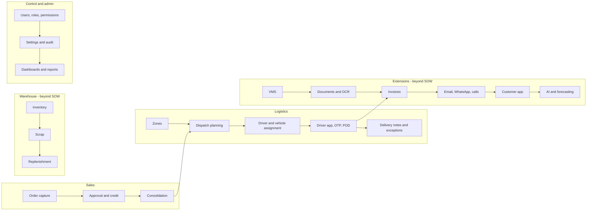

# Product Capability Overview

## Document control

| Field | Value |
|---|---|
| Document title | Product Capability Overview |
| Document ID | BM-OVW-008 |
| Version | 1.0 |
| Status | Draft — for client review |
| Category | Project Overview |
| Related module(s) | All modules |
| Document owner | Product Manager |
| Prepared by | Project documentation team (AI-assisted draft prepared from source-code analysis) |
| Reviewed by | _Pending — not yet reviewed_ |
| Approval | _Not approved — awaiting client review (no approval has been given)_ |
| Created date | 2026-11-12 |
| Last updated date | 2026-11-12 |

> **Status labels used in this document:** VERIFIED (confirmed in the current source code or existing documents) · PROTOTYPE (works in the React/LocalStorage prototype with mock or simulated behaviour) · PROPOSED (recommended production design, not built) · PENDING CONFIRMATION (needs a client decision) · NOT IMPLEMENTED · NOT VERIFIED.

## Purpose

Summarise capabilities by business area with their implementation label.

## Scope

All capability areas found in the source code.

## Definitions

Other terms: see [BM-GLO-001 — Project Glossary](../22_GLOSSARY_AND_REFERENCE/BM-GLO-001_Project_Glossary.md).

## References

- [BM-OVW-014 — Product Feature Catalogue](BM-OVW-014_Product_Feature_Catalogue.md)
- [BM-OVW-016 — Project Feature Inventory](BM-OVW-016_Project_Feature_Inventory.xlsx)

## 1. Capability map

## 2. Capabilities and labels

| Area | Capability | Label |
|---|---|---|
| Sales | Order capture, drafts, submit, resubmit, duplicate, timeline | VERIFIED |
| Sales | Approval with six checks, return, reject | VERIFIED |
| Sales | Approved figures set by manager | PENDING CONFIRMATION (not built) |
| Sales | Credit check (warning / block) | VERIFIED (balance manual) |
| Logistics | Consolidation per salesman | VERIFIED |
| Logistics | Dispatch, sequence, confirmation with stock deduction | VERIFIED |
| Logistics | Zone board drag and drop; traffic-aware routing | PROPOSED |
| Logistics | Driver stop workflow, OTP, POD, delivery notes | VERIFIED (GPS / OTP delivery simulated) |
| Logistics | Live tracking | PROTOTYPE (DEMO GPS) |
| Warehouse | Inventory, scrap, replenishment | VERIFIED — scope PENDING CONFIRMATION |
| Control | RBAC, users, settings, audit, notifications | VERIFIED |
| Control | Dashboards with period filter; 118 reports | VERIFIED (24 reports without source data) |
| Extensions | VMS compliance | VERIFIED |
| Extensions | Documents and OCR | PROTOTYPE (mock OCR) |
| Extensions | Invoices | VERIFIED — scope PENDING CONFIRMATION |
| Extensions | Email / WhatsApp / automation | PROTOTYPE (demo sending) |
| Extensions | Customer app | VERIFIED — scope PENDING CONFIRMATION |
| Extensions | AI assistant, forecasting | PROTOTYPE |
| Integration | SAP | PROPOSED (stage 2) |
| Finance | Payments, credit notes | NOT IMPLEMENTED |

## Revision history

| Version | Date | Author | Description |
|---|---|---|---|
| 1.0 | 2026-11-12 | Documentation team | Initial draft prepared from analysis of the bellomassi-premium-ui source code and existing project documents. |