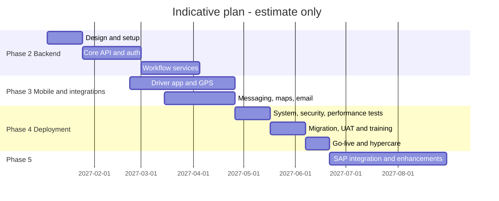

# Scope and Phase Plan

## Document control

| Field | Value |
|---|---|
| Document title | Scope and Phase Plan |
| Document ID | BM-PLN-001 |
| Version | 1.0 |
| Status | Draft — for client review |
| Category | Scope and Planning |
| Related module(s) | All modules |
| Document owner | Project Manager |
| Prepared by | Project documentation team (AI-assisted draft prepared from source-code analysis) |
| Reviewed by | _Pending — not yet reviewed_ |
| Approval | _Not approved — awaiting client review (no approval has been given)_ |
| Created date | 2026-11-12 |
| Last updated date | 2026-11-12 |

> **Status labels used in this document:** VERIFIED (confirmed in the current source code or existing documents) · PROTOTYPE (works in the React/LocalStorage prototype with mock or simulated behaviour) · PROPOSED (recommended production design, not built) · PENDING CONFIRMATION (needs a client decision) · NOT IMPLEMENTED · NOT VERIFIED.

## Purpose

Translate the scope into a phase plan with entry / exit criteria and indicative durations.

## Scope

Phase 1 (prototype, complete) to Phase 5 (enhancements). Durations and dates are estimates based on assumptions; no dates have been agreed with the client.

## Definitions

Other terms: see [BM-GLO-001 — Project Glossary](../22_GLOSSARY_AND_REFERENCE/BM-GLO-001_Project_Glossary.md).

## References

- [BM-SOW-001 — Scope of Work](../02_BUSINESS_REQUIREMENTS/BM-SOW-001_Scope_of_Work.md)
- [BM-PLN-002 — Phase-wise Scope Matrix](BM-PLN-002_Phase_wise_Scope_Matrix.xlsx)
- [BM-PM-001 — Project Plan](../17_PROJECT_MANAGEMENT/BM-PM-001_Project_Plan.md)
- [BM-RMP-001 — Prototype-to-Production Migration Roadmap (Master)](../20_FUTURE_ROADMAP/BM-RMP-001_Prototype_to_Production_Roadmap.md)

## 1. Phases

| Phase | Objective | Main scope | Entry criteria | Exit criteria | Indicative duration (estimate) |
|---|---|---|---|---|---|
| 1 Prototype | Validate workflows | React / LocalStorage prototype — **complete** | — | Client demo; documentation review | Done |
| 2 Backend | Production core | Django API, PostgreSQL, auth / RBAC, SOW workflows server-side, web app integration | Scope baseline signed; hosting decided | API + web pass system tests in test env | 12–14 weeks |
| 3 Mobile and integrations | Field and customer channels | React Native Drivers App, GPS + WebSockets, Maps / Routes, SMS / WhatsApp, email | Phase 2 API stable; provider accounts | Pilot-ready build; integration tests pass | 10–12 weeks (overlaps phase 2 by ~4 weeks) |
| 4 Production deployment | Go-live | Security hardening, performance tests, data migration, UAT, training, go-live, hypercare | Phases 2–3 complete | UAT signed; go-live checklist complete | 6–8 weeks |
| 5 Enhancements | Stage 2 | SAP integration; confirmed extensions; analytics | Go-live stable | Per change request | To be estimated |

## 2. Indicative timeline — ESTIMATE (assumed start date 4 January 2027, not agreed)

## 3. Decision gates

| Gate | Decision needed | Owner |
|---|---|---|
| G0 | Approve BRD and SOW scope (extensions X-01 … X-11) | Client sponsor |
| G1 | Hosting, providers (maps, messaging, email) | Client IT |
| G2 | Pilot go / no-go after driver pilot | Logistics owner |
| G3 | Go-live | Steering committee |

Phase assignment of every requirement: [BM-PLN-002 — Phase-wise Scope Matrix](BM-PLN-002_Phase_wise_Scope_Matrix.xlsx).

## Revision history

| Version | Date | Author | Description |
|---|---|---|---|
| 1.0 | 2026-11-12 | Documentation team | Initial draft prepared from analysis of the bellomassi-premium-ui source code and existing project documents. |