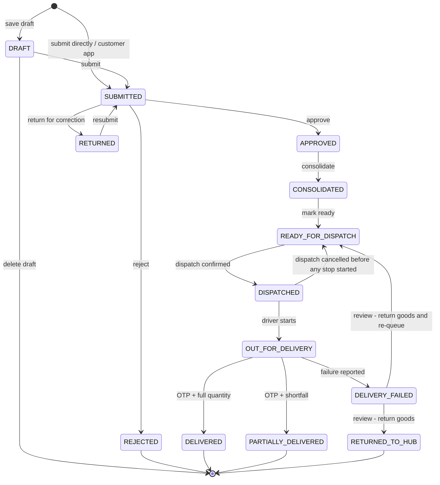

# Business Workflow Catalogue

## Document control

| Field | Value |
|---|---|
| Document title | Business Workflow Catalogue |
| Document ID | BM-WF-00 |
| Version | 1.0 |
| Status | Draft — for client review |
| Category | Business Workflows |
| Related module(s) | All modules |
| Document owner | Business Analyst |
| Prepared by | Project documentation team (AI-assisted draft prepared from source-code analysis) |
| Reviewed by | _Pending — not yet reviewed_ |
| Approval | _Not approved — awaiting client review (no approval has been given)_ |
| Created date | 2026-11-12 |
| Last updated date | 2026-11-12 |

> **Status labels used in this document:** VERIFIED (confirmed in the current source code or existing documents) · PROTOTYPE (works in the React/LocalStorage prototype with mock or simulated behaviour) · PROPOSED (recommended production design, not built) · PENDING CONFIRMATION (needs a client decision) · NOT IMPLEMENTED · NOT VERIFIED.

## Purpose

Index of all 24 business workflows with links to their specifications and to the existing workflow documentation.

## Scope

Order-to-delivery, approval, consolidation, dispatch, driver, customer, inventory, scrap, VMS, invoice, communication, exceptions, rejection, cancellation, returns, documents, notifications, reporting.

## Definitions

Other terms: see [BM-GLO-001 — Project Glossary](../22_GLOSSARY_AND_REFERENCE/BM-GLO-001_Project_Glossary.md).

## References

- [BM-SYS-008 — Requirement Traceability Matrix](../03_SYSTEM_REQUIREMENTS/BM-SYS-008_Requirement_Traceability_Matrix.xlsx)
- [BM-ARC-001 — High-Level Design (HLD)](../07_SYSTEM_ARCHITECTURE/BM-ARC-001_High_Level_Design.md)

## 1. Workflow catalogue

| ID | Workflow | Initiating role | Trigger | Outcome |
|---|---|---|---|---|
| WF-01 | [BM-WF-01 — WF-01 — Overall Business Workflow](BM-WF-01_Overall_Business_Workflow.md) | Salesman / Customer | A customer need (order by call, email, WhatsApp or app) | Order delivered, delivery note and invoice available |
| WF-02 | [BM-WF-02 — WF-02 — Order-to-Delivery Workflow](BM-WF-02_Order_to_Delivery_Workflow.md) | Salesman | Order submitted | Order DELIVERED / PARTIALLY_DELIVERED with delivery note |
| WF-03 | [BM-WF-03 — WF-03 — Salesman Workflow](BM-WF-03_Salesman_Workflow.md) | Salesman | Start of day / customer request | Orders submitted; returned orders corrected |
| WF-04 | [BM-WF-04 — WF-04 — Sales Manager Approval Workflow](BM-WF-04_Sales_Manager_Approval_Workflow.md) | Sales Manager | Order SUBMITTED | APPROVED, RETURNED or REJECTED |
| WF-05 | [BM-WF-05 — WF-05 — Customer Service Workflow](BM-WF-05_Customer_Service_Workflow.md) | Customer Service | Order APPROVED | READY_FOR_DISPATCH |
| WF-06 | [BM-WF-06 — WF-06 — Credit Validation Workflow](BM-WF-06_Credit_Validation_Workflow.md) | System / Sales Manager | Order submitted or opened for approval | Credit warning acknowledged, order returned / rejected, or approval blocked |
| WF-07 | [BM-WF-07 — WF-07 — Order Consolidation Workflow](BM-WF-07_Order_Consolidation_Workflow.md) | Customer Service | Approved order in queue | CONSOLIDATED then READY_FOR_DISPATCH |
| WF-08 | [BM-WF-08 — WF-08 — Dispatch Workflow](BM-WF-08_Dispatch_Workflow.md) | Dispatcher | Orders READY_FOR_DISPATCH | Dispatch CONFIRMED (stock deducted) and closed |
| WF-09 | [BM-WF-09 — WF-09 — Driver Assignment Workflow](BM-WF-09_Driver_Assignment_Workflow.md) | Dispatcher | Dispatch PLANNED | Dispatch ASSIGNED with compliant driver and vehicle |
| WF-10 | [BM-WF-10 — WF-10 — Driver Delivery Workflow](BM-WF-10_Driver_Delivery_Workflow.md) | Driver | Dispatch CONFIRMED and date reached | Stops DELIVERED / PARTIALLY_DELIVERED / FAILED |
| WF-11 | [BM-WF-11 — WF-11 — Customer Order Workflow](BM-WF-11_Customer_Order_Workflow.md) | Customer | Customer opens the catalog | Order submitted for approval |
| WF-12 | [BM-WF-12 — WF-12 — Customer Tracking Workflow](BM-WF-12_Customer_Tracking_Workflow.md) | Customer | Driver starts the stop | Customer shares OTP; delivery note visible |
| WF-13 | [BM-WF-13 — WF-13 — Inventory Workflow](BM-WF-13_Inventory_Workflow.md) | Warehouse / Inventory staff | Goods arrive, move or are found different | Stock and ledger updated |
| WF-14 | [BM-WF-14 — WF-14 — Scrap Workflow](BM-WF-14_Scrap_Workflow.md) | Warehouse / QA / Inventory staff | Unusable stock found | Stock written off once after approval |
| WF-15 | [BM-WF-15 — WF-15 — Vehicle Management Workflow](BM-WF-15_Vehicle_Management_Workflow.md) | Administrator | Vehicle / driver document recorded or expiring | Compliance state updated; assignment blocked when required |
| WF-16 | [BM-WF-16 — WF-16 — Invoice Workflow](BM-WF-16_Invoice_Workflow.md) | Finance | Order approved or delivered | Invoice ISSUED (or CANCELLED and reissued) |
| WF-17 | [BM-WF-17 — WF-17 — Communication Workflow](BM-WF-17_Communication_Workflow.md) | System / user | Workflow event or manual message | Message logged (demo send) and in-app notification |
| WF-18 | [BM-WF-18 — WF-18 — Exception Management Workflow](BM-WF-18_Exception_Management_Workflow.md) | Any role | Validation failure or operational exception | Exception resolved by the named role |
| WF-19 | [BM-WF-19 — WF-19 — Rejection Workflow](BM-WF-19_Rejection_Workflow.md) | Sales Manager / reviewers | Order, scrap, replenishment or document rejected | Requester informed with reason; record closed or corrected |
| WF-20 | [BM-WF-20 — WF-20 — Cancellation Workflow](BM-WF-20_Cancellation_Workflow.md) | Dispatcher / Finance / requester | Dispatch, invoice, scrap or replenishment must be cancelled | Record CANCELLED; stock / order restored once |
| WF-21 | [BM-WF-21 — WF-21 — Return Delivery Workflow](BM-WF-21_Return_Delivery_Workflow.md) | Driver / Dispatcher | Delivery failed or partially accepted | Goods returned to hub; order RETURNED_TO_HUB or re-queued |
| WF-22 | [BM-WF-22 — WF-22 — Document Upload and Verification Workflow](BM-WF-22_Document_Upload_and_Verification_Workflow.md) | Any uploader | Document uploaded | VERIFIED or REJECTED |
| WF-23 | [BM-WF-23 — WF-23 — Notification Workflow](BM-WF-23_Notification_Workflow.md) | System | Any workflow event | In-app notification and optional automated message |
| WF-24 | [BM-WF-24 — WF-24 — Reporting Workflow](BM-WF-24_Reporting_Workflow.md) | Office roles | User opens a dashboard or report | KPIs, tables, CSV export or print |

## 2. Relationship to the existing workflow documentation

The complete workflow documentation delivered on 12 November 2026 (`docs/workflow/`, 20 chapters, 38 diagrams, HTML / PDF / DOCX editions) is **preserved unchanged** and remains the narrative source. The 24 specifications in this folder restate each workflow in the standard enterprise format (ID, purpose, initiating role, preconditions, trigger, steps, decisions, approval / rejection conditions, system and user actions, status changes, notifications, exceptions, outcome) and link it to requirements and test cases.

## 3. Order lifecycle (overview)

## Revision history

| Version | Date | Author | Description |
|---|---|---|---|
| 1.0 | 2026-11-12 | Documentation team | Initial draft prepared from analysis of the bellomassi-premium-ui source code and existing project documents. |