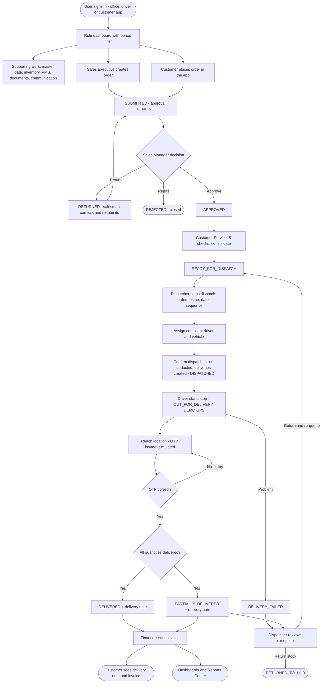
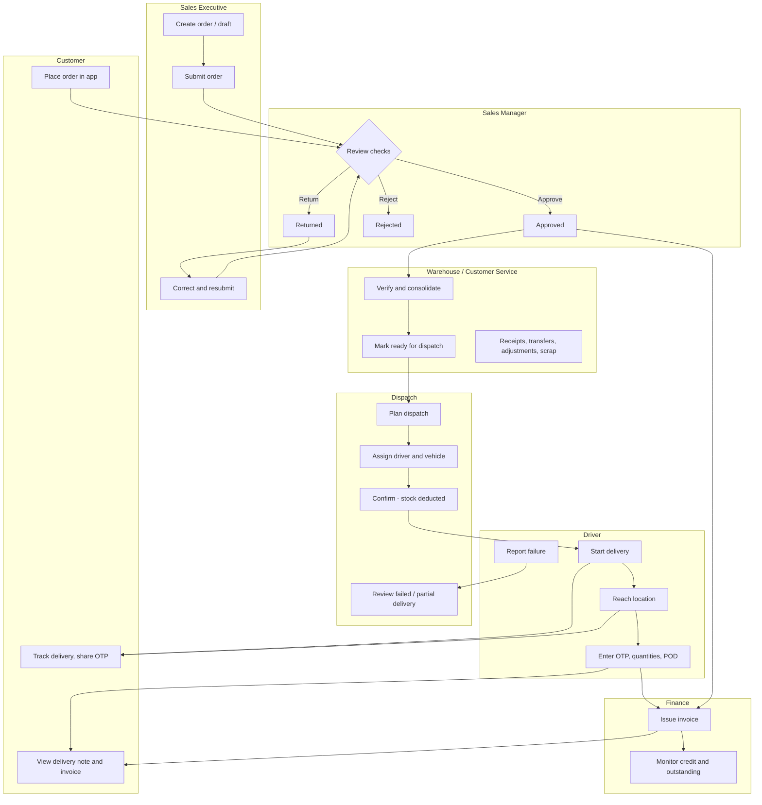

# WF-01 — Overall Business Workflow

## Document control

| Field | Value |
|---|---|
| Document title | WF-01 — Overall Business Workflow |
| Document ID | BM-WF-01 |
| Version | 1.0 |
| Status | Draft — for client review |
| Category | Business Workflows |
| Related module(s) | All modules |
| Document owner | Business Analyst |
| Prepared by | Project documentation team (AI-assisted draft prepared from source-code analysis) |
| Reviewed by | _Pending — not yet reviewed_ |
| Approval | _Not approved — awaiting client review (no approval has been given)_ |
| Created date | 2026-11-12 |
| Last updated date | 2026-11-12 |

> **Status labels used in this document:** VERIFIED (confirmed in the current source code or existing documents) · PROTOTYPE (works in the React/LocalStorage prototype with mock or simulated behaviour) · PROPOSED (recommended production design, not built) · PENDING CONFIRMATION (needs a client decision) · NOT IMPLEMENTED · NOT VERIFIED.

## Purpose

Show the end-to-end business flow across all roles, from order capture to delivery note and invoice.

## Scope

Workflow WF-01 as implemented in the prototype, with production differences marked.

## Definitions

Other terms: see [BM-GLO-001 — Project Glossary](../22_GLOSSARY_AND_REFERENCE/BM-GLO-001_Project_Glossary.md).

## References

- [BM-WF-00 — Business Workflow Catalogue](BM-WF-00_Business_Workflow_Catalogue.md)
- [BM-SYS-008 — Requirement Traceability Matrix](../03_SYSTEM_REQUIREMENTS/BM-SYS-008_Requirement_Traceability_Matrix.xlsx)

## Contents

- 1. Workflow summary
- 2. Step-by-step process
- 3. Decision points
- 4. Approval conditions
- 5. Rejection conditions
- 6. System actions
- 7. User actions
- 8. Status changes
- 9. Notifications
- 10. Exception scenarios
- 11. Workflow diagram
- 12. Final outcome

## 1. Workflow summary

| Field | Value |
|---|---|
| Workflow ID | WF-01 |
| Workflow name | Overall Business Workflow |
| Business purpose | Show the end-to-end business flow across all roles, from order capture to delivery note and invoice. |
| Initiating role | Salesman / Customer |
| Trigger | A customer need (order by call, email, WhatsApp or app) |
| Preconditions | Master data (customers, products, hubs, zones, drivers, vehicles, users) maintained; stock available at the hub. |
| Final outcome | Order delivered with OTP-verified proof and delivery note; invoice issued if in scope. |
| Related requirements | FR-ORD-002, FR-APR-003, FR-CON-003, FR-DSP-004, FR-DRV-004, FR-INVC-002 |
| Related test cases | TC-ORD-002, TC-APR-003, TC-APR-N01, TC-CON-003, TC-DSP-004, TC-DSP-N02, TC-DSP-N03, TC-DSP-N04, TC-DRV-004, TC-INVC-002, TC-INVC-N01, TC-INVC-N02 |
| Detailed chapter | `docs/workflow/` chapter 02 |

## 2. Step-by-step process

1. Salesman (or customer) captures and submits the order.
2. Sales Manager approves, returns or rejects it.
3. Customer Service verifies and consolidates, then releases to dispatch.
4. Dispatcher plans the dispatch, assigns driver and vehicle, confirms loading (stock deducted).
5. Driver delivers stops in sequence: start, reach location, OTP, proof, complete or fail.
6. Delivery note generated; Finance issues the invoice (if in scope); exceptions reviewed by the Dispatcher.

## 3. Decision points

Approve / return / reject; consolidation checks complete; driver and vehicle compliant; OTP valid; all quantities delivered.

## 4. Approval conditions

Sales Manager approval (all blocking checks pass, warnings acknowledged).

## 5. Rejection conditions

Rejection with reason (final) or return for correction.

## 6. System actions

Numbering, validation, notifications, timeline events, stock movements, delivery creation, OTP generation, delivery note.

## 7. User actions

Data entry, decisions, confirmations, handover.

## 8. Status changes

Order DRAFT → SUBMITTED → APPROVED → CONSOLIDATED → READY_FOR_DISPATCH → DISPATCHED → OUT_FOR_DELIVERY → DELIVERED (or exception statuses).

## 9. Notifications

Each hand-off notifies the next role in-app; automated email / WhatsApp per rule (demo).

## 10. Exception scenarios

See WF-18.

## 11. Workflow diagram

Implementation label: diagrams describe the **prototype behaviour (VERIFIED in source code)** unless a step is marked PROPOSED / NOT IMPLEMENTED.

## 12. Final outcome

Order delivered with OTP-verified proof and delivery note; invoice issued if in scope.

## Revision history

| Version | Date | Author | Description |
|---|---|---|---|
| 1.0 | 2026-11-12 | Documentation team | Initial draft prepared from analysis of the bellomassi-premium-ui source code and existing project documents. |