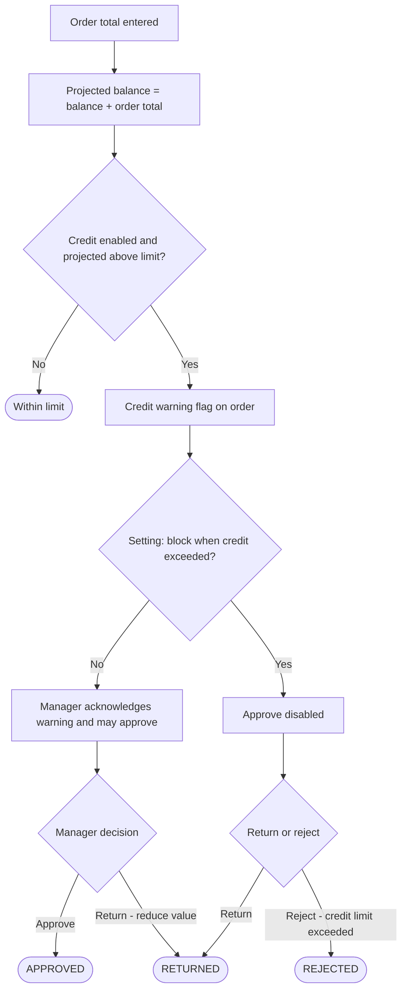

# WF-06 — Credit Validation Workflow

## Document control

| Field | Value |
|---|---|
| Document title | WF-06 — Credit Validation Workflow |
| Document ID | BM-WF-06 |
| Version | 1.0 |
| Status | Draft — for client review |
| Category | Business Workflows |
| Related module(s) | All modules |
| Document owner | Business Analyst |
| Prepared by | Project documentation team (AI-assisted draft prepared from source-code analysis) |
| Reviewed by | _Pending — not yet reviewed_ |
| Approval | _Not approved — awaiting client review (no approval has been given)_ |
| Created date | 2026-11-12 |
| Last updated date | 2026-11-12 |

> **Status labels used in this document:** VERIFIED (confirmed in the current source code or existing documents) · PROTOTYPE (works in the React/LocalStorage prototype with mock or simulated behaviour) · PROPOSED (recommended production design, not built) · PENDING CONFIRMATION (needs a client decision) · NOT IMPLEMENTED · NOT VERIFIED.

## Purpose

Specify how credit exposure is checked.

## Scope

Workflow WF-06 as implemented in the prototype, with production differences marked.

## Definitions

Other terms: see [BM-GLO-001 — Project Glossary](../22_GLOSSARY_AND_REFERENCE/BM-GLO-001_Project_Glossary.md).

## References

- [BM-WF-00 — Business Workflow Catalogue](BM-WF-00_Business_Workflow_Catalogue.md)
- [BM-SYS-008 — Requirement Traceability Matrix](../03_SYSTEM_REQUIREMENTS/BM-SYS-008_Requirement_Traceability_Matrix.xlsx)

## Contents

- 1. Workflow summary
- 2. Step-by-step process
- 3. Decision points
- 4. Approval conditions
- 5. Rejection conditions
- 6. System actions
- 7. User actions
- 8. Status changes
- 9. Notifications
- 10. Exception scenarios
- 11. Workflow diagram
- 12. Final outcome

## 1. Workflow summary

| Field | Value |
|---|---|
| Workflow ID | WF-06 |
| Workflow name | Credit Validation Workflow |
| Business purpose | Specify how credit exposure is checked. |
| Initiating role | System / Sales Manager |
| Trigger | Order submitted or opened for approval |
| Preconditions | Customer credit settings maintained. |
| Final outcome | Credit-controlled approval. |
| Related requirements | FR-CRD-001, FR-CRD-002, FR-CRD-003 |
| Related test cases | TC-CRD-001, TC-CRD-002, TC-CRD-N01, TC-CRD-003 |
| Detailed chapter | `docs/workflow/` chapter 07 |

## 2. Step-by-step process

1. On order entry and approval the system computes projected balance = balance + order total.
2. If projected balance > limit: credit warning flag.
3. At approval: warning must be acknowledged; if the setting blocks, Approve is disabled.
4. Manager may return with "Reduce order value (credit)" or reject with "Credit limit exceeded".

## 3. Decision points

Within limit? Blocking setting on?

## 4. Approval conditions

Acknowledged warning (non-blocking mode).

## 5. Rejection conditions

Return / reject with credit reasons.

## 6. System actions

`getOrderCreditPosition`, approval checks.

## 7. User actions

Manager decision.

## 8. Status changes

No separate status; affects approval outcome.

## 9. Notifications

Warning flags on "New order for approval". Finance notification NOT IMPLEMENTED (G-02).

## 10. Exception scenarios

Balance is not updated automatically (no payments).

## 11. Workflow diagram

Implementation label: diagrams describe the **prototype behaviour (VERIFIED in source code)** unless a step is marked PROPOSED / NOT IMPLEMENTED.

## 12. Final outcome

Credit-controlled approval.

## Revision history

| Version | Date | Author | Description |
|---|---|---|---|
| 1.0 | 2026-11-12 | Documentation team | Initial draft prepared from analysis of the bellomassi-premium-ui source code and existing project documents. |