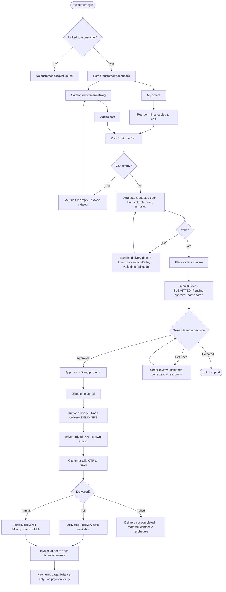

# WF-11 — Customer Order Workflow

## Document control

| Field | Value |
|---|---|
| Document title | WF-11 — Customer Order Workflow |
| Document ID | BM-WF-11 |
| Version | 1.0 |
| Status | Draft — for client review |
| Category | Business Workflows |
| Related module(s) | All modules |
| Document owner | Business Analyst |
| Prepared by | Project documentation team (AI-assisted draft prepared from source-code analysis) |
| Reviewed by | _Pending — not yet reviewed_ |
| Approval | _Not approved — awaiting client review (no approval has been given)_ |
| Created date | 2026-11-12 |
| Last updated date | 2026-11-12 |

> **Status labels used in this document:** VERIFIED (confirmed in the current source code or existing documents) · PROTOTYPE (works in the React/LocalStorage prototype with mock or simulated behaviour) · PROPOSED (recommended production design, not built) · PENDING CONFIRMATION (needs a client decision) · NOT IMPLEMENTED · NOT VERIFIED.

## Purpose

Specify customer self-service ordering.

## Scope

Workflow WF-11 as implemented in the prototype, with production differences marked.

## Definitions

Other terms: see [BM-GLO-001 — Project Glossary](../22_GLOSSARY_AND_REFERENCE/BM-GLO-001_Project_Glossary.md).

## References

- [BM-WF-00 — Business Workflow Catalogue](BM-WF-00_Business_Workflow_Catalogue.md)
- [BM-SYS-008 — Requirement Traceability Matrix](../03_SYSTEM_REQUIREMENTS/BM-SYS-008_Requirement_Traceability_Matrix.xlsx)

## Contents

- 1. Workflow summary
- 2. Step-by-step process
- 3. Decision points
- 4. Approval conditions
- 5. Rejection conditions
- 6. System actions
- 7. User actions
- 8. Status changes
- 9. Notifications
- 10. Exception scenarios
- 11. Workflow diagram
- 12. Final outcome

## 1. Workflow summary

| Field | Value |
|---|---|
| Workflow ID | WF-11 |
| Workflow name | Customer Order Workflow |
| Business purpose | Specify customer self-service ordering. |
| Initiating role | Customer |
| Trigger | Customer opens the catalog |
| Preconditions | Customer user linked to a customer record. |
| Final outcome | Order in approval queue. |
| Related requirements | FR-CAP-001, FR-CAP-002, FR-CAP-006 |
| Related test cases | TC-CAP-001, TC-CAP-002, TC-CAP-N01, TC-CAP-N02, TC-CAP-006 |
| Detailed chapter | `docs/workflow/` chapter 09 |

## 2. Step-by-step process

1. Browse catalog; add to cart.
2. Review cart totals and credit warning.
3. Enter delivery details (address, date tomorrow–60 days, time slot, reference, remarks).
4. Place order; confirm.
5. Order submitted for Sales Manager approval.

## 3. Decision points

Address registered or other; time slot.

## 4. Approval conditions

Sales Manager approval (WF-04).

## 5. Rejection conditions

Manager rejects; customer sees "Not accepted".

## 6. System actions

`placeCustomerOrder` → `submitOrder` (source customer_app; VIP → High priority).

## 7. User actions

Customer.

## 8. Status changes

SUBMITTED (Pending approval).

## 9. Notifications

Order placed; later approved / rejected.

## 10. Exception scenarios

Empty cart; invalid date; unlinked login.

## 11. Workflow diagram

Implementation label: diagrams describe the **prototype behaviour (VERIFIED in source code)** unless a step is marked PROPOSED / NOT IMPLEMENTED.

## 12. Final outcome

Order in approval queue.

## Revision history

| Version | Date | Author | Description |
|---|---|---|---|
| 1.0 | 2026-11-12 | Documentation team | Initial draft prepared from analysis of the bellomassi-premium-ui source code and existing project documents. |