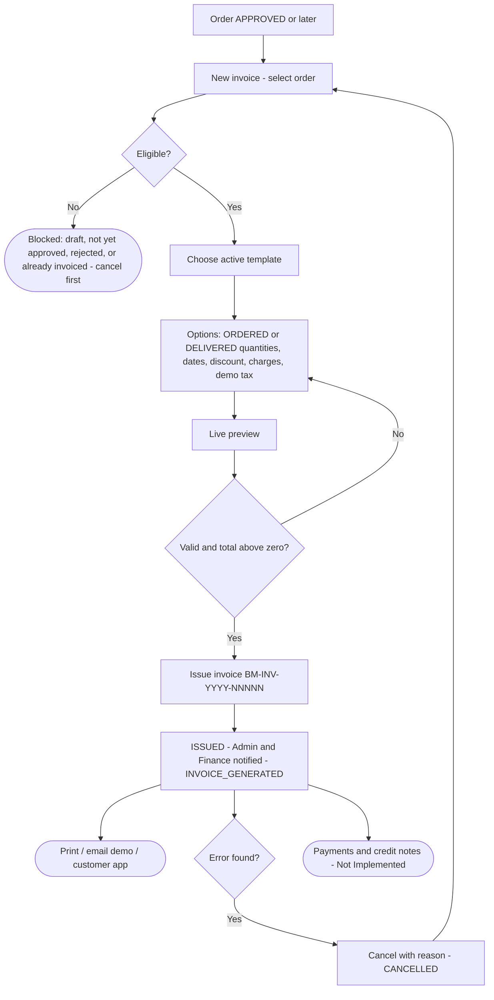
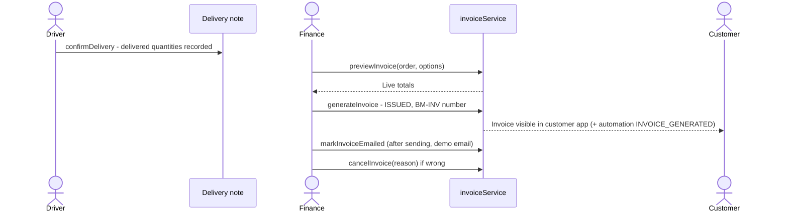

# WF-16 — Invoice Workflow

## Document control

| Field | Value |
|---|---|
| Document title | WF-16 — Invoice Workflow |
| Document ID | BM-WF-16 |
| Version | 1.0 |
| Status | Draft — for client review |
| Category | Business Workflows |
| Related module(s) | All modules |
| Document owner | Business Analyst |
| Prepared by | Project documentation team (AI-assisted draft prepared from source-code analysis) |
| Reviewed by | _Pending — not yet reviewed_ |
| Approval | _Not approved — awaiting client review (no approval has been given)_ |
| Created date | 2026-11-12 |
| Last updated date | 2026-11-12 |

> **Status labels used in this document:** VERIFIED (confirmed in the current source code or existing documents) · PROTOTYPE (works in the React/LocalStorage prototype with mock or simulated behaviour) · PROPOSED (recommended production design, not built) · PENDING CONFIRMATION (needs a client decision) · NOT IMPLEMENTED · NOT VERIFIED.

## Purpose

Specify invoice issue and cancellation (scope to be confirmed).

## Scope

Workflow WF-16 as implemented in the prototype, with production differences marked.

## Definitions

Other terms: see [BM-GLO-001 — Project Glossary](../22_GLOSSARY_AND_REFERENCE/BM-GLO-001_Project_Glossary.md).

## References

- [BM-WF-00 — Business Workflow Catalogue](BM-WF-00_Business_Workflow_Catalogue.md)
- [BM-SYS-008 — Requirement Traceability Matrix](../03_SYSTEM_REQUIREMENTS/BM-SYS-008_Requirement_Traceability_Matrix.xlsx)

## Contents

- 1. Workflow summary
- 2. Step-by-step process
- 3. Decision points
- 4. Approval conditions
- 5. Rejection conditions
- 6. System actions
- 7. User actions
- 8. Status changes
- 9. Notifications
- 10. Exception scenarios
- 11. Workflow diagram
- 12. Final outcome

## 1. Workflow summary

| Field | Value |
|---|---|
| Workflow ID | WF-16 |
| Workflow name | Invoice Workflow |
| Business purpose | Specify invoice issue and cancellation (scope to be confirmed). |
| Initiating role | Finance |
| Trigger | Order approved or delivered |
| Preconditions | Order APPROVED or later without active invoice; active template. |
| Final outcome | Invoice issued. |
| Related requirements | FR-INVC-001, FR-INVC-002, FR-INVC-003, FR-INVC-004 |
| Related test cases | TC-INVC-001, TC-INVC-002, TC-INVC-N01, TC-INVC-N02, TC-INVC-003, TC-INVC-N03, TC-INVC-004 |
| Detailed chapter | `docs/workflow/` chapter 12 |

## 2. Step-by-step process

1. New invoice — select order.
2. Choose template and options (quantity basis, dates, discount, charges, demo tax).
3. Preview; issue (BM-INV-YYYY-NNNNN).
4. Print / email (demo) / visible to customer.
5. Cancel with reason if wrong; reissue.

## 3. Decision points

Eligible? Quantity basis?

## 4. Approval conditions

—

## 5. Rejection conditions

Cancellation.

## 6. System actions

Snapshot, numbering, totals, event INVOICE_GENERATED.

## 7. User actions

Finance.

## 8. Status changes

ISSUED → CANCELLED.

## 9. Notifications

Admin and Finance.

## 10. Exception scenarios

Draft / unapproved order; duplicate; zero total.

## 11. Workflow diagram

Implementation label: diagrams describe the **prototype behaviour (VERIFIED in source code)** unless a step is marked PROPOSED / NOT IMPLEMENTED.

## 12. Final outcome

Invoice issued.

## Revision history

| Version | Date | Author | Description |
|---|---|---|---|
| 1.0 | 2026-11-12 | Documentation team | Initial draft prepared from analysis of the bellomassi-premium-ui source code and existing project documents. |