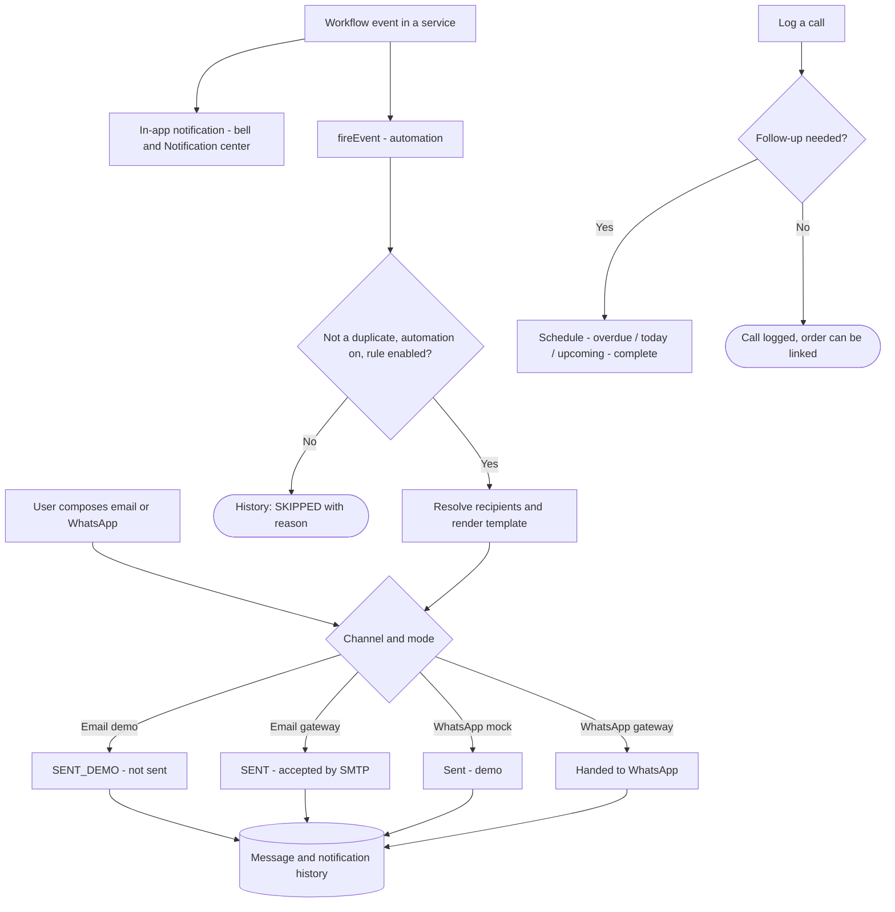
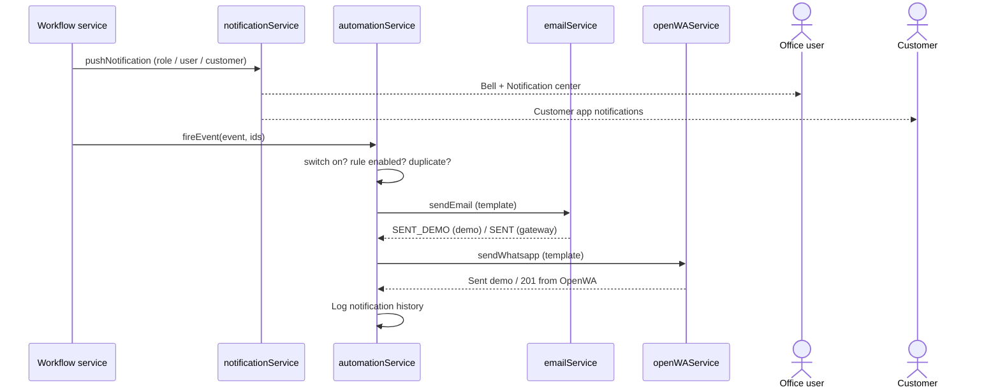

# WF-17 — Communication Workflow

## Document control

| Field | Value |
|---|---|
| Document title | WF-17 — Communication Workflow |
| Document ID | BM-WF-17 |
| Version | 1.0 |
| Status | Draft — for client review |
| Category | Business Workflows |
| Related module(s) | All modules |
| Document owner | Business Analyst |
| Prepared by | Project documentation team (AI-assisted draft prepared from source-code analysis) |
| Reviewed by | _Pending — not yet reviewed_ |
| Approval | _Not approved — awaiting client review (no approval has been given)_ |
| Created date | 2026-11-12 |
| Last updated date | 2026-11-12 |

> **Status labels used in this document:** VERIFIED (confirmed in the current source code or existing documents) · PROTOTYPE (works in the React/LocalStorage prototype with mock or simulated behaviour) · PROPOSED (recommended production design, not built) · PENDING CONFIRMATION (needs a client decision) · NOT IMPLEMENTED · NOT VERIFIED.

## Purpose

Specify manual and automated communication.

## Scope

Workflow WF-17 as implemented in the prototype, with production differences marked.

## Definitions

Other terms: see [BM-GLO-001 — Project Glossary](../22_GLOSSARY_AND_REFERENCE/BM-GLO-001_Project_Glossary.md).

## References

- [BM-WF-00 — Business Workflow Catalogue](BM-WF-00_Business_Workflow_Catalogue.md)
- [BM-SYS-008 — Requirement Traceability Matrix](../03_SYSTEM_REQUIREMENTS/BM-SYS-008_Requirement_Traceability_Matrix.xlsx)

## Contents

- 1. Workflow summary
- 2. Step-by-step process
- 3. Decision points
- 4. Approval conditions
- 5. Rejection conditions
- 6. System actions
- 7. User actions
- 8. Status changes
- 9. Notifications
- 10. Exception scenarios
- 11. Workflow diagram
- 12. Final outcome

## 1. Workflow summary

| Field | Value |
|---|---|
| Workflow ID | WF-17 |
| Workflow name | Communication Workflow |
| Business purpose | Specify manual and automated communication. |
| Initiating role | System / user |
| Trigger | Workflow event or manual message |
| Preconditions | Templates and settings; automation switched on for automated messages. |
| Final outcome | Message logged. |
| Related requirements | FR-EML-001, FR-OWA-001, FR-AUTO-001, FR-AUTO-002, FR-NOTF-001 |
| Related test cases | TC-EML-001, TC-OWA-001, TC-AUTO-001, TC-AUTO-002, TC-NOTF-001 |
| Detailed chapter | `docs/workflow/` chapter 13 |

## 2. Step-by-step process

1. Workflow event fires.
2. In-app notification created.
3. Automation: check duplicate, switch, rule; resolve recipients; render template.
4. Send via email / WhatsApp (demo or gateway); log history.
5. Users may also compose messages manually.

## 3. Decision points

Automation on? Rule enabled? Channel?

## 4. Approval conditions

—

## 5. Rejection conditions

—

## 6. System actions

`fireEvent`, `sendEmail`, `sendWhatsapp`.

## 7. User actions

Compose, templates.

## 8. Status changes

Message statuses (demo: SENT_DEMO).

## 9. Notifications

—

## 10. Exception scenarios

Skipped (no rule / template / address).

## 11. Workflow diagram

Implementation label: diagrams describe the **prototype behaviour (VERIFIED in source code)** unless a step is marked PROPOSED / NOT IMPLEMENTED.

## 12. Final outcome

Message logged.

## Revision history

| Version | Date | Author | Description |
|---|---|---|---|
| 1.0 | 2026-11-12 | Documentation team | Initial draft prepared from analysis of the bellomassi-premium-ui source code and existing project documents. |