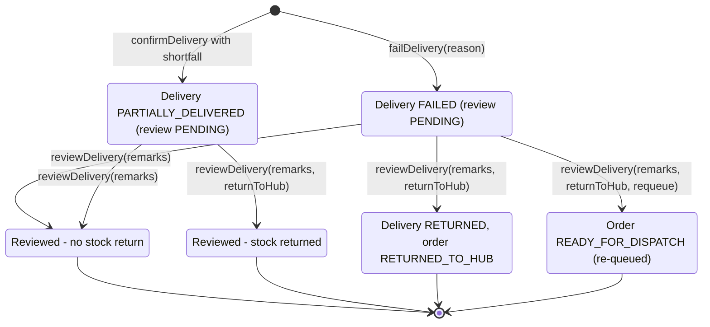

# WF-21 — Return Delivery Workflow

## Document control

| Field | Value |
|---|---|
| Document title | WF-21 — Return Delivery Workflow |
| Document ID | BM-WF-21 |
| Version | 1.0 |
| Status | Draft — for client review |
| Category | Business Workflows |
| Related module(s) | All modules |
| Document owner | Business Analyst |
| Prepared by | Project documentation team (AI-assisted draft prepared from source-code analysis) |
| Reviewed by | _Pending — not yet reviewed_ |
| Approval | _Not approved — awaiting client review (no approval has been given)_ |
| Created date | 2026-11-12 |
| Last updated date | 2026-11-12 |

> **Status labels used in this document:** VERIFIED (confirmed in the current source code or existing documents) · PROTOTYPE (works in the React/LocalStorage prototype with mock or simulated behaviour) · PROPOSED (recommended production design, not built) · PENDING CONFIRMATION (needs a client decision) · NOT IMPLEMENTED · NOT VERIFIED.

## Purpose

Specify return delivery handling.

## Scope

Workflow WF-21 as implemented in the prototype, with production differences marked.

## Definitions

Other terms: see [BM-GLO-001 — Project Glossary](../22_GLOSSARY_AND_REFERENCE/BM-GLO-001_Project_Glossary.md).

## References

- [BM-WF-00 — Business Workflow Catalogue](BM-WF-00_Business_Workflow_Catalogue.md)
- [BM-SYS-008 — Requirement Traceability Matrix](../03_SYSTEM_REQUIREMENTS/BM-SYS-008_Requirement_Traceability_Matrix.xlsx)

## Contents

- 1. Workflow summary
- 2. Step-by-step process
- 3. Decision points
- 4. Approval conditions
- 5. Rejection conditions
- 6. System actions
- 7. User actions
- 8. Status changes
- 9. Notifications
- 10. Exception scenarios
- 11. Workflow diagram
- 12. Final outcome

## 1. Workflow summary

| Field | Value |
|---|---|
| Workflow ID | WF-21 |
| Workflow name | Return Delivery Workflow |
| Business purpose | Specify return delivery handling. |
| Initiating role | Driver / Dispatcher |
| Trigger | Delivery failed or partially accepted |
| Preconditions | Delivery FAILED or PARTIALLY_DELIVERED. |
| Final outcome | Goods and order status corrected. |
| Related requirements | FR-DRV-005, FR-EXC-001, FR-EXC-002, FR-EXC-003 |
| Related test cases | TC-DRV-005, TC-EXC-001, TC-EXC-N01, TC-EXC-002, TC-EXC-N02, TC-EXC-003 |
| Detailed chapter | `docs/workflow/` chapter 15 |

## 2. Step-by-step process

1. Driver records failure reason or shortfall.
2. Dispatcher opens delivery; enters review remarks.
3. Optionally return undelivered goods to hub (once).
4. For failed + returned: optionally re-queue the order.

## 3. Decision points

Return stock? Re-queue?

## 4. Approval conditions

Dispatcher review.

## 5. Rejection conditions

—

## 6. System actions

Delivery Return movement; order status update.

## 7. User actions

Dispatcher.

## 8. Status changes

FAILED → RETURNED; order → RETURNED_TO_HUB or READY_FOR_DISPATCH.

## 9. Notifications

Failure notification to Admin, Dispatcher, customer.

## 10. Exception scenarios

Second review refused.

## 11. Workflow diagram

Implementation label: diagrams describe the **prototype behaviour (VERIFIED in source code)** unless a step is marked PROPOSED / NOT IMPLEMENTED.

## 12. Final outcome

Goods and order status corrected.

## Revision history

| Version | Date | Author | Description |
|---|---|---|---|
| 1.0 | 2026-11-12 | Documentation team | Initial draft prepared from analysis of the bellomassi-premium-ui source code and existing project documents. |