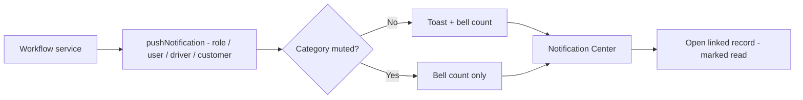

# WF-23 — Notification Workflow

## Document control

| Field | Value |
|---|---|
| Document title | WF-23 — Notification Workflow |
| Document ID | BM-WF-23 |
| Version | 1.0 |
| Status | Draft — for client review |
| Category | Business Workflows |
| Related module(s) | All modules |
| Document owner | Business Analyst |
| Prepared by | Project documentation team (AI-assisted draft prepared from source-code analysis) |
| Reviewed by | _Pending — not yet reviewed_ |
| Approval | _Not approved — awaiting client review (no approval has been given)_ |
| Created date | 2026-11-12 |
| Last updated date | 2026-11-12 |

> **Status labels used in this document:** VERIFIED (confirmed in the current source code or existing documents) · PROTOTYPE (works in the React/LocalStorage prototype with mock or simulated behaviour) · PROPOSED (recommended production design, not built) · PENDING CONFIRMATION (needs a client decision) · NOT IMPLEMENTED · NOT VERIFIED.

## Purpose

Specify in-app notifications.

## Scope

Workflow WF-23 as implemented in the prototype, with production differences marked.

## Definitions

Other terms: see [BM-GLO-001 — Project Glossary](../22_GLOSSARY_AND_REFERENCE/BM-GLO-001_Project_Glossary.md).

## References

- [BM-WF-00 — Business Workflow Catalogue](BM-WF-00_Business_Workflow_Catalogue.md)
- [BM-SYS-008 — Requirement Traceability Matrix](../03_SYSTEM_REQUIREMENTS/BM-SYS-008_Requirement_Traceability_Matrix.xlsx)

## Contents

- 1. Workflow summary
- 2. Step-by-step process
- 3. Decision points
- 4. Approval conditions
- 5. Rejection conditions
- 6. System actions
- 7. User actions
- 8. Status changes
- 9. Notifications
- 10. Exception scenarios
- 11. Workflow diagram
- 12. Final outcome

## 1. Workflow summary

| Field | Value |
|---|---|
| Workflow ID | WF-23 |
| Workflow name | Notification Workflow |
| Business purpose | Specify in-app notifications. |
| Initiating role | System |
| Trigger | Any workflow event |
| Preconditions | — |
| Final outcome | User informed. |
| Related requirements | FR-NOTF-001, FR-NOTF-002, FR-AUTO-002 |
| Related test cases | TC-NOTF-001, TC-NOTF-002, TC-AUTO-002 |
| Detailed chapter | `docs/workflow/` chapter 13 |

## 2. Step-by-step process

1. Service calls `pushNotification` with target role / user / driver / customer.
2. Bell count updates; toast unless muted.
3. User opens Notification Center and follows link.
4. Marked read.

## 3. Decision points

Muted category?

## 4. Approval conditions

—

## 5. Rejection conditions

—

## 6. System actions

`notificationService`.

## 7. User actions

Read / mute.

## 8. Status changes

Unread → Read.

## 9. Notifications

—

## 10. Exception scenarios

—

## 11. Workflow diagram

Implementation label: diagrams describe the **prototype behaviour (VERIFIED in source code)** unless a step is marked PROPOSED / NOT IMPLEMENTED.

## 12. Final outcome

User informed.

## Revision history

| Version | Date | Author | Description |
|---|---|---|---|
| 1.0 | 2026-11-12 | Documentation team | Initial draft prepared from analysis of the bellomassi-premium-ui source code and existing project documents. |