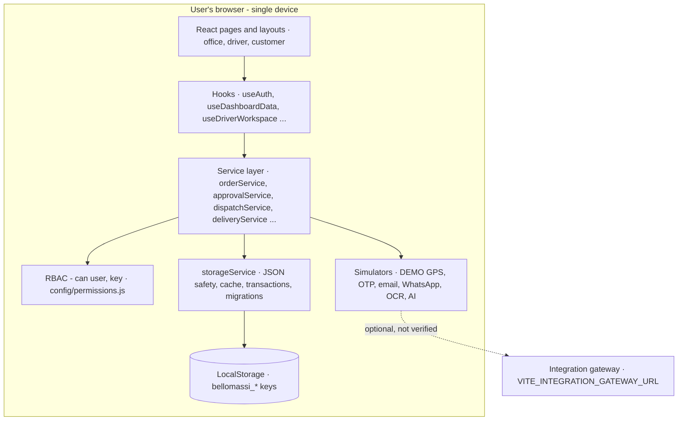
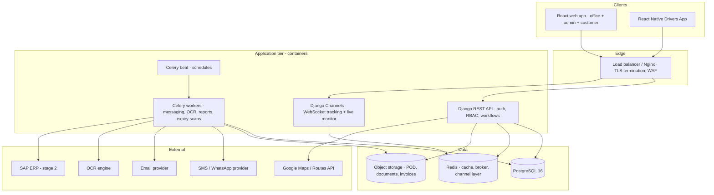
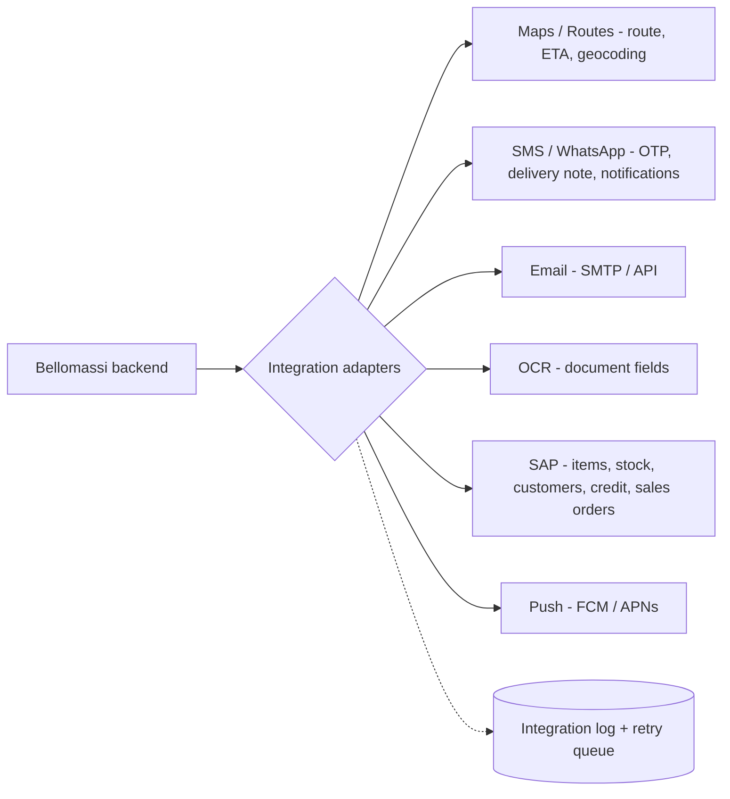
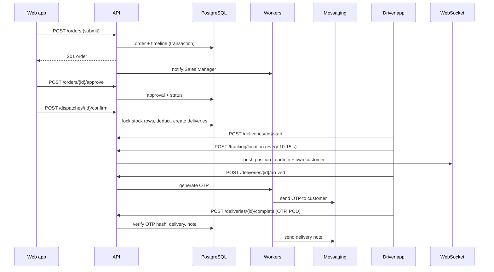

# High-Level Design (HLD)

## Document control

| Field | Value |
|---|---|
| Document title | High-Level Design (HLD) |
| Document ID | BM-ARC-001 |
| Version | 1.0 |
| Status | Draft — for client review |
| Category | System Architecture |
| Related module(s) | All modules |
| Document owner | Solution Architect |
| Prepared by | Project documentation team (AI-assisted draft prepared from source-code analysis) |
| Reviewed by | _Pending — not yet reviewed_ |
| Approval | _Not approved — awaiting client review (no approval has been given)_ |
| Created date | 2026-11-12 |
| Last updated date | 2026-11-12 |

> **Status labels used in this document:** VERIFIED (confirmed in the current source code or existing documents) · PROTOTYPE (works in the React/LocalStorage prototype with mock or simulated behaviour) · PROPOSED (recommended production design, not built) · PENDING CONFIRMATION (needs a client decision) · NOT IMPLEMENTED · NOT VERIFIED.

## Purpose

Describe the architecture of the current prototype (VERIFIED) and the target production architecture (PROPOSED), their components, boundaries, data flows and integration points.

## Scope

Frontend, backend target, database, integrations, deployment, security architecture and scalability strategy.

## Definitions

Other terms: see [BM-GLO-001 — Project Glossary](../22_GLOSSARY_AND_REFERENCE/BM-GLO-001_Project_Glossary.md).

## References

- Driver App GPS Implementation Guide §6, §10, §11
- docs/INTEGRATION_GATEWAY.md (gateway contract)
- [BM-ARC-002 — Low-Level Design (LLD)](BM-ARC-002_Low_Level_Design.md)
- [BM-ARC-003 — Architecture Diagrams](BM-ARC-003_Architecture_Diagrams.md)
- [BM-DAT-002 — Proposed Production Database Design](../08_DATABASE_AND_DATA_DESIGN/BM-DAT-002_Production_Database_Design.md)
- [BM-API-001 — API Specification (Overview and Conventions)](../09_API_AND_INTEGRATION/BM-API-001_API_Specification.md)
- [BM-SEC-002 — Security Architecture](../10_SECURITY_AND_COMPLIANCE/BM-SEC-002_Security_Architecture.md)
- [BM-INF-003 — Infrastructure, Network Architecture and Server Specification](../11_INFRASTRUCTURE_AND_DEVOPS/BM-INF-003_Infrastructure_and_Network_Architecture.md)

## Contents

- 1. Architecture summary
- 2. System architecture — current prototype (VERIFIED)
- 3. Target production architecture (PROPOSED)
- 4. Logical architecture
- 5. Frontend architecture (VERIFIED)
- 6. Backend target architecture (PROPOSED)
- 7. Database architecture
- 8. Integration architecture
- 9. Deployment architecture — PROPOSED
- 10. Security architecture
- 11. Data flow — order to delivery (production)
- 12. Component responsibilities and system boundaries
- 13. External dependencies
- 14. Scalability strategy — PROPOSED

## 1. Architecture summary

| Layer | Prototype — VERIFIED | Production target — PROPOSED |
|---|---|---|
| Presentation | React 19 SPA (Vite 8, Tailwind 4, React Router 7), lazy-loaded pages; office, `/driver`, `/customer` layouts | Same React web app; React Native Drivers App; customer app (web or native, to confirm) |
| Application logic | 84 service modules in the browser (`src/services`) enforce rules and permissions | Django REST Framework services; Celery workers; Django Channels |
| Data | LocalStorage via `storageService` (74 keys, version 8, transactions, migrations) | PostgreSQL 16 (+ PostGIS optional), Redis, S3-compatible object storage |
| Integration | Simulated providers; optional gateway contract (`VITE_INTEGRATION_GATEWAY_URL`) — NOT VERIFIED | Maps / Routes, SMS / WhatsApp, email, OCR, SAP adapters |
| Security | Client-side demo authentication and `can()` checks | JWT / session auth, server-side RBAC, TLS, audit, secrets management |
| Deployment | Static files | Docker containers, Nginx, CI/CD, monitoring |

## 2. System architecture — current prototype (VERIFIED)

## 3. Target production architecture (PROPOSED)

## 4. Logical architecture

| Logical component | Responsibility | Prototype module(s) | Production component |
|---|---|---|---|
| Identity and access | Authentication, sessions, roles, permissions, data scope | `authService`, `rbacService`, `userService`, `ProtectedRoute` | Django auth + `accounts` app, DRF permissions |
| Master data | Customers, products, hubs, zones, drivers, vehicles, suppliers, organisation | `customerService`, `productService`, `hubService`, `zoneService`, `driverService`, `vehicleService` | `masterdata` app |
| Sales | Orders, approval, credit, consolidation | `orderService`, `approvalService`, `consolidationService` | `orders` app |
| Logistics | Dispatch, assignment, deliveries, OTP, POD, notes, tracking, exceptions | `dispatchService`, `deliveryService`, `otpService`, `deliveryNoteService`, `trackingService` | `logistics` app + Channels consumers |
| Inventory | Stock, receipts, transfers, adjustments, scrap, replenishment | `inventoryService`, `scrapService`, `replenishmentService` | `inventory` app |
| Compliance and documents | VMS, documents, OCR | `complianceService`, `documentService`, `ocrService` | `documents` app + OCR worker |
| Finance | Invoices, templates (scope to confirm) | `invoiceService`, `invoiceTemplateService` | `billing` app (optional) |
| Communication | Notifications, automation, email, WhatsApp, calls | `notificationService`, `automationService`, `emailService`, `openWAService`, `callService` | `comms` app + workers |
| Analytics | Dashboards, reports, forecasting, AI | `dashboardService`, `reportService`, `forecastService`, `aiChatService` | `analytics` app, read replicas |
| Platform | Settings, audit, storage, numbering | `appSettingsService`, `auditService`, `storageService` | `core` app |

## 5. Frontend architecture (VERIFIED)

- Single navigation configuration (`src/config/navigation.js`, 206 entries) drives routes, menus, breadcrumbs, search
  and route permissions.
- Pages are lazy-loaded; three layouts: `AppLayout` (office), `DriverLayout`, `CustomerLayout`.
- State: React contexts (`AuthContext`, `ThemeContext`, `DashboardPeriodContext`) + storage subscriptions
  (`useSyncExternalStore` over `storageService.subscribe`, cross-tab `storage` events).
- Rule of the codebase: **page → hook → service → storageService**; pages never touch storage.
- Details: [BM-ARC-002 — Low-Level Design (LLD)](BM-ARC-002_Low_Level_Design.md).

## 6. Backend target architecture (PROPOSED)

- Django 5 project with apps: `core`, `accounts`, `masterdata`, `orders`, `logistics`, `inventory`, `documents`,
  `billing`, `comms`, `analytics`, `integrations`.
- DRF viewsets with permission classes mapped 1:1 to the 110 permission keys; object-level scope filters per role.
- Service layer (Python) re-implements the prototype services' rules; the prototype services are the executable
  specification (messages and edge cases).
- Transactions with `select_for_update` on stock rows and order status changes; idempotency keys for state-changing
  endpoints (approve, confirm, complete, write-off).
- Celery for asynchronous work; Channels for WebSockets; drf-spectacular for OpenAPI.

## 7. Database architecture

Prototype: LocalStorage keys described in [BM-DAT-001 — Current Prototype Data Model (LocalStorage)](../08_DATABASE_AND_DATA_DESIGN/BM-DAT-001_Prototype_Data_Model.md). Production: PostgreSQL schema with ≈45 tables,
audit columns, soft delete, indexes and constraints — [BM-DAT-002 — Proposed Production Database Design](../08_DATABASE_AND_DATA_DESIGN/BM-DAT-002_Production_Database_Design.md).

## 8. Integration architecture

Every adapter is behind an interface with a **sandbox / mock implementation** (as in the prototype) so that tests
never call live providers. Contract details: [BM-API-019 — Integration Specification (External Systems)](../09_API_AND_INTEGRATION/BM-API-019_Integration_Specification.md).

## 9. Deployment architecture — PROPOSED

Containers (API, Channels, workers, beat, Nginx) on a managed container platform or VMs; managed PostgreSQL and Redis;
object storage; CDN for the web app; separate test, staging and production environments. See [BM-INF-003 — Infrastructure, Network Architecture and Server Specification](../11_INFRASTRUCTURE_AND_DEVOPS/BM-INF-003_Infrastructure_and_Network_Architecture.md) and
[BM-INF-006 — Docker Architecture and Deployment Guide](../11_INFRASTRUCTURE_AND_DEVOPS/BM-INF-006_Docker_Architecture_and_Deployment.md).

## 10. Security architecture

TLS everywhere; JWT access (15 min) + refresh tokens; Argon2id; MFA for privileged roles; server-side RBAC and
object scope; OTP hashing and rate limiting; signed URLs for files; audit log; secrets in a vault; WAF and rate limits.
Prototype controls are simulated. See [BM-SEC-002 — Security Architecture](../10_SECURITY_AND_COMPLIANCE/BM-SEC-002_Security_Architecture.md).

## 11. Data flow — order to delivery (production)

## 12. Component responsibilities and system boundaries

- **Inside the system:** all workflows from order capture to delivery note, master data, rules, notifications,
  reporting, (optionally) invoices and inventory.
- **Outside the system:** ERP accounting and invoicing (unless confirmed), payment collection, map and messaging
  infrastructure, SAP master data ownership (stage 2), vehicle hardware.

## 13. External dependencies

Google Maps Platform / Routes API · SMS / WhatsApp provider · email provider · OCR engine · SAP · app stores · hosting
provider. All PENDING CONFIRMATION of account and contract.

## 14. Scalability strategy — PROPOSED

Stateless API containers scaled horizontally behind the load balancer; Channels scaled with a Redis channel layer;
Celery queues separated (messaging, ocr, reports); PostgreSQL vertical scaling + read replica for reports; GPS points
written in batches and partitioned by month (or PostGIS / TimescaleDB if volumes require); CDN for static assets.
Capacity numbers depend on confirmed volumes (NFR-SCAL-002).

## Revision history

| Version | Date | Author | Description |
|---|---|---|---|
| 1.0 | 2026-11-12 | Documentation team | Initial draft prepared from analysis of the bellomassi-premium-ui source code and existing project documents. |