# Architecture Diagrams

## Document control

| Field | Value |
|---|---|
| Document title | Architecture Diagrams |
| Document ID | BM-ARC-003 |
| Version | 1.0 |
| Status | Draft — for client review |
| Category | System Architecture |
| Related module(s) | All modules |
| Document owner | Solution Architect |
| Prepared by | Project documentation team (AI-assisted draft prepared from source-code analysis) |
| Reviewed by | _Pending — not yet reviewed_ |
| Approval | _Not approved — awaiting client review (no approval has been given)_ |
| Created date | 2026-11-12 |
| Last updated date | 2026-11-12 |

> **Status labels used in this document:** VERIFIED (confirmed in the current source code or existing documents) · PROTOTYPE (works in the React/LocalStorage prototype with mock or simulated behaviour) · PROPOSED (recommended production design, not built) · PENDING CONFIRMATION (needs a client decision) · NOT IMPLEMENTED · NOT VERIFIED.

## Purpose

Collect the architecture diagrams required for design review.

## Scope

Context, component, application, logical, order processing, data flow, deployment, network, authentication, integration, driver delivery, customer app and RBAC diagrams.

## Definitions

Other terms: see [BM-GLO-001 — Project Glossary](../22_GLOSSARY_AND_REFERENCE/BM-GLO-001_Project_Glossary.md).

## References

- [BM-ARC-001 — High-Level Design (HLD)](BM-ARC-001_High_Level_Design.md)
- [BM-ARC-002 — Low-Level Design (LLD)](BM-ARC-002_Low_Level_Design.md)
- [BM-DGM-001 — Diagram Catalogue and Visual Documentation](../21_DIAGRAMS_AND_VISUAL_DOCUMENTATION/BM-DGM-001_Diagram_Catalogue.md)

## Contents

- 1. System context diagram (DGM-19)
- 2. Component diagram (DGM-20)
- 3. Application / logical architecture diagram (DGM-01)
- 4. Order processing architecture (DGM-23)
- 5. Data flow diagram (DGM-12)
- 6. Deployment architecture diagram (DGM-13)
- 7. Network architecture (DGM-14)
- 8. Authentication flow diagram (DGM-15)
- 9. Integration architecture diagram (DGM-16)
- 10. Driver delivery architecture (DGM-21)
- 11. Customer application architecture (DGM-22)
- 12. RBAC diagram (DGM-10)

## 1. System context diagram (DGM-19)

Label: **VERIFIED (actors) / PROPOSED (external systems)**

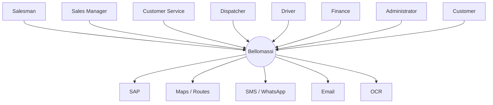

## 2. Component diagram (DGM-20)

Label: **VERIFIED**

```mermaid
flowchart TB
    subgraph UI[Presentation]
        L[Layouts: App, Driver, Customer] --> PG[Pages - 134 files]
        PG --> CMP[Components - 121 files]
    end
    subgraph LOGIC[Logic]
        HK[Hooks - 19] --> SV[Services - 84]
        SV --> CFG[Config: navigation, roles, permissions, statuses]
    end
    subgraph DATA[Data]
        STS[storageService] --> LS[(LocalStorage)]
        SEED[Seed modules] --> STS
    end
    PG --> HK
    SV --> STS
    SV --> SIM[Simulators: GPS, OTP, email, WhatsApp, OCR, AI]
```

## 3. Application / logical architecture diagram (DGM-01)

Label: **VERIFIED (prototype) / PROPOSED (target)**

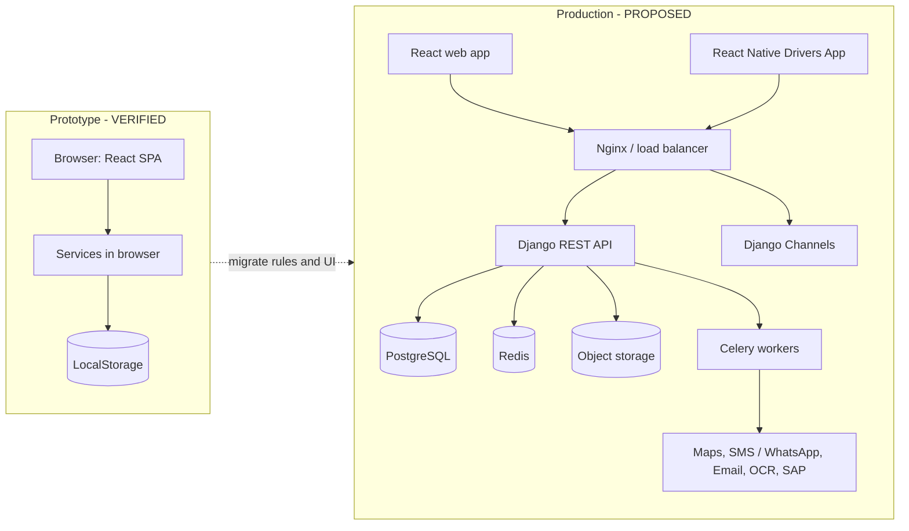

## 4. Order processing architecture (DGM-23)

Label: **VERIFIED (logic) / PROPOSED (server)**

```mermaid
flowchart LR
    IN[Order input: office or customer app] --> VAL[validateOrder]
    VAL --> SUB[submitOrder: number, warnings, timeline]
    SUB --> CHK[getApprovalChecks: 6 checks]
    CHK --> DEC[approve / return / reject]
    DEC --> CON[consolidateOrder: 5 checks]
    CON --> RDY[markReadyForDispatch]
    RDY --> DSP[dispatch: create, assign, confirm - stock deducted]
    DSP --> DEL[deliveries]
```

## 5. Data flow diagram (DGM-12)

Label: **PROPOSED**

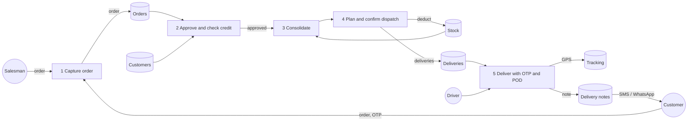

## 6. Deployment architecture diagram (DGM-13)

Label: **PROPOSED**

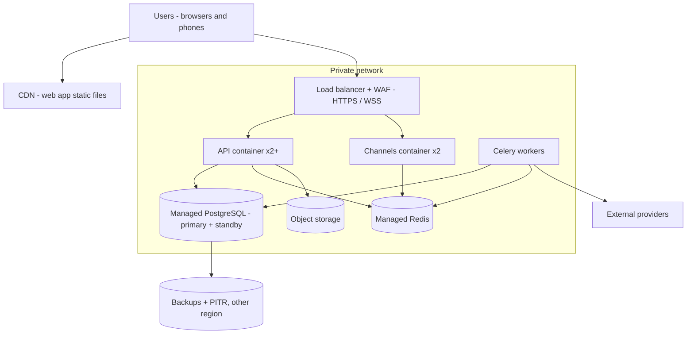

## 7. Network architecture (DGM-14)

Label: **PROPOSED**

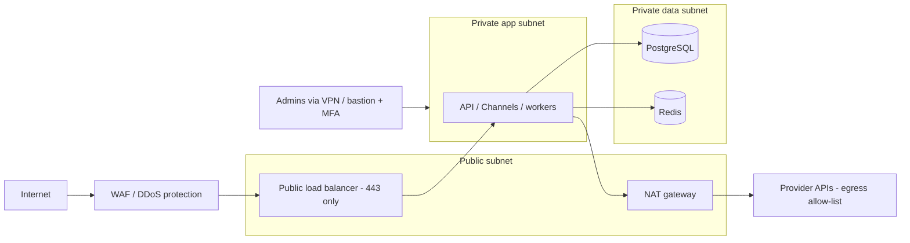

## 8. Authentication flow diagram (DGM-15)

Label: **PROPOSED**

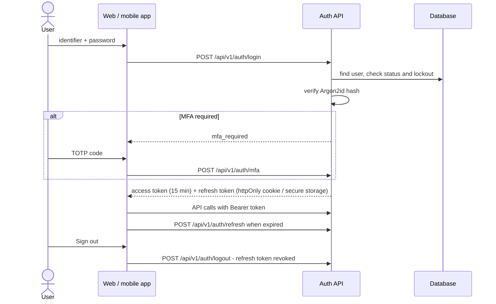

## 9. Integration architecture diagram (DGM-16)

Label: **PROPOSED**

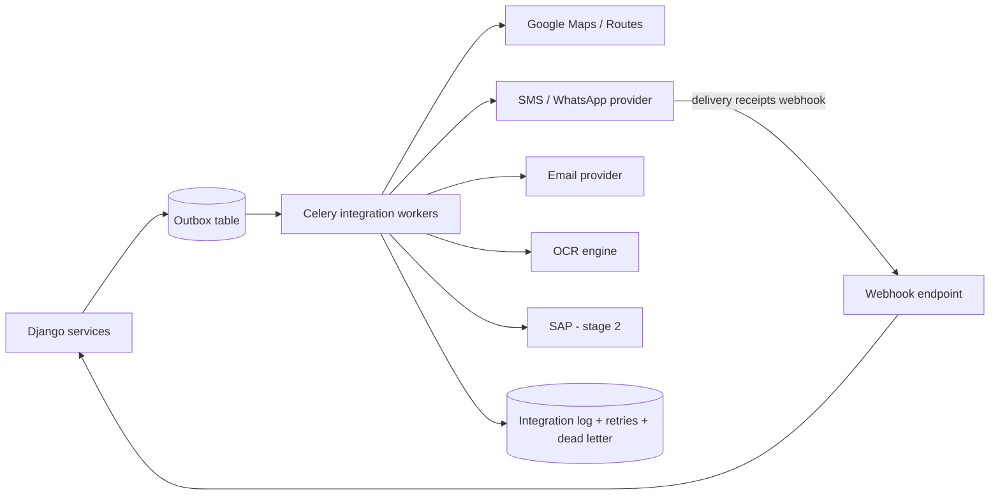

## 10. Driver delivery architecture (DGM-21)

Label: **PROPOSED**

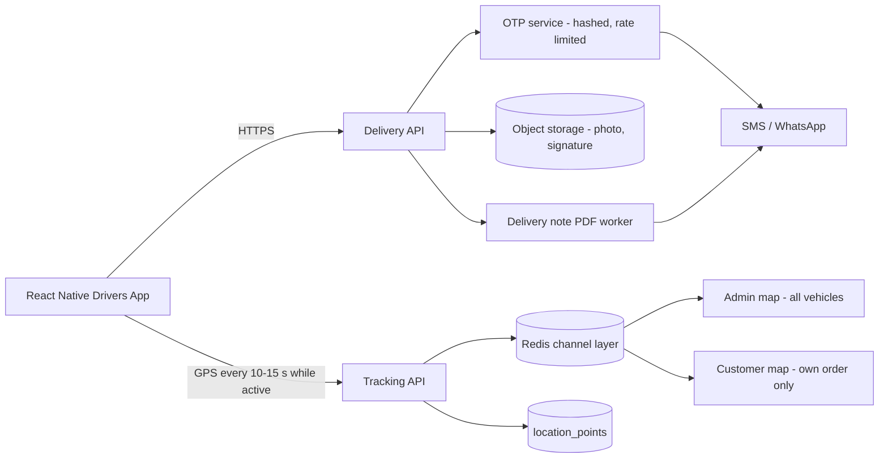

## 11. Customer application architecture (DGM-22)

Label: **VERIFIED (prototype) / PROPOSED (production)**

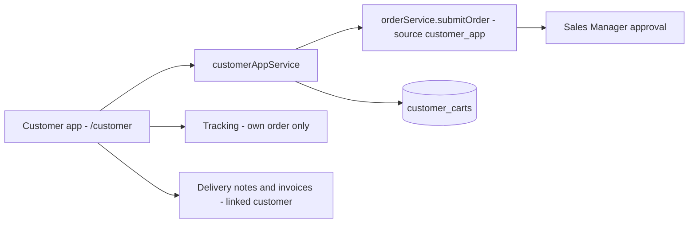

## 12. RBAC diagram (DGM-10)

Label: **VERIFIED (prototype) / PROPOSED (server enforcement)**

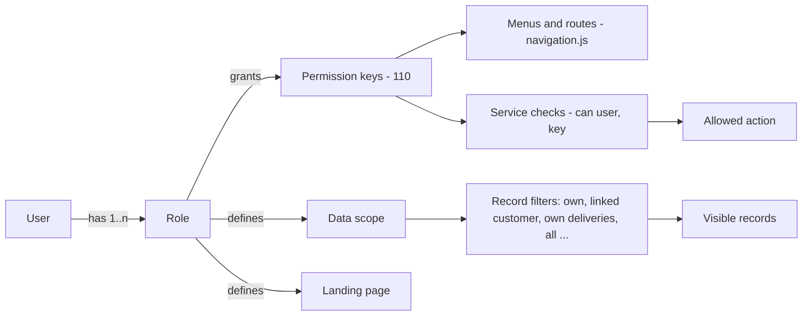

## Revision history

| Version | Date | Author | Description |
|---|---|---|---|
| 1.0 | 2026-11-12 | Documentation team | Initial draft prepared from analysis of the bellomassi-premium-ui source code and existing project documents. |