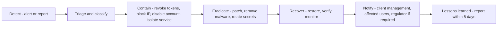

# Security Incident Response Plan

## Document control

| Field | Value |
|---|---|
| Document title | Security Incident Response Plan |
| Document ID | BM-SEC-010 |
| Version | 1.0 |
| Status | Draft — for client review |
| Category | Security and Compliance |
| Related module(s) | All modules |
| Document owner | Security Architect / Client IT |
| Prepared by | Project documentation team (AI-assisted draft prepared from source-code analysis) |
| Reviewed by | _Pending — not yet reviewed_ |
| Approval | _Not approved — awaiting client review (no approval has been given)_ |
| Created date | 2026-11-12 |
| Last updated date | 2026-11-12 |

> **Status labels used in this document:** VERIFIED (confirmed in the current source code or existing documents) · PROTOTYPE (works in the React/LocalStorage prototype with mock or simulated behaviour) · PROPOSED (recommended production design, not built) · PENDING CONFIRMATION (needs a client decision) · NOT IMPLEMENTED · NOT VERIFIED.

## Purpose

Define how security incidents are detected, handled, communicated and learned from.

## Scope

Production platform; roles to be named by the client (PENDING CONFIRMATION).

## Definitions

Other terms: see [BM-GLO-001 — Project Glossary](../22_GLOSSARY_AND_REFERENCE/BM-GLO-001_Project_Glossary.md).

## References

- [BM-SEC-008 — Audit Logging and Security Monitoring Policy](BM-SEC-008_Audit_Logging_and_Security_Monitoring.md)
- [BM-INF-009 — Backup and Disaster Recovery Plan](../11_INFRASTRUCTURE_AND_DEVOPS/BM-INF-009_Backup_and_Disaster_Recovery.md)

## 1. Severity

| Severity | Example | Response time |
|---|---|---|
| S1 Critical | Data breach, ransomware, production down | 15 min, 24×7 |
| S2 High | Account takeover of privileged user, OTP abuse, provider compromise | 1 h |
| S3 Medium | Malware upload blocked, suspicious login pattern | 1 working day |
| S4 Low | Policy violation, false positive | 3 working days |

## 2. Process

## 3. Roles (to be named)

Incident manager · technical lead · client IT contact · data protection officer · communications.

## 4. Playbooks (summary)

- **Credential compromise:** force logout of all sessions of the user, reset password, review audit trail.
- **OTP abuse:** lock deliveries, review driver and customer accounts, rotate pepper if needed.
- **Data exposure:** identify records, contain access, legal assessment of notification duty (72 h where applicable).
- **Provider outage:** switch messaging to fallback provider / manual OTP exception process.

## Revision history

| Version | Date | Author | Description |
|---|---|---|---|
| 1.0 | 2026-11-12 | Documentation team | Initial draft prepared from analysis of the bellomassi-premium-ui source code and existing project documents. |