# Screen Specifications

## Document control

| Field | Value |
|---|---|
| Document title | Screen Specifications |
| Document ID | BM-UX-005 |
| Version | 1.0 |
| Status | Draft — for client review |
| Category | UI/UX and Design |
| Related module(s) | All modules |
| Document owner | UX Designer |
| Prepared by | Project documentation team (AI-assisted draft prepared from source-code analysis) |
| Reviewed by | _Pending — not yet reviewed_ |
| Approval | _Not approved — awaiting client review (no approval has been given)_ |
| Created date | 2026-11-12 |
| Last updated date | 2026-11-12 |

> **Status labels used in this document:** VERIFIED (confirmed in the current source code or existing documents) · PROTOTYPE (works in the React/LocalStorage prototype with mock or simulated behaviour) · PROPOSED (recommended production design, not built) · PENDING CONFIRMATION (needs a client decision) · NOT IMPLEMENTED · NOT VERIFIED.

## Purpose

Specify the key screens: purpose, users, access, layout content, fields, actions and states, each with a real screenshot.

## Scope

73 key screens captured from the running prototype (build of 2026-11-12, demo seed data). Remaining screens are listed in BM-UX-004.

## Definitions

Other terms: see [BM-GLO-001 — Project Glossary](../22_GLOSSARY_AND_REFERENCE/BM-GLO-001_Project_Glossary.md).

## References

- Screenshots captured with Playwright from `vite preview` of the prototype
- src/config/navigation.js
- [BM-UX-004 — Screen Inventory](BM-UX-004_Screen_Inventory.xlsx)
- [BM-UX-006 — Prototype Screenshot Gallery](BM-UX-006_Prototype_Screenshot_Gallery.md)
- [BM-FRD-ORD — Functional Requirements — Salesman Order Management](../04_FUNCTIONAL_REQUIREMENTS/BM-FRD-ORD_Salesman_Order_Management.md)
- [BM-SEC-005 — RBAC and Access Control Matrix](../10_SECURITY_AND_COMPLIANCE/BM-SEC-005_RBAC_and_Access_Control_Matrix.xlsx)

## Contents

- 1. How to read this document
- UX-DASH-SA — Dashboard
- UX-USERS — User Management
- UX-ROLES — Role Management
- UX-PERMS — Permission Matrix
- UX-AUDIT — Audit Log
- UX-SETTINGS — Application Settings
- UX-COMPANY — Company
- UX-CUSTOMERS — Customer List
- UX-CUSTOMER-DETAIL — Customer Details
- UX-CREDIT — Customer Credit
- UX-PRODUCTS — Products
- UX-HUBS — Hubs
- UX-SUPPLIERS — Suppliers
- UX-ORDERS — Order List
- UX-ORDER-DETAIL — Order Details
- UX-REPORTS — Reports Center
- UX-INVENTORY — Inventory Dashboard
- UX-STOCK — Stock Overview
- UX-MOVEMENTS — Stock Movements
- UX-SCRAP — Scrap Requests
- UX-WAREHOUSE — Warehouse Dashboard
- UX-QUALITY — QA & Cold Chain
- UX-VMS — VMS Dashboard
- UX-VMS-EXPIRY — Document Expiry
- UX-DOCUMENTS — Document Repository
- UX-OCR — OCR Queue
- UX-INVOICES — Invoices
- UX-INVOICE-TPL — Invoice Templates
- UX-EMAIL — Email
- UX-WHATSAPP — WhatsApp
- UX-CALLS — Call History
- UX-AI — AI Overview
- UX-FORECAST — Forecasting
- UX-NOTIFICATIONS — Notification Center
- UX-DASH-SE — Dashboard
- UX-ORDER-CREATE — Create Order
- UX-MY-ORDERS — My Orders
- UX-DASH-SM — Dashboard
- UX-APPROVAL — Order Approval
- UX-APPROVAL-DETAIL — Review Order
- UX-DASH-CS — Dashboard
- UX-CONSOLIDATION — Order Consolidation
- UX-DASH-DP — Dashboard
- UX-READY — Ready for Dispatch
- UX-PLANNING — Dispatch Planning
- UX-DISPATCH-LIST — Dispatch Dashboard
- UX-DISPATCH-DETAIL — Dispatch Details
- UX-DISPATCH-CREATE — New Dispatch
- UX-ZONES — Dispatch Zones
- UX-DRIVERS — Drivers
- UX-VEHICLES — Vehicles
- UX-TRACKING — Delivery Tracking
- UX-LIVE — Live Tracking (Demo GPS)
- UX-DELIVERY-REVIEW — Delivery Details
- UX-DN — Delivery Note
- UX-DELIVERY-HISTORY — Delivery History
- UX-DASH-FI — Dashboard
- UX-INVOICE-DASH — Invoice Dashboard
- UX-DRV-DASH — Today
- UX-DRV-DELIVERIES — My Deliveries
- UX-DRV-DELIVERY — Delivery
- UX-DRV-ROUTE — Route
- UX-DRV-COMPLETED — Completed
- UX-DRV-NOTES — My Delivery Notes
- UX-DRV-PROFILE — Driver Profile
- UX-CUS-DASH — Home
- UX-CUS-CATALOG — Catalog
- UX-CUS-CART — Cart
- UX-CUS-ORDERS — My Orders
- UX-CUS-ORDER — Order
- UX-CUS-NOTES — Delivery Notes
- UX-CUS-INVOICES — Invoices
- UX-CUS-PROFILE — Profile

## 1. How to read this document

Content lists (headings, fields, buttons, table columns) were read from the rendered screen at capture time, so they reflect
the prototype as built (VERIFIED for the demo data shown). Field names followed by `*` are mandatory in the form. The
screenshots show demo data only. Behaviour behind buttons is specified in the FRDs ([BM-SYS-003 — Functional Requirements Document (Consolidated)](../03_SYSTEM_REQUIREMENTS/BM-SYS-003_Functional_Requirements_Document.md)).

Common states for every list screen: loading, empty state with call to action, filtered-empty, error boundary. Common
states for forms: validation messages under fields, disabled submit while saving, toast on success / error.

## UX-DASH-SA — Dashboard

| Item | Value |
|---|---|
| Screen ID | SCR-001 |
| Route | `/dashboard` (captured: `/dashboard`) |
| Application | Public (no sign-in) |
| Permission | (signed in) |
| Captured as role | superadmin |
| Roles with access | all signed-in roles |
| Purpose | Role-specific overview of orders, approvals, dispatch and deliveries. |
| Page heading | Good morning, Omar |
| Sections | Operations overview; Order pipeline; Order trend; Order status distribution; Delivery performance; Pending tasks; Recent orders; Quick actions; Recent activity; Low stock alerts |
| Fields / filters | Period |
| Table columns | ORDER; Salesman; STATUS; VALUE; Updated |
| Actions | Date range; Specific period; Compare; Which dates are filtered; All TimeAll dates; View all |
| Screen type | dashboard |
| Layout | Office layout: sidebar, header (breadcrumbs, search, notifications, profile), page header, content cards |
| Components | Period filter, KPI cards, charts (Recharts), queue tables, quick links |
| Validation | Period filter: valid date range |
| Responsive behaviour | Sidebar fixed ≥ 1024 px, drawer below; grids collapse to one column; tables scroll horizontally inside the card |
| Empty state | EmptyState with explanation and call to action |
| Loading state | Spinner / skeleton while data is read (prototype reads are near-instant from LocalStorage) |
| Error state | ErrorBoundary page; action refusals as error toast |
| Success state | Data displayed with counts |

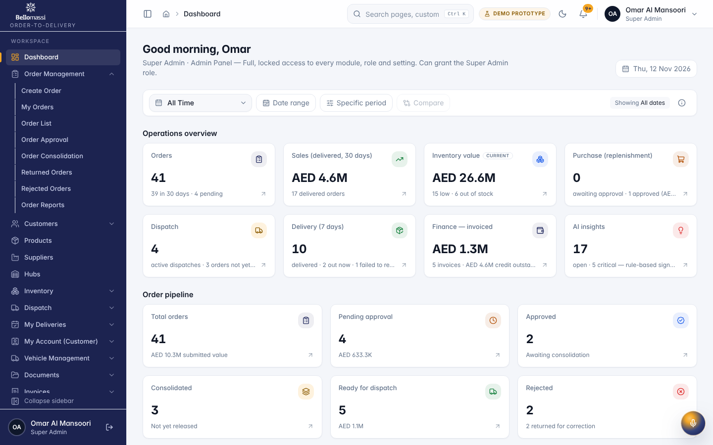{width=16cm}

## UX-USERS — User Management

| Item | Value |
|---|---|
| Screen ID | SCR-144 |
| Route | `/admin/users` (captured: `/admin/users`) |
| Application | Office web app |
| Permission | users.view |
| Captured as role | superadmin |
| Roles with access | SUPER_ADMIN, ADMIN |
| Purpose | Users, their roles, hubs and status — create, edit, activate, reset demo passwords and export. |
| Page heading | User Management |
| Fields / filters | Role; Status; Department; Hub |
| Table columns | ID; USER; Phone; ROLE; DEPARTMENT; HUB; STATUS; CREATED; ACTIONS |
| Actions | Export CSV; ID; USER; ROLE; DEPARTMENT; HUB; STATUS; CREATED; Row actions; Previous page; 1; 2; Next page |
| Screen type | list |
| Layout | Office layout: sidebar, header (breadcrumbs, search, notifications, profile), page header, content cards |
| Components | PageHeader, FilterToolbar, DataTable (sort, paging), Badge, RowActions, EmptyState |
| Validation | Filter inputs only |
| Responsive behaviour | Sidebar fixed ≥ 1024 px, drawer below; grids collapse to one column; tables scroll horizontally inside the card |
| Empty state | EmptyState with explanation and call to action |
| Loading state | Spinner / skeleton while data is read (prototype reads are near-instant from LocalStorage) |
| Error state | ErrorBoundary page; action refusals as error toast |
| Success state | Data displayed with counts |

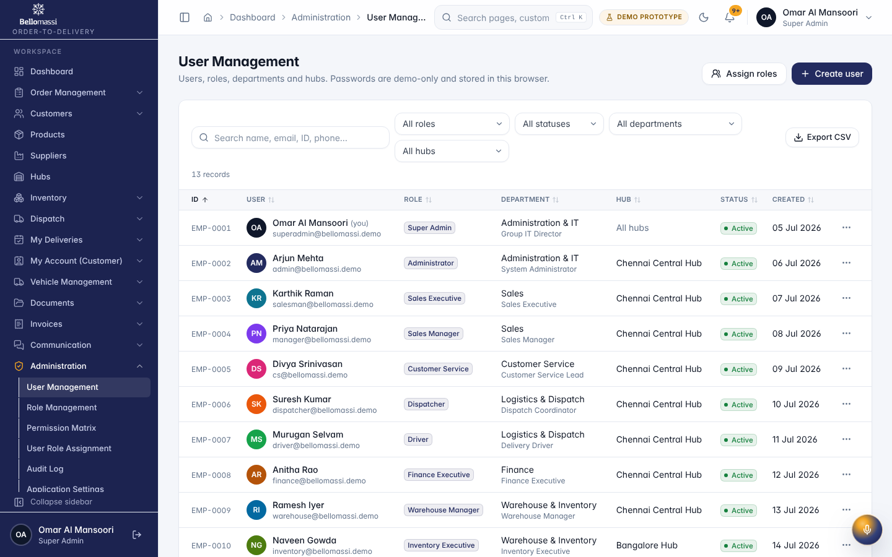{width=16cm}

## UX-ROLES — Role Management

| Item | Value |
|---|---|
| Screen ID | SCR-145 |
| Route | `/admin/roles` (captured: `/admin/roles`) |
| Application | Office web app |
| Permission | roles.view |
| Captured as role | superadmin |
| Roles with access | SUPER_ADMIN, ADMIN |
| Purpose | System and custom roles — create, edit, duplicate and delete, with module, page and action permissions. |
| Page heading | Role Management |
| Fields / filters | Type; Status |
| Table columns | ROLE; TYPE; DATA SCOPE; USERS; PERMISSIONS; STATUS; UPDATED; ACTIONS |
| Actions | Export CSV; ROLE; USERS; PERMISSIONS; STATUS; UPDATED; Row actions; Previous page; 1; 2; Next page |
| Screen type | list |
| Layout | Office layout: sidebar, header (breadcrumbs, search, notifications, profile), page header, content cards |
| Components | PageHeader, FilterToolbar, DataTable (sort, paging), Badge, RowActions, EmptyState |
| Validation | Filter inputs only |
| Responsive behaviour | Sidebar fixed ≥ 1024 px, drawer below; grids collapse to one column; tables scroll horizontally inside the card |
| Empty state | EmptyState with explanation and call to action |
| Loading state | Spinner / skeleton while data is read (prototype reads are near-instant from LocalStorage) |
| Error state | ErrorBoundary page; action refusals as error toast |
| Success state | Data displayed with counts |

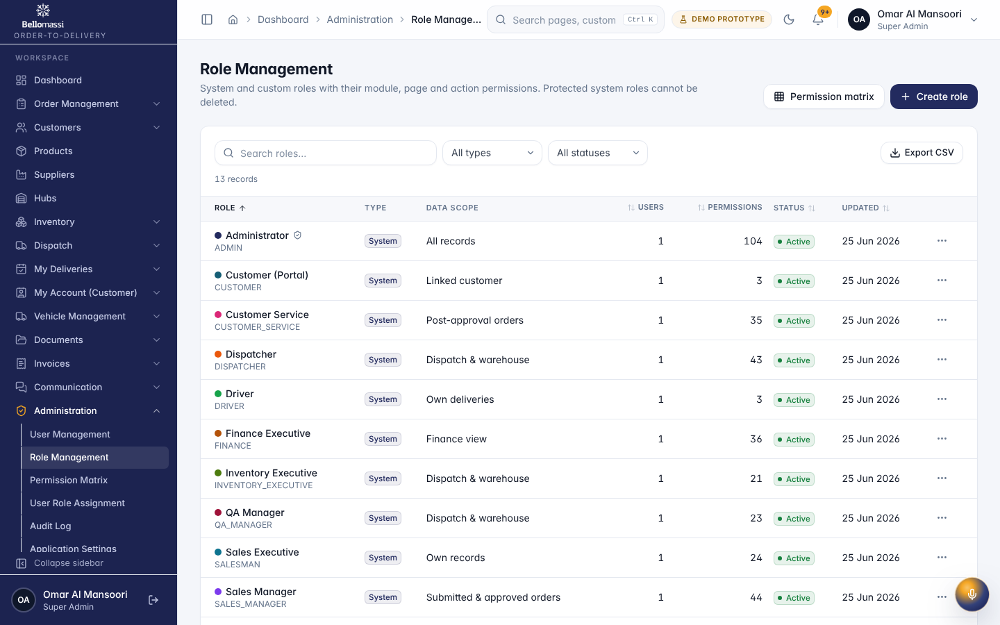{width=16cm}

## UX-PERMS — Permission Matrix

| Item | Value |
|---|---|
| Screen ID | SCR-146 |
| Route | `/admin/permissions` (captured: `/admin/permissions`) |
| Application | Office web app |
| Permission | roles.view |
| Captured as role | superadmin |
| Roles with access | SUPER_ADMIN, ADMIN |
| Purpose | Every role against every module and action in one grid. |
| Page heading | Permission Matrix |
| Sections | Overview; Sales Manager — module × action permissions |
| Fields / filters | Role |
| Table columns | Module; Super Admin; Administrator; Sales Executive; Sales Manager; Customer Service; Dispatcher; Driver; Finance Executive; Warehouse Manager; Inventory Executive; QA Manager; Customer (Portal); Supplier (Portal); Dashboard; Customers; Products; Suppliers; Procurement; Inventory |
| Actions | Export CSV; Super Admin; Administrator; Sales Executive; Sales Manager; Customer Service; Dispatcher; Driver; Finance Executive; Warehouse Manager; Inventory Executive; QA Manager; Customer (Portal); Supplier (Portal); Select all; Clear all; Dashboard; Customers; Products; Suppliers; Procurement; Inventory; Warehouse; Sales; Orders |
| Screen type | list |
| Layout | Office layout: sidebar, header (breadcrumbs, search, notifications, profile), page header, content cards |
| Components | PageHeader, FilterToolbar, DataTable (sort, paging), Badge, RowActions, EmptyState |
| Validation | Filter inputs only |
| Responsive behaviour | Sidebar fixed ≥ 1024 px, drawer below; grids collapse to one column; tables scroll horizontally inside the card |
| Empty state | EmptyState with explanation and call to action |
| Loading state | Spinner / skeleton while data is read (prototype reads are near-instant from LocalStorage) |
| Error state | ErrorBoundary page; action refusals as error toast |
| Success state | Data displayed with counts |

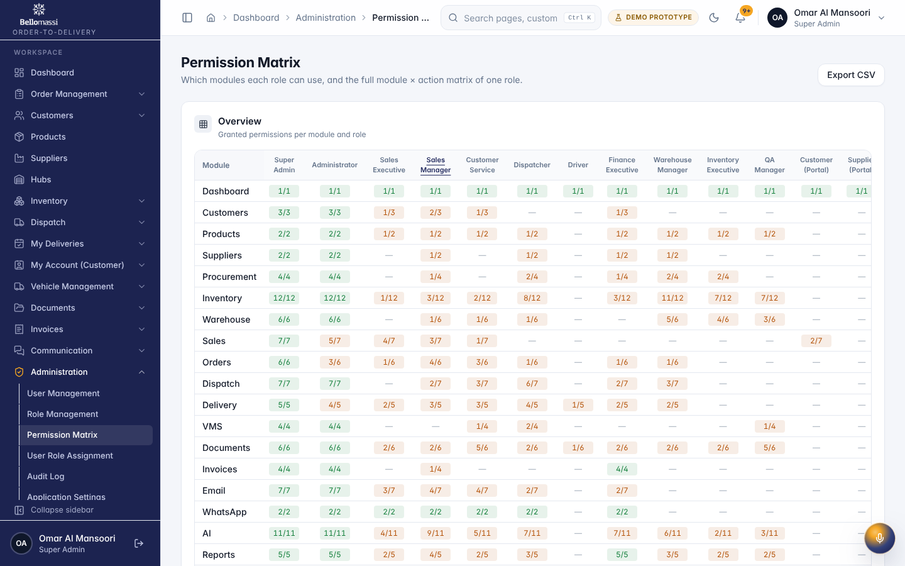{width=16cm}

## UX-AUDIT — Audit Log

| Item | Value |
|---|---|
| Screen ID | SCR-148 |
| Route | `/admin/audit-logs` (captured: `/admin/audit-logs`) |
| Application | Office web app |
| Permission | audit.view |
| Captured as role | superadmin |
| Roles with access | SUPER_ADMIN, ADMIN |
| Purpose | Who did what and when — logins, creates, edits, deletes, approvals, rejections, status and settings changes. |
| Page heading | Audit Log |
| Fields / filters | User; Action; Module; From; To |
| Table columns | TIMESTAMP; USER; ACTION; MODULE; ENTITY; DESCRIPTION; CHANGES |
| Actions | Export CSV; TIMESTAMP; USER; ACTION; MODULE |
| Screen type | list |
| Layout | Office layout: sidebar, header (breadcrumbs, search, notifications, profile), page header, content cards |
| Components | PageHeader, FilterToolbar, DataTable (sort, paging), Badge, RowActions, EmptyState |
| Validation | Filter inputs only |
| Responsive behaviour | Sidebar fixed ≥ 1024 px, drawer below; grids collapse to one column; tables scroll horizontally inside the card |
| Empty state | EmptyState with explanation and call to action |
| Loading state | Spinner / skeleton while data is read (prototype reads are near-instant from LocalStorage) |
| Error state | ErrorBoundary page; action refusals as error toast |
| Success state | Data displayed with counts |

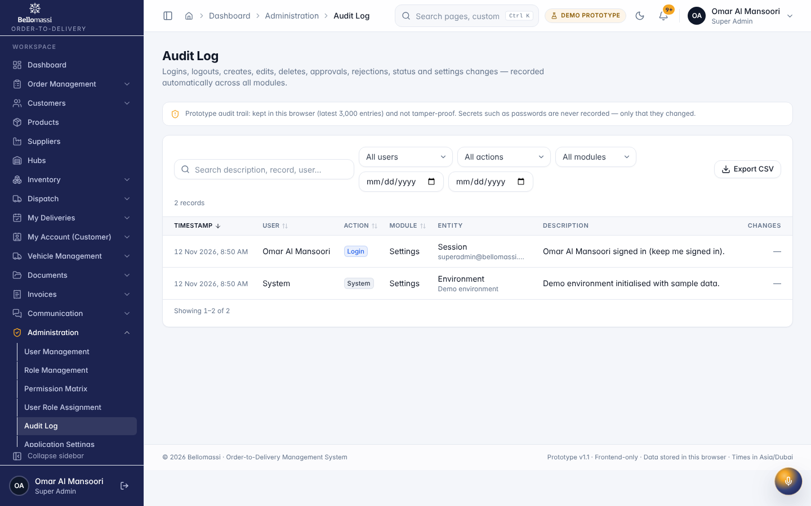{width=16cm}

## UX-SETTINGS — Application Settings

| Item | Value |
|---|---|
| Screen ID | SCR-149 |
| Route | `/admin/settings` (captured: `/admin/settings`) |
| Application | Office web app |
| Permission | settings.view |
| Captured as role | superadmin |
| Roles with access | SUPER_ADMIN, ADMIN |
| Purpose | General, localization, currency, numbering, notifications, security, approval, inventory, warehouse, cold chain, integration and AI settings. |
| Page heading | Application Settings |
| Sections | General; Preview |
| Fields / filters | Application name; Support email; Rows per page (administration lists); Show the DEMO PROTOTYPE badge in the header |
| Tabs | General; Company; Localization; Currency; Numbering; Notifications; Security; Approval Settings; Inventory Settings; Warehouse Settings; Cold Chain Settings; Integration Settings; AI Settings |
| Actions | General; Company; Localization; Currency; Numbering; Notifications; Security; Approval Settings; Inventory Settings; Warehouse Settings; Cold Chain Settings; Integration Settings; AI Settings; Reset section; Discard; Save general |
| Screen type | detail |
| Layout | Office layout: sidebar, header (breadcrumbs, search, notifications, profile), page header, content cards |
| Components | PageHeader with status Badge, InfoList, Tabs / Cards, Timeline, action Buttons, ConfirmDialog |
| Validation | Action pre-conditions checked by the service (status, permission, data scope); refusal message shown |
| Responsive behaviour | Sidebar fixed ≥ 1024 px, drawer below; grids collapse to one column; tables scroll horizontally inside the card |
| Empty state | Not found / access denied message for missing record |
| Loading state | Spinner / skeleton while data is read (prototype reads are near-instant from LocalStorage) |
| Error state | ErrorBoundary page; action refusals as error toast |
| Success state | Success toast after actions; badges and timeline update immediately |

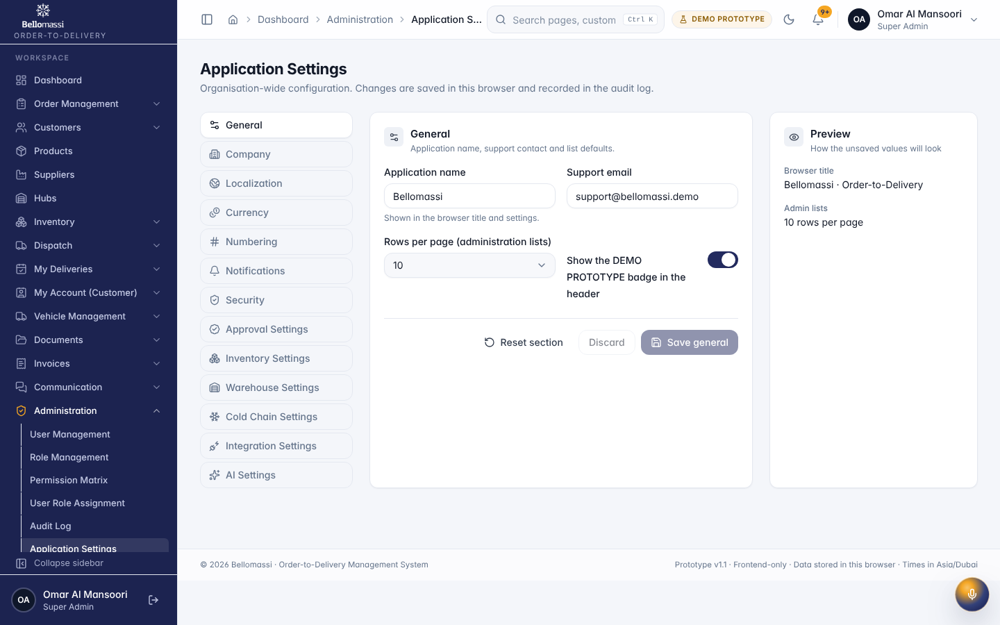{width=16cm}

## UX-COMPANY — Company

| Item | Value |
|---|---|
| Screen ID | SCR-156 |
| Route | `/admin/organization/company` (captured: `/admin/organization/company`) |
| Application | Office web app |
| Permission | organization.view |
| Captured as role | superadmin |
| Roles with access | SUPER_ADMIN, ADMIN |
| Purpose | Company name, logo, address, country, currency and tax registration number. |
| Page heading | Company |
| Sections | Identity; Address & contact; Country, currency & timezone; Tax & registration |
| Fields / filters | Company name*; Registered legal name*; Tagline; Address line 1*; Address line 2 / PO Box; City*; Emirate / region; Postal code; Phone; Email; Website; Country*; Base currency*; Timezone*; Tax number label; Tax registration number*; Trade licence number |
| Actions | Upload; Discard; Save company |
| Screen type | detail |
| Layout | Office layout: sidebar, header (breadcrumbs, search, notifications, profile), page header, content cards |
| Components | PageHeader with status Badge, InfoList, Tabs / Cards, Timeline, action Buttons, ConfirmDialog |
| Validation | Action pre-conditions checked by the service (status, permission, data scope); refusal message shown |
| Responsive behaviour | Sidebar fixed ≥ 1024 px, drawer below; grids collapse to one column; tables scroll horizontally inside the card |
| Empty state | Not found / access denied message for missing record |
| Loading state | Spinner / skeleton while data is read (prototype reads are near-instant from LocalStorage) |
| Error state | ErrorBoundary page; action refusals as error toast |
| Success state | Success toast after actions; badges and timeline update immediately |

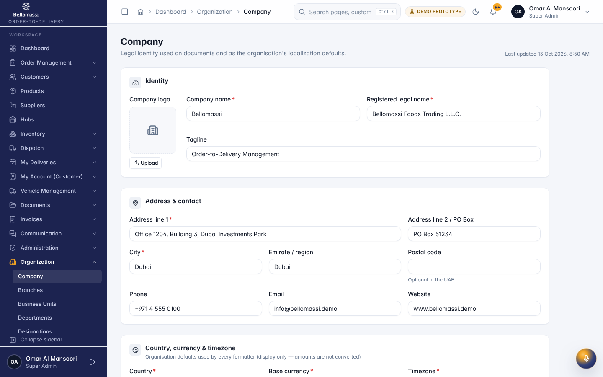{width=16cm}

## UX-CUSTOMERS — Customer List

| Item | Value |
|---|---|
| Screen ID | SCR-014 |
| Route | `/customers` (captured: `/customers`) |
| Application | Office web app |
| Permission | customers.view |
| Captured as role | superadmin |
| Roles with access | SUPER_ADMIN, ADMIN, SALESMAN, SALES_MANAGER, CUSTOMER_SERVICE |
| Purpose | Customer accounts with contacts, addresses, credit configuration and VIP passes. |
| Page heading | Customers |
| Fields / filters | Customer type; Status; VIP; Credit; Credit status; Assigned salesman |
| Table columns | CUSTOMER; TYPE; CITY; SALESMAN; CREDIT; STATUS; ACTIONS |
| Actions | Export CSV; CUSTOMER; TYPE; CITY; SALESMAN; CREDIT; STATUS; Actions for ABC Enterprises; Actions for Annapoorna Caterers; Actions for Charminar Foods; Actions for Chennai Industrial Supplies; Actions for Coastal Seafood Traders; Actions for Deccan Retail Mart; Actions for Global Distributors; Actions for Green Leaf Restaurants; Actions for Kaveri Supermarket; Actions for Kochi Hotel Supplies; Previous page; 1; 2; Next page |
| Screen type | list |
| Layout | Office layout: sidebar, header (breadcrumbs, search, notifications, profile), page header, content cards |
| Components | PageHeader, FilterToolbar, DataTable (sort, paging), Badge, RowActions, EmptyState |
| Validation | Filter inputs only |
| Responsive behaviour | Designed for 360–430 px; single column; bottom navigation |
| Empty state | EmptyState with explanation and call to action |
| Loading state | Spinner / skeleton while data is read (prototype reads are near-instant from LocalStorage) |
| Error state | ErrorBoundary page; action refusals as error toast |
| Success state | Data displayed with counts |

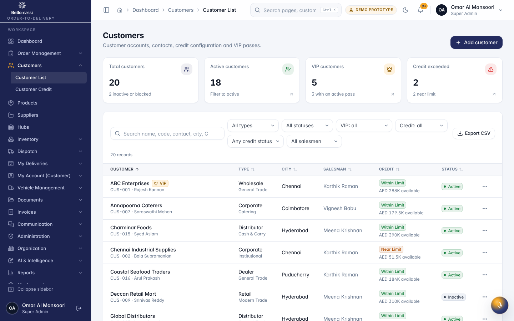{width=8cm}

## UX-CUSTOMER-DETAIL — Customer Details

| Item | Value |
|---|---|
| Screen ID | SCR-017 |
| Route | `/customers/:id` (captured: `/customers/c-001`) |
| Application | Office web app |
| Permission | customers.view |
| Captured as role | superadmin |
| Roles with access | SUPER_ADMIN, ADMIN, SALESMAN, SALES_MANAGER, CUSTOMER_SERVICE |
| Purpose | ABC Enterprises |
| Page heading | ABC Enterprises |
| Sections | Business information; Credit configuration; VIP; Order history; Activity timeline; Credit history |
| Table columns | ORDER; DATE; ITEMS; VALUE; STATUS |
| Actions | Back; Delete; Previous page; 1; 2; Next page |
| Screen type | list |
| Layout | Office layout: sidebar, header (breadcrumbs, search, notifications, profile), page header, content cards |
| Components | PageHeader, FilterToolbar, DataTable (sort, paging), Badge, RowActions, EmptyState |
| Validation | Filter inputs only |
| Responsive behaviour | Designed for 360–430 px; single column; bottom navigation |
| Empty state | EmptyState with explanation and call to action |
| Loading state | Spinner / skeleton while data is read (prototype reads are near-instant from LocalStorage) |
| Error state | ErrorBoundary page; action refusals as error toast |
| Success state | Data displayed with counts |

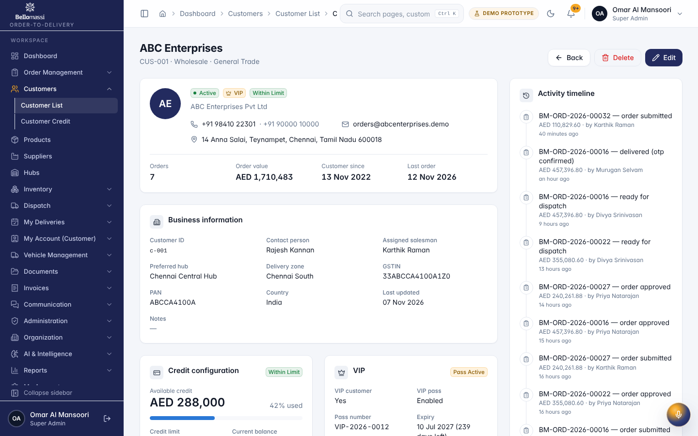{width=8cm}

## UX-CREDIT — Customer Credit

| Item | Value |
|---|---|
| Screen ID | SCR-015 |
| Route | `/customers/credit` (captured: `/customers/credit`) |
| Application | Office web app |
| Permission | customers.credit.view |
| Captured as role | superadmin |
| Roles with access | SUPER_ADMIN, ADMIN, SALES_MANAGER, FINANCE |
| Purpose | Credit limits, balances, available credit and credit status. |
| Page heading | Customer credit |
| Fields / filters | Credit status; Customer status; Salesman |
| Table columns | CUSTOMER; LIMIT; BALANCE; AVAILABLE; UTILISATION; DAYS; STATUS |
| Actions | Export CSV; CUSTOMER; LIMIT; BALANCE; AVAILABLE; UTILISATION; DAYS; STATUS; Previous page; 1; 2; Next page |
| Screen type | list |
| Layout | Office layout: sidebar, header (breadcrumbs, search, notifications, profile), page header, content cards |
| Components | PageHeader, FilterToolbar, DataTable (sort, paging), Badge, RowActions, EmptyState |
| Validation | Filter inputs only |
| Responsive behaviour | Sidebar fixed ≥ 1024 px, drawer below; grids collapse to one column; tables scroll horizontally inside the card |
| Empty state | EmptyState with explanation and call to action |
| Loading state | Spinner / skeleton while data is read (prototype reads are near-instant from LocalStorage) |
| Error state | ErrorBoundary page; action refusals as error toast |
| Success state | Data displayed with counts |

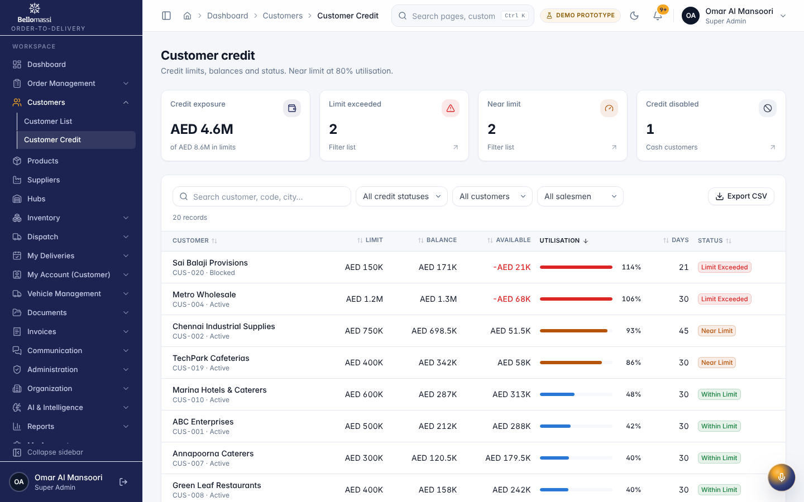{width=16cm}

## UX-PRODUCTS — Products

| Item | Value |
|---|---|
| Screen ID | SCR-019 |
| Route | `/products` (captured: `/products`) |
| Application | Office web app |
| Permission | products.view |
| Captured as role | superadmin |
| Roles with access | SUPER_ADMIN, ADMIN, SALESMAN, SALES_MANAGER, CUSTOMER_SERVICE, DISPATCHER, FINANCE, WAREHOUSE_MANAGER, INVENTORY_EXECUTIVE, QA_MANAGER |
| Purpose | Product catalogue with pricing, units and inventory rules. |
| Page heading | Products |
| Fields / filters | Category; Status; Inventory tracking |
| Table columns | PRODUCT; CATEGORY; UNIT; PRICE; AVAILABLE; STATUS; ACTIONS |
| Actions | Export CSV; PRODUCT; CATEGORY; UNIT; PRICE; AVAILABLE; STATUS; Actions for Aloo Tikki; Actions for Basa Fish Fillet; Actions for Cheddar Cheese Slices; Actions for Chicken Breast Boneless; Actions for Chicken Nuggets; Actions for Chicken Seekh Kebab; Actions for Chicken Wings; Actions for Doorstep Handling Charge; Actions for Fish Fingers; Actions for Food-Grade Nitrile Gloves; Previous page; 1; 2; 3; Next page |
| Screen type | list |
| Layout | Office layout: sidebar, header (breadcrumbs, search, notifications, profile), page header, content cards |
| Components | PageHeader, FilterToolbar, DataTable (sort, paging), Badge, RowActions, EmptyState |
| Validation | Filter inputs only |
| Responsive behaviour | Sidebar fixed ≥ 1024 px, drawer below; grids collapse to one column; tables scroll horizontally inside the card |
| Empty state | EmptyState with explanation and call to action |
| Loading state | Spinner / skeleton while data is read (prototype reads are near-instant from LocalStorage) |
| Error state | ErrorBoundary page; action refusals as error toast |
| Success state | Data displayed with counts |

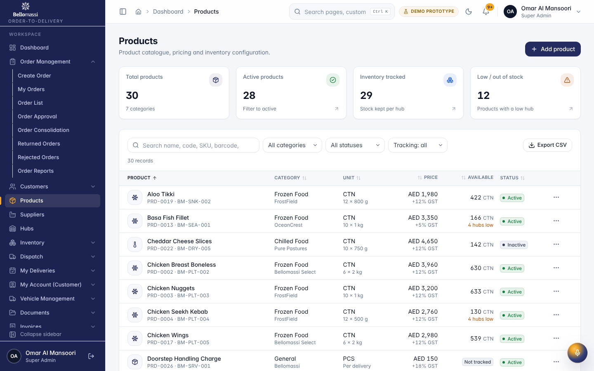{width=16cm}

## UX-HUBS — Hubs

| Item | Value |
|---|---|
| Screen ID | SCR-021 |
| Route | `/hubs` (captured: `/hubs`) |
| Application | Office web app |
| Permission | hubs.view |
| Captured as role | superadmin |
| Roles with access | SUPER_ADMIN, ADMIN, SALES_MANAGER, CUSTOMER_SERVICE, DISPATCHER, WAREHOUSE_MANAGER, INVENTORY_EXECUTIVE, QA_MANAGER |
| Purpose | Hubs and warehouses with managers, locations and stock valuation. |
| Page heading | Hubs |
| Fields / filters | Hub type; Status |
| Table columns | HUB; LOCATION; MANAGER; PRODUCTS; STOCK VALUE; LOW / OUT; STATUS; ACTIONS |
| Actions | Export CSV; HUB; LOCATION; MANAGER; PRODUCTS; STOCK VALUE; LOW / OUT; STATUS; Actions for Bangalore Hub; Actions for Chennai Central Hub; Actions for Coimbatore Hub; Actions for Hyderabad Hub; Actions for Madurai Hub; Actions for Trichy Branch Hub |
| Screen type | list |
| Layout | Office layout: sidebar, header (breadcrumbs, search, notifications, profile), page header, content cards |
| Components | PageHeader, FilterToolbar, DataTable (sort, paging), Badge, RowActions, EmptyState |
| Validation | Filter inputs only |
| Responsive behaviour | Sidebar fixed ≥ 1024 px, drawer below; grids collapse to one column; tables scroll horizontally inside the card |
| Empty state | EmptyState with explanation and call to action |
| Loading state | Spinner / skeleton while data is read (prototype reads are near-instant from LocalStorage) |
| Error state | ErrorBoundary page; action refusals as error toast |
| Success state | Data displayed with counts |

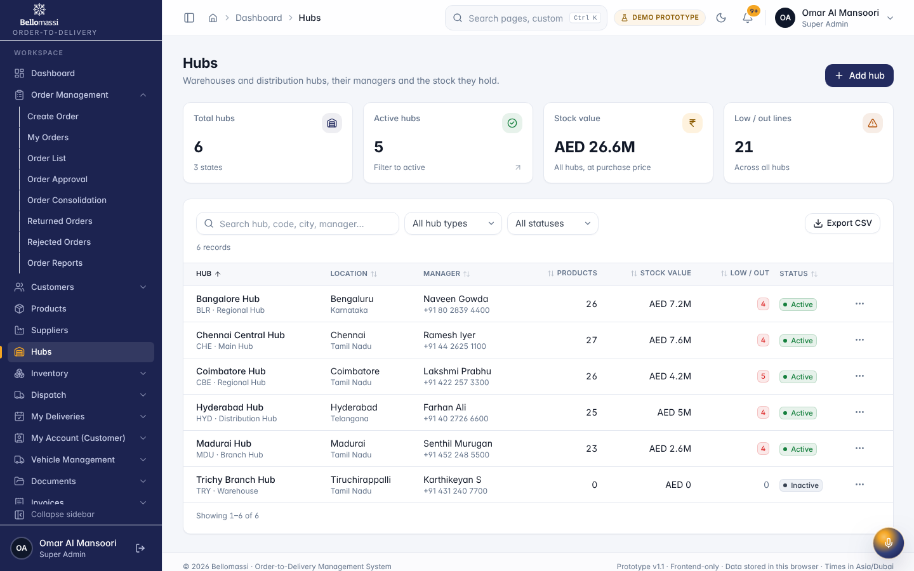{width=16cm}

## UX-SUPPLIERS — Suppliers

| Item | Value |
|---|---|
| Screen ID | SCR-020 |
| Route | `/suppliers` (captured: `/suppliers`) |
| Application | Office web app |
| Permission | suppliers.view |
| Captured as role | superadmin |
| Roles with access | SUPER_ADMIN, ADMIN, SALES_MANAGER, DISPATCHER, FINANCE, WAREHOUSE_MANAGER |
| Purpose | Supplier directory with lead times, minimum order values and replenishment history. |
| Page heading | Suppliers |
| Table columns | SUPPLIER; CATEGORIES; LEAD TIME; MIN ORDER; OPEN REQUESTS; REQUESTED VALUE; PORTAL USERS; EDIT |
| Actions | Export CSV; SUPPLIER; LEAD TIME; MIN ORDER; OPEN REQUESTS; REQUESTED VALUE; Edit |
| Screen type | list |
| Layout | Office layout: sidebar, header (breadcrumbs, search, notifications, profile), page header, content cards |
| Components | PageHeader, FilterToolbar, DataTable (sort, paging), Badge, RowActions, EmptyState |
| Validation | Filter inputs only |
| Responsive behaviour | Sidebar fixed ≥ 1024 px, drawer below; grids collapse to one column; tables scroll horizontally inside the card |
| Empty state | EmptyState with explanation and call to action |
| Loading state | Spinner / skeleton while data is read (prototype reads are near-instant from LocalStorage) |
| Error state | ErrorBoundary page; action refusals as error toast |
| Success state | Data displayed with counts |

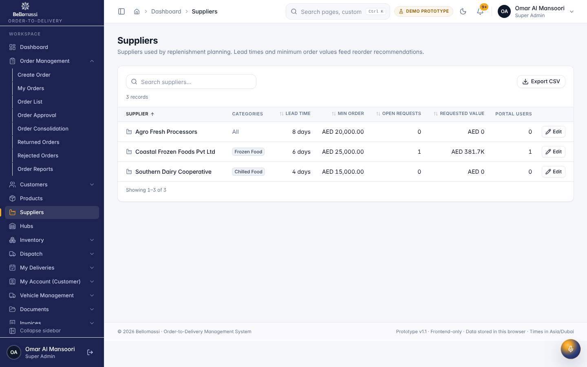{width=16cm}

## UX-ORDERS — Order List

| Item | Value |
|---|---|
| Screen ID | SCR-004 |
| Route | `/orders` (captured: `/orders`) |
| Application | Office web app |
| Permission | orders.view |
| Captured as role | superadmin |
| Roles with access | SUPER_ADMIN, ADMIN, SALESMAN, SALES_MANAGER, CUSTOMER_SERVICE, DISPATCHER, FINANCE, WAREHOUSE_MANAGER |
| Purpose | Every order with its live status, full history, search, filters and export. |
| Page heading | Orders |
| Fields / filters | Order status; Approval status; Customer; Salesman; Hub; Priority; From order date; To order date |
| Table columns | ORDER; CUSTOMER; SALESMAN; HUB; QTY; TOTAL; STATUS; APPROVAL; PRIORITY; DELIVERY; CREATED; ACTIONS |
| Actions | Export CSV; ORDER; CUSTOMER; SALESMAN; HUB; QTY; TOTAL; STATUS; APPROVAL; PRIORITY; DELIVERY; CREATED; Actions for BM-ORD-2026-00031; Actions for draft order; Actions for BM-ORD-2026-00034; Actions for BM-ORD-2026-00032; Actions for BM-ORD-2026-00033; Actions for BM-ORD-2026-00029; Actions for BM-ORD-2026-00030; Actions for BM-ORD-2026-00038; Actions for BM-ORD-2026-00035; Actions for BM-ORD-2026-00027; Actions for BM-ORD-2026-00017; Previous page; 1 |
| Screen type | list |
| Layout | Office layout: sidebar, header (breadcrumbs, search, notifications, profile), page header, content cards |
| Components | PageHeader, FilterToolbar, DataTable (sort, paging), Badge, RowActions, EmptyState |
| Validation | Filter inputs only |
| Responsive behaviour | Sidebar fixed ≥ 1024 px, drawer below; grids collapse to one column; tables scroll horizontally inside the card |
| Empty state | EmptyState with explanation and call to action |
| Loading state | Spinner / skeleton while data is read (prototype reads are near-instant from LocalStorage) |
| Error state | ErrorBoundary page; action refusals as error toast |
| Success state | Data displayed with counts |

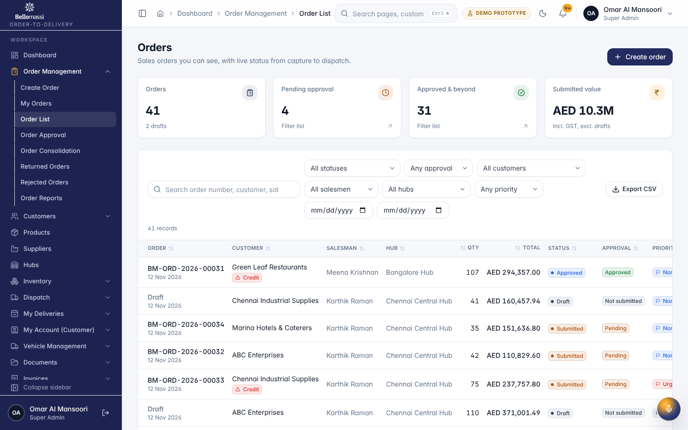{width=16cm}

## UX-ORDER-DETAIL — Order Details

| Item | Value |
|---|---|
| Screen ID | SCR-013 |
| Route | `/orders/:id` (captured: `/orders/ord-0001`) |
| Application | Office web app |
| Permission | orders.view |
| Captured as role | superadmin |
| Roles with access | SUPER_ADMIN, ADMIN, SALESMAN, SALES_MANAGER, CUSTOMER_SERVICE, DISPATCHER, FINANCE, WAREHOUSE_MANAGER |
| Purpose | BM-ORD-2026-00001 |
| Page heading | BM-ORD-2026-00001 |
| Sections | Products; Delivery; Order details; Approval; Consolidation; Dispatch & delivery; Customer & credit; Salesman; Fulfilment hub |
| Table columns | PRODUCT; QTY; UNIT PRICE; DISC.; GST; LINE TOTAL |
| Tabs | Overview; Timeline (8); Approval history (1); Consolidation |
| Actions | Back; Duplicate; Overview; Timeline (8); Approval history (1); Consolidation |
| Screen type | list |
| Layout | Office layout: sidebar, header (breadcrumbs, search, notifications, profile), page header, content cards |
| Components | PageHeader, FilterToolbar, DataTable (sort, paging), Badge, RowActions, EmptyState |
| Validation | Filter inputs only |
| Responsive behaviour | Sidebar fixed ≥ 1024 px, drawer below; grids collapse to one column; tables scroll horizontally inside the card |
| Empty state | EmptyState with explanation and call to action |
| Loading state | Spinner / skeleton while data is read (prototype reads are near-instant from LocalStorage) |
| Error state | ErrorBoundary page; action refusals as error toast |
| Success state | Data displayed with counts |

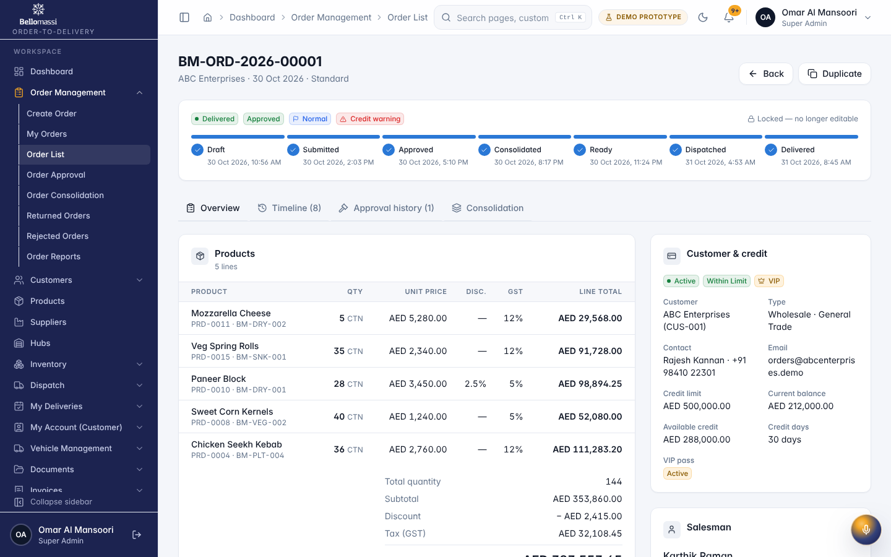{width=16cm}

## UX-REPORTS — Reports Center

| Item | Value |
|---|---|
| Screen ID | SCR-185 |
| Route | `/reports/center` (captured: `/reports/center`) |
| Application | Office web app |
| Permission | reports.center |
| Captured as role | superadmin |
| Roles with access | SUPER_ADMIN, ADMIN, SALESMAN, SALES_MANAGER, CUSTOMER_SERVICE, DISPATCHER, FINANCE, WAREHOUSE_MANAGER, INVENTORY_EXECUTIVE, QA_MANAGER |
| Purpose | Every report in one place — sales, inventory, procurement, delivery, finance, customers, suppliers, fleet, calls, scrap and AI — with filters, charts and CSV. |
| Page heading | Reports Center |
| Sections | Favourites; Recently viewed; Popular; Sales Order Register; Sales Order Summary; Sales by Customer; Sales by Salesman; Sales by Product; Sales by Category; Sales by Month; Sales Order Status; Pending Approval; Rejected Orders; Credit Limit Exceptions; Order Conversion; Customer Sales Analysis; VIP Orders; Stock Overview |
| Fields / filters | Category |
| Actions | 118 All reports; 14 Sales; 18 Inventory; 10 Procurement; 19 Dispatch & Delivery; 14 Finance; 8 Customer; 5 Supplier; 9 Fleet; 7 Communication; 7 Scrap; 7 AI; Favourites only; Add Sales Order Register to favourites; Add Sales Order Summary to favourites; Add Sales by Customer to favourites; Add Sales by Salesman to favourites; Add Sales by Product to favourites; Add Sales by Category to favourites; Add Sales by Month to favourites; Add Sales Order Status to favourites; Add Pending Approval to favourites; Add Rejected Orders to favourites; Add Credit Limit Exceptions to favourites; Add Order Conversion to favourites |
| Screen type | detail |
| Layout | Office layout: sidebar, header (breadcrumbs, search, notifications, profile), page header, content cards |
| Components | PageHeader with status Badge, InfoList, Tabs / Cards, Timeline, action Buttons, ConfirmDialog |
| Validation | Action pre-conditions checked by the service (status, permission, data scope); refusal message shown |
| Responsive behaviour | Sidebar fixed ≥ 1024 px, drawer below; grids collapse to one column; tables scroll horizontally inside the card |
| Empty state | Not found / access denied message for missing record |
| Loading state | Spinner / skeleton while data is read (prototype reads are near-instant from LocalStorage) |
| Error state | ErrorBoundary page; action refusals as error toast |
| Success state | Success toast after actions; badges and timeline update immediately |

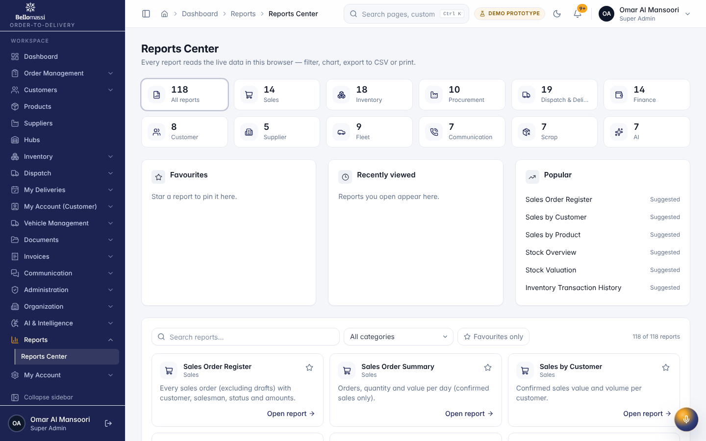{width=16cm}

## UX-INVENTORY — Inventory Dashboard

| Item | Value |
|---|---|
| Screen ID | SCR-022 |
| Route | `/inventory` (captured: `/inventory`) |
| Application | Office web app |
| Permission | inventory.dashboard |
| Captured as role | superadmin |
| Roles with access | SUPER_ADMIN, ADMIN, DISPATCHER, FINANCE, WAREHOUSE_MANAGER, INVENTORY_EXECUTIVE |
| Purpose | Stock quantity, value, low-stock alerts and recent movements across all hubs. |
| Page heading | Inventory |
| Sections | Stock by hub; Inventory by category; Low stock overview; Low stock products; Hub stock summary; Recent stock movements |
| Table columns | PRODUCT; AVAILABLE; REORDER AT; STATUS; HUB; PRODUCTS; ON HAND; DAMAGED; VALUE; LOW / OUT; DATE; TYPE; QTY; REFERENCE; BY |
| Screen type | dashboard |
| Layout | Office layout: sidebar, header (breadcrumbs, search, notifications, profile), page header, content cards |
| Components | Period filter, KPI cards, charts (Recharts), queue tables, quick links |
| Validation | Period filter: valid date range |
| Responsive behaviour | Sidebar fixed ≥ 1024 px, drawer below; grids collapse to one column; tables scroll horizontally inside the card |
| Empty state | EmptyState with explanation and call to action |
| Loading state | Spinner / skeleton while data is read (prototype reads are near-instant from LocalStorage) |
| Error state | ErrorBoundary page; action refusals as error toast |
| Success state | Data displayed with counts |

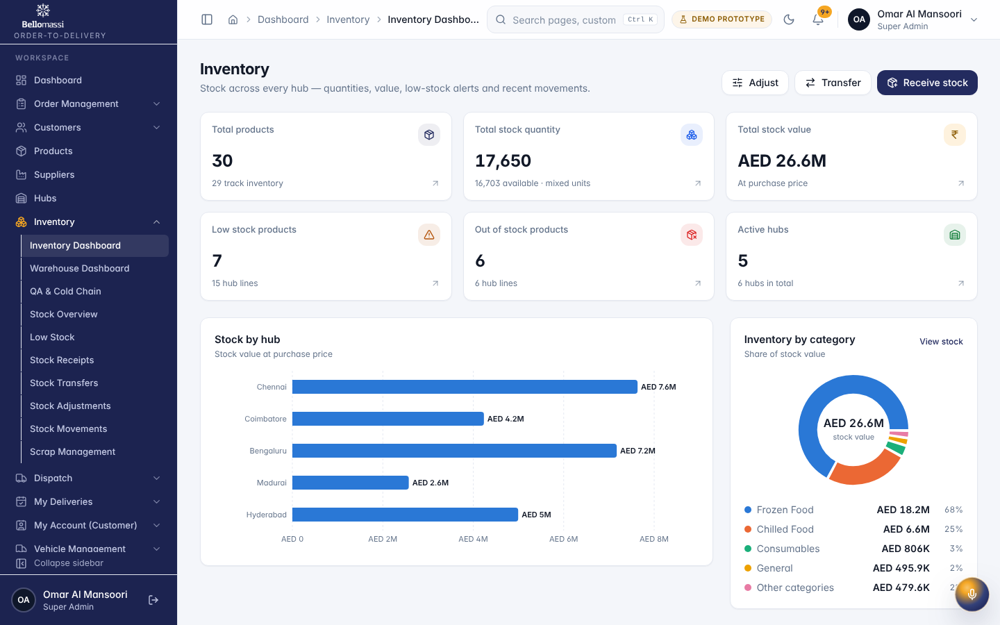{width=16cm}

## UX-STOCK — Stock Overview

| Item | Value |
|---|---|
| Screen ID | SCR-025 |
| Route | `/inventory/stock` (captured: `/inventory/stock`) |
| Application | Office web app |
| Permission | inventory.stock.view |
| Captured as role | superadmin |
| Roles with access | SUPER_ADMIN, ADMIN, SALESMAN, SALES_MANAGER, CUSTOMER_SERVICE, DISPATCHER, FINANCE, WAREHOUSE_MANAGER, INVENTORY_EXECUTIVE, QA_MANAGER |
| Purpose | Hub-wise stock: total, reserved, damaged and available quantities. |
| Page heading | Stock overview |
| Fields / filters | Product; Hub; Category; Stock status |
| Table columns | CODE; PRODUCT; HUB; TOTAL; RESERVED; DAMAGED; AVAILABLE; REORDER; STATUS; UPDATED |
| Actions | By hub line; By product; Export CSV; CODE; PRODUCT; HUB; TOTAL; RESERVED; DAMAGED; AVAILABLE; REORDER; STATUS; UPDATED; Previous page; 1; 2; 11; Next page |
| Screen type | list |
| Layout | Office layout: sidebar, header (breadcrumbs, search, notifications, profile), page header, content cards |
| Components | PageHeader, FilterToolbar, DataTable (sort, paging), Badge, RowActions, EmptyState |
| Validation | Filter inputs only |
| Responsive behaviour | Sidebar fixed ≥ 1024 px, drawer below; grids collapse to one column; tables scroll horizontally inside the card |
| Empty state | EmptyState with explanation and call to action |
| Loading state | Spinner / skeleton while data is read (prototype reads are near-instant from LocalStorage) |
| Error state | ErrorBoundary page; action refusals as error toast |
| Success state | Data displayed with counts |

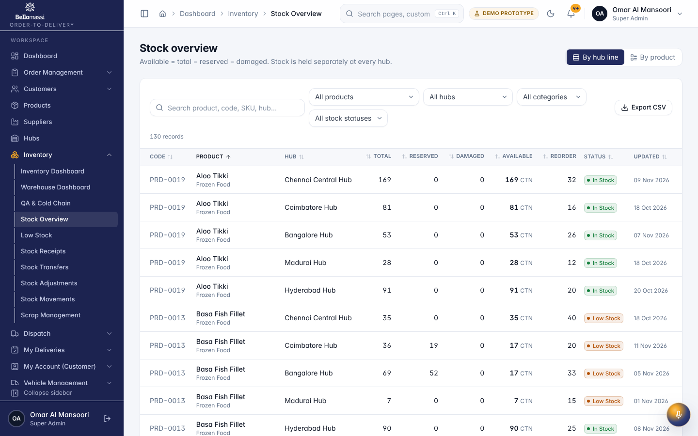{width=16cm}

## UX-MOVEMENTS — Stock Movements

| Item | Value |
|---|---|
| Screen ID | SCR-030 |
| Route | `/inventory/movements` (captured: `/inventory/movements`) |
| Application | Office web app |
| Permission | inventory.movements.view |
| Captured as role | superadmin |
| Roles with access | SUPER_ADMIN, ADMIN, DISPATCHER, WAREHOUSE_MANAGER, INVENTORY_EXECUTIVE, QA_MANAGER |
| Purpose | The read-only stock ledger with every movement. |
| Page heading | Stock movements |
| Fields / filters | Movement type; Hub; Product; From date; To date |
| Table columns | DATE; PRODUCT; HUB; TYPE; QTY; AVAILABLE; REFERENCE; BY |
| Actions | Export CSV; DATE; PRODUCT; HUB; TYPE; QTY; REFERENCE; Previous page; 1; 2; 5; Next page |
| Screen type | list |
| Layout | Office layout: sidebar, header (breadcrumbs, search, notifications, profile), page header, content cards |
| Components | PageHeader, FilterToolbar, DataTable (sort, paging), Badge, RowActions, EmptyState |
| Validation | Filter inputs only |
| Responsive behaviour | Sidebar fixed ≥ 1024 px, drawer below; grids collapse to one column; tables scroll horizontally inside the card |
| Empty state | EmptyState with explanation and call to action |
| Loading state | Spinner / skeleton while data is read (prototype reads are near-instant from LocalStorage) |
| Error state | ErrorBoundary page; action refusals as error toast |
| Success state | Data displayed with counts |

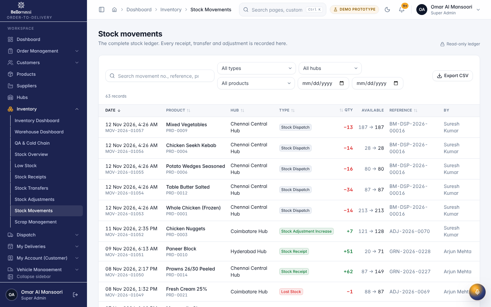{width=16cm}

## UX-SCRAP — Scrap Requests

| Item | Value |
|---|---|
| Screen ID | SCR-032 |
| Route | `/inventory/scrap/requests` (captured: `/inventory/scrap/requests`) |
| Application | Office web app |
| Permission | inventory.scrap.view |
| Captured as role | superadmin |
| Roles with access | SUPER_ADMIN, ADMIN, DISPATCHER, WAREHOUSE_MANAGER, INVENTORY_EXECUTIVE, QA_MANAGER |
| Purpose | Scrap Requests |
| Page heading | Scrap Requests |
| Fields / filters | Status; Approval; Reason; Hub; Warehouse; Product; Requested by; From date; To date |
| Table columns | SCRAP NO.; DATE; PRODUCT; HUB; QTY; VALUE; REASON; REQUESTED BY; STATUS; ACTIONS |
| Actions | Print; Export CSV; SCRAP NO.; DATE; PRODUCT; HUB; QTY; VALUE; REASON; REQUESTED BY; STATUS; Actions for SCR-2026-0012; Actions for SCR-2026-0011; Actions for SCR-2026-0010; Actions for SCR-2026-0009; Actions for SCR-2026-0008; Actions for SCR-2026-0007; Actions for SCR-2026-0006; Actions for SCR-2026-0005; Actions for SCR-2026-0004; Actions for SCR-2026-0003; Actions for SCR-2026-0002; Actions for SCR-2026-0001 |
| Screen type | list |
| Layout | Office layout: sidebar, header (breadcrumbs, search, notifications, profile), page header, content cards |
| Components | PageHeader, FilterToolbar, DataTable (sort, paging), Badge, RowActions, EmptyState |
| Validation | Filter inputs only |
| Responsive behaviour | Sidebar fixed ≥ 1024 px, drawer below; grids collapse to one column; tables scroll horizontally inside the card |
| Empty state | EmptyState with explanation and call to action |
| Loading state | Spinner / skeleton while data is read (prototype reads are near-instant from LocalStorage) |
| Error state | ErrorBoundary page; action refusals as error toast |
| Success state | Data displayed with counts |

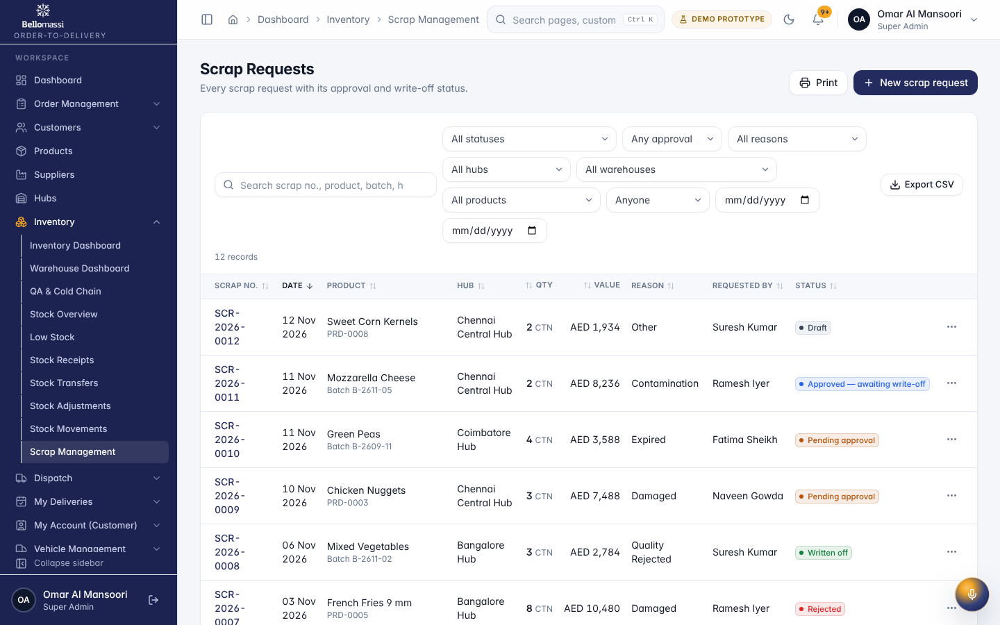{width=16cm}

## UX-WAREHOUSE — Warehouse Dashboard

| Item | Value |
|---|---|
| Screen ID | SCR-023 |
| Route | `/warehouse` (captured: `/warehouse`) |
| Application | Office web app |
| Permission | warehouse.dashboard |
| Captured as role | superadmin |
| Roles with access | SUPER_ADMIN, ADMIN, WAREHOUSE_MANAGER, INVENTORY_EXECUTIVE, QA_MANAGER |
| Purpose | Receiving, stock, picking readiness, expiry and inventory alerts per hub. |
| Page heading | Warehouse Dashboard |
| Sections | Inventory alerts; Quick actions; Receiving; Picking & loading; Expiry |
| Fields / filters | Hub |
| Table columns | PRODUCT; HUB; AVAILABLE; REORDER AT; STATUS; RECEIPT; QTY; DATE; ORDER; CUSTOMER; UNITS; OWNER; DOCUMENT; EXPIRY; STATE |
| Screen type | dashboard |
| Layout | Office layout: sidebar, header (breadcrumbs, search, notifications, profile), page header, content cards |
| Components | Period filter, KPI cards, charts (Recharts), queue tables, quick links |
| Validation | Period filter: valid date range |
| Responsive behaviour | Sidebar fixed ≥ 1024 px, drawer below; grids collapse to one column; tables scroll horizontally inside the card |
| Empty state | EmptyState with explanation and call to action |
| Loading state | Spinner / skeleton while data is read (prototype reads are near-instant from LocalStorage) |
| Error state | ErrorBoundary page; action refusals as error toast |
| Success state | Data displayed with counts |

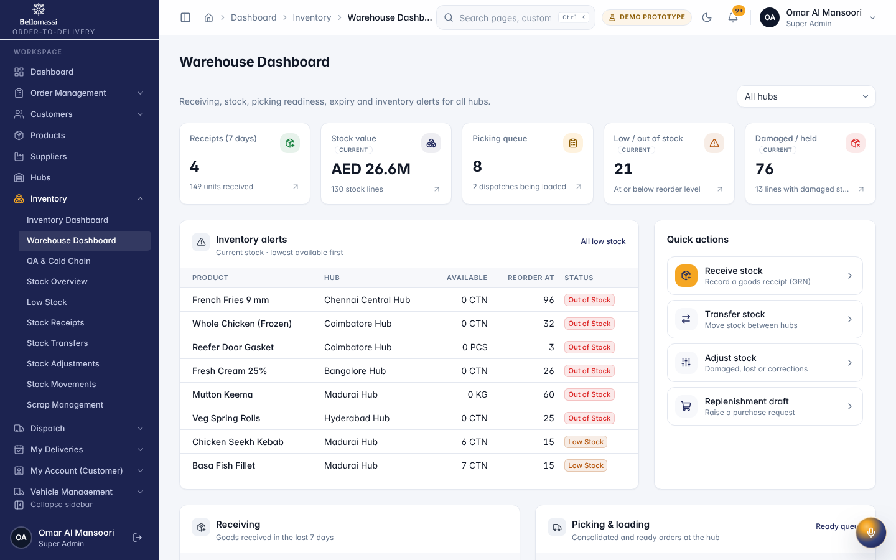{width=16cm}

## UX-QUALITY — QA & Cold Chain

| Item | Value |
|---|---|
| Screen ID | SCR-024 |
| Route | `/quality` (captured: `/quality`) |
| Application | Office web app |
| Permission | warehouse.qa.view |
| Captured as role | superadmin |
| Roles with access | SUPER_ADMIN, ADMIN, WAREHOUSE_MANAGER, QA_MANAGER |
| Purpose | Inspection queue, quarantined stock, document expiry and cold-chain ranges. |
| Page heading | QA & Cold Chain |
| Sections | Inspection queue; Quick actions; Quarantine; Expiry; Cold chain & temperature alerts |
| Table columns | DOCUMENT; TYPE; LINKED TO; UPLOADED; PRODUCT; HUB; DAMAGED; OWNER; EXPIRY; STATE |
| Screen type | dashboard |
| Layout | Office layout: sidebar, header (breadcrumbs, search, notifications, profile), page header, content cards |
| Components | Period filter, KPI cards, charts (Recharts), queue tables, quick links |
| Validation | Period filter: valid date range |
| Responsive behaviour | Sidebar fixed ≥ 1024 px, drawer below; grids collapse to one column; tables scroll horizontally inside the card |
| Empty state | EmptyState with explanation and call to action |
| Loading state | Spinner / skeleton while data is read (prototype reads are near-instant from LocalStorage) |
| Error state | ErrorBoundary page; action refusals as error toast |
| Success state | Data displayed with counts |

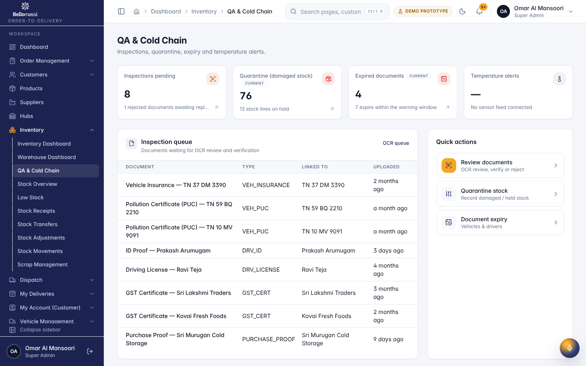{width=16cm}

## UX-VMS — VMS Dashboard

| Item | Value |
|---|---|
| Screen ID | SCR-087 |
| Route | `/vms` (captured: `/vms`) |
| Application | Office web app |
| Permission | vms.view |
| Captured as role | superadmin |
| Roles with access | SUPER_ADMIN, ADMIN, DISPATCHER, QA_MANAGER |
| Purpose | Fleet status, compliance and document expiry. |
| Page heading | Vehicle Management |
| Sections | Vehicle status; Vehicle type; Hub-wise vehicles; Vehicle document expiry; Driver document expiry; Expiry alerts; Document verification; Vehicle availability; Recent vehicle activity |
| Screen type | dashboard |
| Layout | Office layout: sidebar, header (breadcrumbs, search, notifications, profile), page header, content cards |
| Components | Period filter, KPI cards, charts (Recharts), queue tables, quick links |
| Validation | Period filter: valid date range |
| Responsive behaviour | Sidebar fixed ≥ 1024 px, drawer below; grids collapse to one column; tables scroll horizontally inside the card |
| Empty state | EmptyState with explanation and call to action |
| Loading state | Spinner / skeleton while data is read (prototype reads are near-instant from LocalStorage) |
| Error state | ErrorBoundary page; action refusals as error toast |
| Success state | Data displayed with counts |

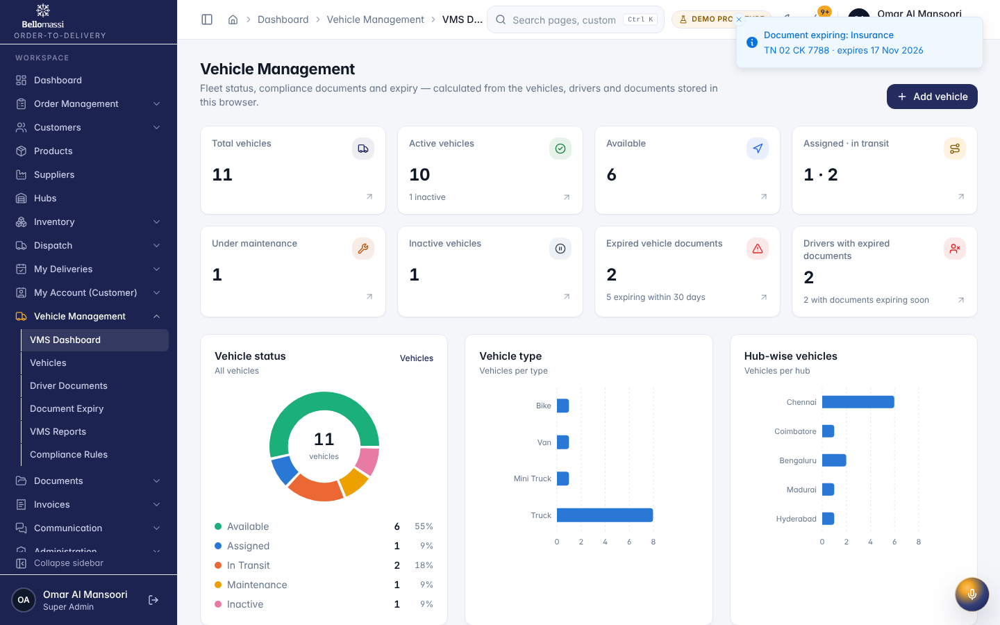{width=16cm}

## UX-VMS-EXPIRY — Document Expiry

| Item | Value |
|---|---|
| Screen ID | SCR-090 |
| Route | `/vms/document-expiry` (captured: `/vms/document-expiry`) |
| Application | Office web app |
| Permission | vms.view |
| Captured as role | superadmin |
| Roles with access | SUPER_ADMIN, ADMIN, DISPATCHER, QA_MANAGER |
| Purpose | Expired and expiring vehicle and driver documents. |
| Page heading | Document expiry |
| Fields / filters | Expiry state; Hub; Required |
| Table columns | VEHICLE; DOCUMENT; EXPIRY DATE; STATE |
| Tabs | Vehicle documents; Driver documents |
| Actions | Send expiry alerts; Vehicle documents; Driver documents; Export CSV; Previous page; 1; 2; 4; Next page |
| Screen type | list |
| Layout | Office layout: sidebar, header (breadcrumbs, search, notifications, profile), page header, content cards |
| Components | PageHeader, FilterToolbar, DataTable (sort, paging), Badge, RowActions, EmptyState |
| Validation | Filter inputs only |
| Responsive behaviour | Sidebar fixed ≥ 1024 px, drawer below; grids collapse to one column; tables scroll horizontally inside the card |
| Empty state | EmptyState with explanation and call to action |
| Loading state | Spinner / skeleton while data is read (prototype reads are near-instant from LocalStorage) |
| Error state | ErrorBoundary page; action refusals as error toast |
| Success state | Data displayed with counts |

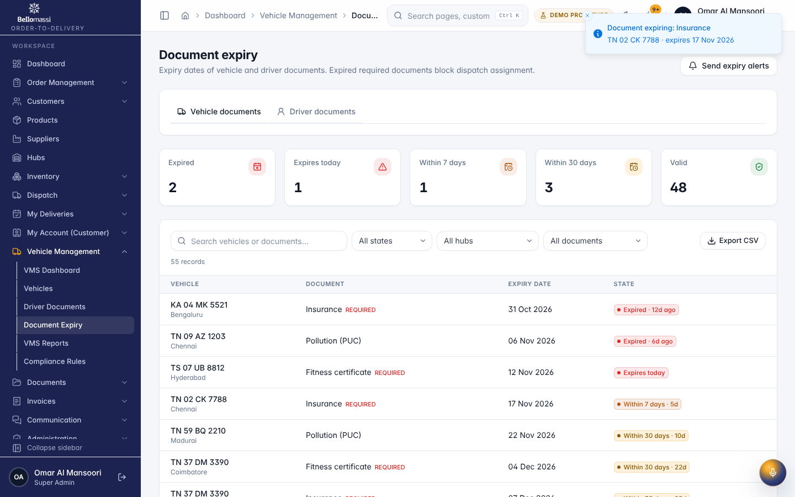{width=16cm}

## UX-DOCUMENTS — Document Repository

| Item | Value |
|---|---|
| Screen ID | SCR-098 |
| Route | `/documents` (captured: `/documents`) |
| Application | Office web app |
| Permission | documents.view |
| Captured as role | superadmin |
| Roles with access | SUPER_ADMIN, ADMIN, SALESMAN, SALES_MANAGER, CUSTOMER_SERVICE, DISPATCHER, FINANCE, WAREHOUSE_MANAGER, INVENTORY_EXECUTIVE, QA_MANAGER |
| Purpose | All proofs and documents with OCR review and verification. |
| Page heading | Document repository |
| Fields / filters | Document type; Entity; Status; Expiry; Uploaded from; Uploaded to |
| Table columns | DOCUMENT; RELATED TO; EXPIRY; OCR; STATUS; UPLOADED |
| Tabs | All; OCR queue; Verified; Rejected |
| Actions | All; OCR queue; Verified; Rejected; Export CSV; Actions for ID Proof — Prakash Arumugam; Actions for Purchase Proof — Sri Murugan Cold Storage; Actions for Delivery Proof — BM-DN-2026-00004; Actions for Delivery Proof — BM-DN-2026-00003; Actions for Delivery Proof — BM-DN-2026-00002; Actions for Delivery Proof — BM-DN-2026-00001; Actions for Pollution Certificate (PUC) — TN 22 BK 0077; Actions for Pollution Certificate (PUC) — TN 01 RX 3344; Actions for Pollution Certificate (PUC) — TN 10 MV 9091; Actions for Pollution Certificate (PUC) — KA 01 HN 6604; Actions for Pollution Certificate (PUC) — TN 59 BQ 2210; Actions for Pollution Certificate (PUC) — TS 07 UB 8812; Previous page; 1; 2; 6; Next page |
| Screen type | list |
| Layout | Office layout: sidebar, header (breadcrumbs, search, notifications, profile), page header, content cards |
| Components | PageHeader, FilterToolbar, DataTable (sort, paging), Badge, RowActions, EmptyState |
| Validation | Filter inputs only |
| Responsive behaviour | Sidebar fixed ≥ 1024 px, drawer below; grids collapse to one column; tables scroll horizontally inside the card |
| Empty state | EmptyState with explanation and call to action |
| Loading state | Spinner / skeleton while data is read (prototype reads are near-instant from LocalStorage) |
| Error state | ErrorBoundary page; action refusals as error toast |
| Success state | Data displayed with counts |

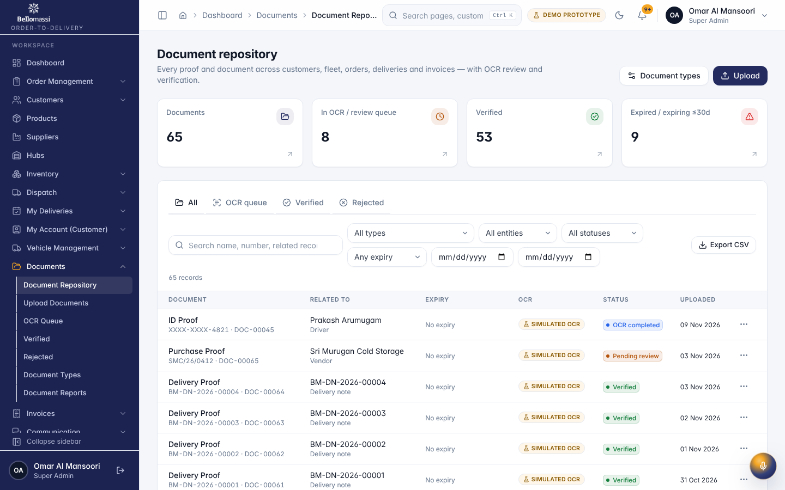{width=16cm}

## UX-OCR — OCR Queue

| Item | Value |
|---|---|
| Screen ID | SCR-100 |
| Route | `/documents/ocr-queue` (captured: `/documents/ocr-queue`) |
| Application | Office web app |
| Permission | documents.view |
| Captured as role | superadmin |
| Roles with access | SUPER_ADMIN, ADMIN, SALESMAN, SALES_MANAGER, CUSTOMER_SERVICE, DISPATCHER, FINANCE, WAREHOUSE_MANAGER, INVENTORY_EXECUTIVE, QA_MANAGER |
| Purpose | Documents waiting for OCR or review. |
| Page heading | OCR queue |
| Fields / filters | Document type; Entity; Expiry; Uploaded from; Uploaded to |
| Table columns | DOCUMENT; RELATED TO; EXPIRY; OCR; STATUS; UPLOADED |
| Tabs | All; OCR queue; Verified; Rejected |
| Actions | All; OCR queue; Verified; Rejected; Export CSV; Actions for ID Proof — Prakash Arumugam; Actions for Purchase Proof — Sri Murugan Cold Storage; Actions for Pollution Certificate (PUC) — TN 10 MV 9091; Actions for Pollution Certificate (PUC) — TN 59 BQ 2210; Actions for GST Certificate — Kovai Fresh Foods; Actions for Vehicle Insurance — TN 37 DM 3390; Actions for GST Certificate — Sri Lakshmi Traders; Actions for Driving License — Ravi Teja |
| Screen type | list |
| Layout | Office layout: sidebar, header (breadcrumbs, search, notifications, profile), page header, content cards |
| Components | PageHeader, FilterToolbar, DataTable (sort, paging), Badge, RowActions, EmptyState |
| Validation | Filter inputs only |
| Responsive behaviour | Sidebar fixed ≥ 1024 px, drawer below; grids collapse to one column; tables scroll horizontally inside the card |
| Empty state | EmptyState with explanation and call to action |
| Loading state | Spinner / skeleton while data is read (prototype reads are near-instant from LocalStorage) |
| Error state | ErrorBoundary page; action refusals as error toast |
| Success state | Data displayed with counts |

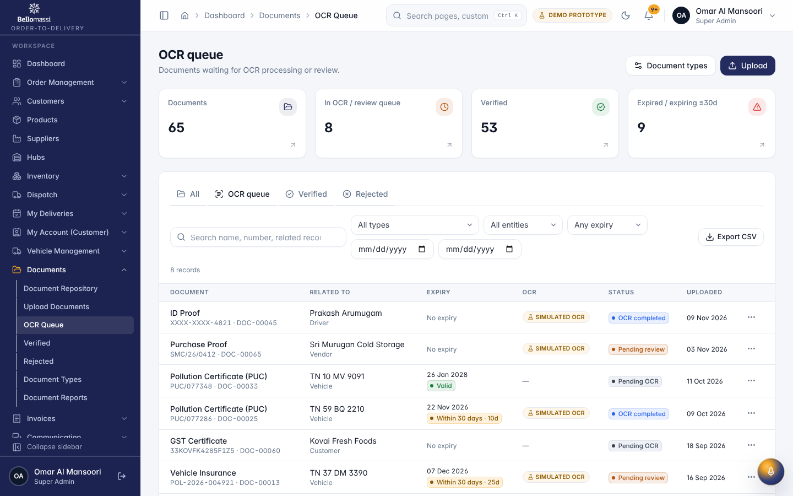{width=16cm}

## UX-INVOICES — Invoices

| Item | Value |
|---|---|
| Screen ID | SCR-110 |
| Route | `/invoices` (captured: `/invoices`) |
| Application | Office web app |
| Permission | invoices.view |
| Captured as role | superadmin |
| Roles with access | SUPER_ADMIN, ADMIN, SALES_MANAGER, FINANCE |
| Purpose | Issued and cancelled invoices. |
| Page heading | Invoices |
| Fields / filters | Status; Customer; Hub; From; To |
| Table columns | INVOICE; CUSTOMER; ORDER; DELIVERY NOTE; TOTAL; STATUS |
| Actions | Export CSV |
| Screen type | list |
| Layout | Office layout: sidebar, header (breadcrumbs, search, notifications, profile), page header, content cards |
| Components | PageHeader, FilterToolbar, DataTable (sort, paging), Badge, RowActions, EmptyState |
| Validation | Filter inputs only |
| Responsive behaviour | Sidebar fixed ≥ 1024 px, drawer below; grids collapse to one column; tables scroll horizontally inside the card |
| Empty state | EmptyState with explanation and call to action |
| Loading state | Spinner / skeleton while data is read (prototype reads are near-instant from LocalStorage) |
| Error state | ErrorBoundary page; action refusals as error toast |
| Success state | Data displayed with counts |

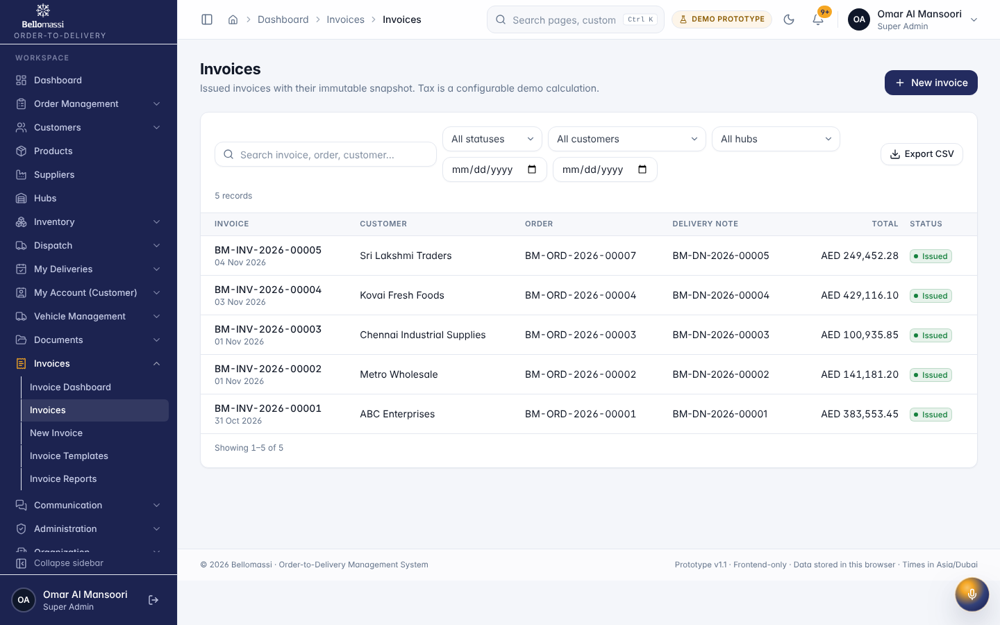{width=16cm}

## UX-INVOICE-TPL — Invoice Templates

| Item | Value |
|---|---|
| Screen ID | SCR-112 |
| Route | `/invoices/templates` (captured: `/invoices/templates`) |
| Application | Office web app |
| Permission | invoices.templates |
| Captured as role | superadmin |
| Roles with access | SUPER_ADMIN, ADMIN, FINANCE |
| Purpose | Template builder and invoice numbering. |
| Page heading | Invoice templates |
| Sections | Invoice numbering |
| Fields / filters | Prefix; Year; Starting number; Digits; Include year |
| Table columns | TEMPLATE; PAGE; COLOURS; USED BY; STATUS |
| Actions | Actions for Standard invoice; Actions for Compact (no SKU / description); Actions for Landscape — banner header; Save numbering |
| Screen type | list |
| Layout | Office layout: sidebar, header (breadcrumbs, search, notifications, profile), page header, content cards |
| Components | PageHeader, FilterToolbar, DataTable (sort, paging), Badge, RowActions, EmptyState |
| Validation | Filter inputs only |
| Responsive behaviour | Sidebar fixed ≥ 1024 px, drawer below; grids collapse to one column; tables scroll horizontally inside the card |
| Empty state | EmptyState with explanation and call to action |
| Loading state | Spinner / skeleton while data is read (prototype reads are near-instant from LocalStorage) |
| Error state | ErrorBoundary page; action refusals as error toast |
| Success state | Data displayed with counts |

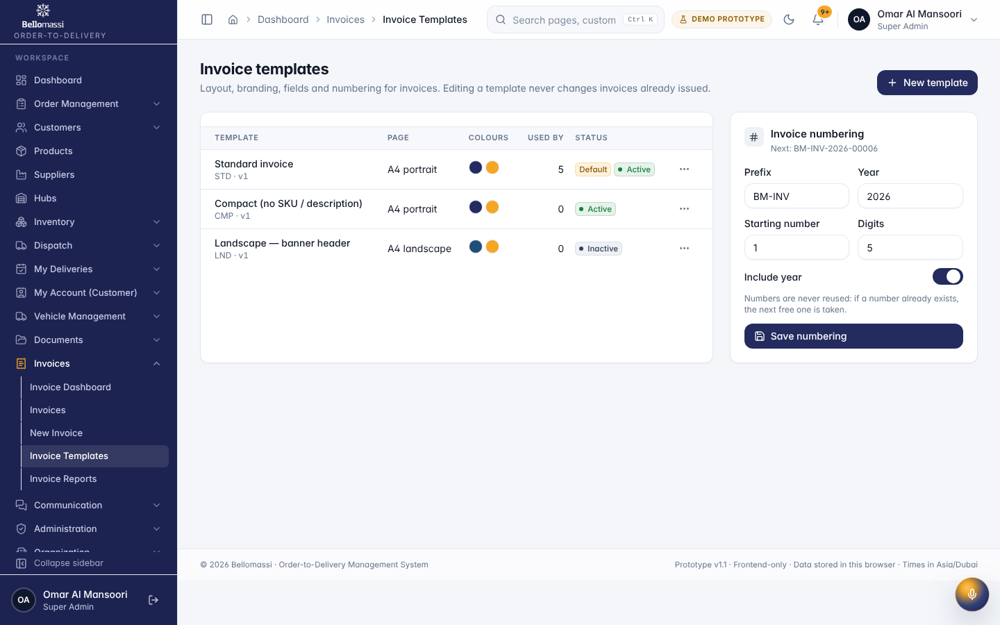{width=16cm}

## UX-EMAIL — Email

| Item | Value |
|---|---|
| Screen ID | SCR-120 |
| Route | `/communication/email` (captured: `/communication/email`) |
| Application | Office web app |
| Permission | communication.view |
| Captured as role | superadmin |
| Roles with access | SUPER_ADMIN, ADMIN, SALESMAN, SALES_MANAGER, CUSTOMER_SERVICE, DISPATCHER, FINANCE |
| Purpose | SMTP sending and IMAP inbox through the backend gateway. |
| Page heading | Email |
| Sections | Connection; Recent email |
| Tabs | Overview; Inbox; Sent; Drafts; History; Templates |
| Actions | Overview; Inbox; Sent; Drafts; History; Templates |
| Screen type | detail |
| Layout | Office layout: sidebar, header (breadcrumbs, search, notifications, profile), page header, content cards |
| Components | PageHeader with status Badge, InfoList, Tabs / Cards, Timeline, action Buttons, ConfirmDialog |
| Validation | Action pre-conditions checked by the service (status, permission, data scope); refusal message shown |
| Responsive behaviour | Sidebar fixed ≥ 1024 px, drawer below; grids collapse to one column; tables scroll horizontally inside the card |
| Empty state | Not found / access denied message for missing record |
| Loading state | Spinner / skeleton while data is read (prototype reads are near-instant from LocalStorage) |
| Error state | ErrorBoundary page; action refusals as error toast |
| Success state | Success toast after actions; badges and timeline update immediately |

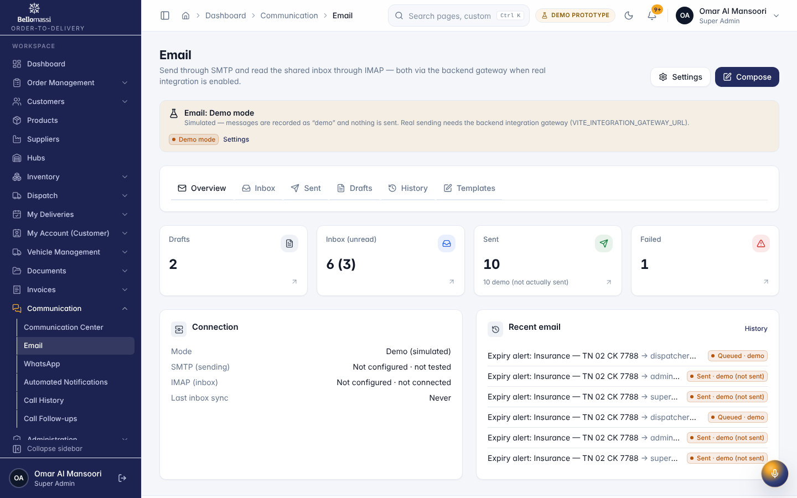{width=16cm}

## UX-WHATSAPP — WhatsApp

| Item | Value |
|---|---|
| Screen ID | SCR-121 |
| Route | `/communication/whatsapp` (captured: `/communication/whatsapp`) |
| Application | Office web app |
| Permission | whatsapp.view |
| Captured as role | superadmin |
| Roles with access | SUPER_ADMIN, ADMIN, SALESMAN, SALES_MANAGER, CUSTOMER_SERVICE, DISPATCHER, FINANCE |
| Purpose | WhatsApp through OpenWA, with a clearly labelled demo mode. |
| Page heading | WhatsApp (OpenWA) |
| Sections | Session; Recent messages |
| Tabs | Overview; Compose; History; Templates |
| Actions | Overview; Compose; History; Templates; Disconnect session; Refresh status; Test connection |
| Screen type | detail |
| Layout | Office layout: sidebar, header (breadcrumbs, search, notifications, profile), page header, content cards |
| Components | PageHeader with status Badge, InfoList, Tabs / Cards, Timeline, action Buttons, ConfirmDialog |
| Validation | Action pre-conditions checked by the service (status, permission, data scope); refusal message shown |
| Responsive behaviour | Sidebar fixed ≥ 1024 px, drawer below; grids collapse to one column; tables scroll horizontally inside the card |
| Empty state | Not found / access denied message for missing record |
| Loading state | Spinner / skeleton while data is read (prototype reads are near-instant from LocalStorage) |
| Error state | ErrorBoundary page; action refusals as error toast |
| Success state | Success toast after actions; badges and timeline update immediately |

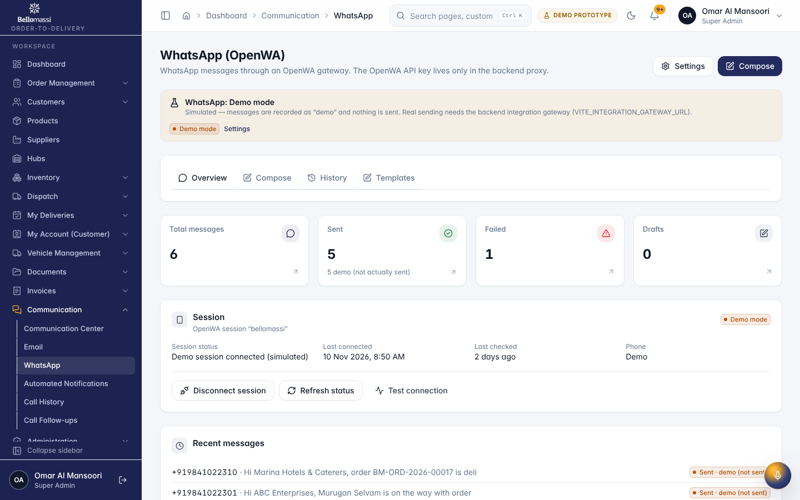{width=16cm}

## UX-CALLS — Call History

| Item | Value |
|---|---|
| Screen ID | SCR-123 |
| Route | `/communication/calls` (captured: `/communication/calls`) |
| Application | Office web app |
| Permission | communication.calls |
| Captured as role | superadmin |
| Roles with access | SUPER_ADMIN, ADMIN, SALESMAN, SALES_MANAGER, CUSTOMER_SERVICE |
| Purpose | Customer call log (manually recorded — no telephony connected) linked to customers, salesmen and the orders they produced. |
| Page heading | Call History |
| Sections | Calls by day; Outcome distribution; Calls and orders by salesman; Calls by customer |
| Screen type | detail |
| Layout | Office layout: sidebar, header (breadcrumbs, search, notifications, profile), page header, content cards |
| Components | PageHeader with status Badge, InfoList, Tabs / Cards, Timeline, action Buttons, ConfirmDialog |
| Validation | Action pre-conditions checked by the service (status, permission, data scope); refusal message shown |
| Responsive behaviour | Sidebar fixed ≥ 1024 px, drawer below; grids collapse to one column; tables scroll horizontally inside the card |
| Empty state | Not found / access denied message for missing record |
| Loading state | Spinner / skeleton while data is read (prototype reads are near-instant from LocalStorage) |
| Error state | ErrorBoundary page; action refusals as error toast |
| Success state | Success toast after actions; badges and timeline update immediately |

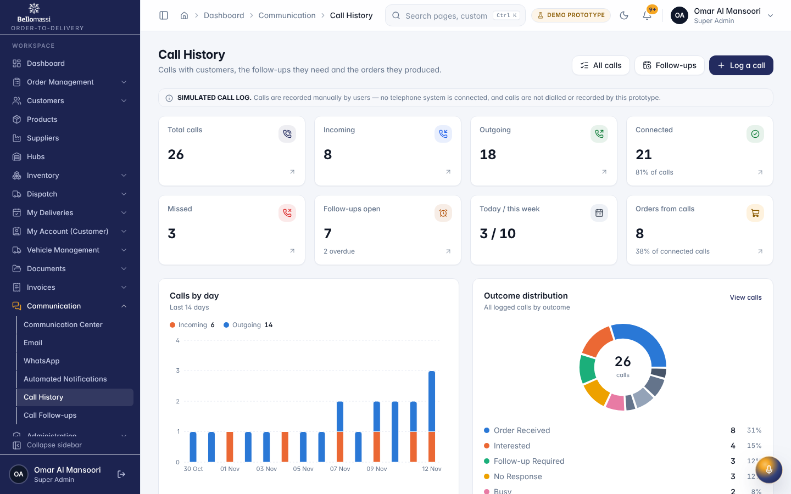{width=16cm}

## UX-AI — AI Overview

| Item | Value |
|---|---|
| Screen ID | SCR-163 |
| Route | `/ai` (captured: `/ai`) |
| Application | Office web app |
| Permission | ai.assistant.view |
| Captured as role | superadmin |
| Roles with access | SUPER_ADMIN, ADMIN, SALESMAN, SALES_MANAGER, CUSTOMER_SERVICE, DISPATCHER, FINANCE, WAREHOUSE_MANAGER, INVENTORY_EXECUTIVE, QA_MANAGER |
| Purpose | AI insights, recommendations, provider status and recent AI activity. |
| Page heading | AI & Intelligence |
| Sections | Business insights; French Fries 9 mm at Chennai Central Hub may run out now; Whole Chicken (Frozen) at Coimbatore Hub may run out now; Reefer Door Gasket at Coimbatore Hub may run out now; Fresh Cream 25% at Bangalore Hub may run out now; AI recommendations; Recent AI activity; AI provider; Try asking |
| Fields / filters | Question |
| Table columns | PRODUCT; RISK; RECOMMENDED; WHY |
| Actions | Ask; Mark reviewed; Resolve |
| Screen type | dashboard |
| Layout | Office layout: sidebar, header (breadcrumbs, search, notifications, profile), page header, content cards |
| Components | Period filter, KPI cards, charts (Recharts), queue tables, quick links |
| Validation | Period filter: valid date range |
| Responsive behaviour | Sidebar fixed ≥ 1024 px, drawer below; grids collapse to one column; tables scroll horizontally inside the card |
| Empty state | EmptyState with explanation and call to action |
| Loading state | Spinner / skeleton while data is read (prototype reads are near-instant from LocalStorage) |
| Error state | ErrorBoundary page; action refusals as error toast |
| Success state | Data displayed with counts |

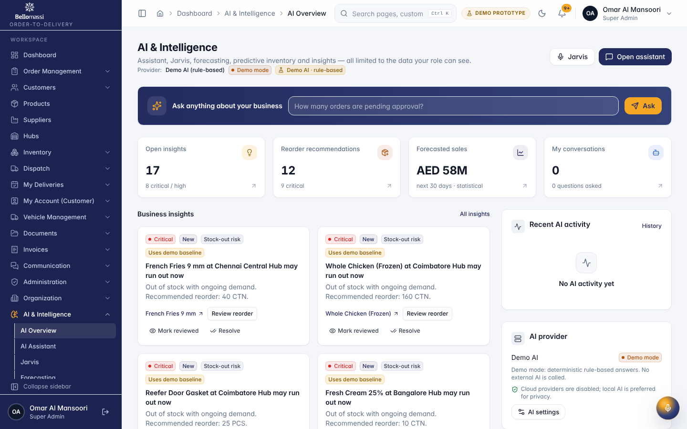{width=16cm}

## UX-FORECAST — Forecasting

| Item | Value |
|---|---|
| Screen ID | SCR-166 |
| Route | `/ai/forecasting` (captured: `/ai/forecasting`) |
| Application | Office web app |
| Permission | forecasting.view |
| Captured as role | superadmin |
| Roles with access | SUPER_ADMIN, ADMIN, SALES_MANAGER, DISPATCHER, FINANCE, WAREHOUSE_MANAGER |
| Purpose | Sales, order and demand forecasts with backtest accuracy. |
| Page heading | Forecasting |
| Sections | Daily revenue — next 30 days; Quick forecast; Model & data; Actual vs predicted; Recent forecasts |
| Fields / filters | Forecast; Period |
| Table columns | FORECAST; TARGET; MODEL; FORECAST TOTAL; ACCURACY; STATUS |
| Actions | 7 d; 14 d; 30 d; 60 d; 90 d; Generate |
| Screen type | list |
| Layout | Office layout: sidebar, header (breadcrumbs, search, notifications, profile), page header, content cards |
| Components | PageHeader, FilterToolbar, DataTable (sort, paging), Badge, RowActions, EmptyState |
| Validation | Filter inputs only |
| Responsive behaviour | Sidebar fixed ≥ 1024 px, drawer below; grids collapse to one column; tables scroll horizontally inside the card |
| Empty state | EmptyState with explanation and call to action |
| Loading state | Spinner / skeleton while data is read (prototype reads are near-instant from LocalStorage) |
| Error state | ErrorBoundary page; action refusals as error toast |
| Success state | Data displayed with counts |

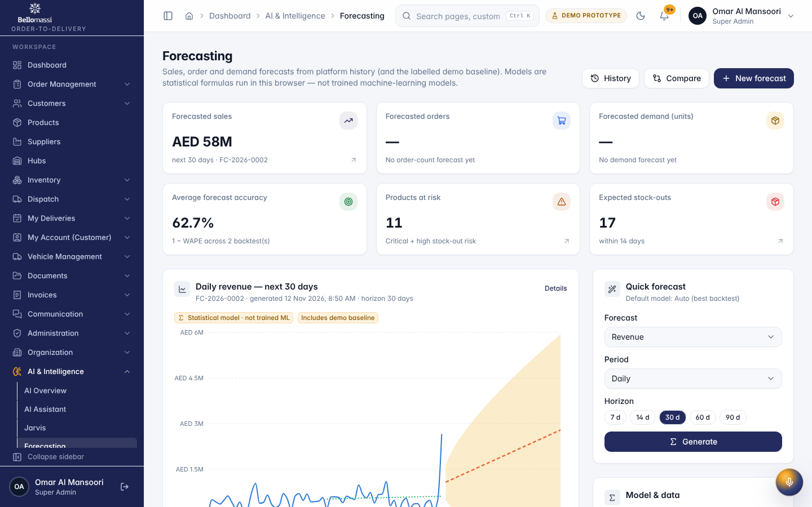{width=16cm}

## UX-NOTIFICATIONS — Notification Center

| Item | Value |
|---|---|
| Screen ID | SCR-188 |
| Route | `/notifications` (captured: `/notifications`) |
| Application | Public (no sign-in) |
| Permission | (signed in) |
| Captured as role | superadmin |
| Roles with access | all signed-in roles |
| Purpose | All notifications with categories, filters, read status, history and preferences. |
| Page heading | Notification Center |
| Sections | Categories |
| Fields / filters | Category; Type; Read state |
| Tabs | Inbox (13); History; Preferences |
| Actions | Mark all read; Inbox (13); History; Preferences; Open; Mark “Document expiring: Insurance” as read; Archive “Document expiring: Insurance”; Mark “Welcome to Bellomassi” as read; Archive “Welcome to Bellomassi”; Mark “Demo environment initialised” as read; Archive “Demo environment initialised”; Mark “Sample order data loaded” as read; Archive “Sample order data loaded”; Mark “Dispatch & delivery is live” as read; Archive “Dispatch & delivery is live”; Mark “21 stock lines need replenishment” as read; Archive “21 stock lines need replenishment”; Mark “Pending order approval” as read; Archive “Pending order approval”; Mark “Low stock alert” as read; Archive “Low stock alert”; Mark “Delivery failed” as read; Archive “Delivery failed”; Mark “Vehicle document expiry” as read; Archive “Vehicle document expiry” |
| Screen type | list |
| Layout | Office layout: sidebar, header (breadcrumbs, search, notifications, profile), page header, content cards |
| Components | PageHeader, FilterToolbar, DataTable (sort, paging), Badge, RowActions, EmptyState |
| Validation | Filter inputs only |
| Responsive behaviour | Sidebar fixed ≥ 1024 px, drawer below; grids collapse to one column; tables scroll horizontally inside the card |
| Empty state | EmptyState with explanation and call to action |
| Loading state | Spinner / skeleton while data is read (prototype reads are near-instant from LocalStorage) |
| Error state | ErrorBoundary page; action refusals as error toast |
| Success state | Data displayed with counts |

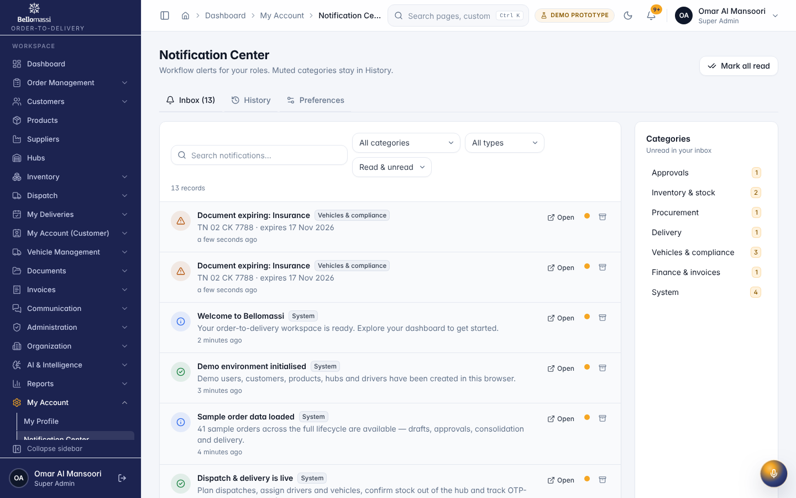{width=16cm}

## UX-DASH-SE — Dashboard

| Item | Value |
|---|---|
| Screen ID | SCR-001 |
| Route | `/dashboard` (captured: `/dashboard`) |
| Application | Public (no sign-in) |
| Permission | (signed in) |
| Captured as role | salesman |
| Roles with access | all signed-in roles |
| Purpose | Role-specific overview of orders, approvals, dispatch and deliveries. |
| Page heading | Good morning, Karthik |
| Sections | Got an order by call, email or WhatsApp?; My recent orders; Needs your action; Quick actions; My order trend |
| Fields / filters | Period |
| Table columns | ORDER; STATUS; VALUE; Updated |
| Actions | Date range; Specific period; Compare; Which dates are filtered; All TimeAll dates; View all |
| Screen type | dashboard |
| Layout | Office layout: sidebar, header (breadcrumbs, search, notifications, profile), page header, content cards |
| Components | Period filter, KPI cards, charts (Recharts), queue tables, quick links |
| Validation | Period filter: valid date range |
| Responsive behaviour | Sidebar fixed ≥ 1024 px, drawer below; grids collapse to one column; tables scroll horizontally inside the card |
| Empty state | EmptyState with explanation and call to action |
| Loading state | Spinner / skeleton while data is read (prototype reads are near-instant from LocalStorage) |
| Error state | ErrorBoundary page; action refusals as error toast |
| Success state | Data displayed with counts |

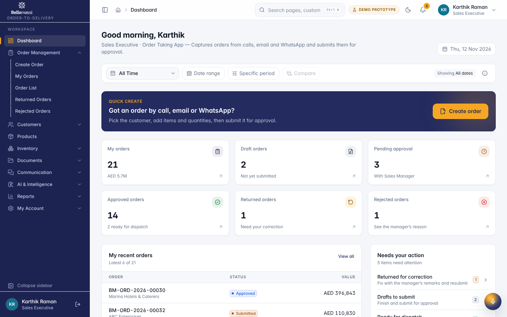{width=16cm}

## UX-ORDER-CREATE — Create Order

| Item | Value |
|---|---|
| Screen ID | SCR-002 |
| Route | `/orders/create` (captured: `/orders/create`) |
| Application | Office web app |
| Permission | orders.create |
| Captured as role | salesman |
| Roles with access | SUPER_ADMIN, ADMIN, SALESMAN |
| Purpose | Capture orders received by call, email or WhatsApp — customer first, then items and quantities, then submit for approval. |
| Page heading | New sales order |
| Sections | Order information; Delivery information; Products; Notes; Customer; Order summary |
| Fields / filters | Order number; Order date*; Order source; Order type*; Priority*; Payment terms*; Customer*; Assigned salesman; Fulfilment hub*; Customer reference; Delivery address*; City*; State*; Pincode*; Requested delivery date*; Delivery instructions; Internal notes |
| Actions | Submit for approval; Save draft; Preview |
| Screen type | form |
| Layout | Office layout: sidebar, header (breadcrumbs, search, notifications, profile), page header, content cards |
| Components | PageHeader, FormSection, Input / Select / Textarea / Checkbox, Button (primary / secondary), ConfirmDialog, toasts |
| Validation | Mandatory fields marked *; inline messages under fields; service-level validation re-checked on save (see FRD business rules) |
| Responsive behaviour | Sidebar fixed ≥ 1024 px, drawer below; grids collapse to one column; tables scroll horizontally inside the card |
| Empty state | Blank form with defaults |
| Loading state | Spinner / skeleton while data is read (prototype reads are near-instant from LocalStorage) |
| Error state | Field errors + error toast; ErrorBoundary for unexpected errors |
| Success state | Success toast and navigation to the record / landing page |

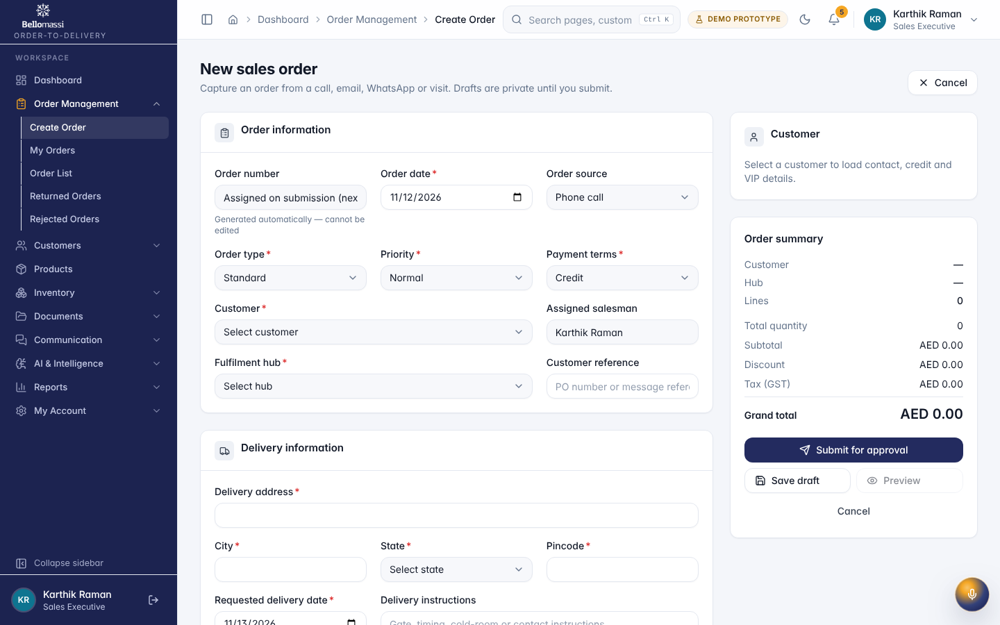{width=16cm}

## UX-MY-ORDERS — My Orders

| Item | Value |
|---|---|
| Screen ID | SCR-003 |
| Route | `/orders/my-orders` (captured: `/orders/my-orders`) |
| Application | Office web app |
| Permission | orders.mine |
| Captured as role | salesman |
| Roles with access | SUPER_ADMIN, ADMIN, SALESMAN |
| Purpose | Your drafts and submitted orders with their approval and consolidation status. |
| Page heading | My orders |
| Fields / filters | Order status; Approval status; Customer; Hub; Priority; From order date; To order date |
| Table columns | ORDER; CUSTOMER; SALESMAN; HUB; QTY; TOTAL; STATUS; APPROVAL; PRIORITY; DELIVERY; CREATED; ACTIONS |
| Actions | Export CSV; ORDER; CUSTOMER; SALESMAN; HUB; QTY; TOTAL; STATUS; APPROVAL; PRIORITY; DELIVERY; CREATED; Actions for draft order; Actions for BM-ORD-2026-00034; Actions for BM-ORD-2026-00032; Actions for BM-ORD-2026-00033; Actions for BM-ORD-2026-00030; Actions for BM-ORD-2026-00038; Actions for BM-ORD-2026-00027; Actions for BM-ORD-2026-00017; Actions for BM-ORD-2026-00022; Actions for BM-ORD-2026-00024; Actions for BM-ORD-2026-00016; Previous page; 1 |
| Screen type | list |
| Layout | Office layout: sidebar, header (breadcrumbs, search, notifications, profile), page header, content cards |
| Components | PageHeader, FilterToolbar, DataTable (sort, paging), Badge, RowActions, EmptyState |
| Validation | Filter inputs only |
| Responsive behaviour | Sidebar fixed ≥ 1024 px, drawer below; grids collapse to one column; tables scroll horizontally inside the card |
| Empty state | EmptyState with explanation and call to action |
| Loading state | Spinner / skeleton while data is read (prototype reads are near-instant from LocalStorage) |
| Error state | ErrorBoundary page; action refusals as error toast |
| Success state | Data displayed with counts |

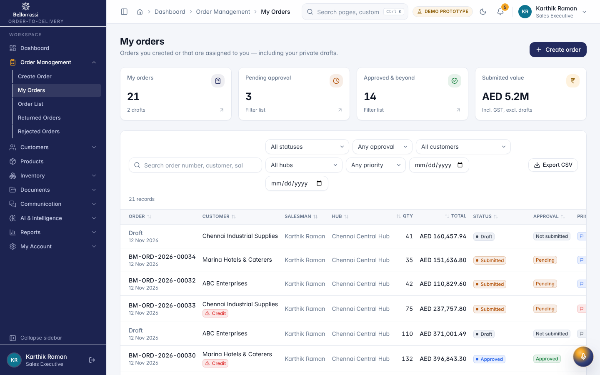{width=16cm}

## UX-DASH-SM — Dashboard

| Item | Value |
|---|---|
| Screen ID | SCR-001 |
| Route | `/dashboard` (captured: `/dashboard`) |
| Application | Public (no sign-in) |
| Permission | (signed in) |
| Captured as role | manager |
| Roles with access | all signed-in roles |
| Purpose | Role-specific overview of orders, approvals, dispatch and deliveries. |
| Page heading | Good morning, Priya |
| Sections | Recent pending orders; Approval trend; Sales targets; Customers CURRENT; Customer credit overview; Recent orders |
| Fields / filters | Period |
| Table columns | CUSTOMER; LIMIT; OUTSTANDING; UTILISATION; ORDER; Salesman; STATUS; VALUE; Updated |
| Actions | Date range; Specific period; Compare; Which dates are filtered; All TimeAll dates; Set targets; Open credit module; View all |
| Screen type | dashboard |
| Layout | Office layout: sidebar, header (breadcrumbs, search, notifications, profile), page header, content cards |
| Components | Period filter, KPI cards, charts (Recharts), queue tables, quick links |
| Validation | Period filter: valid date range |
| Responsive behaviour | Sidebar fixed ≥ 1024 px, drawer below; grids collapse to one column; tables scroll horizontally inside the card |
| Empty state | EmptyState with explanation and call to action |
| Loading state | Spinner / skeleton while data is read (prototype reads are near-instant from LocalStorage) |
| Error state | ErrorBoundary page; action refusals as error toast |
| Success state | Data displayed with counts |

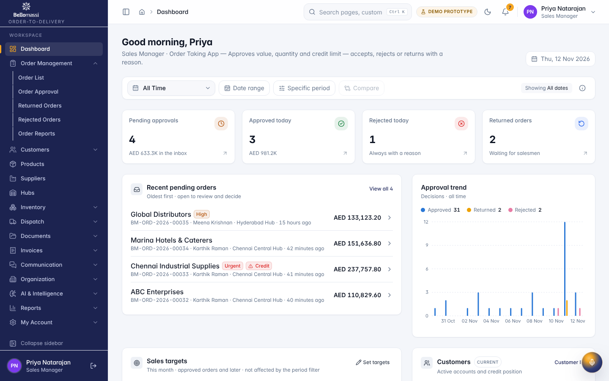{width=16cm}

## UX-APPROVAL — Order Approval

| Item | Value |
|---|---|
| Screen ID | SCR-005 |
| Route | `/orders/approval` (captured: `/orders/approval`) |
| Application | Office web app |
| Permission | orders.approval.view |
| Captured as role | manager |
| Roles with access | SUPER_ADMIN, ADMIN, SALES_MANAGER |
| Purpose | Approval inbox for the Sales Manager — approve, return for correction or reject with a mandatory reason, including the credit-limit decision. |
| Page heading | Order approval |
| Fields / filters | Warnings; Salesman; Hub; Priority |
| Table columns | ORDER; CUSTOMER; SALESMAN; HUB; QTY; TOTAL; CREDIT; STOCK; PRIORITY; DELIVERY; SUBMITTED; ACTIONS |
| Tabs | Pending (4); Decision history (35) |
| Actions | Pending (4); Decision history (35); Export CSV; ORDER; CUSTOMER; SALESMAN; HUB; QTY; TOTAL; CREDIT; STOCK; PRIORITY; DELIVERY; SUBMITTED; Decide BM-ORD-2026-00035; Decide BM-ORD-2026-00034; Decide BM-ORD-2026-00033; Decide BM-ORD-2026-00032 |
| Screen type | list |
| Layout | Office layout: sidebar, header (breadcrumbs, search, notifications, profile), page header, content cards |
| Components | PageHeader, FilterToolbar, DataTable (sort, paging), Badge, RowActions, EmptyState |
| Validation | Filter inputs only |
| Responsive behaviour | Sidebar fixed ≥ 1024 px, drawer below; grids collapse to one column; tables scroll horizontally inside the card |
| Empty state | EmptyState with explanation and call to action |
| Loading state | Spinner / skeleton while data is read (prototype reads are near-instant from LocalStorage) |
| Error state | ErrorBoundary page; action refusals as error toast |
| Success state | Data displayed with counts |

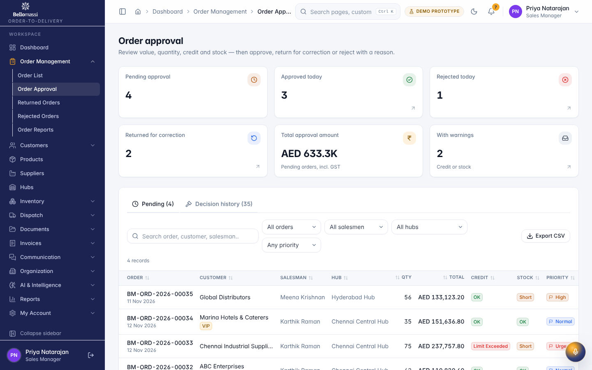{width=16cm}

## UX-APPROVAL-DETAIL — Review Order

| Item | Value |
|---|---|
| Screen ID | SCR-011 |
| Route | `/orders/approval/:id` (captured: `/orders/approval/ord-0001`) |
| Application | Office web app |
| Permission | orders.approval.view |
| Captured as role | manager |
| Roles with access | SUPER_ADMIN, ADMIN, SALES_MANAGER |
| Purpose | Review BM-ORD-2026-00001 |
| Page heading | Review BM-ORD-2026-00001 |
| Sections | Order header; Product details; Delivery information; History; Approval checks; Customer information |
| Table columns | PRODUCT; QTY; UNIT PRICE; DISC.; GST; HUB STOCK NOW; LINE TOTAL |
| Screen type | list |
| Layout | Office layout: sidebar, header (breadcrumbs, search, notifications, profile), page header, content cards |
| Components | PageHeader, FilterToolbar, DataTable (sort, paging), Badge, RowActions, EmptyState |
| Validation | Filter inputs only |
| Responsive behaviour | Sidebar fixed ≥ 1024 px, drawer below; grids collapse to one column; tables scroll horizontally inside the card |
| Empty state | EmptyState with explanation and call to action |
| Loading state | Spinner / skeleton while data is read (prototype reads are near-instant from LocalStorage) |
| Error state | ErrorBoundary page; action refusals as error toast |
| Success state | Data displayed with counts |

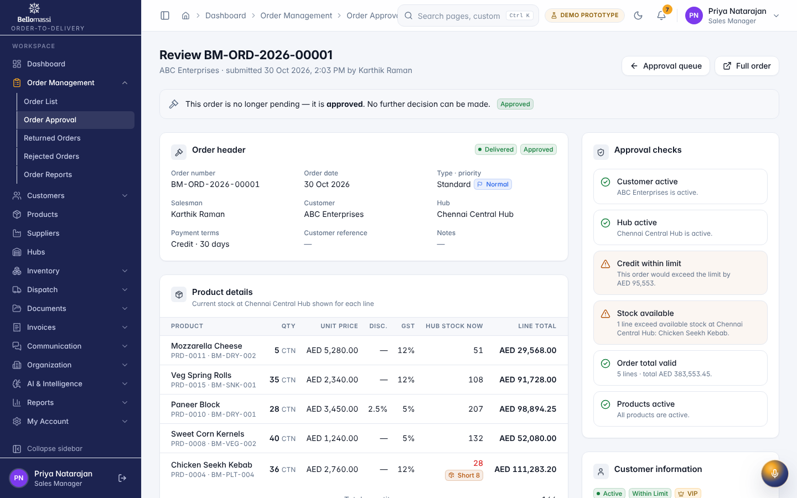{width=16cm}

## UX-DASH-CS — Dashboard

| Item | Value |
|---|---|
| Screen ID | SCR-001 |
| Route | `/dashboard` (captured: `/dashboard`) |
| Application | Public (no sign-in) |
| Permission | (signed in) |
| Captured as role | cs |
| Roles with access | all signed-in roles |
| Purpose | Role-specific overview of orders, approvals, dispatch and deliveries. |
| Page heading | Good morning, Divya |
| Sections | Consolidation queue; Queue by salesman; Order status distribution; Recent approved orders |
| Fields / filters | Period |
| Table columns | SALESMAN; ORDERS; VALUE; ORDER; Salesman; STATUS; Updated |
| Actions | Date range; Specific period; Compare; Which dates are filtered; All TimeAll dates; View all |
| Screen type | dashboard |
| Layout | Office layout: sidebar, header (breadcrumbs, search, notifications, profile), page header, content cards |
| Components | Period filter, KPI cards, charts (Recharts), queue tables, quick links |
| Validation | Period filter: valid date range |
| Responsive behaviour | Sidebar fixed ≥ 1024 px, drawer below; grids collapse to one column; tables scroll horizontally inside the card |
| Empty state | EmptyState with explanation and call to action |
| Loading state | Spinner / skeleton while data is read (prototype reads are near-instant from LocalStorage) |
| Error state | ErrorBoundary page; action refusals as error toast |
| Success state | Data displayed with counts |

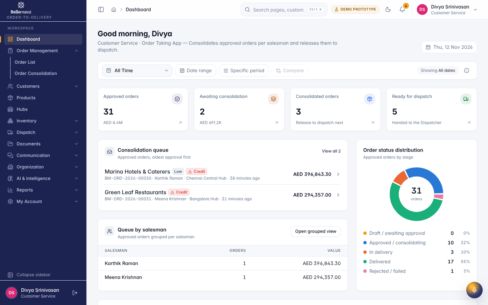{width=16cm}

## UX-CONSOLIDATION — Order Consolidation

| Item | Value |
|---|---|
| Screen ID | SCR-006 |
| Route | `/orders/consolidation` (captured: `/orders/consolidation`) |
| Application | Office web app |
| Permission | orders.consolidation.view |
| Captured as role | cs |
| Roles with access | SUPER_ADMIN, ADMIN, CUSTOMER_SERVICE |
| Purpose | Approved orders grouped per salesman, verified, consolidated and released to the Dispatcher. |
| Page heading | Order consolidation |
| Fields / filters | Salesman; Hub |
| Table columns | ORDER; CUSTOMER; SALESMAN; HUB; PRODUCTS; QTY; TOTAL; APPROVED; CONSOLIDATION; ACTIONS |
| Tabs | Awaiting (2); Consolidated (3); Ready (5); History |
| Actions | Awaiting (2); Consolidated (3); Ready (5); History; List; By salesman; Export CSV; ORDER; CUSTOMER; SALESMAN; HUB; PRODUCTS; QTY; TOTAL; APPROVED; Actions for BM-ORD-2026-00030; Actions for BM-ORD-2026-00031 |
| Screen type | list |
| Layout | Office layout: sidebar, header (breadcrumbs, search, notifications, profile), page header, content cards |
| Components | PageHeader, FilterToolbar, DataTable (sort, paging), Badge, RowActions, EmptyState |
| Validation | Filter inputs only |
| Responsive behaviour | Sidebar fixed ≥ 1024 px, drawer below; grids collapse to one column; tables scroll horizontally inside the card |
| Empty state | EmptyState with explanation and call to action |
| Loading state | Spinner / skeleton while data is read (prototype reads are near-instant from LocalStorage) |
| Error state | ErrorBoundary page; action refusals as error toast |
| Success state | Data displayed with counts |

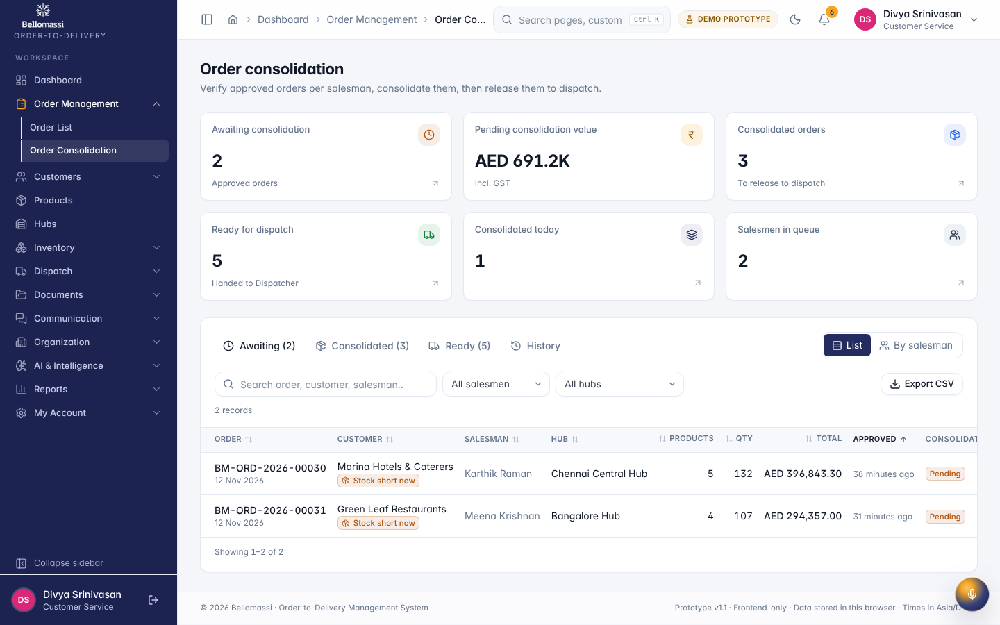{width=16cm}

## UX-DASH-DP — Dashboard

| Item | Value |
|---|---|
| Screen ID | SCR-001 |
| Route | `/dashboard` (captured: `/dashboard`) |
| Application | Public (no sign-in) |
| Permission | (signed in) |
| Captured as role | dispatcher |
| Roles with access | all signed-in roles |
| Purpose | Role-specific overview of orders, approvals, dispatch and deliveries. |
| Page heading | Good morning, Suresh |
| Sections | Dispatch trend; Delivery completion trend; Delivery status distribution; Driver performance; Zone delivery performance; Recent dispatches; In-transit deliveries; Failed / partial — review; Pending assignments; Recent delivery notes; Quick actions |
| Fields / filters | Period |
| Actions | Date range; Specific period; Compare; Which dates are filtered; All TimeAll dates |
| Screen type | dashboard |
| Layout | Office layout: sidebar, header (breadcrumbs, search, notifications, profile), page header, content cards |
| Components | Period filter, KPI cards, charts (Recharts), queue tables, quick links |
| Validation | Period filter: valid date range |
| Responsive behaviour | Sidebar fixed ≥ 1024 px, drawer below; grids collapse to one column; tables scroll horizontally inside the card |
| Empty state | EmptyState with explanation and call to action |
| Loading state | Spinner / skeleton while data is read (prototype reads are near-instant from LocalStorage) |
| Error state | ErrorBoundary page; action refusals as error toast |
| Success state | Data displayed with counts |

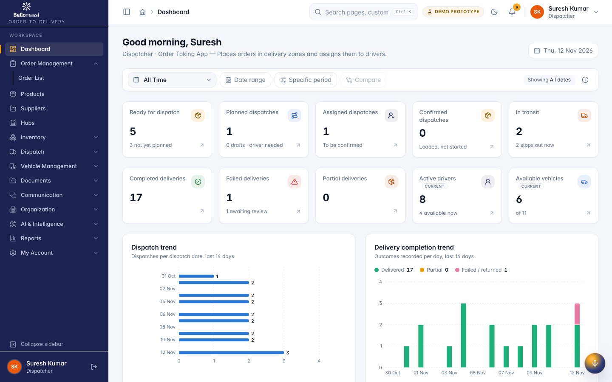{width=16cm}

## UX-READY — Ready for Dispatch

| Item | Value |
|---|---|
| Screen ID | SCR-042 |
| Route | `/dispatch/ready-orders` (captured: `/dispatch/ready-orders`) |
| Application | Office web app |
| Permission | dispatch.ready.view |
| Captured as role | dispatcher |
| Roles with access | SUPER_ADMIN, ADMIN, CUSTOMER_SERVICE, DISPATCHER, WAREHOUSE_MANAGER |
| Purpose | Orders released by Customer Service, waiting to be planned into a dispatch. |
| Page heading | Ready for dispatch |
| Fields / filters | Customer; Hub; Zone; Priority; Dispatch status; Requested from; Requested to |
| Table columns | ORDER; CUSTOMER; HUB / ZONE; Delivery address; QTY; AMOUNT; REQUESTED; PRIORITY; DISPATCH STATUS; ACTIONS |
| Actions | Create dispatch; Export CSV; ORDER; CUSTOMER; HUB / ZONE; QTY; AMOUNT; REQUESTED; PRIORITY; Actions for BM-ORD-2026-00022; Actions for BM-ORD-2026-00026; Actions for BM-ORD-2026-00024; Actions for BM-ORD-2026-00023; Actions for BM-ORD-2026-00025 |
| Screen type | list |
| Layout | Office layout: sidebar, header (breadcrumbs, search, notifications, profile), page header, content cards |
| Components | PageHeader, FilterToolbar, DataTable (sort, paging), Badge, RowActions, EmptyState |
| Validation | Filter inputs only |
| Responsive behaviour | Sidebar fixed ≥ 1024 px, drawer below; grids collapse to one column; tables scroll horizontally inside the card |
| Empty state | EmptyState with explanation and call to action |
| Loading state | Spinner / skeleton while data is read (prototype reads are near-instant from LocalStorage) |
| Error state | ErrorBoundary page; action refusals as error toast |
| Success state | Data displayed with counts |

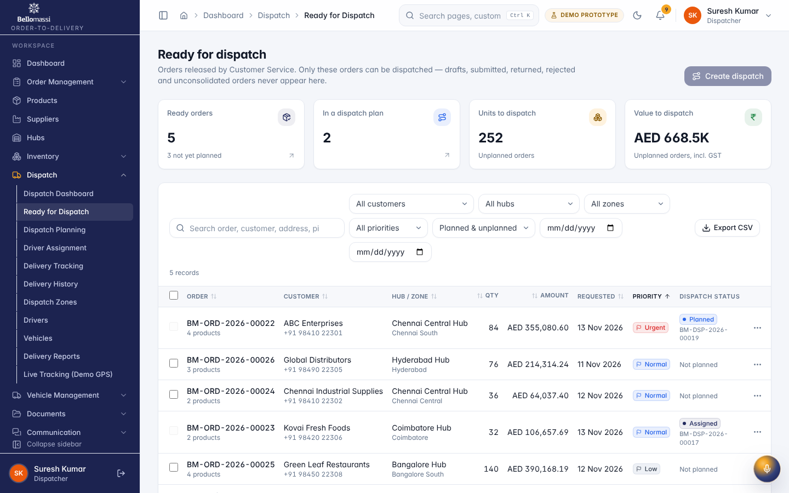{width=16cm}

## UX-PLANNING — Dispatch Planning

| Item | Value |
|---|---|
| Screen ID | SCR-043 |
| Route | `/dispatch/planning` (captured: `/dispatch/planning`) |
| Application | Office web app |
| Permission | dispatch.view |
| Captured as role | dispatcher |
| Roles with access | SUPER_ADMIN, ADMIN, SALES_MANAGER, CUSTOMER_SERVICE, DISPATCHER, FINANCE, WAREHOUSE_MANAGER |
| Purpose | Plan multi-order dispatches by hub and zone, set the delivery sequence and confirm loading. |
| Page heading | Dispatch planning |
| Sections | Ready orders by zone |
| Fields / filters | Hub; Zone; Driver; From date; To date |
| Tabs | Board; All dispatches |
| Actions | Plan this zone; Board; All dispatches; Export CSV |
| Screen type | detail |
| Layout | Office layout: sidebar, header (breadcrumbs, search, notifications, profile), page header, content cards |
| Components | PageHeader with status Badge, InfoList, Tabs / Cards, Timeline, action Buttons, ConfirmDialog |
| Validation | Action pre-conditions checked by the service (status, permission, data scope); refusal message shown |
| Responsive behaviour | Sidebar fixed ≥ 1024 px, drawer below; grids collapse to one column; tables scroll horizontally inside the card |
| Empty state | Not found / access denied message for missing record |
| Loading state | Spinner / skeleton while data is read (prototype reads are near-instant from LocalStorage) |
| Error state | ErrorBoundary page; action refusals as error toast |
| Success state | Success toast after actions; badges and timeline update immediately |

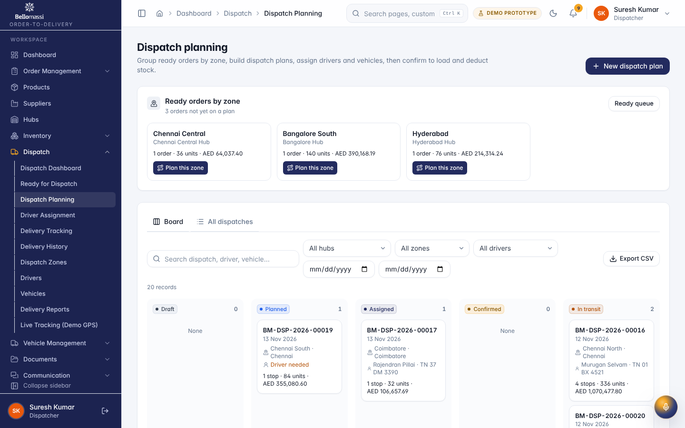{width=16cm}

## UX-DISPATCH-LIST — Dispatch Dashboard

| Item | Value |
|---|---|
| Screen ID | SCR-041 |
| Route | `/dispatch` (captured: `/dispatch`) |
| Application | Office web app |
| Permission | dispatch.view |
| Captured as role | dispatcher |
| Roles with access | SUPER_ADMIN, ADMIN, SALES_MANAGER, CUSTOMER_SERVICE, DISPATCHER, FINANCE, WAREHOUSE_MANAGER |
| Purpose | Ready orders, dispatch plans, drivers on the road and delivery outcomes. |
| Page heading | Dispatch & delivery |
| Sections | Dispatch trend; Delivery completion trend; Delivery status distribution; Driver performance; Zone delivery performance; Recent dispatches; In-transit deliveries; Failed / partial — review; Pending assignments; Recent delivery notes; Quick actions |
| Screen type | list |
| Layout | Office layout: sidebar, header (breadcrumbs, search, notifications, profile), page header, content cards |
| Components | PageHeader, FilterToolbar, DataTable (sort, paging), Badge, RowActions, EmptyState |
| Validation | Filter inputs only |
| Responsive behaviour | Sidebar fixed ≥ 1024 px, drawer below; grids collapse to one column; tables scroll horizontally inside the card |
| Empty state | EmptyState with explanation and call to action |
| Loading state | Spinner / skeleton while data is read (prototype reads are near-instant from LocalStorage) |
| Error state | ErrorBoundary page; action refusals as error toast |
| Success state | Data displayed with counts |

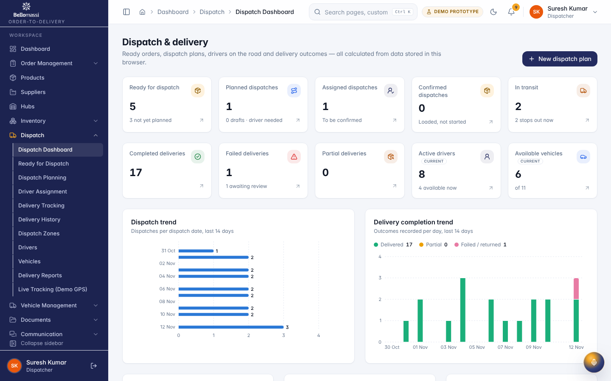{width=16cm}

## UX-DISPATCH-DETAIL — Dispatch Details

| Item | Value |
|---|---|
| Screen ID | SCR-063 |
| Route | `/dispatch/:id` (captured: `/dispatch/dsp-0001`) |
| Application | Office web app |
| Permission | dispatch.view |
| Captured as role | dispatcher |
| Roles with access | SUPER_ADMIN, ADMIN, SALES_MANAGER, CUSTOMER_SERVICE, DISPATCHER, FINANCE, WAREHOUSE_MANAGER |
| Purpose | BM-DSP-2026-00001 |
| Page heading | BM-DSP-2026-00001 |
| Sections | Dispatch |
| Tabs | Stops (1); Stock; Timeline (10) |
| Actions | Stops (1); Stock; Timeline (10); Open |
| Screen type | detail |
| Layout | Office layout: sidebar, header (breadcrumbs, search, notifications, profile), page header, content cards |
| Components | PageHeader with status Badge, InfoList, Tabs / Cards, Timeline, action Buttons, ConfirmDialog |
| Validation | Action pre-conditions checked by the service (status, permission, data scope); refusal message shown |
| Responsive behaviour | Sidebar fixed ≥ 1024 px, drawer below; grids collapse to one column; tables scroll horizontally inside the card |
| Empty state | Not found / access denied message for missing record |
| Loading state | Spinner / skeleton while data is read (prototype reads are near-instant from LocalStorage) |
| Error state | ErrorBoundary page; action refusals as error toast |
| Success state | Success toast after actions; badges and timeline update immediately |

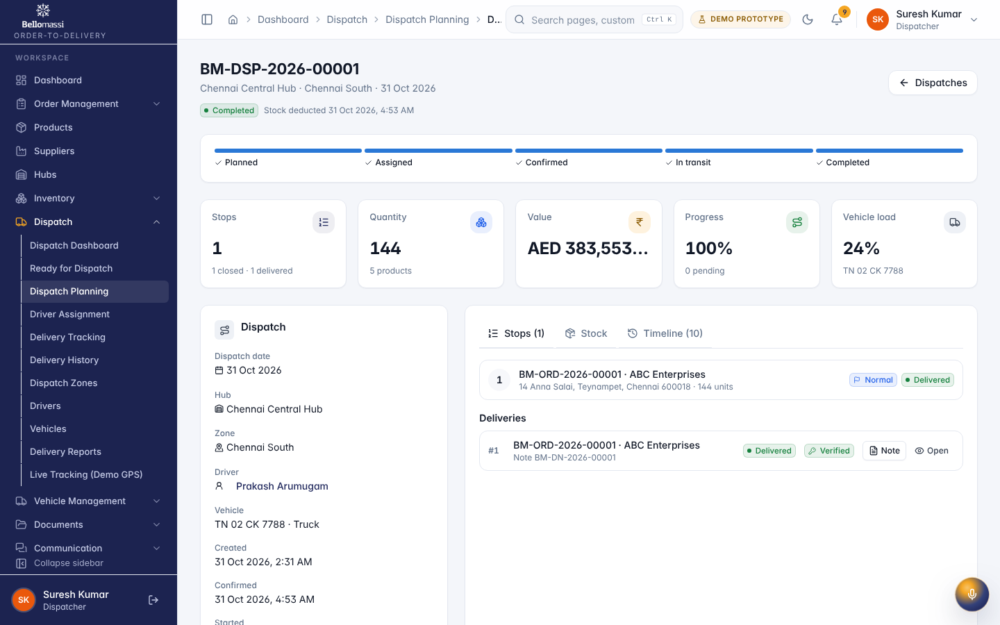{width=16cm}

## UX-DISPATCH-CREATE — New Dispatch

| Item | Value |
|---|---|
| Screen ID | SCR-051 |
| Route | `/dispatch/create` (captured: `/dispatch/create`) |
| Application | Office web app |
| Permission | dispatch.manage |
| Captured as role | dispatcher |
| Roles with access | SUPER_ADMIN, ADMIN, DISPATCHER |
| Purpose | New dispatch plan |
| Page heading | New dispatch plan |
| Sections | 1 · Hub, date & zone; 2 · Ready orders; 3 · Delivery sequence; 4 · Load summary; 5 · Driver & vehicle |
| Fields / filters | Dispatching hub*; Dispatch date*; Delivery zone*; Dispatch notes |
| Actions | Save draft; Create plan |
| Screen type | form |
| Layout | Office layout: sidebar, header (breadcrumbs, search, notifications, profile), page header, content cards |
| Components | PageHeader, FormSection, Input / Select / Textarea / Checkbox, Button (primary / secondary), ConfirmDialog, toasts |
| Validation | Mandatory fields marked *; inline messages under fields; service-level validation re-checked on save (see FRD business rules) |
| Responsive behaviour | Sidebar fixed ≥ 1024 px, drawer below; grids collapse to one column; tables scroll horizontally inside the card |
| Empty state | Blank form with defaults |
| Loading state | Spinner / skeleton while data is read (prototype reads are near-instant from LocalStorage) |
| Error state | Field errors + error toast; ErrorBoundary for unexpected errors |
| Success state | Success toast and navigation to the record / landing page |

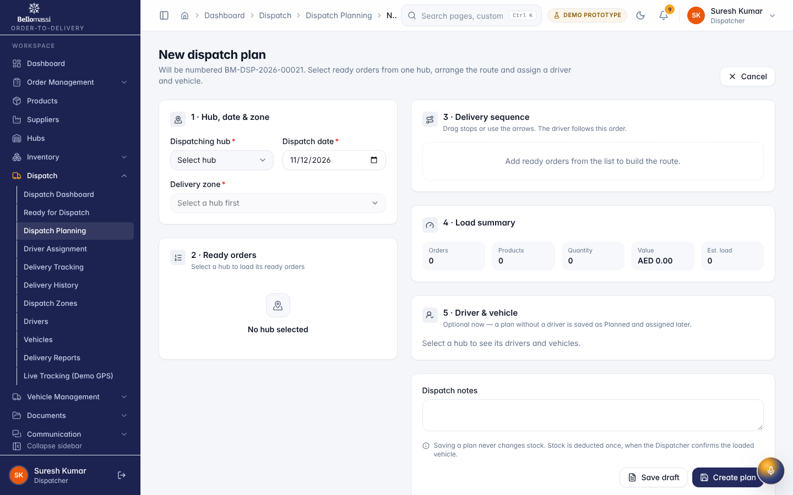{width=16cm}

## UX-ZONES — Dispatch Zones

| Item | Value |
|---|---|
| Screen ID | SCR-047 |
| Route | `/dispatch/zones` (captured: `/dispatch/zones`) |
| Application | Office web app |
| Permission | fleet.view |
| Captured as role | dispatcher |
| Roles with access | SUPER_ADMIN, ADMIN, DISPATCHER |
| Purpose | Delivery zones per hub with their pincodes. |
| Page heading | Dispatch zones |
| Fields / filters | Hub; Status; City |
| Table columns | ZONE; HUB; CITY; MANAGER; PINCODES; ACTIVE DISPATCHES; STATUS; ACTIONS |
| Actions | Export CSV; ZONE; HUB; CITY; MANAGER; PINCODES; ACTIVE DISPATCHES; STATUS; Actions for Bangalore North; Actions for Bangalore South; Actions for Chennai Central; Actions for Chennai North; Actions for Chennai South; Actions for Coimbatore; Actions for Hyderabad; Actions for Madurai |
| Screen type | list |
| Layout | Office layout: sidebar, header (breadcrumbs, search, notifications, profile), page header, content cards |
| Components | PageHeader, FilterToolbar, DataTable (sort, paging), Badge, RowActions, EmptyState |
| Validation | Filter inputs only |
| Responsive behaviour | Sidebar fixed ≥ 1024 px, drawer below; grids collapse to one column; tables scroll horizontally inside the card |
| Empty state | EmptyState with explanation and call to action |
| Loading state | Spinner / skeleton while data is read (prototype reads are near-instant from LocalStorage) |
| Error state | ErrorBoundary page; action refusals as error toast |
| Success state | Data displayed with counts |

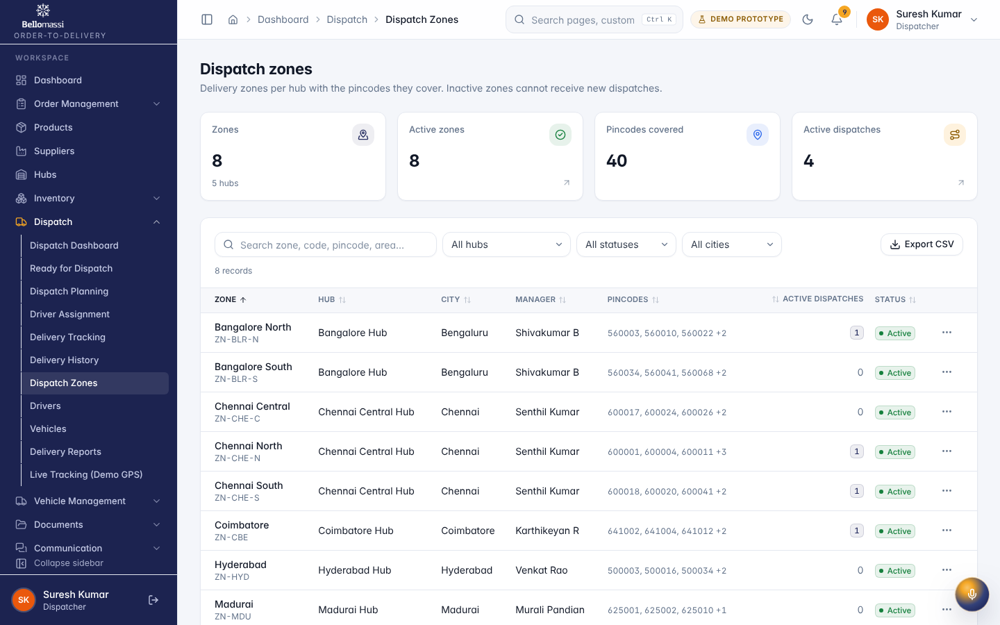{width=16cm}

## UX-DRIVERS — Drivers

| Item | Value |
|---|---|
| Screen ID | SCR-048 |
| Route | `/dispatch/drivers` (captured: `/dispatch/drivers`) |
| Application | Office web app |
| Permission | fleet.view |
| Captured as role | dispatcher |
| Roles with access | SUPER_ADMIN, ADMIN, DISPATCHER |
| Purpose | Driver records, licences, availability and delivery performance. |
| Page heading | Drivers |
| Fields / filters | Hub; Zone; Availability; Licence |
| Table columns | DRIVER; HUB / ZONE; VEHICLE; LICENCE; AVAILABILITY; CURRENT DISPATCH; STATUS; ACTIONS |
| Actions | Export CSV; DRIVER; HUB / ZONE; LICENCE; AVAILABILITY; STATUS; Actions for Dinesh Kumar; Actions for Manjunath Gowda; Actions for Murugan Selvam; Actions for Pandiyan Raj; Actions for Prakash Arumugam; Actions for Rajendran Pillai; Actions for Ravi Teja; Actions for Syed Ameer |
| Screen type | list |
| Layout | Office layout: sidebar, header (breadcrumbs, search, notifications, profile), page header, content cards |
| Components | PageHeader, FilterToolbar, DataTable (sort, paging), Badge, RowActions, EmptyState |
| Validation | Filter inputs only |
| Responsive behaviour | Sidebar fixed ≥ 1024 px, drawer below; grids collapse to one column; tables scroll horizontally inside the card |
| Empty state | EmptyState with explanation and call to action |
| Loading state | Spinner / skeleton while data is read (prototype reads are near-instant from LocalStorage) |
| Error state | ErrorBoundary page; action refusals as error toast |
| Success state | Data displayed with counts |

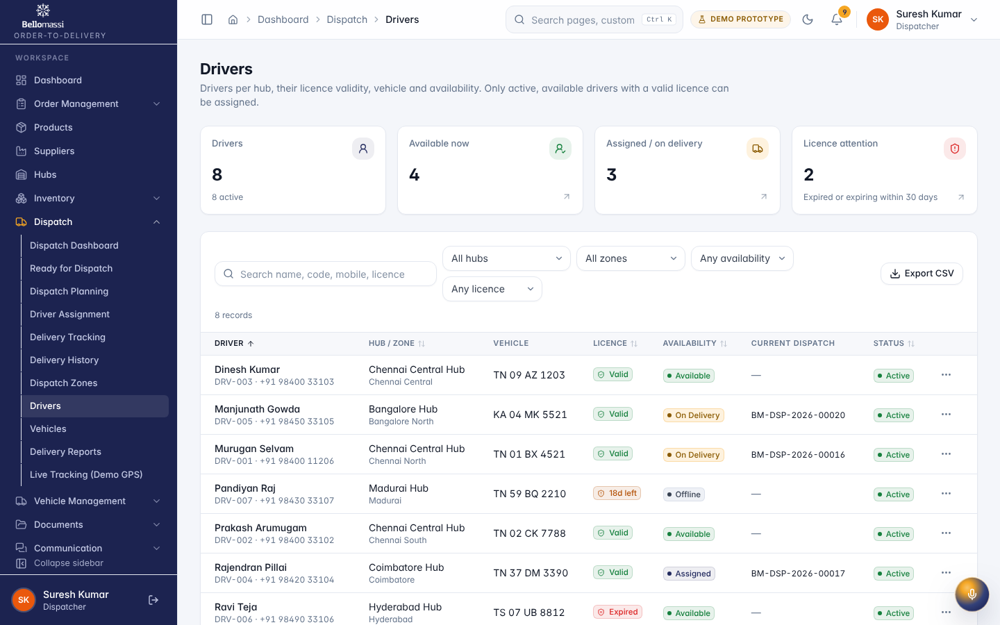{width=16cm}

## UX-VEHICLES — Vehicles

| Item | Value |
|---|---|
| Screen ID | SCR-049 |
| Route | `/dispatch/vehicles` (captured: `/dispatch/vehicles`) |
| Application | Office web app |
| Permission | fleet.view |
| Captured as role | dispatcher |
| Roles with access | SUPER_ADMIN, ADMIN, DISPATCHER |
| Purpose | Delivery vehicles, capacity and status. |
| Page heading | Vehicles |
| Fields / filters | Hub; Status; Type |
| Table columns | VEHICLE; HUB; CAPACITY; REGULAR DRIVER; CURRENT DISPATCH; STATUS; ACTIONS |
| Actions | Export CSV; VEHICLE; HUB; CAPACITY; STATUS; Actions for KA 01 HN 6604; Actions for KA 04 MK 5521; Actions for TN 01 BX 4521; Actions for TN 01 RX 3344; Actions for TN 02 CK 7788; Actions for TN 09 AZ 1203; Actions for TN 10 MV 9091; Actions for TN 22 BK 0077; Actions for TN 37 DM 3390; Actions for TN 59 BQ 2210; Previous page; 1; 2; Next page |
| Screen type | list |
| Layout | Office layout: sidebar, header (breadcrumbs, search, notifications, profile), page header, content cards |
| Components | PageHeader, FilterToolbar, DataTable (sort, paging), Badge, RowActions, EmptyState |
| Validation | Filter inputs only |
| Responsive behaviour | Sidebar fixed ≥ 1024 px, drawer below; grids collapse to one column; tables scroll horizontally inside the card |
| Empty state | EmptyState with explanation and call to action |
| Loading state | Spinner / skeleton while data is read (prototype reads are near-instant from LocalStorage) |
| Error state | ErrorBoundary page; action refusals as error toast |
| Success state | Data displayed with counts |

{width=16cm}

## UX-TRACKING — Delivery Tracking

| Item | Value |
|---|---|
| Screen ID | SCR-045 |
| Route | `/dispatch/delivery-tracking` (captured: `/dispatch/delivery-tracking`) |
| Application | Office web app |
| Permission | dispatch.tracking |
| Captured as role | dispatcher |
| Roles with access | SUPER_ADMIN, ADMIN, SALES_MANAGER, CUSTOMER_SERVICE, DISPATCHER |
| Purpose | Live status of every delivery stop: out for delivery, delivered, partial or failed. |
| Page heading | Delivery tracking |
| Fields / filters | From date; To date; Hub; Zone; Driver; Dispatch status; Delivery status; Customer; Order number |
| Table columns | ORDER / CUSTOMER; DISPATCH; DRIVER / VEHICLE; Hub / zone; DATE; DELIVERY; PROGRESS; OTP; Note; UPDATED; ACTIONS |
| Actions | Export CSV; ORDER / CUSTOMER; DISPATCH; DRIVER / VEHICLE; DATE; DELIVERY; UPDATED; Actions for BM-ORD-2026-00020; Actions for BM-ORD-2026-00018; Actions for BM-ORD-2026-00016; Actions for BM-ORD-2026-00017; Actions for BM-ORD-2026-00019; Actions for BM-ORD-2026-00021; Actions for BM-ORD-2026-00015; Actions for BM-ORD-2026-00014; Actions for BM-ORD-2026-00012; Actions for BM-ORD-2026-00013; Actions for BM-ORD-2026-00011; Actions for BM-ORD-2026-00010; Previous page; 1; 2; Next page |
| Screen type | list |
| Layout | Office layout: sidebar, header (breadcrumbs, search, notifications, profile), page header, content cards |
| Components | PageHeader, FilterToolbar, DataTable (sort, paging), Badge, RowActions, EmptyState |
| Validation | Filter inputs only |
| Responsive behaviour | Sidebar fixed ≥ 1024 px, drawer below; grids collapse to one column; tables scroll horizontally inside the card |
| Empty state | EmptyState with explanation and call to action |
| Loading state | Spinner / skeleton while data is read (prototype reads are near-instant from LocalStorage) |
| Error state | ErrorBoundary page; action refusals as error toast |
| Success state | Data displayed with counts |

{width=16cm}

## UX-LIVE — Live Tracking (Demo GPS)

| Item | Value |
|---|---|
| Screen ID | SCR-054 |
| Route | `/dispatch/live-tracking` (captured: `/dispatch/live-tracking`) |
| Application | Office web app |
| Permission | tracking.fleet |
| Captured as role | dispatcher |
| Roles with access | SUPER_ADMIN, ADMIN, DISPATCHER |
| Purpose | Drivers on the road with simulated DEMO GPS positions, ETAs and VIP late-arrival warnings. |
| Page heading | Live Tracking |
| Sections | VIP timing warnings; Routes; BM-DSP-2026-00016 · Murugan Selvam |
| Fields / filters | Hub |
| Screen type | detail |
| Layout | Office layout: sidebar, header (breadcrumbs, search, notifications, profile), page header, content cards |
| Components | PageHeader with status Badge, InfoList, Tabs / Cards, Timeline, action Buttons, ConfirmDialog |
| Validation | Action pre-conditions checked by the service (status, permission, data scope); refusal message shown |
| Responsive behaviour | Sidebar fixed ≥ 1024 px, drawer below; grids collapse to one column; tables scroll horizontally inside the card |
| Empty state | Not found / access denied message for missing record |
| Loading state | Spinner / skeleton while data is read (prototype reads are near-instant from LocalStorage) |
| Error state | ErrorBoundary page; action refusals as error toast |
| Success state | Success toast after actions; badges and timeline update immediately |

{width=16cm}

## UX-DELIVERY-REVIEW — Delivery Details

| Item | Value |
|---|---|
| Screen ID | SCR-060 |
| Route | `/dispatch/deliveries/:id` (captured: `/dispatch/deliveries/dlv-0001`) |
| Application | Office web app |
| Permission | deliveries.view |
| Captured as role | dispatcher |
| Roles with access | SUPER_ADMIN, ADMIN, SALESMAN, SALES_MANAGER, CUSTOMER_SERVICE, DISPATCHER, FINANCE, WAREHOUSE_MANAGER |
| Purpose | BM-ORD-2026-00001 · stop 1 |
| Page heading | BM-ORD-2026-00001 · stop 1 |
| Sections | Customer & address; Driver; Delivery OTP |
| Table columns | PRODUCT; ORDERED; DISPATCHED; DELIVERED; REMAINING; DAMAGED |
| Tabs | Items; Timeline (3) |
| Actions | Items; Timeline (3) |
| Screen type | list |
| Layout | Office layout: sidebar, header (breadcrumbs, search, notifications, profile), page header, content cards |
| Components | PageHeader, FilterToolbar, DataTable (sort, paging), Badge, RowActions, EmptyState |
| Validation | Filter inputs only |
| Responsive behaviour | Sidebar fixed ≥ 1024 px, drawer below; grids collapse to one column; tables scroll horizontally inside the card |
| Empty state | EmptyState with explanation and call to action |
| Loading state | Spinner / skeleton while data is read (prototype reads are near-instant from LocalStorage) |
| Error state | ErrorBoundary page; action refusals as error toast |
| Success state | Data displayed with counts |

{width=16cm}

## UX-DN — Delivery Note

| Item | Value |
|---|---|
| Screen ID | SCR-061 |
| Route | `/dispatch/delivery-notes/:id` (captured: `/dispatch/delivery-notes/dn-0001`) |
| Application | Office web app |
| Permission | deliveryNotes.view |
| Captured as role | dispatcher |
| Roles with access | SUPER_ADMIN, ADMIN, SALESMAN, SALES_MANAGER, CUSTOMER_SERVICE, DISPATCHER, FINANCE, WAREHOUSE_MANAGER |
| Purpose | Delivery Note |
| Page heading | — |
| Table columns | #; PRODUCT; ORDERED; DISPATCHED; DELIVERED; REMAINING; DAMAGED |
| Actions | Download PDF; Print |
| Screen type | list |
| Layout | Office layout: sidebar, header (breadcrumbs, search, notifications, profile), page header, content cards |
| Components | PageHeader, FilterToolbar, DataTable (sort, paging), Badge, RowActions, EmptyState |
| Validation | Filter inputs only |
| Responsive behaviour | Sidebar fixed ≥ 1024 px, drawer below; grids collapse to one column; tables scroll horizontally inside the card |
| Empty state | EmptyState with explanation and call to action |
| Loading state | Spinner / skeleton while data is read (prototype reads are near-instant from LocalStorage) |
| Error state | ErrorBoundary page; action refusals as error toast |
| Success state | Data displayed with counts |

{width=16cm}

## UX-DELIVERY-HISTORY — Delivery History

| Item | Value |
|---|---|
| Screen ID | SCR-046 |
| Route | `/dispatch/delivery-history` (captured: `/dispatch/delivery-history`) |
| Application | Office web app |
| Permission | dispatch.history |
| Captured as role | dispatcher |
| Roles with access | SUPER_ADMIN, ADMIN, SALES_MANAGER, CUSTOMER_SERVICE, DISPATCHER, FINANCE, WAREHOUSE_MANAGER |
| Purpose | Closed deliveries, delivery notes and failed / partial deliveries awaiting review. |
| Page heading | Delivery history |
| Fields / filters | From; To; Hub; Driver; Status |
| Table columns | ORDER / CUSTOMER; DISPATCH · DRIVER; DELIVERED / DISPATCHED; OUTCOME; CLOSED; STATUS |
| Tabs | Closed deliveries (18); Needs review (1); Delivery notes (17) |
| Actions | Closed deliveries (18); Needs review (1); Delivery notes (17); Export CSV; ORDER / CUSTOMER; DISPATCH · DRIVER; CLOSED; STATUS; Previous page; 1; 2; Next page |
| Screen type | list |
| Layout | Office layout: sidebar, header (breadcrumbs, search, notifications, profile), page header, content cards |
| Components | PageHeader, FilterToolbar, DataTable (sort, paging), Badge, RowActions, EmptyState |
| Validation | Filter inputs only |
| Responsive behaviour | Sidebar fixed ≥ 1024 px, drawer below; grids collapse to one column; tables scroll horizontally inside the card |
| Empty state | EmptyState with explanation and call to action |
| Loading state | Spinner / skeleton while data is read (prototype reads are near-instant from LocalStorage) |
| Error state | ErrorBoundary page; action refusals as error toast |
| Success state | Data displayed with counts |

{width=16cm}

## UX-DASH-FI — Dashboard

| Item | Value |
|---|---|
| Screen ID | SCR-001 |
| Route | `/dashboard` (captured: `/dashboard`) |
| Application | Public (no sign-in) |
| Permission | (signed in) |
| Captured as role | finance |
| Roles with access | all signed-in roles |
| Purpose | Role-specific overview of orders, approvals, dispatch and deliveries. |
| Page heading | Good morning, Anitha |
| Sections | Invoices; Collections; Order value overview; Customer credit overview; Credit utilisation; Credit limits; Order reports |
| Fields / filters | Period |
| Table columns | CUSTOMER; LIMIT; OUTSTANDING; UTILISATION |
| Actions | Date range; Specific period; Compare; Which dates are filtered; All TimeAll dates; Open credit module |
| Screen type | dashboard |
| Layout | Office layout: sidebar, header (breadcrumbs, search, notifications, profile), page header, content cards |
| Components | Period filter, KPI cards, charts (Recharts), queue tables, quick links |
| Validation | Period filter: valid date range |
| Responsive behaviour | Sidebar fixed ≥ 1024 px, drawer below; grids collapse to one column; tables scroll horizontally inside the card |
| Empty state | EmptyState with explanation and call to action |
| Loading state | Spinner / skeleton while data is read (prototype reads are near-instant from LocalStorage) |
| Error state | ErrorBoundary page; action refusals as error toast |
| Success state | Data displayed with counts |

{width=16cm}

## UX-INVOICE-DASH — Invoice Dashboard

| Item | Value |
|---|---|
| Screen ID | SCR-109 |
| Route | `/invoices/dashboard` (captured: `/invoices/dashboard`) |
| Application | Office web app |
| Permission | invoices.view |
| Captured as role | finance |
| Roles with access | SUPER_ADMIN, ADMIN, SALES_MANAGER, FINANCE |
| Purpose | Invoiced value and delivered orders still to invoice. |
| Page heading | Invoice dashboard |
| Sections | Invoiced value by month; Top customers; Delivered orders waiting for an invoice |
| Screen type | dashboard |
| Layout | Office layout: sidebar, header (breadcrumbs, search, notifications, profile), page header, content cards |
| Components | Period filter, KPI cards, charts (Recharts), queue tables, quick links |
| Validation | Period filter: valid date range |
| Responsive behaviour | Sidebar fixed ≥ 1024 px, drawer below; grids collapse to one column; tables scroll horizontally inside the card |
| Empty state | EmptyState with explanation and call to action |
| Loading state | Spinner / skeleton while data is read (prototype reads are near-instant from LocalStorage) |
| Error state | ErrorBoundary page; action refusals as error toast |
| Success state | Data displayed with counts |

{width=16cm}

## UX-DRV-DASH — Today

| Item | Value |
|---|---|
| Screen ID | SCR-064 |
| Route | `/driver/dashboard` (captured: `/driver/dashboard`) |
| Application | Driver app (mobile) |
| Permission | driver.app |
| Captured as role | driver |
| Roles with access | SUPER_ADMIN, DRIVER |
| Purpose | Today's dispatch, progress and next delivery. |
| Page heading | Hello, Murugan |
| Sections | My performance; Active delivery; Route summary; Delivery sequence; Tomorrow’s plan; Notifications |
| Fields / filters | Period |
| Actions | Date range; Specific period; Compare; Which dates are filtered; Today 12-Nov-2026 |
| Screen type | dashboard |
| Layout | Driver layout: navy header with demo badge and notifications, single-column cards, bottom navigation |
| Components | Period filter, KPI cards, charts (Recharts), queue tables, quick links |
| Validation | Period filter: valid date range |
| Responsive behaviour | Designed for 360–430 px; single column; bottom navigation |
| Empty state | EmptyState with explanation and call to action |
| Loading state | Spinner / skeleton while data is read (prototype reads are near-instant from LocalStorage) |
| Error state | ErrorBoundary page; action refusals as error toast |
| Success state | Data displayed with counts |

{width=8cm}

## UX-DRV-DELIVERIES — My Deliveries

| Item | Value |
|---|---|
| Screen ID | SCR-065 |
| Route | `/driver/deliveries` (captured: `/driver/deliveries`) |
| Application | Driver app (mobile) |
| Permission | driver.app |
| Captured as role | driver |
| Roles with access | SUPER_ADMIN, DRIVER |
| Purpose | Your delivery stops in sequence, upcoming dispatches and history. |
| Page heading | My deliveries |
| Tabs | Current route; Upcoming; History |
| Actions | Current route; Upcoming; History |
| Screen type | detail |
| Layout | Driver layout: navy header with demo badge and notifications, single-column cards, bottom navigation |
| Components | PageHeader with status Badge, InfoList, Tabs / Cards, Timeline, action Buttons, ConfirmDialog |
| Validation | Action pre-conditions checked by the service (status, permission, data scope); refusal message shown |
| Responsive behaviour | Designed for 360–430 px; single column; bottom navigation |
| Empty state | Not found / access denied message for missing record |
| Loading state | Spinner / skeleton while data is read (prototype reads are near-instant from LocalStorage) |
| Error state | ErrorBoundary page; action refusals as error toast |
| Success state | Success toast after actions; badges and timeline update immediately |

{width=8cm}

## UX-DRV-DELIVERY — Delivery

| Item | Value |
|---|---|
| Screen ID | SCR-073 |
| Route | `/driver/deliveries/:id` (captured: `/driver/deliveries/dlv-0016`) |
| Application | Driver app (mobile) |
| Permission | driver.app |
| Captured as role | driver |
| Roles with access | SUPER_ADMIN, DRIVER |
| Purpose | Marina Hotels & Caterers |
| Page heading | Marina Hotels & Caterers |
| Sections | Deliver to; Items |
| Screen type | detail |
| Layout | Driver layout: navy header with demo badge and notifications, single-column cards, bottom navigation |
| Components | PageHeader with status Badge, InfoList, Tabs / Cards, Timeline, action Buttons, ConfirmDialog |
| Validation | Action pre-conditions checked by the service (status, permission, data scope); refusal message shown |
| Responsive behaviour | Designed for 360–430 px; single column; bottom navigation |
| Empty state | Not found / access denied message for missing record |
| Loading state | Spinner / skeleton while data is read (prototype reads are near-instant from LocalStorage) |
| Error state | ErrorBoundary page; action refusals as error toast |
| Success state | Success toast after actions; badges and timeline update immediately |

{width=8cm}

## UX-DRV-ROUTE — Route

| Item | Value |
|---|---|
| Screen ID | SCR-066 |
| Route | `/driver/route` (captured: `/driver/route`) |
| Application | Driver app (mobile) |
| Permission | driver.app |
| Captured as role | driver |
| Roles with access | SUPER_ADMIN, DRIVER |
| Purpose | Your stops on a DEMO GPS route map with ETAs. |
| Page heading | Route |
| Sections | Stops in sequence |
| Screen type | detail |
| Layout | Driver layout: navy header with demo badge and notifications, single-column cards, bottom navigation |
| Components | PageHeader with status Badge, InfoList, Tabs / Cards, Timeline, action Buttons, ConfirmDialog |
| Validation | Action pre-conditions checked by the service (status, permission, data scope); refusal message shown |
| Responsive behaviour | Designed for 360–430 px; single column; bottom navigation |
| Empty state | Not found / access denied message for missing record |
| Loading state | Spinner / skeleton while data is read (prototype reads are near-instant from LocalStorage) |
| Error state | ErrorBoundary page; action refusals as error toast |
| Success state | Success toast after actions; badges and timeline update immediately |

{width=8cm}

## UX-DRV-COMPLETED — Completed

| Item | Value |
|---|---|
| Screen ID | SCR-067 |
| Route | `/driver/completed` (captured: `/driver/completed`) |
| Application | Driver app (mobile) |
| Permission | driver.app |
| Captured as role | driver |
| Roles with access | SUPER_ADMIN, DRIVER |
| Purpose | Deliveries you completed today with OTP and POD status. |
| Page heading | Completed today |
| Screen type | detail |
| Layout | Driver layout: navy header with demo badge and notifications, single-column cards, bottom navigation |
| Components | PageHeader with status Badge, InfoList, Tabs / Cards, Timeline, action Buttons, ConfirmDialog |
| Validation | Action pre-conditions checked by the service (status, permission, data scope); refusal message shown |
| Responsive behaviour | Designed for 360–430 px; single column; bottom navigation |
| Empty state | Not found / access denied message for missing record |
| Loading state | Spinner / skeleton while data is read (prototype reads are near-instant from LocalStorage) |
| Error state | ErrorBoundary page; action refusals as error toast |
| Success state | Success toast after actions; badges and timeline update immediately |

{width=8cm}

## UX-DRV-NOTES — My Delivery Notes

| Item | Value |
|---|---|
| Screen ID | SCR-068 |
| Route | `/driver/delivery-notes` (captured: `/driver/delivery-notes`) |
| Application | Driver app (mobile) |
| Permission | driver.app |
| Captured as role | driver |
| Roles with access | SUPER_ADMIN, DRIVER |
| Purpose | Delivery notes for your deliveries. |
| Page heading | Delivery notes |
| Screen type | detail |
| Layout | Driver layout: navy header with demo badge and notifications, single-column cards, bottom navigation |
| Components | PageHeader with status Badge, InfoList, Tabs / Cards, Timeline, action Buttons, ConfirmDialog |
| Validation | Action pre-conditions checked by the service (status, permission, data scope); refusal message shown |
| Responsive behaviour | Designed for 360–430 px; single column; bottom navigation |
| Empty state | Not found / access denied message for missing record |
| Loading state | Spinner / skeleton while data is read (prototype reads are near-instant from LocalStorage) |
| Error state | ErrorBoundary page; action refusals as error toast |
| Success state | Success toast after actions; badges and timeline update immediately |

{width=8cm}

## UX-DRV-PROFILE — Driver Profile

| Item | Value |
|---|---|
| Screen ID | SCR-069 |
| Route | `/driver/profile` (captured: `/driver/profile`) |
| Application | Driver app (mobile) |
| Permission | driver.app |
| Captured as role | driver |
| Roles with access | SUPER_ADMIN, DRIVER |
| Purpose | Your driver details, licence and performance. |
| Page heading | Murugan Selvam |
| Sections | Today; Details |
| Actions | Sign out |
| Screen type | detail |
| Layout | Driver layout: navy header with demo badge and notifications, single-column cards, bottom navigation |
| Components | PageHeader with status Badge, InfoList, Tabs / Cards, Timeline, action Buttons, ConfirmDialog |
| Validation | Action pre-conditions checked by the service (status, permission, data scope); refusal message shown |
| Responsive behaviour | Designed for 360–430 px; single column; bottom navigation |
| Empty state | Not found / access denied message for missing record |
| Loading state | Spinner / skeleton while data is read (prototype reads are near-instant from LocalStorage) |
| Error state | ErrorBoundary page; action refusals as error toast |
| Success state | Success toast after actions; badges and timeline update immediately |

{width=8cm}

## UX-CUS-DASH — Home

| Item | Value |
|---|---|
| Screen ID | SCR-075 |
| Route | `/customer/dashboard` (captured: `/customer/dashboard`) |
| Application | Customer app (mobile) |
| Permission | customer.app |
| Captured as role | customer |
| Roles with access | SUPER_ADMIN, CUSTOMER |
| Purpose | Your orders, deliveries and documents. |
| Page heading | Welcome, Joseph |
| Sections | Your order is on the vehicle; Recent orders; Recent delivery notes; Notifications |
| Fields / filters | Period |
| Actions | Date range; Specific period; Compare; Which dates are filtered; All Time All dates |
| Screen type | dashboard |
| Layout | Customer layout: header, single-column cards, bottom navigation |
| Components | Period filter, KPI cards, charts (Recharts), queue tables, quick links |
| Validation | Period filter: valid date range |
| Responsive behaviour | Designed for 360–430 px; single column; bottom navigation |
| Empty state | EmptyState with explanation and call to action |
| Loading state | Spinner / skeleton while data is read (prototype reads are near-instant from LocalStorage) |
| Error state | ErrorBoundary page; action refusals as error toast |
| Success state | Data displayed with counts |

{width=8cm}

## UX-CUS-CATALOG — Catalog

| Item | Value |
|---|---|
| Screen ID | SCR-076 |
| Route | `/customer/catalog` (captured: `/customer/catalog`) |
| Application | Customer app (mobile) |
| Permission | customer.app |
| Captured as role | customer |
| Roles with access | SUPER_ADMIN, CUSTOMER |
| Purpose | Browse products and add them to your cart. |
| Page heading | Catalog |
| Actions | All; Chilled Food; Consumables; Electrical; Frozen Food; General; Spare Parts; Decrease quantity; Increase quantity; Add; Chicken Nuggets BM-PLT-003 · 10 × 1 kg AED 3,200 / CTN; Chicken Seekh Kebab BM-PLT-004 · 12 × 500 g AED 2,760 / CTN; French Fries 9 mm BM-PTO-001 · 4 × 2.5 kg AED 1,680 / CTN; Green Peas BM-VEG-001 · 10 × 1 kg AED 1,150 / CTN; Sweet Corn Kernels BM-VEG-002 · 10 × 1 kg AED 1,240 / CTN; Mixed Vegetables BM-VEG-003 · 10 × 1 kg AED 1,190 / CTN; Paneer Block BM-DRY-001 · 10 × 1 kg AED 3,450 / CTN; Mozzarella Cheese BM-DRY-002 · 6 × 2 kg AED 5,280 / CTN; Table Butter Salted BM-DRY-003 · 20 × 500 g AED 4,900 / CTN; Basa Fish Fillet BM-SEA-001 · 10 × 1 kg AED 3,350 / CTN; Prawns 26/30 Peeled BM-SEA-002 · 10 × 1 kg AED 6,900 / CTN; Veg Spring Rolls BM-SNK-001 · 12 × 600 g AED 2,340 / CTN; Mutton Keema BM-MTN-001 · Bulk AED 720 / KG; Chicken Wings BM-PLT-005 · 6 × 2 kg AED 2,980 / CTN; Fish Fingers BM-SEA-003 · 10 × 1 kg AED 2,650 / CTN |
| Screen type | detail |
| Layout | Customer layout: header, single-column cards, bottom navigation |
| Components | PageHeader with status Badge, InfoList, Tabs / Cards, Timeline, action Buttons, ConfirmDialog |
| Validation | Action pre-conditions checked by the service (status, permission, data scope); refusal message shown |
| Responsive behaviour | Designed for 360–430 px; single column; bottom navigation |
| Empty state | Not found / access denied message for missing record |
| Loading state | Spinner / skeleton while data is read (prototype reads are near-instant from LocalStorage) |
| Error state | ErrorBoundary page; action refusals as error toast |
| Success state | Success toast after actions; badges and timeline update immediately |

{width=8cm}

## UX-CUS-CART — Cart

| Item | Value |
|---|---|
| Screen ID | SCR-077 |
| Route | `/customer/cart` (captured: `/customer/cart`) |
| Application | Customer app (mobile) |
| Permission | customer.order |
| Captured as role | customer |
| Roles with access | SUPER_ADMIN, CUSTOMER |
| Purpose | Review your cart and place an order. |
| Page heading | — |
| Screen type | detail |
| Layout | Customer layout: header, single-column cards, bottom navigation |
| Components | PageHeader with status Badge, InfoList, Tabs / Cards, Timeline, action Buttons, ConfirmDialog |
| Validation | Action pre-conditions checked by the service (status, permission, data scope); refusal message shown |
| Responsive behaviour | Designed for 360–430 px; single column; bottom navigation |
| Empty state | Not found / access denied message for missing record |
| Loading state | Spinner / skeleton while data is read (prototype reads are near-instant from LocalStorage) |
| Error state | ErrorBoundary page; action refusals as error toast |
| Success state | Success toast after actions; badges and timeline update immediately |

{width=8cm}

## UX-CUS-ORDERS — My Orders

| Item | Value |
|---|---|
| Screen ID | SCR-078 |
| Route | `/customer/orders` (captured: `/customer/orders`) |
| Application | Customer app (mobile) |
| Permission | customer.app |
| Captured as role | customer |
| Roles with access | SUPER_ADMIN, CUSTOMER |
| Purpose | Your orders with approval and delivery status. |
| Page heading | My orders |
| Actions | All (7); Pending (1); In progress (2); Delivered (3); Issues (1) |
| Screen type | detail |
| Layout | Customer layout: header, single-column cards, bottom navigation |
| Components | PageHeader with status Badge, InfoList, Tabs / Cards, Timeline, action Buttons, ConfirmDialog |
| Validation | Action pre-conditions checked by the service (status, permission, data scope); refusal message shown |
| Responsive behaviour | Designed for 360–430 px; single column; bottom navigation |
| Empty state | Not found / access denied message for missing record |
| Loading state | Spinner / skeleton while data is read (prototype reads are near-instant from LocalStorage) |
| Error state | ErrorBoundary page; action refusals as error toast |
| Success state | Success toast after actions; badges and timeline update immediately |

{width=8cm}

## UX-CUS-ORDER — Order

| Item | Value |
|---|---|
| Screen ID | SCR-079 |
| Route | `/customer/orders/:id` (captured: `/customer/orders/ord-0005`) |
| Application | Customer app (mobile) |
| Permission | customer.app |
| Captured as role | customer |
| Roles with access | SUPER_ADMIN, CUSTOMER |
| Purpose | BM-ORD-2026-00005 |
| Page heading | BM-ORD-2026-00005 |
| Sections | Progress; Order; Items; Delivery address; History |
| Actions | Reorder |
| Screen type | detail |
| Layout | Customer layout: header, single-column cards, bottom navigation |
| Components | PageHeader with status Badge, InfoList, Tabs / Cards, Timeline, action Buttons, ConfirmDialog |
| Validation | Action pre-conditions checked by the service (status, permission, data scope); refusal message shown |
| Responsive behaviour | Designed for 360–430 px; single column; bottom navigation |
| Empty state | Not found / access denied message for missing record |
| Loading state | Spinner / skeleton while data is read (prototype reads are near-instant from LocalStorage) |
| Error state | ErrorBoundary page; action refusals as error toast |
| Success state | Success toast after actions; badges and timeline update immediately |

{width=8cm}

## UX-CUS-NOTES — Delivery Notes

| Item | Value |
|---|---|
| Screen ID | SCR-081 |
| Route | `/customer/delivery-notes` (captured: `/customer/delivery-notes`) |
| Application | Customer app (mobile) |
| Permission | customer.app |
| Captured as role | customer |
| Roles with access | SUPER_ADMIN, CUSTOMER |
| Purpose | Delivery notes for your delivered orders. |
| Page heading | Delivery notes |
| Screen type | detail |
| Layout | Customer layout: header, single-column cards, bottom navigation |
| Components | PageHeader with status Badge, InfoList, Tabs / Cards, Timeline, action Buttons, ConfirmDialog |
| Validation | Action pre-conditions checked by the service (status, permission, data scope); refusal message shown |
| Responsive behaviour | Designed for 360–430 px; single column; bottom navigation |
| Empty state | Not found / access denied message for missing record |
| Loading state | Spinner / skeleton while data is read (prototype reads are near-instant from LocalStorage) |
| Error state | ErrorBoundary page; action refusals as error toast |
| Success state | Success toast after actions; badges and timeline update immediately |

{width=8cm}

## UX-CUS-INVOICES — Invoices

| Item | Value |
|---|---|
| Screen ID | SCR-083 |
| Route | `/customer/invoices` (captured: `/customer/invoices`) |
| Application | Customer app (mobile) |
| Permission | customer.app |
| Captured as role | customer |
| Roles with access | SUPER_ADMIN, CUSTOMER |
| Purpose | Your invoices. |
| Page heading | Invoices |
| Screen type | detail |
| Layout | Customer layout: header, single-column cards, bottom navigation |
| Components | PageHeader with status Badge, InfoList, Tabs / Cards, Timeline, action Buttons, ConfirmDialog |
| Validation | Action pre-conditions checked by the service (status, permission, data scope); refusal message shown |
| Responsive behaviour | Designed for 360–430 px; single column; bottom navigation |
| Empty state | Not found / access denied message for missing record |
| Loading state | Spinner / skeleton while data is read (prototype reads are near-instant from LocalStorage) |
| Error state | ErrorBoundary page; action refusals as error toast |
| Success state | Success toast after actions; badges and timeline update immediately |

{width=8cm}

## UX-CUS-PROFILE — Profile

| Item | Value |
|---|---|
| Screen ID | SCR-086 |
| Route | `/customer/profile` (captured: `/customer/profile`) |
| Application | Customer app (mobile) |
| Permission | customer.app |
| Captured as role | customer |
| Roles with access | SUPER_ADMIN, CUSTOMER |
| Purpose | Your company details, addresses and credit. |
| Page heading | Joseph Daniel |
| Sections | Company; Addresses; Credit |
| Actions | Sign out |
| Screen type | detail |
| Layout | Customer layout: header, single-column cards, bottom navigation |
| Components | PageHeader with status Badge, InfoList, Tabs / Cards, Timeline, action Buttons, ConfirmDialog |
| Validation | Action pre-conditions checked by the service (status, permission, data scope); refusal message shown |
| Responsive behaviour | Designed for 360–430 px; single column; bottom navigation |
| Empty state | Not found / access denied message for missing record |
| Loading state | Spinner / skeleton while data is read (prototype reads are near-instant from LocalStorage) |
| Error state | ErrorBoundary page; action refusals as error toast |
| Success state | Success toast after actions; badges and timeline update immediately |

{width=8cm}

## Revision history

| Version | Date | Author | Description |
|---|---|---|---|
| 1.0 | 2026-11-12 | Documentation team | Initial draft prepared from analysis of the bellomassi-premium-ui source code and existing project documents. |