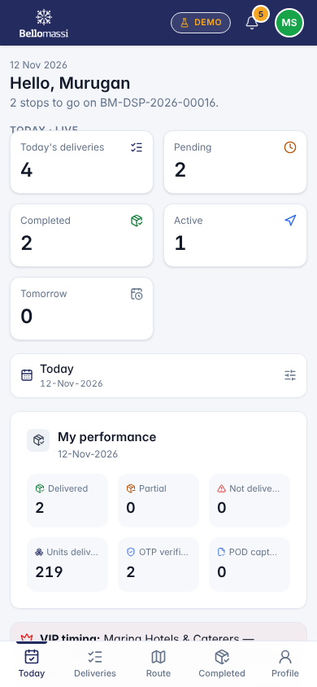
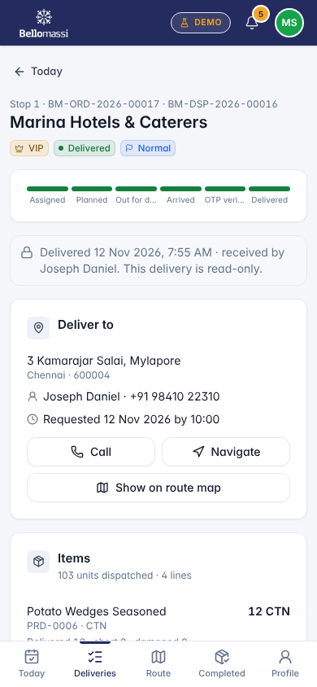
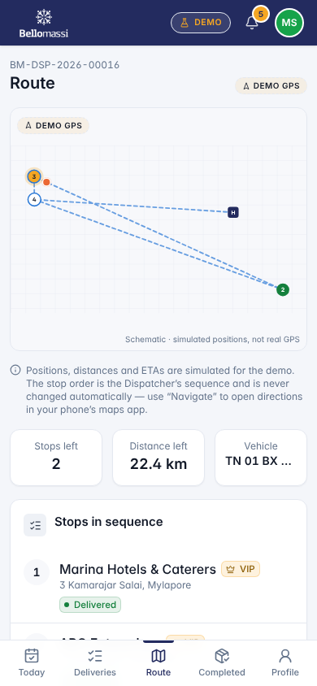

# Mobile UX — Driver App and Customer App

## Document control

| Field | Value |
|---|---|
| Document title | Mobile UX — Driver App and Customer App |
| Document ID | BM-UX-007 |
| Version | 1.0 |
| Status | Draft — for client review |
| Category | UI/UX and Design |
| Related module(s) | All modules |
| Document owner | UX Designer |
| Prepared by | Project documentation team (AI-assisted draft prepared from source-code analysis) |
| Reviewed by | _Pending — not yet reviewed_ |
| Approval | _Not approved — awaiting client review (no approval has been given)_ |
| Created date | 2026-11-12 |
| Last updated date | 2026-11-12 |

> **Status labels used in this document:** VERIFIED (confirmed in the current source code or existing documents) · PROTOTYPE (works in the React/LocalStorage prototype with mock or simulated behaviour) · PROPOSED (recommended production design, not built) · PENDING CONFIRMATION (needs a client decision) · NOT IMPLEMENTED · NOT VERIFIED.

## Purpose

Describe the mobile experience of the driver and customer apps and the changes proposed for the native driver app.

## Scope

Prototype mobile web screens (VERIFIED, 390 px viewport); native React Native driver app (PROPOSED).

## Definitions

Other terms: see [BM-GLO-001 — Project Glossary](../22_GLOSSARY_AND_REFERENCE/BM-GLO-001_Project_Glossary.md).

## References

- [BM-UX-005 — Screen Specifications](BM-UX-005_Screen_Specifications.md)
- [BM-MAN-001 — Driver App User Manual](../15_USER_MANUALS/BM-MAN-001_Driver_App_User_Manual.md)
- [BM-MAN-002 — Customer App User Manual](../15_USER_MANUALS/BM-MAN-002_Customer_App_User_Manual.md)
- [BM-FRD-DRV — Functional Requirements — Driver Application](../04_FUNCTIONAL_REQUIREMENTS/BM-FRD-DRV_Driver_Application.md)
- [BM-FRD-CAP — Functional Requirements — Customer Application](../04_FUNCTIONAL_REQUIREMENTS/BM-FRD-CAP_Customer_Application.md)

## 1. Driver app — prototype (VERIFIED)

| Screen | Content | Screenshot |
|---|---|---|
| Sign-in | Mobile number or email + password; demo account hint | UX-DRV-LOGIN |
| Today | Greeting, dispatch number, today's counts (deliveries, pending, completed, active, tomorrow), performance | UX-DRV-DASH |
| Deliveries | Stop list in sequence with status | UX-DRV-DELIVERIES |
| Delivery detail | Customer, address, items, actions: navigate, arrive, verify OTP, confirm | UX-DRV-DELIVERY |
| Route | Ordered stops on a map (DEMO GPS) | UX-DRV-ROUTE |
| Completed / Delivery notes / Profile | History, notes, profile and documents | UX-DRV-COMPLETED, UX-DRV-NOTES, UX-DRV-PROFILE |

The confirmation screen (`/driver/deliveries/:id/confirm`) opens only after the driver has arrived and the OTP flow has
started; opening it directly redirects back to the delivery (VERIFIED during capture).

{width=5.5cm} {width=5.5cm} {width=5.5cm}

## 2. Customer app — prototype (VERIFIED; scope PENDING CONFIRMATION — extension X-01)

| Screen | Content | Screenshot |
|---|---|---|
| Home | Active / pending / delivered orders, outstanding, "your order is on the vehicle" card with Track delivery | UX-CUS-DASH |
| Catalog / Cart | Product browse, quantities, submit order (goes to Sales Manager approval) | UX-CUS-CATALOG, UX-CUS-CART |
| Orders / Order detail | Order list and status timeline | UX-CUS-ORDERS, UX-CUS-ORDER |
| Delivery notes / Invoices / Profile | Documents of the linked customer only | UX-CUS-NOTES, UX-CUS-INVOICES, UX-CUS-PROFILE |

## 3. Mobile UX rules (prototype and production)

- Single column, cards, minimum 44 px touch targets, primary action at the bottom within thumb reach.
- Bottom navigation with 5 items; current item highlighted.
- Large OTP input (6 digits, numeric keyboard); clear error after wrong attempt with attempts remaining.
- Show connection / GPS state; never hide that GPS is simulated (DEMO GPS badge).
- Signature pad and photo capture full-width.

## 4. Native driver app — PROPOSED

| Need | Proposal |
|---|---|
| Background GPS while a delivery is active | Native location service with foreground notification |
| Offline | Local queue of POD / status updates, sync when online |
| Push notifications | New dispatch, changes, messages |
| Camera / signature | Native camera, compressed upload |
| Navigation | Hand-off to Google Maps / Waze |
| Battery | Adaptive interval (10–15 s moving, longer when stationary) |

## Revision history

| Version | Date | Author | Description |
|---|---|---|---|
| 1.0 | 2026-11-12 | Documentation team | Initial draft prepared from analysis of the bellomassi-premium-ui source code and existing project documents. |