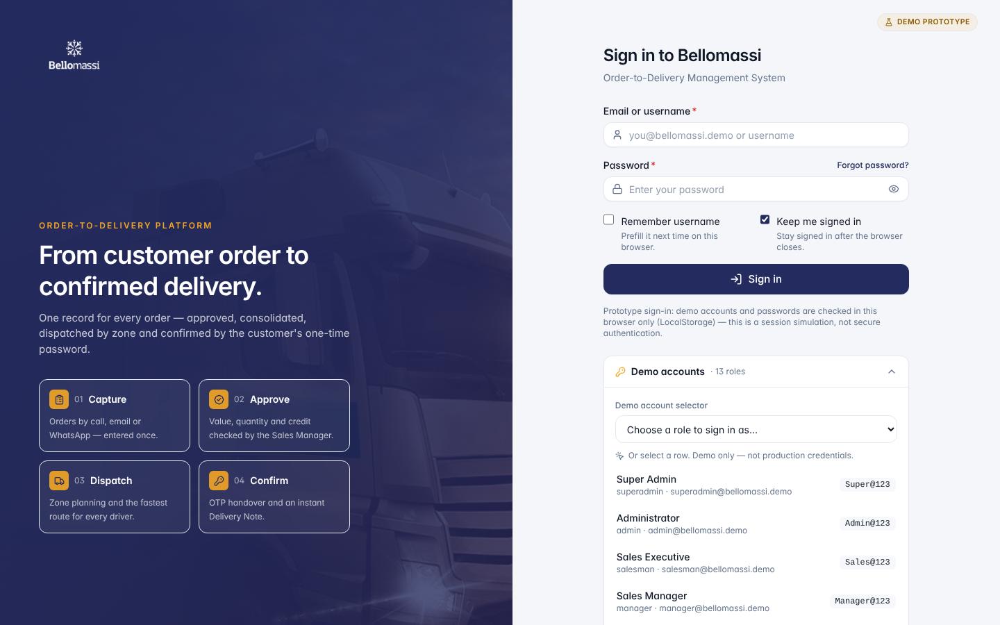
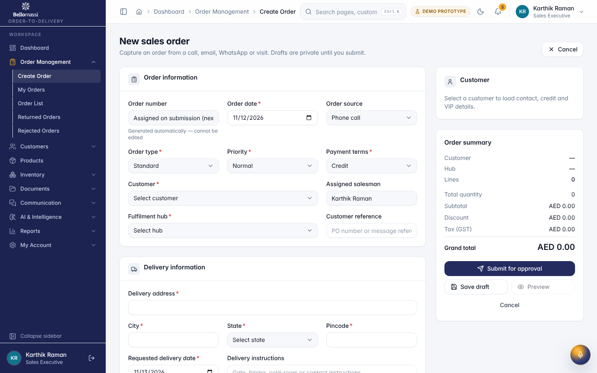
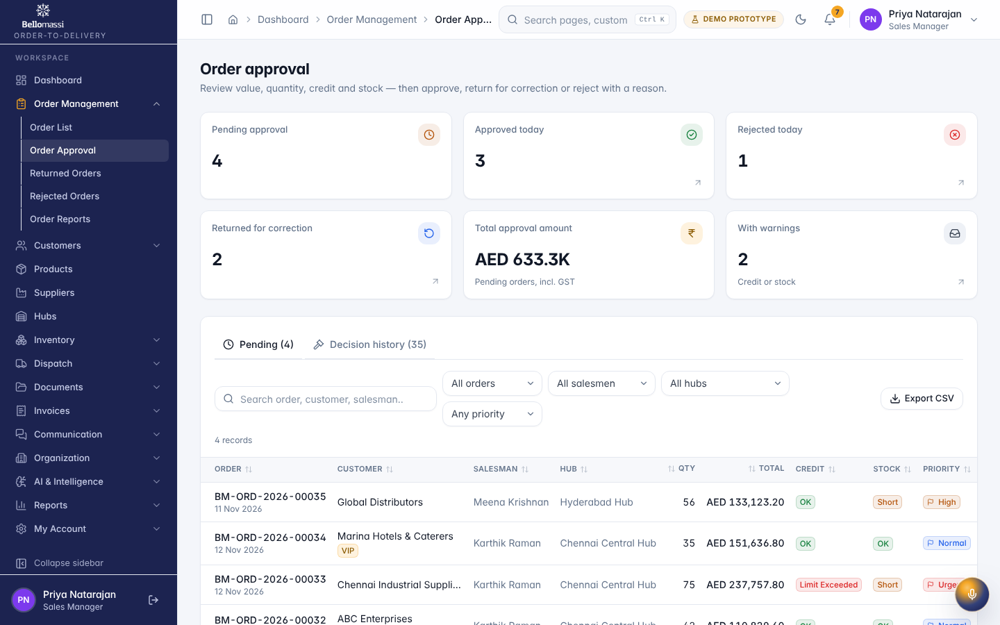
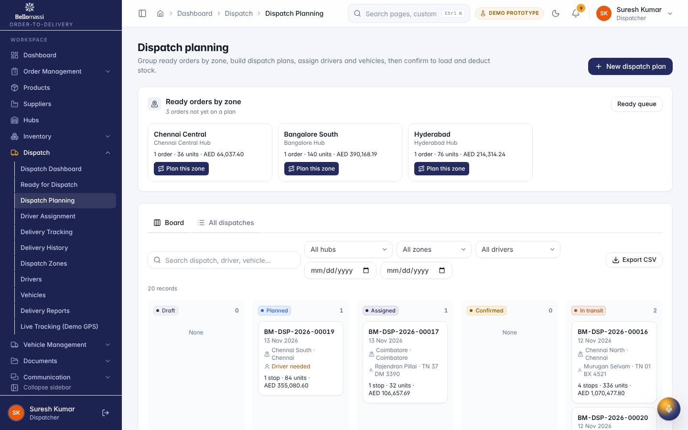

# Office Web Application User Manual (All Office Roles)

## Document control

| Field | Value |
|---|---|
| Document title | Office Web Application User Manual (All Office Roles) |
| Document ID | BM-MAN-003 |
| Version | 1.0 |
| Status | Draft — for client review |
| Category | User Manuals |
| Related module(s) | All modules |
| Document owner | Training Lead |
| Prepared by | Project documentation team (AI-assisted draft prepared from source-code analysis) |
| Reviewed by | _Pending — not yet reviewed_ |
| Approval | _Not approved — awaiting client review (no approval has been given)_ |
| Created date | 2026-11-12 |
| Last updated date | 2026-11-12 |

> **Status labels used in this document:** VERIFIED (confirmed in the current source code or existing documents) · PROTOTYPE (works in the React/LocalStorage prototype with mock or simulated behaviour) · PROPOSED (recommended production design, not built) · PENDING CONFIRMATION (needs a client decision) · NOT IMPLEMENTED · NOT VERIFIED.

## Purpose

Common guide to the office web application and the main order-to-delivery procedures; role details are in the role manuals.

## Scope

Office web app of the prototype (VERIFIED with real screenshots captured 2026-11-12, demo data).

## Definitions

Other terms: see [BM-GLO-001 — Project Glossary](../22_GLOSSARY_AND_REFERENCE/BM-GLO-001_Project_Glossary.md).

## References

- [BM-MAN-101 — Role User Manual — Super Admin](BM-MAN-101_User_Manual_Super_Admin.md)
- [BM-MAN-102 — Role User Manual — Administrator](BM-MAN-102_User_Manual_Administrator.md)
- [BM-MAN-103 — Role User Manual — Sales Executive (SALESMAN)](BM-MAN-103_User_Manual_Sales_Executive.md)
- [BM-MAN-104 — Role User Manual — Sales Manager](BM-MAN-104_User_Manual_Sales_Manager.md)
- [BM-MAN-105 — Role User Manual — Customer Service](BM-MAN-105_User_Manual_Customer_Service.md)
- [BM-MAN-106 — Role User Manual — Dispatcher](BM-MAN-106_User_Manual_Dispatcher.md)
- [BM-MAN-108 — Role User Manual — Finance Executive](BM-MAN-108_User_Manual_Finance_Executive.md)
- [BM-MAN-120 — Role Responsibility Matrix](BM-MAN-120_Role_Responsibility_Matrix.xlsx)
- [BM-UX-005 — Screen Specifications](../12_UI_UX_AND_DESIGN/BM-UX-005_Screen_Specifications.md)

## 1. Signing in and out

1. Open the application and sign in with your user name or email and password.
2. Tick *Remember username* / *Keep me signed in* only on your own computer.
3. After 5 wrong passwords the account is locked for 15 minutes (default) — an Administrator can unlock it.
4. Inactivity signs you out after 60 minutes (default setting).
5. Sign out from the profile menu (top right).

{width=15cm}

## 2. Finding your way

| Element | Use |
|---|---|
| Sidebar | Menu groups for your role; collapse with the arrow; on small screens it opens as a drawer |
| Breadcrumbs | Shows where you are; click to go back |
| Global search (Ctrl K) | Find pages, customers, orders, deliveries, drivers, vehicles, reports |
| Bell | Notifications; open the Notification Center for history |
| Theme | Light / dark mode |
| Profile menu | My profile, change password, preferences, sign out |
| Dashboard period filter | All time, date range, specific period, compare with previous period |

## 3. Working with lists and forms

- Lists: search box, filters, sorting by column header, paging, row actions (view, edit, more).
- Forms: fields with `*` are mandatory; errors appear below the field; **Save draft** keeps unfinished work; destructive
  actions ask for confirmation.
- Every important change is written to the audit log.

## 4. Main procedures

### 4.1 Create and submit an order (Salesman)

1. **Orders → Create Order**. Choose customer, order type, priority, payment terms, fulfilment hub; delivery address and
   requested date.
2. Add products and quantities; review warnings (stock, credit).
3. **Preview**, then **Submit for approval** (or **Save draft**).

{width=15cm}

### 4.2 Approve, return or reject (Sales Manager)

1. **Order Approval** shows submitted orders.
2. Open an order; review the 6 automatic checks (including credit).
3. **Approve**, **Return for correction** (reason required) or **Reject** (reason required).

{width=15cm}

### 4.3 Consolidate (Customer Service)

**Order Consolidation** → open approved orders per salesman → verify (5 checks) → consolidate → **Ready for dispatch**.

### 4.4 Plan and confirm a dispatch (Dispatcher)

1. **Ready Orders** → select orders (by zone / date).
2. **New Dispatch**: orders, zone, date, stop sequence; assign a compliant driver and vehicle of the same hub.
3. **Confirm** after loading review — stock is deducted at this point and the driver can start.
4. Follow progress in **Delivery Tracking** / **Live Tracking** (DEMO GPS).
5. Review failed / partial deliveries: return stock or re-queue.

{width=15cm}

### 4.5 Delivery notes and invoices

Delivery notes are created automatically for each completed stop (**Dispatch → delivery note**). Invoices (Finance) are an
extension module; whether invoicing is in scope is PENDING CONFIRMATION.

### 4.6 Reports

**Reports Center**: 118 reports in 11 categories — search, filter, group, export CSV, print. 24 reports show "No source
data" because the prototype does not capture that data.

## 5. Role manuals

| Role | Manual |
|---|---|
| Super Admin | [BM-MAN-101 — Role User Manual — Super Admin](BM-MAN-101_User_Manual_Super_Admin.md) |
| Administrator | [BM-MAN-102 — Role User Manual — Administrator](BM-MAN-102_User_Manual_Administrator.md) |
| Sales Executive | [BM-MAN-103 — Role User Manual — Sales Executive (SALESMAN)](BM-MAN-103_User_Manual_Sales_Executive.md) |
| Sales Manager | [BM-MAN-104 — Role User Manual — Sales Manager](BM-MAN-104_User_Manual_Sales_Manager.md) |
| Customer Service | [BM-MAN-105 — Role User Manual — Customer Service](BM-MAN-105_User_Manual_Customer_Service.md) |
| Dispatcher | [BM-MAN-106 — Role User Manual — Dispatcher](BM-MAN-106_User_Manual_Dispatcher.md) |
| Finance | [BM-MAN-108 — Role User Manual — Finance Executive](BM-MAN-108_User_Manual_Finance_Executive.md) |
| Warehouse Manager | [BM-MAN-109 — Role User Manual — Warehouse Manager](BM-MAN-109_User_Manual_Warehouse_Manager.md) |
| Inventory Executive | [BM-MAN-110 — Role User Manual — Inventory Executive](BM-MAN-110_User_Manual_Inventory_Executive.md) |
| QA Manager | [BM-MAN-111 — Role User Manual — QA Manager](BM-MAN-111_User_Manual_QA_Manager.md) |
| Supplier | [BM-MAN-113 — Role User Manual — Supplier (portal)](BM-MAN-113_User_Manual_Supplier.md) |
| Management (proposed) | [BM-MAN-114 — Role User Manual — Management (Read-only Oversight)](BM-MAN-114_User_Manual_Management.md) |

## 6. Prototype notes

Data is stored in your browser only — another computer does not see your changes. Email, WhatsApp, GPS, OCR and AI
functions are simulated and labelled. Do not enter real customer data in the prototype.

## Revision history

| Version | Date | Author | Description |
|---|---|---|---|
| 1.0 | 2026-11-12 | Documentation team | Initial draft prepared from analysis of the bellomassi-premium-ui source code and existing project documents. |