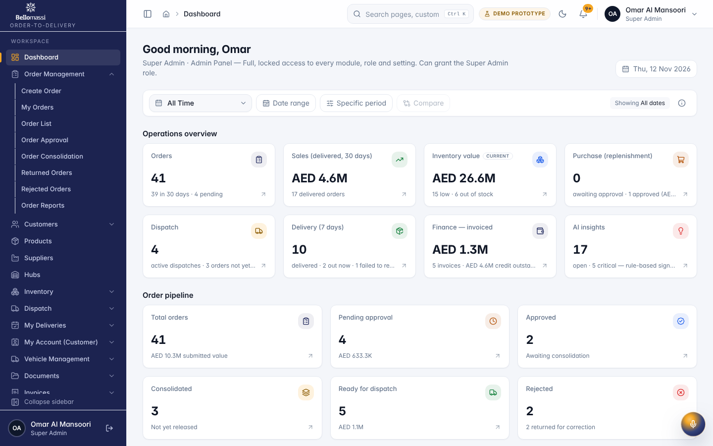
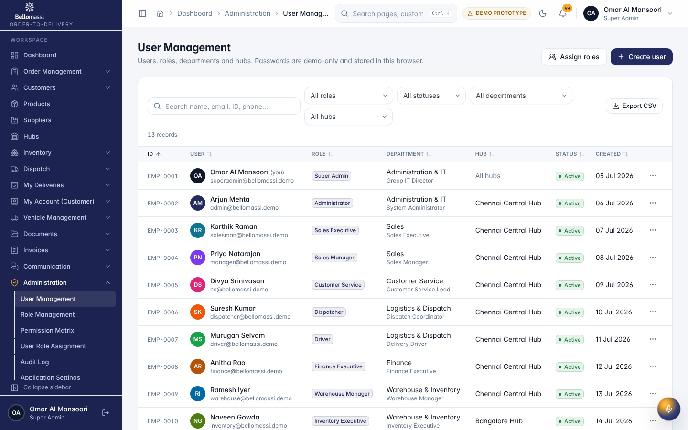
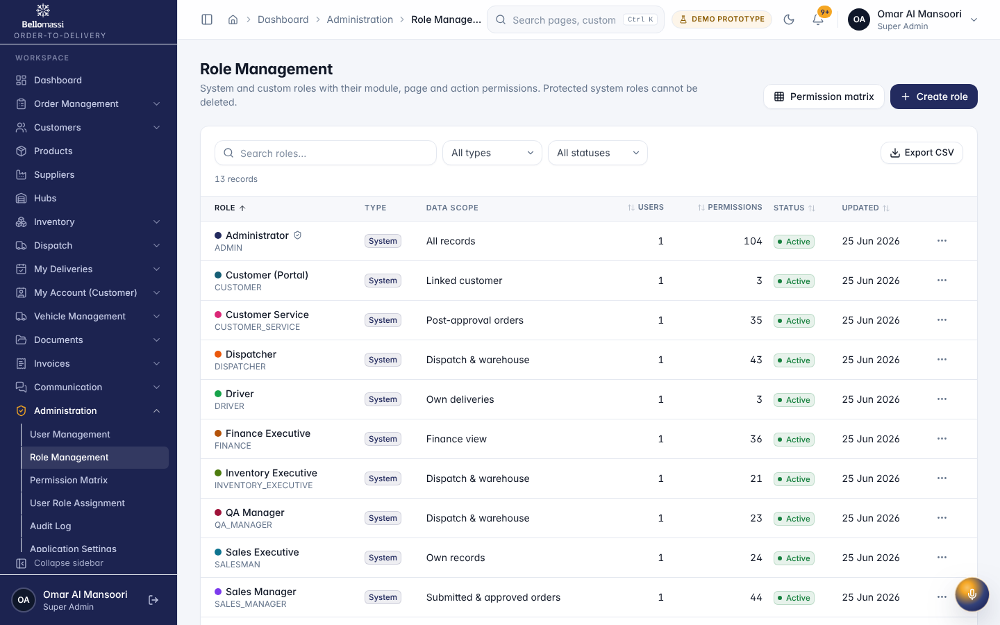
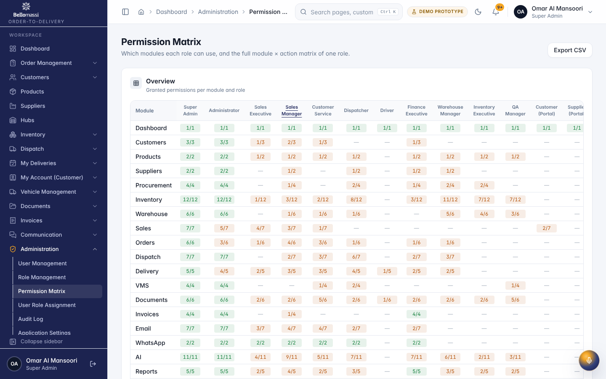
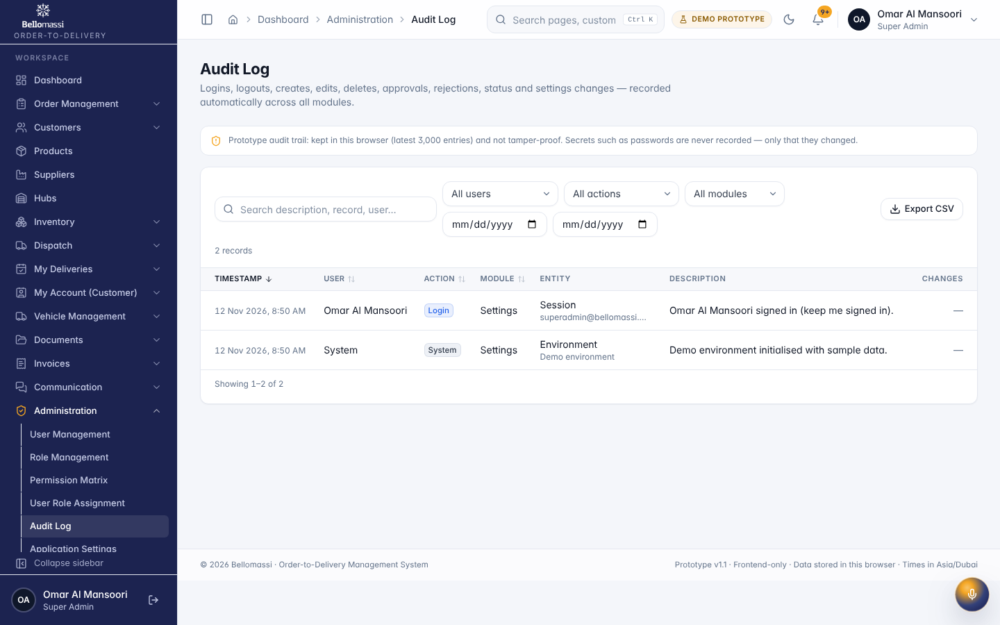

# Role User Manual — Super Admin

## Document control

| Field | Value |
|---|---|
| Document title | Role User Manual — Super Admin |
| Document ID | BM-MAN-101 |
| Version | 1.0 |
| Status | Draft — for client review |
| Category | User Manuals |
| Related module(s) | All modules |
| Document owner | Training Lead |
| Prepared by | Project documentation team (AI-assisted draft prepared from source-code analysis) |
| Reviewed by | _Pending — not yet reviewed_ |
| Approval | _Not approved — awaiting client review (no approval has been given)_ |
| Created date | 2026-11-12 |
| Last updated date | 2026-11-12 |

> **Status labels used in this document:** VERIFIED (confirmed in the current source code or existing documents) · PROTOTYPE (works in the React/LocalStorage prototype with mock or simulated behaviour) · PROPOSED (recommended production design, not built) · PENDING CONFIRMATION (needs a client decision) · NOT IMPLEMENTED · NOT VERIFIED.

## Purpose

Explain to a Super Admin user how to sign in, find their screens and do their daily work in the Bellomassi prototype.

## Scope

Role SUPER_ADMIN with its default permissions (VERIFIED from src/config/permissions.js and navigation.js). An Administrator can change permissions, so menus may differ.

## Definitions

Other terms: see [BM-GLO-001 — Project Glossary](../22_GLOSSARY_AND_REFERENCE/BM-GLO-001_Project_Glossary.md).

## References

- Workflow documentation chapter 04 (existing document
- reused)
- BM-UX-005 Screen Specifications
- [BM-MAN-003 — Office Web Application User Manual (All Office Roles)](BM-MAN-003_Office_Web_App_User_Manual.md)
- [BM-MAN-120 — Role Responsibility Matrix](BM-MAN-120_Role_Responsibility_Matrix.xlsx)
- [BM-SEC-005 — RBAC and Access Control Matrix](../10_SECURITY_AND_COMPLIANCE/BM-SEC-005_RBAC_and_Access_Control_Matrix.xlsx)

## 1. Your role

Owner of the platform: every module, every role and setting. The only role that can grant, change, reset or delete Super Admin accounts.

| Topic | Details |
|---|---|
| Purpose | Owner of the platform: every module, every role and setting. The only role that can grant, change, reset or delete Super Admin accounts. |
| Login | `/login` · **superadmin / Super@123** (demo account — PROTOTYPE only; production accounts are issued by the Administrator) |
| Dashboard | `/dashboard` → `AdminDashboard` (Operations overview) |
| Menus | Everything the Administrator sees (4.2). Because Super Admin holds every permission key, the **My Deliveries** (driver app) and **My Account (Customer)** groups also appear; those pages show "No driver profile linked" / "No customer account linked" unless the user is linked to a driver or customer record. |
| KPIs | Total orders, Pending approval, Approved, Rejected, Consolidated, Ready for dispatch, Order pipeline; Operations overview: Sales (delivered, 30 days), Delivery (7 days), Inventory value, Finance — invoiced, Purchase (replenishment), AI insights |
| CRUD | All master data, users, roles, permissions, settings, organization, templates |
| Approvals | Orders, scrap, replenishment, documents (all permissions) |
| Reports | All 118 reports in the Reports Center; every module report |
| Notifications | Administrative and operational notifications addressed to ADMIN / SUPER_ADMIN |
| Cannot do | Delete or deactivate their **own** account; remove their own access to user management |
| Next responsible user | Administrator (day-to-day administration) |
| Logout | Header menu › Sign Out → `/logout` → `/login` |

## 2. Getting started

1. Open the application address given by your Administrator.
2. Sign in with your user name (or mobile number / email) and password. After 5 wrong attempts the account is locked for 15 minutes (default security setting; an Administrator can unlock it).
3. You land on your dashboard. Use the menu (sidebar on desktop, bottom bar on phone) to move between screens.
4. Use the bell icon for notifications and the profile menu to change your password, preferences or to sign out.

## 3. Your daily work

1. Review dashboard
2. user and role administration
3. audit log
4. settings

## 4. Screens you use

{width=15cm}

{width=15cm}

{width=15cm}

{width=15cm}

{width=15cm}

## 5. Rules to remember

- Delete or deactivate their own account; remove their own access to user management
- Work only with the records in your data scope: as configured.
- After your step the next responsible user is: Administrator (day-to-day administration).

## 6. Prototype notes

This manual describes the prototype (PROTOTYPE). Data is stored only in your browser; demo markers show simulated
features (GPS, OTP messages, email / WhatsApp). Production behaviour may differ — see [BM-OVW-015 — Project Status and Implementation Summary](../01_PROJECT_OVERVIEW/BM-OVW-015_Project_Status_and_Implementation_Summary.md).

## Revision history

| Version | Date | Author | Description |
|---|---|---|---|
| 1.0 | 2026-11-12 | Documentation team | Initial draft prepared from analysis of the bellomassi-premium-ui source code and existing project documents. |