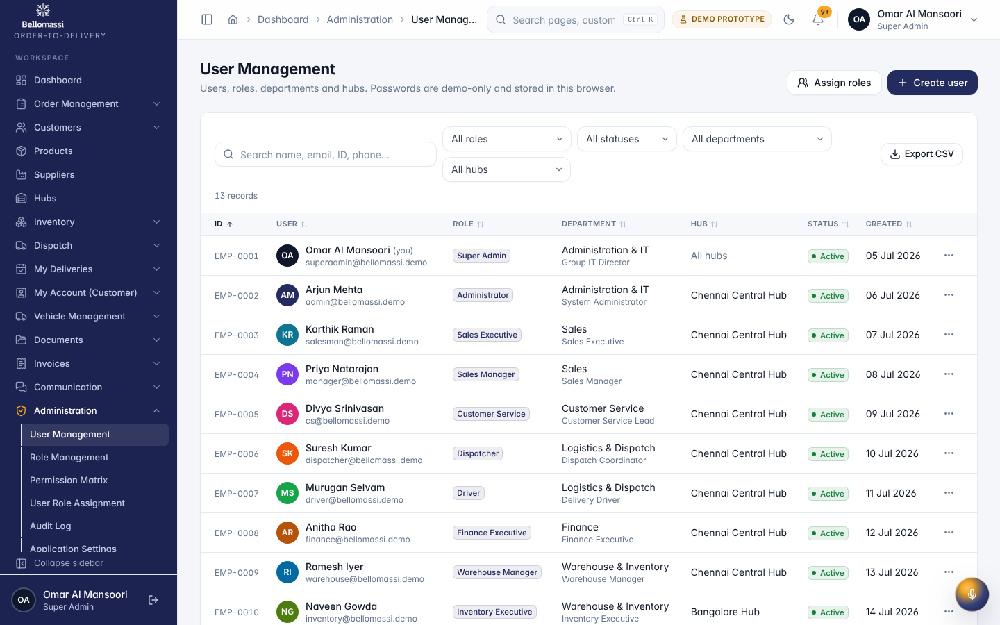
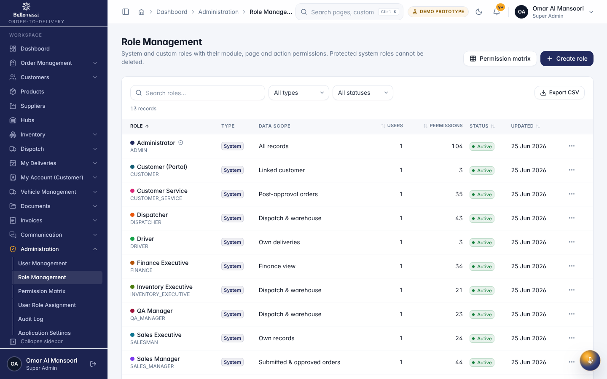
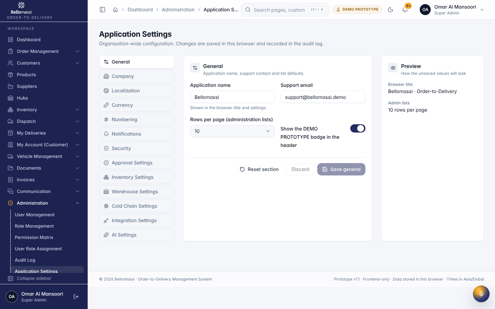
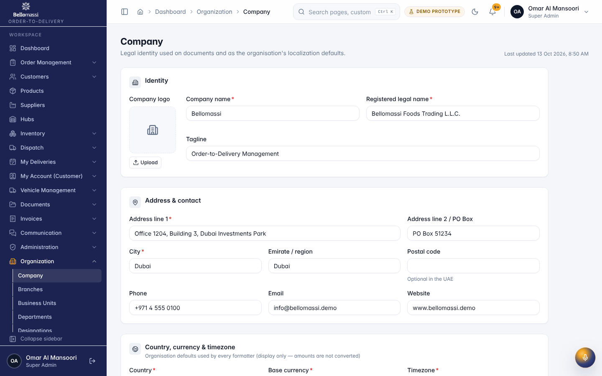
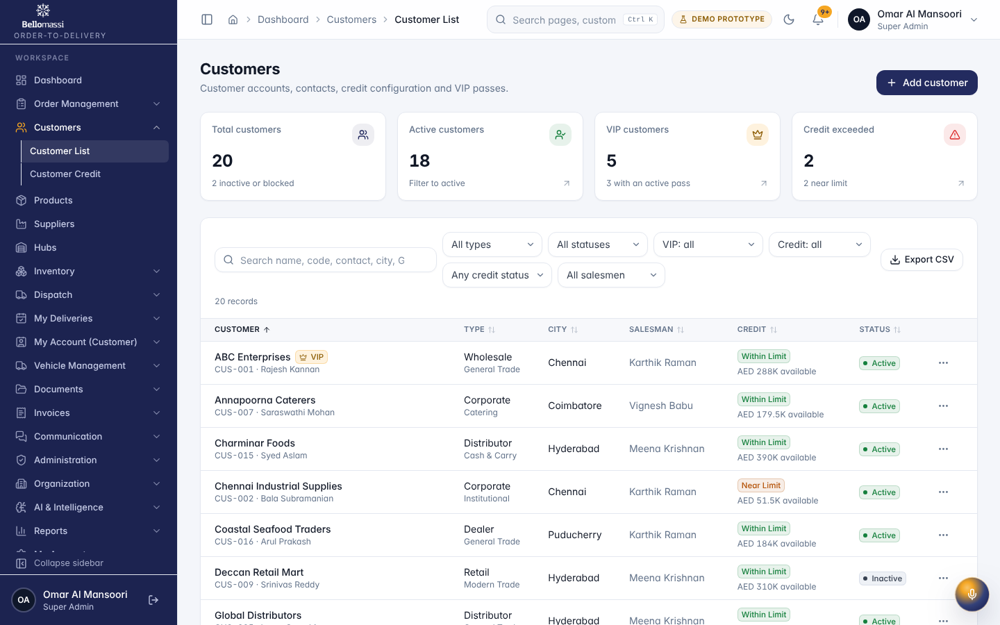
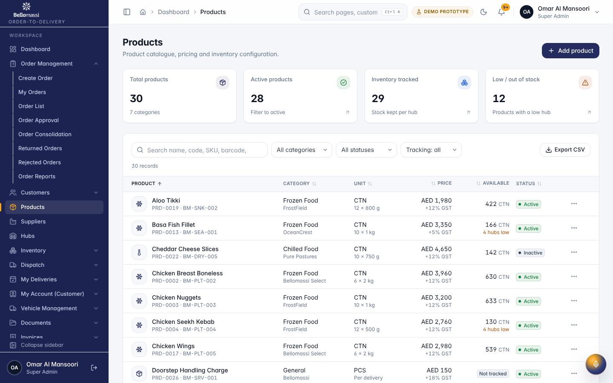

# Role User Manual — Administrator

## Document control

| Field | Value |
|---|---|
| Document title | Role User Manual — Administrator |
| Document ID | BM-MAN-102 |
| Version | 1.0 |
| Status | Draft — for client review |
| Category | User Manuals |
| Related module(s) | All modules |
| Document owner | Training Lead |
| Prepared by | Project documentation team (AI-assisted draft prepared from source-code analysis) |
| Reviewed by | _Pending — not yet reviewed_ |
| Approval | _Not approved — awaiting client review (no approval has been given)_ |
| Created date | 2026-11-12 |
| Last updated date | 2026-11-12 |

> **Status labels used in this document:** VERIFIED (confirmed in the current source code or existing documents) · PROTOTYPE (works in the React/LocalStorage prototype with mock or simulated behaviour) · PROPOSED (recommended production design, not built) · PENDING CONFIRMATION (needs a client decision) · NOT IMPLEMENTED · NOT VERIFIED.

## Purpose

Explain to a Administrator user how to sign in, find their screens and do their daily work in the Bellomassi prototype.

## Scope

Role ADMIN with its default permissions (VERIFIED from src/config/permissions.js and navigation.js). An Administrator can change permissions, so menus may differ.

## Definitions

Other terms: see [BM-GLO-001 — Project Glossary](../22_GLOSSARY_AND_REFERENCE/BM-GLO-001_Project_Glossary.md).

## References

- Workflow documentation chapter 04 (existing document
- reused)
- BM-UX-005 Screen Specifications
- [BM-MAN-003 — Office Web Application User Manual (All Office Roles)](BM-MAN-003_Office_Web_App_User_Manual.md)
- [BM-MAN-120 — Role Responsibility Matrix](BM-MAN-120_Role_Responsibility_Matrix.xlsx)
- [BM-SEC-005 — RBAC and Access Control Matrix](../10_SECURITY_AND_COMPLIANCE/BM-SEC-005_RBAC_and_Access_Control_Matrix.xlsx)

## 1. Your role

Runs the system day to day: administers users, roles and settings and can perform most business steps (create orders, plan and confirm dispatches, issue invoices, approve scrap and replenishment).

| Topic | Details |
|---|---|
| Purpose | Runs the system day to day: administers users, roles and settings and can perform most business steps (create orders, plan and confirm dispatches, issue invoices, approve scrap and replenishment). |
| Login | `/login` · **admin / Admin@123** (demo account — PROTOTYPE only; production accounts are issued by the Administrator) |
| Dashboard | `/dashboard` → `AdminDashboard` (same KPIs as Super Admin) |
| Menus | **Order Management:** Create Order, My Orders, Order List, Order Approval, Order Consolidation, Returned Orders, Rejected Orders, Order Reports · **Customers:** Customer List, Customer Credit · Products, Suppliers, Hubs · **Inventory:** Inventory Dashboard, Warehouse Dashboard, QA & Cold Chain, Stock Overview, Low Stock, Stock Receipts, Stock Transfers, Stock Adjustments, Stock Movements, Scrap Management · **Dispatch:** Dispatch Dashboard, Ready for Dispatch, Dispatch Planning, Driver Assignment, Delivery Tracking, Delivery History, Dispatch Zones, Drivers, Vehicles, Delivery Reports, Live Tracking (Demo GPS) · **Vehicle Management:** VMS Dashboard, Vehicles, Driver Documents, Document Expiry, VMS Reports, Compliance Rules · **Documents:** Document Repository, Upload Documents, OCR Queue, Verified, Rejected, Document Types, Document Reports · **Invoices:** Invoice Dashboard, Invoices, New Invoice, Invoice Templates, Invoice Reports · **Communication:** Communication Center, Email, WhatsApp, Automated Notifications, Call History, Call Follow-ups · **Administration:** User Management, Role Management, Permission Matrix, User Role Assignment, Audit Log, Application Settings · **Organization:** Company, Branches, Business Units, Departments, Designations, Employee Master, Warehouse Master · **AI & Intelligence:** AI Overview, AI Assistant, Jarvis, Forecasting, Predictive Inventory, Replenishment, AI Insights, Model Management, AI Settings · **Reports:** Reports Center |
| CRUD | Customers, products, suppliers, hubs, zones, drivers, vehicles, document types, invoice templates, email/WhatsApp templates, users, roles, organization records |
| Approvals | Scrap (`scrap.approve`), replenishment (`procurement.approve` / `procurement.reject` — **only** Administrator and Super Admin hold these), documents (`documents.review`, `documents.reject`). **Not** order approval or consolidation: the Administrator can open the Order Approval and Consolidation queues but `orders.approve`, `orders.reject` and `orders.consolidate` are not granted by default (Super Admin holds them). |
| Reports | All report categories |
| Notifications | Failed deliveries, dispatch confirmations, document expiry, low stock, purchase approvals |
| Cannot do | Change or delete a Super Admin account; change the Administrator role unless they are Administrator or Super Admin |
| Next responsible user | Depends on the module (e.g. approved replenishment → Supplier / warehouse goods receipt) |
| Logout | `/logout` → `/login` |

## 2. Getting started

1. Open the application address given by your Administrator.
2. Sign in with your user name (or mobile number / email) and password. After 5 wrong attempts the account is locked for 15 minutes (default security setting; an Administrator can unlock it).
3. You land on your dashboard. Use the menu (sidebar on desktop, bottom bar on phone) to move between screens.
4. Use the bell icon for notifications and the profile menu to change your password, preferences or to sign out.

## 3. Your daily work

1. Check dashboard
2. approve replenishment drafts
3. handle user requests (unlock, reset password)
4. review audit log
5. adjust settings

## 4. Screens you use

{width=15cm}

{width=15cm}

{width=15cm}

{width=15cm}

{width=6.5cm}

{width=15cm}

## 5. Rules to remember

- Change or delete a Super Admin account; change the Administrator role unless they are Administrator or Super Admin
- Work only with the records in your data scope: as configured.
- After your step the next responsible user is: Depends on the module (e.g. approved replenishment → Supplier / warehouse goods receipt).

## 6. Prototype notes

This manual describes the prototype (PROTOTYPE). Data is stored only in your browser; demo markers show simulated
features (GPS, OTP messages, email / WhatsApp). Production behaviour may differ — see [BM-OVW-015 — Project Status and Implementation Summary](../01_PROJECT_OVERVIEW/BM-OVW-015_Project_Status_and_Implementation_Summary.md).

## Revision history

| Version | Date | Author | Description |
|---|---|---|---|
| 1.0 | 2026-11-12 | Documentation team | Initial draft prepared from analysis of the bellomassi-premium-ui source code and existing project documents. |