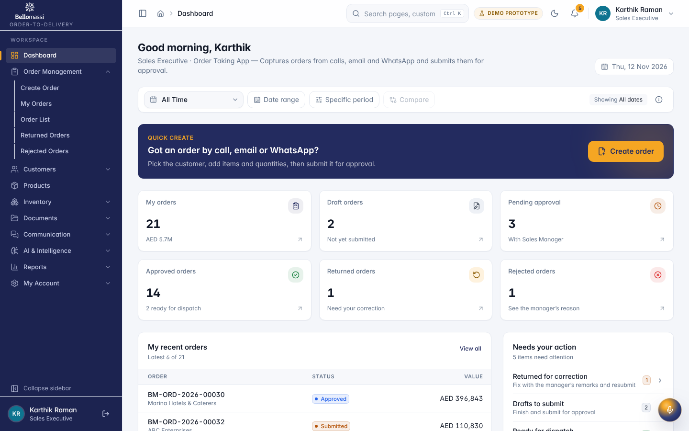
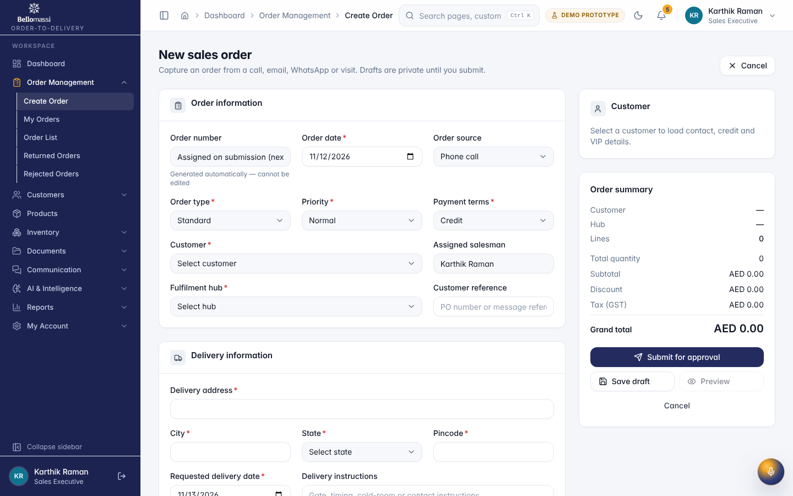
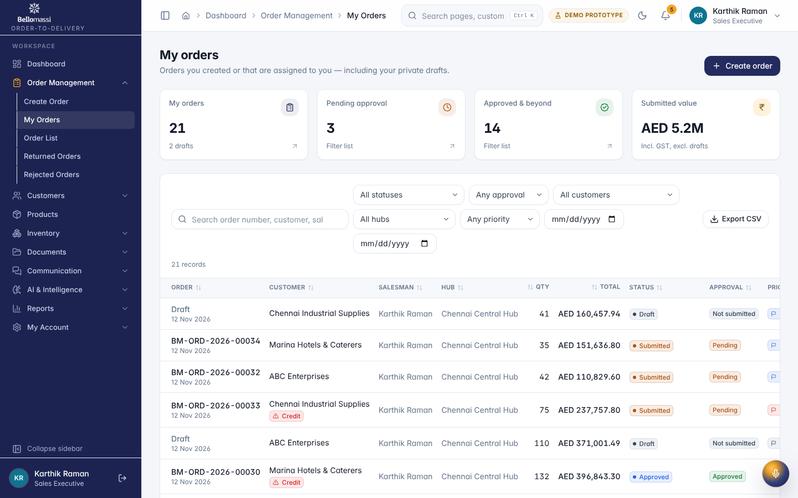
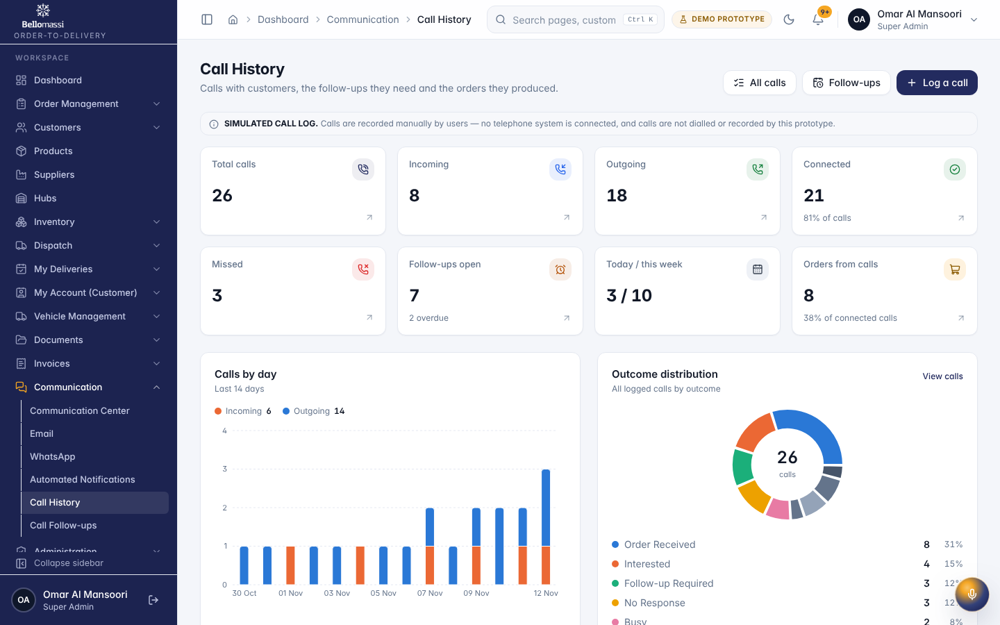

# Role User Manual — Sales Executive (SALESMAN)

## Document control

| Field | Value |
|---|---|
| Document title | Role User Manual — Sales Executive (SALESMAN) |
| Document ID | BM-MAN-103 |
| Version | 1.0 |
| Status | Draft — for client review |
| Category | User Manuals |
| Related module(s) | All modules |
| Document owner | Training Lead |
| Prepared by | Project documentation team (AI-assisted draft prepared from source-code analysis) |
| Reviewed by | _Pending — not yet reviewed_ |
| Approval | _Not approved — awaiting client review (no approval has been given)_ |
| Created date | 2026-11-12 |
| Last updated date | 2026-11-12 |

> **Status labels used in this document:** VERIFIED (confirmed in the current source code or existing documents) · PROTOTYPE (works in the React/LocalStorage prototype with mock or simulated behaviour) · PROPOSED (recommended production design, not built) · PENDING CONFIRMATION (needs a client decision) · NOT IMPLEMENTED · NOT VERIFIED.

## Purpose

Explain to a Sales Executive (SALESMAN) user how to sign in, find their screens and do their daily work in the Bellomassi prototype.

## Scope

Role SALESMAN with its default permissions (VERIFIED from src/config/permissions.js and navigation.js). An Administrator can change permissions, so menus may differ.

## Definitions

Other terms: see [BM-GLO-001 — Project Glossary](../22_GLOSSARY_AND_REFERENCE/BM-GLO-001_Project_Glossary.md).

## References

- Workflow documentation chapter 04 (existing document
- reused)
- BM-UX-005 Screen Specifications
- [BM-MAN-003 — Office Web Application User Manual (All Office Roles)](BM-MAN-003_Office_Web_App_User_Manual.md)
- [BM-MAN-120 — Role Responsibility Matrix](BM-MAN-120_Role_Responsibility_Matrix.xlsx)
- [BM-SEC-005 — RBAC and Access Control Matrix](../10_SECURITY_AND_COMPLIANCE/BM-SEC-005_RBAC_and_Access_Control_Matrix.xlsx)

## 1. Your role

Takes orders for the customers assigned to them and keeps them moving through approval.

| Topic | Details |
|---|---|
| Purpose | Takes orders for the customers assigned to them and keeps them moving through approval. |
| Login | `/login` · **salesman / Sales@123** (demo account — PROTOTYPE only; production accounts are issued by the Administrator) |
| Dashboard | `SalesmanDashboard`: My orders, Draft orders, Pending approval, Approved orders, Returned orders, Rejected orders, Needs your action, My order trend, My recent orders |
| Menus | **Order Management:** Create Order, My Orders, Order List, Returned Orders, Rejected Orders · **Customers:** Customer List · Products · **Inventory:** Stock Overview · **Documents:** Repository, Upload, OCR Queue, Verified, Rejected · **Communication:** Communication Center, Email, WhatsApp, Call History, Call Follow-ups · **AI:** AI Overview, AI Assistant, Jarvis · Reports Center |
| Data scope | Own records only (orders where `salesmanId` or `createdBy` is the user) |
| CRUD | Create, edit and delete **draft** orders; duplicate an order; edit and resubmit **returned** orders; log, edit and delete own calls; upload documents for own records |
| Approvals | None (submits for approval) |
| Reports | Reports Center — only categories their permissions allow (Customer reports via `customers.view`, Communication reports via `communication.calls`) |
| Notifications | Order submitted / approved / returned (with link to edit) / rejected / ready for dispatch |
| Cannot do | Approve or reject orders; consolidate; dispatch; invoice; see other salesmen's orders; delete a submitted order ("Only draft orders can be deleted") |
| Next responsible user | **Sales Manager** (approval) |
| Logout | `/logout` → `/login` |

## 2. Getting started

1. Open the application address given by your Administrator.
2. Sign in with your user name (or mobile number / email) and password. After 5 wrong attempts the account is locked for 15 minutes (default security setting; an Administrator can unlock it).
3. You land on your dashboard. Use the menu (sidebar on desktop, bottom bar on phone) to move between screens.
4. Use the bell icon for notifications and the profile menu to change your password, preferences or to sign out.

## 3. Your daily work

1. Dashboard "Needs your action"
2. fix returned orders
3. create today's orders (or from a call)
4. submit
5. follow up calls
6. check approvals

## 4. Screens you use

{width=15cm}

{width=15cm}

{width=15cm}

{width=15cm}

## 5. Rules to remember

- Approve or reject orders; consolidate; dispatch; invoice; see other salesmen's orders; delete a submitted order ("Only draft orders can be deleted")
- Work only with the records in your data scope: Own records only (orders where `salesmanId` or `createdBy` is the user).
- After your step the next responsible user is: Sales Manager (approval).

## 6. Prototype notes

This manual describes the prototype (PROTOTYPE). Data is stored only in your browser; demo markers show simulated
features (GPS, OTP messages, email / WhatsApp). Production behaviour may differ — see [BM-OVW-015 — Project Status and Implementation Summary](../01_PROJECT_OVERVIEW/BM-OVW-015_Project_Status_and_Implementation_Summary.md).

## Revision history

| Version | Date | Author | Description |
|---|---|---|---|
| 1.0 | 2026-11-12 | Documentation team | Initial draft prepared from analysis of the bellomassi-premium-ui source code and existing project documents. |