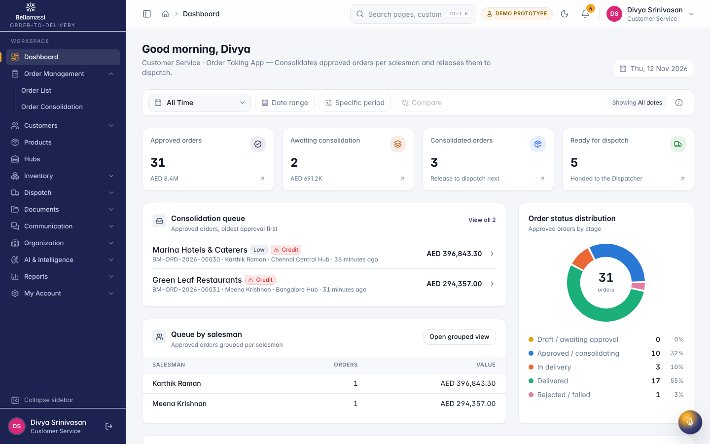
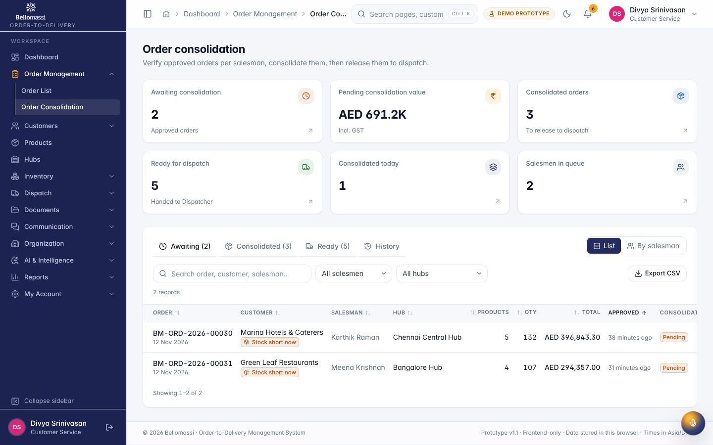

# Role User Manual — Customer Service

## Document control

| Field | Value |
|---|---|
| Document title | Role User Manual — Customer Service |
| Document ID | BM-MAN-105 |
| Version | 1.0 |
| Status | Draft — for client review |
| Category | User Manuals |
| Related module(s) | All modules |
| Document owner | Training Lead |
| Prepared by | Project documentation team (AI-assisted draft prepared from source-code analysis) |
| Reviewed by | _Pending — not yet reviewed_ |
| Approval | _Not approved — awaiting client review (no approval has been given)_ |
| Created date | 2026-11-12 |
| Last updated date | 2026-11-12 |

> **Status labels used in this document:** VERIFIED (confirmed in the current source code or existing documents) · PROTOTYPE (works in the React/LocalStorage prototype with mock or simulated behaviour) · PROPOSED (recommended production design, not built) · PENDING CONFIRMATION (needs a client decision) · NOT IMPLEMENTED · NOT VERIFIED.

## Purpose

Explain to a Customer Service user how to sign in, find their screens and do their daily work in the Bellomassi prototype.

## Scope

Role CUSTOMER_SERVICE with its default permissions (VERIFIED from src/config/permissions.js and navigation.js). An Administrator can change permissions, so menus may differ.

## Definitions

Other terms: see [BM-GLO-001 — Project Glossary](../22_GLOSSARY_AND_REFERENCE/BM-GLO-001_Project_Glossary.md).

## References

- Workflow documentation chapter 04 (existing document
- reused)
- BM-UX-005 Screen Specifications
- [BM-MAN-003 — Office Web Application User Manual (All Office Roles)](BM-MAN-003_Office_Web_App_User_Manual.md)
- [BM-MAN-120 — Role Responsibility Matrix](BM-MAN-120_Role_Responsibility_Matrix.xlsx)
- [BM-SEC-005 — RBAC and Access Control Matrix](../10_SECURITY_AND_COMPLIANCE/BM-SEC-005_RBAC_and_Access_Control_Matrix.xlsx)

## 1. Your role

Verifies approved orders against the warehouse, consolidates them and releases them to dispatch; reviews documents.

| Topic | Details |
|---|---|
| Purpose | Verifies approved orders against the warehouse, consolidates them and releases them to dispatch; reviews documents. |
| Login | `/login` · **cs / Cs@123** (demo account — PROTOTYPE only; production accounts are issued by the Administrator) |
| Dashboard | `CustomerServiceDashboard`: Approved orders, Awaiting consolidation, Consolidated orders, Ready for dispatch, Approved orders by stage, Queue by salesman, Consolidation queue (oldest approval first), Recent approved orders |
| Menus | **Order Management:** Order List, Order Consolidation · Customer List · Products, Hubs · **Inventory:** Stock Overview, Low Stock · **Dispatch:** Dispatch Dashboard, Ready for Dispatch, Dispatch Planning, Delivery Tracking, Delivery History · **Documents:** Repository, Upload, OCR Queue, Verified, Rejected, Document Reports · **Communication:** Center, Email, WhatsApp, Call History, Call Follow-ups · **AI:** AI Overview, AI Assistant, Jarvis, AI Insights · Reports Center |
| Data scope | Orders from approval onwards; all documents |
| CRUD | Consolidation records; calls; documents (upload, review, reject); VMS document upload |
| Approvals | Consolidation (5-point verification); **document review** (verify / reject) |
| Reports | Customer, Communication, Dispatch & Delivery (where permitted) |
| Notifications | "Order awaiting consolidation" after each approval |
| Cannot do | Approve or reject orders; create dispatches; assign drivers; confirm dispatch; issue invoices |
| Next responsible user | **Dispatcher** |
| Logout | `/logout` → `/login` |

## 2. Getting started

1. Open the application address given by your Administrator.
2. Sign in with your user name (or mobile number / email) and password. After 5 wrong attempts the account is locked for 15 minutes (default security setting; an Administrator can unlock it).
3. You land on your dashboard. Use the menu (sidebar on desktop, bottom bar on phone) to move between screens.
4. Use the bell icon for notifications and the profile menu to change your password, preferences or to sign out.

## 3. Your daily work

1. Consolidation queue
2. open order
3. tick the 5 checks, review hub stock
4. Consolidate
5. Mark ready for dispatch
6. OCR queue / document review
7. customer calls

## 4. Screens you use

{width=15cm}

{width=15cm}

## 5. Rules to remember

- Approve or reject orders; create dispatches; assign drivers; confirm dispatch; issue invoices
- Work only with the records in your data scope: Orders from approval onwards; all documents.
- After your step the next responsible user is: Dispatcher.

## 6. Prototype notes

This manual describes the prototype (PROTOTYPE). Data is stored only in your browser; demo markers show simulated
features (GPS, OTP messages, email / WhatsApp). Production behaviour may differ — see [BM-OVW-015 — Project Status and Implementation Summary](../01_PROJECT_OVERVIEW/BM-OVW-015_Project_Status_and_Implementation_Summary.md).

## Revision history

| Version | Date | Author | Description |
|---|---|---|---|
| 1.0 | 2026-11-12 | Documentation team | Initial draft prepared from analysis of the bellomassi-premium-ui source code and existing project documents. |