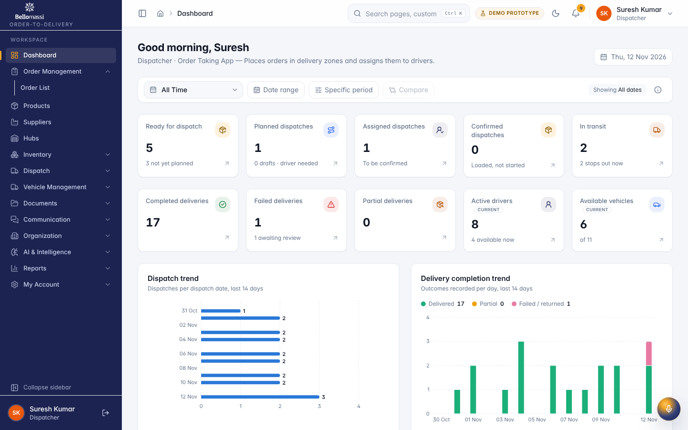
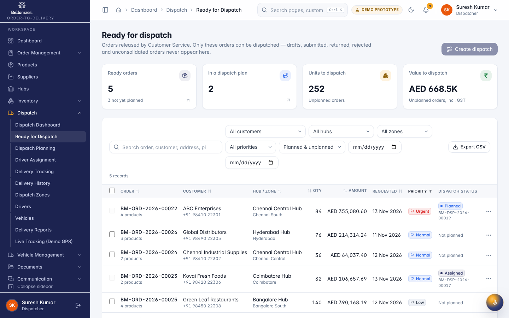
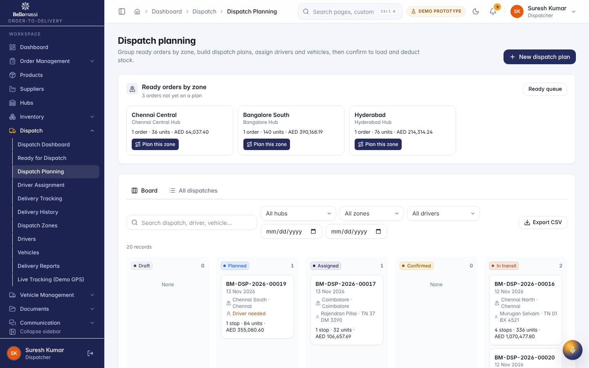
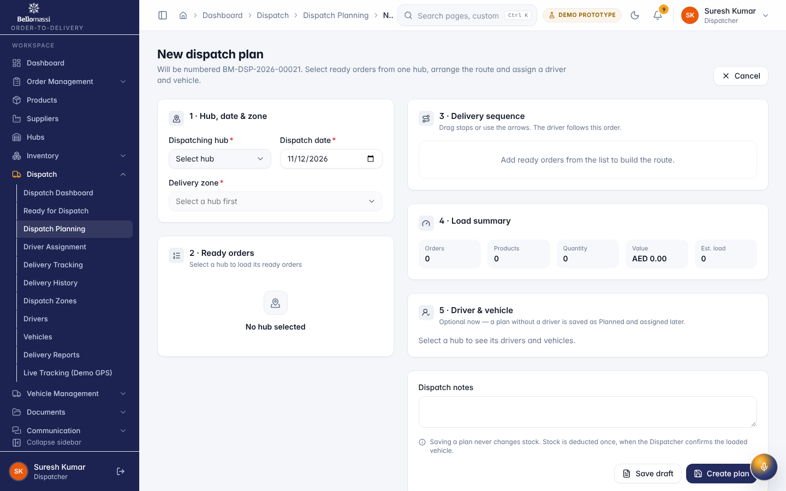
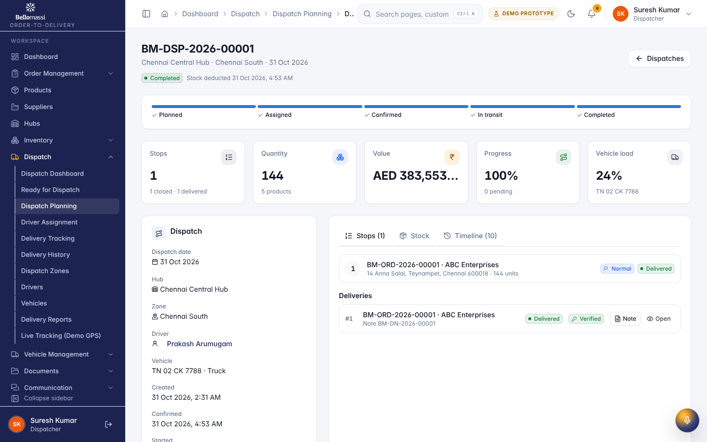
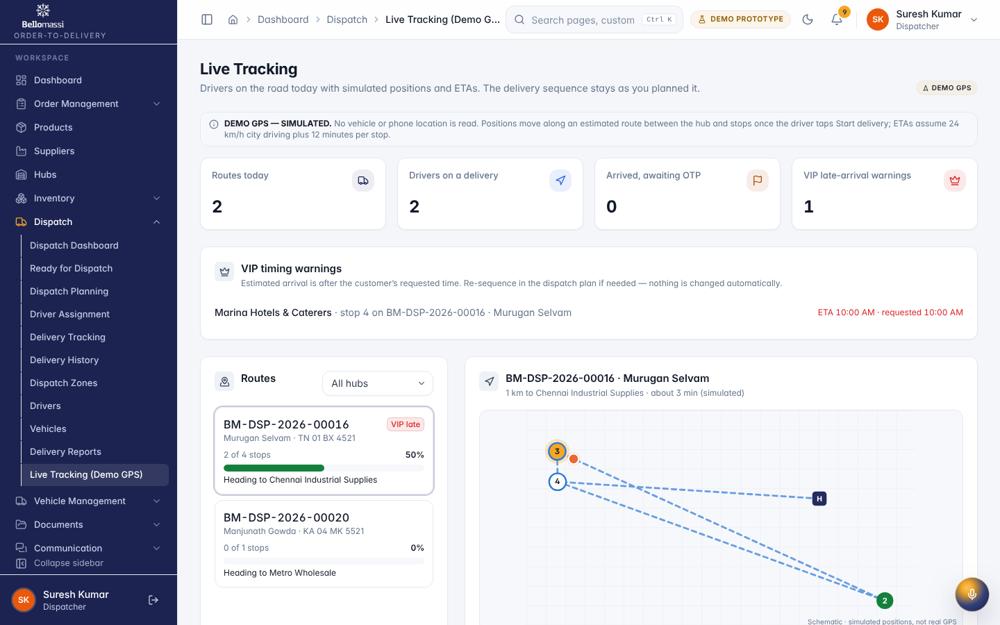
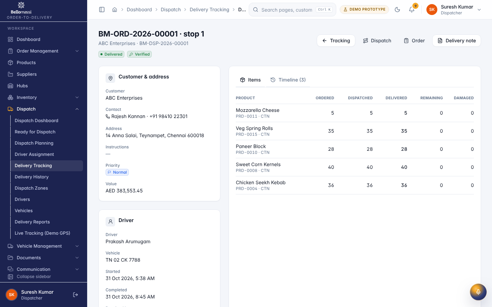

# Role User Manual — Dispatcher

## Document control

| Field | Value |
|---|---|
| Document title | Role User Manual — Dispatcher |
| Document ID | BM-MAN-106 |
| Version | 1.0 |
| Status | Draft — for client review |
| Category | User Manuals |
| Related module(s) | All modules |
| Document owner | Training Lead |
| Prepared by | Project documentation team (AI-assisted draft prepared from source-code analysis) |
| Reviewed by | _Pending — not yet reviewed_ |
| Approval | _Not approved — awaiting client review (no approval has been given)_ |
| Created date | 2026-11-12 |
| Last updated date | 2026-11-12 |

> **Status labels used in this document:** VERIFIED (confirmed in the current source code or existing documents) · PROTOTYPE (works in the React/LocalStorage prototype with mock or simulated behaviour) · PROPOSED (recommended production design, not built) · PENDING CONFIRMATION (needs a client decision) · NOT IMPLEMENTED · NOT VERIFIED.

## Purpose

Explain to a Dispatcher user how to sign in, find their screens and do their daily work in the Bellomassi prototype.

## Scope

Role DISPATCHER with its default permissions (VERIFIED from src/config/permissions.js and navigation.js). An Administrator can change permissions, so menus may differ.

## Definitions

Other terms: see [BM-GLO-001 — Project Glossary](../22_GLOSSARY_AND_REFERENCE/BM-GLO-001_Project_Glossary.md).

## References

- Workflow documentation chapter 04 (existing document
- reused)
- BM-UX-005 Screen Specifications
- [BM-MAN-003 — Office Web Application User Manual (All Office Roles)](BM-MAN-003_Office_Web_App_User_Manual.md)
- [BM-MAN-120 — Role Responsibility Matrix](BM-MAN-120_Role_Responsibility_Matrix.xlsx)
- [BM-SEC-005 — RBAC and Access Control Matrix](../10_SECURITY_AND_COMPLIANCE/BM-SEC-005_RBAC_and_Access_Control_Matrix.xlsx)

## 1. Your role

Plans dispatches from ready orders, assigns compliant drivers and vehicles, confirms loading (stock deduction), follows deliveries and resolves exceptions.

| Topic | Details |
|---|---|
| Purpose | Plans dispatches from ready orders, assigns compliant drivers and vehicles, confirms loading (stock deduction), follows deliveries and resolves exceptions. |
| Login | `/login` · **dispatcher / Dispatch@123** (demo account — PROTOTYPE only; production accounts are issued by the Administrator) |
| Dashboard | `DispatcherDashboard` / `DispatchOverview`: Ready for dispatch, Planned dispatches, Assigned dispatches, Confirmed dispatches, In transit, Completed deliveries, Failed deliveries, Partial deliveries, Active drivers, Available vehicles; charts: Dispatch trend, Delivery completion trend, Delivery status distribution, Driver performance, Zone delivery performance; tables: Recent dispatches, In-transit deliveries |
| Menus | Order List · Products, Suppliers, Hubs · **Inventory:** Inventory Dashboard, Stock Overview, Low Stock, Stock Receipts, Stock Transfers, Stock Adjustments, Stock Movements, Scrap Management · **Dispatch:** all 11 pages including Live Tracking (Demo GPS) · **VMS:** Dashboard, Vehicles, Driver Documents, Document Expiry, VMS Reports · **Documents** (5) · **Communication:** Center, Email, WhatsApp · **AI:** AI Overview, Assistant, Jarvis, Forecasting, Predictive Inventory, Replenishment, AI Insights, Model Management · Reports Center |
| Data scope | Orders from consolidation onwards; fleet and hub documents |
| CRUD | Dispatches (create, edit while DRAFT/PLANNED/ASSIGNED, cancel), delivery sequence; scrap requests (create); replenishment drafts (create); documents upload. Drivers, vehicles and zones are **view-only** for the Dispatcher (`fleet.manage` is Administrator only). |
| Approvals | Confirms dispatch (loading check); reviews failed / partial deliveries; can inspect delivery OTPs (`dispatch.otp.inspect`) |
| Reports | Dispatch & Delivery, Fleet, Inventory-related (where permitted), Procurement, AI |
| Notifications | "Ready for dispatch: …", "Delivery failed: … Review required", dispatch confirmations, document expiry |
| Cannot do | Approve orders; consolidate; issue invoices; create or edit drivers / vehicles / zones; approve scrap or replenishment |
| Next responsible user | **Driver**; for exceptions, the Dispatcher again |
| Logout | `/logout` → `/login` |

## 2. Getting started

1. Open the application address given by your Administrator.
2. Sign in with your user name (or mobile number / email) and password. After 5 wrong attempts the account is locked for 15 minutes (default security setting; an Administrator can unlock it).
3. You land on your dashboard. Use the menu (sidebar on desktop, bottom bar on phone) to move between screens.
4. Use the bell icon for notifications and the profile menu to change your password, preferences or to sign out.

## 3. Your daily work

1. Ready for Dispatch
2. New Dispatch (orders, zone, date, sequence)
3. assign driver & vehicle
4. confirm (tick review)
5. Live Tracking
6. review failed / partial stops
7. re-queue or return stock

## 4. Screens you use

{width=15cm}

{width=15cm}

{width=15cm}

{width=15cm}

{width=15cm}

{width=15cm}

{width=15cm}

## 5. Rules to remember

- Approve orders; consolidate; issue invoices; create or edit drivers / vehicles / zones; approve scrap or replenishment
- Work only with the records in your data scope: Orders from consolidation onwards; fleet and hub documents.
- After your step the next responsible user is: Driver; for exceptions, the Dispatcher again.

## 6. Prototype notes

This manual describes the prototype (PROTOTYPE). Data is stored only in your browser; demo markers show simulated
features (GPS, OTP messages, email / WhatsApp). Production behaviour may differ — see [BM-OVW-015 — Project Status and Implementation Summary](../01_PROJECT_OVERVIEW/BM-OVW-015_Project_Status_and_Implementation_Summary.md).

## Revision history

| Version | Date | Author | Description |
|---|---|---|---|
| 1.0 | 2026-11-12 | Documentation team | Initial draft prepared from analysis of the bellomassi-premium-ui source code and existing project documents. |