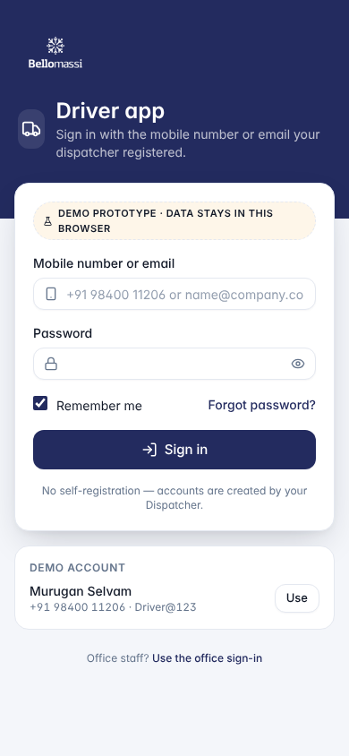
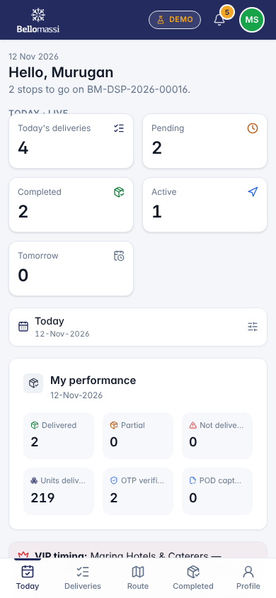
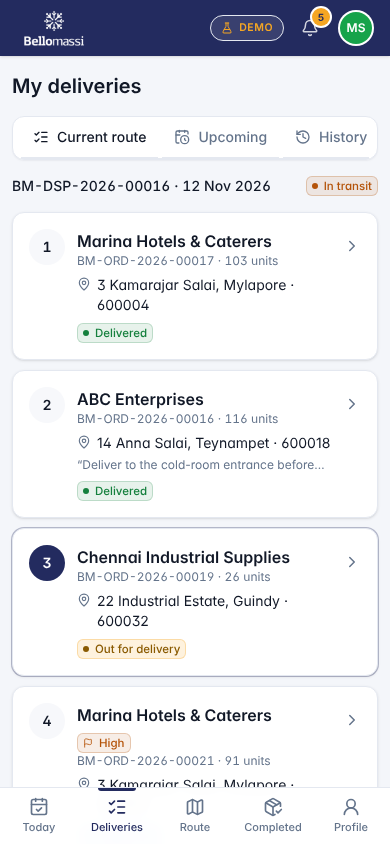
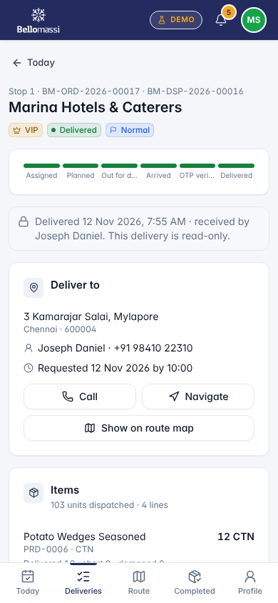
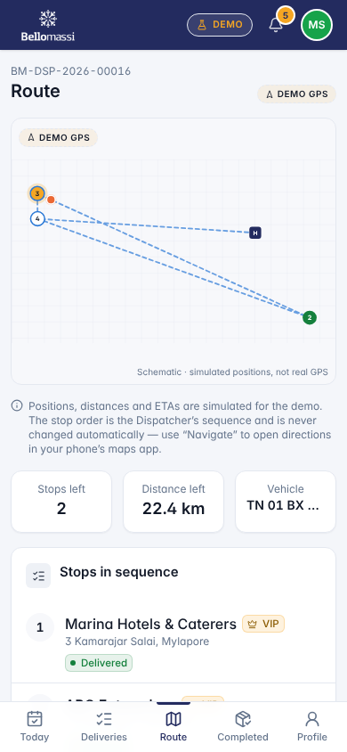
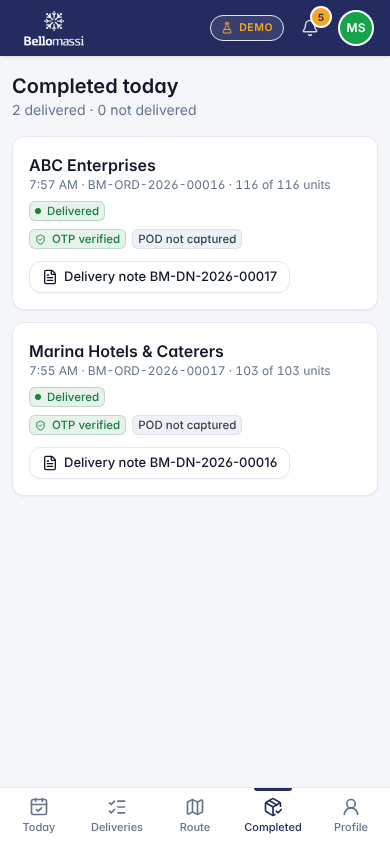

# Role User Manual — Driver

## Document control

| Field | Value |
|---|---|
| Document title | Role User Manual — Driver |
| Document ID | BM-MAN-107 |
| Version | 1.0 |
| Status | Draft — for client review |
| Category | User Manuals |
| Related module(s) | All modules |
| Document owner | Training Lead |
| Prepared by | Project documentation team (AI-assisted draft prepared from source-code analysis) |
| Reviewed by | _Pending — not yet reviewed_ |
| Approval | _Not approved — awaiting client review (no approval has been given)_ |
| Created date | 2026-11-12 |
| Last updated date | 2026-11-12 |

> **Status labels used in this document:** VERIFIED (confirmed in the current source code or existing documents) · PROTOTYPE (works in the React/LocalStorage prototype with mock or simulated behaviour) · PROPOSED (recommended production design, not built) · PENDING CONFIRMATION (needs a client decision) · NOT IMPLEMENTED · NOT VERIFIED.

## Purpose

Explain to a Driver user how to sign in, find their screens and do their daily work in the Bellomassi prototype.

## Scope

Role DRIVER with its default permissions (VERIFIED from src/config/permissions.js and navigation.js). An Administrator can change permissions, so menus may differ.

## Definitions

Other terms: see [BM-GLO-001 — Project Glossary](../22_GLOSSARY_AND_REFERENCE/BM-GLO-001_Project_Glossary.md).

## References

- Workflow documentation chapter 04 (existing document
- reused)
- BM-UX-005 Screen Specifications
- [BM-MAN-003 — Office Web Application User Manual (All Office Roles)](BM-MAN-003_Office_Web_App_User_Manual.md)
- [BM-MAN-120 — Role Responsibility Matrix](BM-MAN-120_Role_Responsibility_Matrix.xlsx)
- [BM-SEC-005 — RBAC and Access Control Matrix](../10_SECURITY_AND_COMPLIANCE/BM-SEC-005_RBAC_and_Access_Control_Matrix.xlsx)
- [BM-MAN-001 — Driver App User Manual](BM-MAN-001_Driver_App_User_Manual.md)

## 1. Your role

Delivers the stops of their confirmed dispatch in sequence and records proof of delivery.

| Topic | Details |
|---|---|
| Purpose | Delivers the stops of their confirmed dispatch in sequence and records proof of delivery. |
| Login | `/driver/login` · **driver / Driver@123** or mobile **+91 98400 11206** (also works on `/login`) (demo account — PROTOTYPE only; production accounts are issued by the Administrator) |
| Dashboard | `/driver/dashboard` (Today) — period filter defaults to **Today**; Pending / Completed stops, Today / Tomorrow plan ("Published by the Dispatcher"), next stop, driver performance |
| Menus (bottom bar) | Today, My Deliveries, Route, Completed, My Delivery Notes, Driver Profile, My Documents |
| Data scope | Own dispatches, deliveries and documents only — another driver's delivery shows "Access denied" |
| CRUD | Upload own documents (`documents.upload`); delivery notes are generated automatically |
| Approvals | None |
| Actions | Start delivery → Reach location → Enter OTP & complete (quantities, receiver, photo/signature) → or Report issue / mark failed |
| Reports | Driver performance on the Today screen only |
| Notifications | New dispatch assigned, dispatch confirmed ("Start your first delivery when you leave the hub"), sequence updated, removed from dispatch, dispatch cancelled |
| Cannot do | Start a stop out of sequence, start a future-dated dispatch, start before the Dispatcher confirms, complete without the correct OTP, restart a closed stop, see office modules |
| Next responsible user | **Customer** (receives goods), **Finance** (invoice), **Dispatcher** (exceptions) |
| Logout | Driver Profile › Sign Out → `/driver/login` |

## 2. Getting started

1. Open the application address given by your Administrator.
2. Sign in with your user name (or mobile number / email) and password. After 5 wrong attempts the account is locked for 15 minutes (default security setting; an Administrator can unlock it).
3. You land on your dashboard. Use the menu (sidebar on desktop, bottom bar on phone) to move between screens.
4. Use the bell icon for notifications and the profile menu to change your password, preferences or to sign out.

## 3. Your daily work

The full step-by-step driver procedure is in [BM-MAN-001 — Driver App User Manual](BM-MAN-001_Driver_App_User_Manual.md). In short:

1. Start delivery
2. Reach location
3. Enter OTP & complete (quantities, receiver, photo/signature)
4. or Report issue / mark failed

## 4. Screens you use

{width=6.5cm}

{width=6.5cm}

{width=6.5cm}

{width=6.5cm}

{width=6.5cm}

{width=6.5cm}

## 5. Rules to remember

- Start a stop out of sequence, start a future-dated dispatch, start before the Dispatcher confirms, complete without the correct OTP, restart a closed stop, see office modules
- Work only with the records in your data scope: Own dispatches, deliveries and documents only — another driver's delivery shows "Access denied".
- After your step the next responsible user is: Customer (receives goods), Finance (invoice), Dispatcher (exceptions).

## 6. Prototype notes

This manual describes the prototype (PROTOTYPE). Data is stored only in your browser; demo markers show simulated
features (GPS, OTP messages, email / WhatsApp). Production behaviour may differ — see [BM-OVW-015 — Project Status and Implementation Summary](../01_PROJECT_OVERVIEW/BM-OVW-015_Project_Status_and_Implementation_Summary.md).

## Revision history

| Version | Date | Author | Description |
|---|---|---|---|
| 1.0 | 2026-11-12 | Documentation team | Initial draft prepared from analysis of the bellomassi-premium-ui source code and existing project documents. |