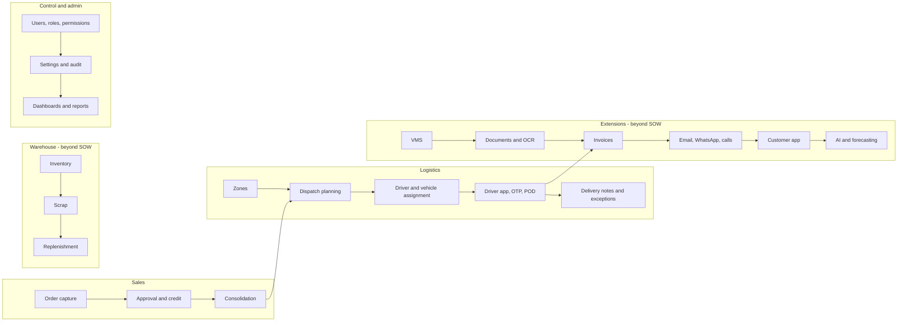

## 1. Capability map

## 2. Capabilities and labels

| Area | Capability | Label |
|---|---|---|
| Sales | Order capture, drafts, submit, resubmit, duplicate, timeline | VERIFIED |
| Sales | Approval with six checks, return, reject | VERIFIED |
| Sales | Approved figures set by manager | PENDING CONFIRMATION (not built) |
| Sales | Credit check (warning / block) | VERIFIED (balance manual) |
| Logistics | Consolidation per salesman | VERIFIED |
| Logistics | Dispatch, sequence, confirmation with stock deduction | VERIFIED |
| Logistics | Zone board drag and drop; traffic-aware routing | PROPOSED |
| Logistics | Driver stop workflow, OTP, POD, delivery notes | VERIFIED (GPS / OTP delivery simulated) |
| Logistics | Live tracking | PROTOTYPE (DEMO GPS) |
| Warehouse | Inventory, scrap, replenishment | VERIFIED — scope PENDING CONFIRMATION |
| Control | RBAC, users, settings, audit, notifications | VERIFIED |
| Control | Dashboards with period filter; 118 reports | VERIFIED (24 reports without source data) |
| Extensions | VMS compliance | VERIFIED |
| Extensions | Documents and OCR | PROTOTYPE (mock OCR) |
| Extensions | Invoices | VERIFIED — scope PENDING CONFIRMATION |
| Extensions | Email / WhatsApp / automation | PROTOTYPE (demo sending) |
| Extensions | Customer app | VERIFIED — scope PENDING CONFIRMATION |
| Extensions | AI assistant, forecasting | PROTOTYPE |
| Integration | SAP | PROPOSED (stage 2) |
| Finance | Payments, credit notes | NOT IMPLEMENTED |
