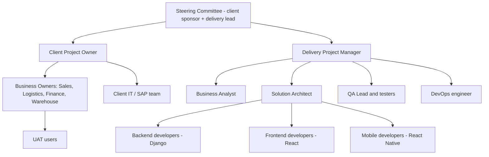

## 1. Proposed structure — PROPOSED

## 2. Roles

| Role | Responsibility |
|---|---|
| Steering Committee | Scope, budget, go-live decisions |
| Client Project Owner | Day-to-day decisions, access to business owners |
| Delivery Project Manager | Plan, status, risks, changes |
| Business Analyst | Requirements, traceability, UAT support |
| Solution Architect | Architecture, security, integrations |
| Developers | Build backend, web, mobile |
| QA | Test planning and execution |
| DevOps | Environments, CI/CD, monitoring, backups |
