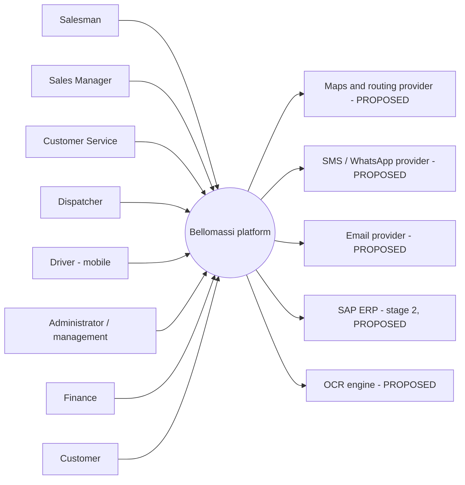

## 1. System overview

Bellomassi manages the order-to-delivery process of a food distributor: order capture, approval with credit control,
consolidation, zone-based dispatch, driver delivery with OTP and proof of delivery, delivery notes, notifications,
administration and reporting. The current implementation is a **frontend prototype** (React 19, LocalStorage);
production requires a backend (Django REST Framework, PostgreSQL) and mobile apps (React Native) — **PROPOSED**.

## 2. System context

## 3. System-level requirements

| ID | Requirement | Label |
|---|---|---|
| SYS-REQ-001 | The system shall maintain one order record from capture to delivery with a complete timeline. | VERIFIED |
| SYS-REQ-002 | The system shall enforce role-based access with permission keys and data scopes on every action. | VERIFIED (prototype client-side) / PROPOSED (server-side) |
| SYS-REQ-003 | The system shall provide an office web application, a driver mobile application and an administration panel. | VERIFIED (web) / PROPOSED (native mobile) |
| SYS-REQ-004 | The system shall notify the responsible role at every workflow hand-off. | VERIFIED (in-app) |
| SYS-REQ-005 | The system shall verify each delivery with a customer OTP and generate a delivery note. | VERIFIED (OTP shown in app) / PROPOSED (SMS / WhatsApp) |
| SYS-REQ-006 | The system shall store data centrally, shared by all users and devices, with backups. | PROPOSED (prototype: per-browser LocalStorage) |
| SYS-REQ-007 | The system shall track drivers' locations during active deliveries and show them to authorised users. | PROTOTYPE (DEMO GPS) / PROPOSED |
| SYS-REQ-008 | The system shall integrate with SAP for items, stock, customers and credit in stage 2. | PROPOSED |
| SYS-REQ-009 | The system shall keep an audit trail of administrative, security and workflow events. | VERIFIED |
| SYS-REQ-010 | The system shall provide dashboards and exportable reports per role. | VERIFIED |

## 4. Product functions

35 modules with 179 functional requirements — summary in {{ref:BM-SYS-003}}, detail per module in folder 04
(e.g. {{ref:BM-FRD-ORD}}, {{ref:BM-FRD-APR}}, {{ref:BM-FRD-DSP}}, {{ref:BM-FRD-DRV}}).

## 5. User classes and roles

| User class | Roles (code) | Device | Frequency | Technical skill |
|---|---|---|---|---|
| Sales | SALESMAN, SALES_MANAGER | Mobile and desktop | Daily, high | Basic |
| Operations office | CUSTOMER_SERVICE, DISPATCHER | Desktop / tablet | Daily, high | Basic to medium |
| Field | DRIVER | Smartphone | Daily, high | Basic |
| Finance | FINANCE | Desktop | Daily | Medium |
| Warehouse (extension) | WAREHOUSE_MANAGER, INVENTORY_EXECUTIVE, QA_MANAGER | Desktop / tablet | Daily | Basic |
| Administration | SUPER_ADMIN, ADMIN | Desktop | Daily | Medium to high |
| External | CUSTOMER, SUPPLIER | Smartphone / desktop | Occasional | Basic |

Role details: {{ref:BM-MAN-120}}, permission matrix {{ref:BM-SEC-005}}.

## 6. Functional requirements

See {{ref:BM-SYS-003}} (consolidated, unique IDs FR-<MODULE>-NNN) and the 35 module FRDs. Business rules: {{ref:BM-SYS-007}}.

## 7. Non-functional requirements

See {{ref:BM-SYS-004}} (NFR-PERF, NFR-SCAL, NFR-AVL, NFR-REL, NFR-SEC, NFR-USE, NFR-ACC, NFR-MNT, NFR-DATA, NFR-COMP,
NFR-PORT, NFR-OBS).

## 8. External interfaces

| Interface | Type | Prototype | Production |
|---|---|---|---|
| User interface — office | Responsive web (React) | VERIFIED | Same, connected to API |
| User interface — driver | Mobile | Web `/driver` VERIFIED | React Native PROPOSED |
| User interface — customer | Mobile | Web `/customer` VERIFIED | PENDING CONFIRMATION |
| REST API | HTTPS JSON | None | PROPOSED ({{ref:BM-API-001}}) |
| Real-time | WebSocket (WSS) | None | PROPOSED |
| Maps / routing | Google Maps JS, Routes API | Static demo map | PROPOSED |
| Messaging | SMS / WhatsApp provider API | Demo / mock | PROPOSED |
| Email | SMTP / IMAP or provider API | Demo; gateway contract NOT VERIFIED | PROPOSED |
| OCR | Server OCR API | Mock | PROPOSED |
| SAP | RFC / OData / IDoc (to confirm) | None | PROPOSED (stage 2) |

## 9. Hardware requirements

| Item | Requirement | Label |
|---|---|---|
| Office workstation | Any device with a current browser; 1366×768 minimum | VERIFIED |
| Driver phone | Android 10+ or iOS 15+, GPS, camera, mobile data, ≥ 3 GB RAM | PROPOSED |
| Servers | See {{ref:BM-INF-003}} | PROPOSED |

## 10. Software requirements

Browsers: current Chrome, Edge, Safari, Firefox (VERIFIED for the prototype). Production stack: Python 3.12, Django 5,
DRF, PostgreSQL 16, Redis, Celery, Django Channels, Nginx, Docker; React 19 / Vite; React Native — {{ref:BM-INF-001}}.

## 11. Performance requirements

NFR-PERF-001 … NFR-PERF-004. No production measurements exist; targets are PROPOSED.

## 12. Security requirements

NFR-SEC-001 … NFR-SEC-007 and the security package ({{ref:BM-SEC-001}}).

## 13. Availability, scalability and reliability

NFR-AVL-001 (99.5% target), NFR-SCAL-001/002, NFR-REL-001 … 003.

## 14. Usability and maintainability

NFR-USE-001 … 003, NFR-ACC-001, NFR-MNT-001 … 003.

## 15. Data requirements

| Data | Requirement |
|---|---|
| Master data | Customers, products, hubs, zones, drivers, vehicles, users, roles — maintained in the Admin Panel; SAP later |
| Transactions | Orders, approvals, consolidations, dispatches, deliveries, OTPs, PODs, delivery notes, stock movements, scrap, documents, invoices, messages |
| Retention | PENDING CONFIRMATION ({{ref:BM-DAT-005}}) |
| Model | Prototype model {{ref:BM-DAT-001}}; production schema {{ref:BM-DAT-002}} |

## 16. Acceptance criteria

1. Every FR labelled VERIFIED passes its test cases on the production build ({{ref:BM-QA-011}}).
2. PROPOSED requirements are implemented or formally deferred by change request.
3. PENDING CONFIRMATION items are decided and the baseline updated ({{ref:BM-SYS-009}}).
4. NFR targets are measured in staging and accepted.
5. UAT scenarios pass and are signed ({{ref:BM-QA-012}}, {{ref:BM-HND-004}}).
