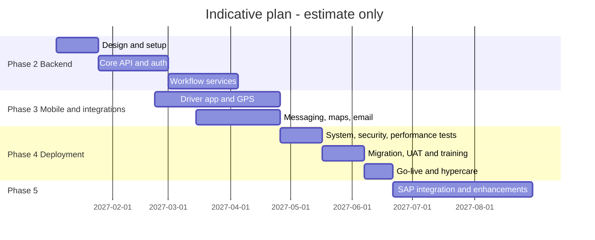

## 1. Phases

| Phase | Objective | Main scope | Entry criteria | Exit criteria | Indicative duration (estimate) |
|---|---|---|---|---|---|
| 1 Prototype | Validate workflows | React / LocalStorage prototype — **complete** | — | Client demo; documentation review | Done |
| 2 Backend | Production core | Django API, PostgreSQL, auth / RBAC, SOW workflows server-side, web app integration | Scope baseline signed; hosting decided | API + web pass system tests in test env | 12–14 weeks |
| 3 Mobile and integrations | Field and customer channels | React Native Drivers App, GPS + WebSockets, Maps / Routes, SMS / WhatsApp, email | Phase 2 API stable; provider accounts | Pilot-ready build; integration tests pass | 10–12 weeks (overlaps phase 2 by ~4 weeks) |
| 4 Production deployment | Go-live | Security hardening, performance tests, data migration, UAT, training, go-live, hypercare | Phases 2–3 complete | UAT signed; go-live checklist complete | 6–8 weeks |
| 5 Enhancements | Stage 2 | SAP integration; confirmed extensions; analytics | Go-live stable | Per change request | To be estimated |

## 2. Indicative timeline — ESTIMATE (assumed start date 4 January 2027, not agreed)

## 3. Decision gates

| Gate | Decision needed | Owner |
|---|---|---|
| G0 | Approve BRD and SOW scope (extensions X-01 … X-11) | Client sponsor |
| G1 | Hosting, providers (maps, messaging, email) | Client IT |
| G2 | Pilot go / no-go after driver pilot | Logistics owner |
| G3 | Go-live | Steering committee |

Phase assignment of every requirement: {{ref:BM-PLN-002}}.
