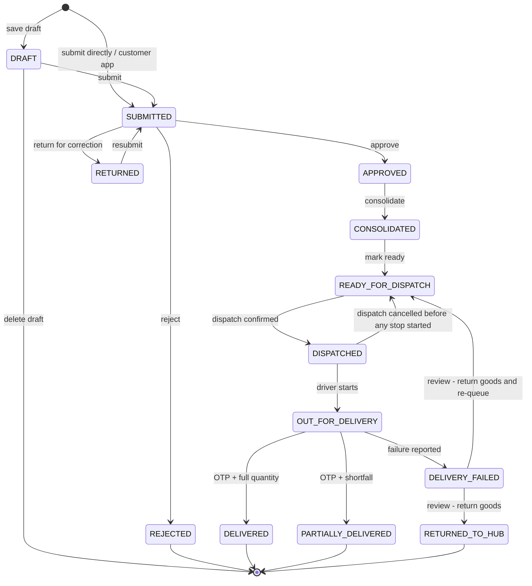

## 1. Workflow catalogue

| ID | Workflow | Initiating role | Trigger | Outcome |
|---|---|---|---|---|
| WF-01 | {{ref:BM-WF-01}} | Salesman / Customer | A customer need (order by call, email, WhatsApp or app) | Order delivered, delivery note and invoice available |
| WF-02 | {{ref:BM-WF-02}} | Salesman | Order submitted | Order DELIVERED / PARTIALLY_DELIVERED with delivery note |
| WF-03 | {{ref:BM-WF-03}} | Salesman | Start of day / customer request | Orders submitted; returned orders corrected |
| WF-04 | {{ref:BM-WF-04}} | Sales Manager | Order SUBMITTED | APPROVED, RETURNED or REJECTED |
| WF-05 | {{ref:BM-WF-05}} | Customer Service | Order APPROVED | READY_FOR_DISPATCH |
| WF-06 | {{ref:BM-WF-06}} | System / Sales Manager | Order submitted or opened for approval | Credit warning acknowledged, order returned / rejected, or approval blocked |
| WF-07 | {{ref:BM-WF-07}} | Customer Service | Approved order in queue | CONSOLIDATED then READY_FOR_DISPATCH |
| WF-08 | {{ref:BM-WF-08}} | Dispatcher | Orders READY_FOR_DISPATCH | Dispatch CONFIRMED (stock deducted) and closed |
| WF-09 | {{ref:BM-WF-09}} | Dispatcher | Dispatch PLANNED | Dispatch ASSIGNED with compliant driver and vehicle |
| WF-10 | {{ref:BM-WF-10}} | Driver | Dispatch CONFIRMED and date reached | Stops DELIVERED / PARTIALLY_DELIVERED / FAILED |
| WF-11 | {{ref:BM-WF-11}} | Customer | Customer opens the catalog | Order submitted for approval |
| WF-12 | {{ref:BM-WF-12}} | Customer | Driver starts the stop | Customer shares OTP; delivery note visible |
| WF-13 | {{ref:BM-WF-13}} | Warehouse / Inventory staff | Goods arrive, move or are found different | Stock and ledger updated |
| WF-14 | {{ref:BM-WF-14}} | Warehouse / QA / Inventory staff | Unusable stock found | Stock written off once after approval |
| WF-15 | {{ref:BM-WF-15}} | Administrator | Vehicle / driver document recorded or expiring | Compliance state updated; assignment blocked when required |
| WF-16 | {{ref:BM-WF-16}} | Finance | Order approved or delivered | Invoice ISSUED (or CANCELLED and reissued) |
| WF-17 | {{ref:BM-WF-17}} | System / user | Workflow event or manual message | Message logged (demo send) and in-app notification |
| WF-18 | {{ref:BM-WF-18}} | Any role | Validation failure or operational exception | Exception resolved by the named role |
| WF-19 | {{ref:BM-WF-19}} | Sales Manager / reviewers | Order, scrap, replenishment or document rejected | Requester informed with reason; record closed or corrected |
| WF-20 | {{ref:BM-WF-20}} | Dispatcher / Finance / requester | Dispatch, invoice, scrap or replenishment must be cancelled | Record CANCELLED; stock / order restored once |
| WF-21 | {{ref:BM-WF-21}} | Driver / Dispatcher | Delivery failed or partially accepted | Goods returned to hub; order RETURNED_TO_HUB or re-queued |
| WF-22 | {{ref:BM-WF-22}} | Any uploader | Document uploaded | VERIFIED or REJECTED |
| WF-23 | {{ref:BM-WF-23}} | System | Any workflow event | In-app notification and optional automated message |
| WF-24 | {{ref:BM-WF-24}} | Office roles | User opens a dashboard or report | KPIs, tables, CSV export or print |

## 2. Relationship to the existing workflow documentation

The complete workflow documentation delivered on 12 November 2026 (`docs/workflow/`, 20 chapters, 38 diagrams, HTML / PDF / DOCX editions) is **preserved unchanged** and remains the narrative source. The 24 specifications in this folder restate each workflow in the standard enterprise format (ID, purpose, initiating role, preconditions, trigger, steps, decisions, approval / rejection conditions, system and user actions, status changes, notifications, exceptions, outcome) and link it to requirements and test cases.

## 3. Order lifecycle (overview)

