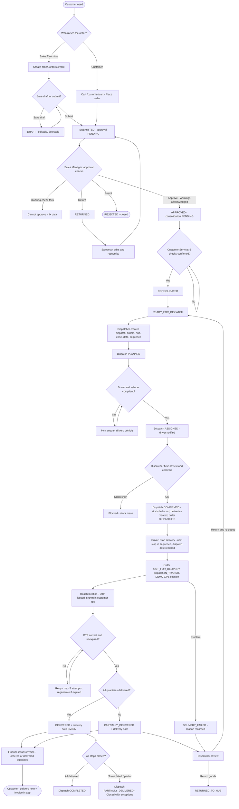
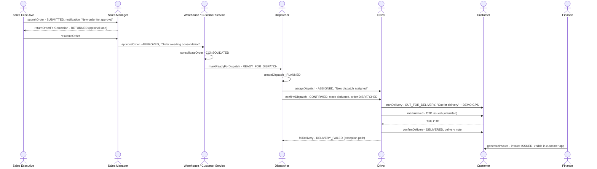

## 1. Workflow summary

| Field | Value |
|---|---|
| Workflow ID | WF-02 |
| Workflow name | Order-to-Delivery Workflow |
| Business purpose | Specify the core order lifecycle and the system effect of each step. |
| Initiating role | Salesman |
| Trigger | Order submitted |
| Preconditions | Active customer, hub and products. |
| Final outcome | Delivered order with delivery note and stock movements. |
| Related requirements | FR-ORD-002, FR-APR-003, FR-CON-002, FR-CON-003, FR-DSP-001, FR-DSP-004, FR-DRV-002, FR-DRV-004 |
| Related test cases | TC-ORD-002, TC-APR-003, TC-APR-N01, TC-CON-002, TC-CON-N01, TC-CON-003, TC-DSP-001, TC-DSP-004, TC-DSP-N02, TC-DSP-N03, TC-DSP-N04, TC-DRV-002, TC-DRV-N01, TC-DRV-N02, TC-DRV-N03, TC-DRV-004 |
| Detailed chapter | `docs/workflow/` chapter 06 |

## 2. Step-by-step process

1. Create order and submit (number BM-ORD-… assigned).
2. Approval checks run; manager decides.
3. Customer Service ticks five checks and consolidates.
4. Order marked READY_FOR_DISPATCH.
5. Dispatcher creates dispatch and sequence; assigns resources; confirms — stock deducted and deliveries created; order DISPATCHED.
6. Driver starts (OUT_FOR_DELIVERY), reaches location (OTP issued), completes with OTP (DELIVERED / PARTIALLY_DELIVERED).

## 3. Decision points

Blocking checks; warnings; stock sufficient at confirmation; OTP; quantities.

## 4. Approval conditions

Approval, consolidation checklist, dispatch confirmation tick.

## 5. Rejection conditions

Rejection; cancellation of dispatch.

## 6. System actions

`submitOrder`, `approveOrder`, `consolidateOrder`, `markReadyForDispatch`, `createDispatch`, `assignDispatch`, `confirmDispatch`, `startDelivery`, `markArrived`, `confirmDelivery`.

## 7. User actions

Each role acts on its queue.

## 8. Status changes

As WF-01; dispatch DRAFT → PLANNED → ASSIGNED → CONFIRMED → IN_TRANSIT → COMPLETED.

## 9. Notifications

New order for approval; awaiting consolidation; ready for dispatch; dispatch assigned / confirmed; out for delivery; delivered.

## 10. Exception scenarios

Stock short at confirmation; non-compliant resources; wrong OTP; partial / failed delivery.

## 11. Workflow diagram

Implementation label: diagrams describe the **prototype behaviour (VERIFIED in source code)** unless a step is marked PROPOSED / NOT IMPLEMENTED.

## 12. Final outcome

Delivered order with delivery note and stock movements.
