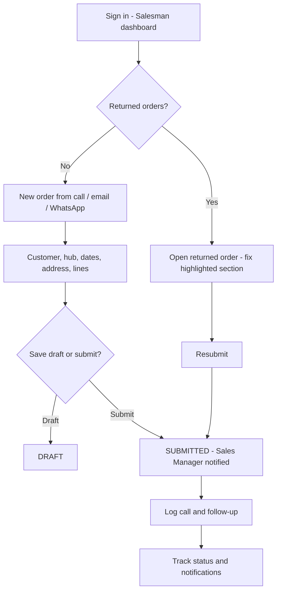

## 1. Workflow summary

| Field | Value |
|---|---|
| Workflow ID | WF-03 |
| Workflow name | Salesman Workflow |
| Business purpose | Describe the salesman's daily work: capture, submit, correct returned orders, follow up calls. |
| Initiating role | Salesman |
| Trigger | Start of day / customer request |
| Preconditions | Salesman account; assigned customers. |
| Final outcome | Orders submitted for approval. |
| Related requirements | FR-ORD-001, FR-ORD-002, FR-ORD-005, FR-CALL-001 |
| Related test cases | TC-ORD-001, TC-LS-N02, TC-ORD-002, TC-ORD-005, TC-CALL-001 |
| Detailed chapter | `docs/workflow/` chapter 04 |

## 2. Step-by-step process

1. Open dashboard → "Needs your action".
2. Correct returned orders (highlighted section) and resubmit.
3. Capture new orders (from calls, email, WhatsApp) — optionally from a call record.
4. Save draft or submit.
5. Log calls and follow-ups.
6. Track statuses and notifications.

## 3. Decision points

Draft or submit; respond to warnings.

## 4. Approval conditions

—

## 5. Rejection conditions

Receives returns / rejections with reason.

## 6. System actions

Validation, warnings, numbering, notifications.

## 7. User actions

Data entry, corrections.

## 8. Status changes

DRAFT → SUBMITTED; RETURNED → SUBMITTED.

## 9. Notifications

Approved, returned, rejected, ready for dispatch.

## 10. Exception scenarios

Validation errors; credit / stock warnings.

## 11. Workflow diagram

Implementation label: diagrams describe the **prototype behaviour (VERIFIED in source code)** unless a step is marked PROPOSED / NOT IMPLEMENTED.

## 12. Final outcome

Orders submitted for approval.
