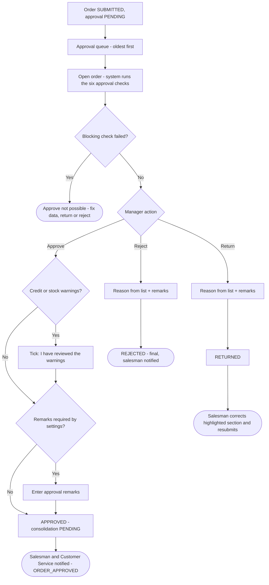
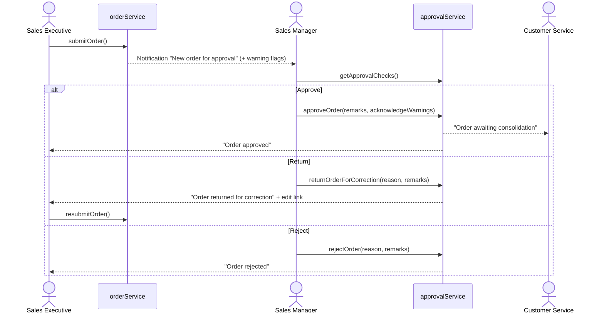

## 1. Workflow summary

| Field | Value |
|---|---|
| Workflow ID | WF-04 |
| Workflow name | Sales Manager Approval Workflow |
| Business purpose | Specify the Sales Manager decision on submitted orders. |
| Initiating role | Sales Manager |
| Trigger | Order SUBMITTED |
| Preconditions | Order SUBMITTED with approval PENDING. |
| Final outcome | Recorded decision with reason. |
| Related requirements | FR-APR-001, FR-APR-002, FR-APR-003, FR-APR-004, FR-APR-005 |
| Related test cases | TC-APR-001, TC-APR-002, TC-APR-N04, TC-APR-003, TC-APR-N01, TC-APR-004, TC-APR-005, TC-APR-N02 |
| Detailed chapter | `docs/workflow/` chapter 07 |

## 2. Step-by-step process

1. Open approval queue (oldest first).
2. Open order; system runs six checks.
3. Approve (acknowledge warnings, remarks if required) or return / reject with reason and remarks.

## 3. Decision points

Blocking checks; warnings; decision.

## 4. Approval conditions

All blocking checks pass; warnings acknowledged; remarks given if required.

## 5. Rejection conditions

Reason from list + remarks; reject is final; return sends back to salesman.

## 6. System actions

Approval record + timeline in one transaction; notifications; automation events.

## 7. User actions

Review and decide.

## 8. Status changes

SUBMITTED → APPROVED / RETURNED / REJECTED.

## 9. Notifications

Approved → salesman + Customer Service; returned / rejected → salesman.

## 10. Exception scenarios

Repeated decision refused; draft cannot be decided.

## 11. Workflow diagram

Implementation label: diagrams describe the **prototype behaviour (VERIFIED in source code)** unless a step is marked PROPOSED / NOT IMPLEMENTED.

## 12. Final outcome

Recorded decision with reason.
