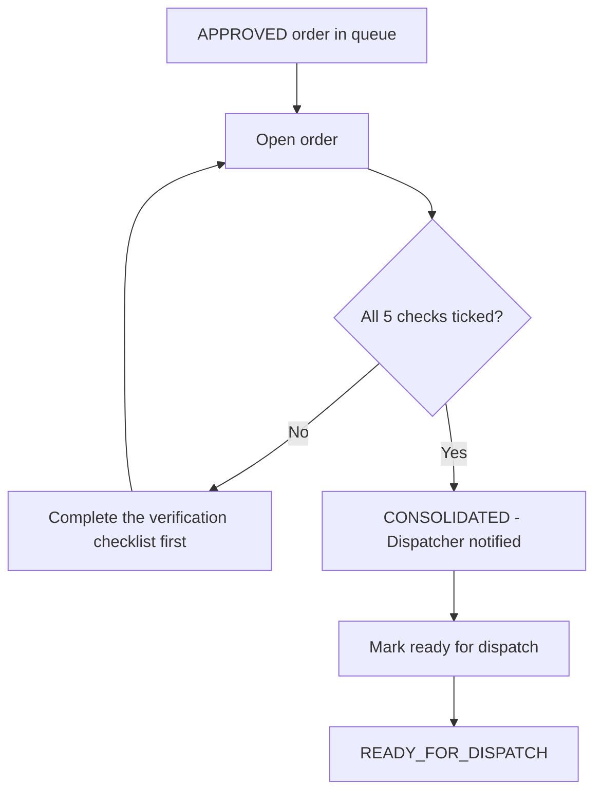

## 1. Workflow summary

| Field | Value |
|---|---|
| Workflow ID | WF-05 |
| Workflow name | Customer Service Workflow |
| Business purpose | Describe Customer Service's daily work. |
| Initiating role | Customer Service |
| Trigger | Order APPROVED |
| Preconditions | Approved orders exist. |
| Final outcome | Orders released to dispatch. |
| Related requirements | FR-CON-001, FR-CON-002, FR-CON-003, FR-DOC-003 |
| Related test cases | TC-CON-001, TC-CON-002, TC-CON-N01, TC-CON-003, TC-DOC-003, TC-DOC-N01 |
| Detailed chapter | `docs/workflow/` chapter 04 |

## 2. Step-by-step process

1. Open consolidation queue grouped by salesman.
2. For each order tick the five checks, review stock, add notes, consolidate.
3. Mark ready for dispatch.
4. Review documents in the OCR queue.
5. Handle customer calls.

## 3. Decision points

All checks confirmed?

## 4. Approval conditions

Consolidation (checklist).

## 5. Rejection conditions

Customer Service cannot reject; issues go to the Sales Manager / Administrator.

## 6. System actions

Consolidation record, notifications.

## 7. User actions

Verification.

## 8. Status changes

APPROVED → CONSOLIDATED → READY_FOR_DISPATCH.

## 9. Notifications

Dispatcher informed.

## 10. Exception scenarios

Incomplete checklist; non-approved order.

## 11. Workflow diagram

Implementation label: diagrams describe the **prototype behaviour (VERIFIED in source code)** unless a step is marked PROPOSED / NOT IMPLEMENTED.

## 12. Final outcome

Orders released to dispatch.
