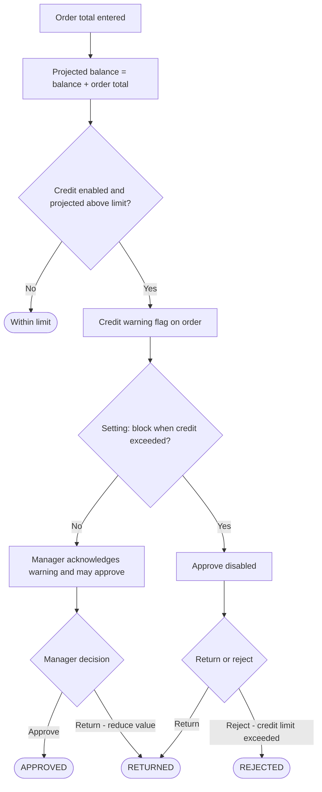

## 1. Workflow summary

| Field | Value |
|---|---|
| Workflow ID | WF-06 |
| Workflow name | Credit Validation Workflow |
| Business purpose | Specify how credit exposure is checked. |
| Initiating role | System / Sales Manager |
| Trigger | Order submitted or opened for approval |
| Preconditions | Customer credit settings maintained. |
| Final outcome | Credit-controlled approval. |
| Related requirements | FR-CRD-001, FR-CRD-002, FR-CRD-003 |
| Related test cases | TC-CRD-001, TC-CRD-002, TC-CRD-N01, TC-CRD-003 |
| Detailed chapter | `docs/workflow/` chapter 07 |

## 2. Step-by-step process

1. On order entry and approval the system computes projected balance = balance + order total.
2. If projected balance > limit: credit warning flag.
3. At approval: warning must be acknowledged; if the setting blocks, Approve is disabled.
4. Manager may return with "Reduce order value (credit)" or reject with "Credit limit exceeded".

## 3. Decision points

Within limit? Blocking setting on?

## 4. Approval conditions

Acknowledged warning (non-blocking mode).

## 5. Rejection conditions

Return / reject with credit reasons.

## 6. System actions

`getOrderCreditPosition`, approval checks.

## 7. User actions

Manager decision.

## 8. Status changes

No separate status; affects approval outcome.

## 9. Notifications

Warning flags on "New order for approval". Finance notification NOT IMPLEMENTED (G-02).

## 10. Exception scenarios

Balance is not updated automatically (no payments).

## 11. Workflow diagram

Implementation label: diagrams describe the **prototype behaviour (VERIFIED in source code)** unless a step is marked PROPOSED / NOT IMPLEMENTED.

## 12. Final outcome

Credit-controlled approval.
