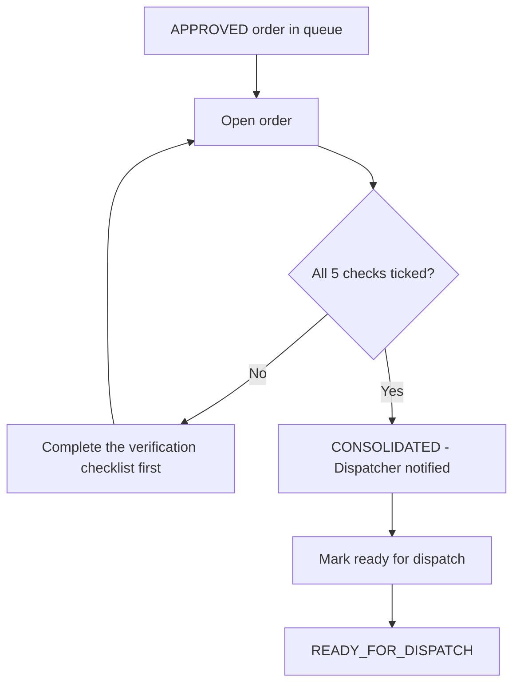

## 1. Workflow summary

| Field | Value |
|---|---|
| Workflow ID | WF-07 |
| Workflow name | Order Consolidation Workflow |
| Business purpose | Specify consolidation in detail. |
| Initiating role | Customer Service |
| Trigger | Approved order in queue |
| Preconditions | Order APPROVED, consolidation PENDING. |
| Final outcome | Order in ready queue. |
| Related requirements | FR-CON-001, FR-CON-002, FR-CON-003, FR-CON-004 |
| Related test cases | TC-CON-001, TC-CON-002, TC-CON-N01, TC-CON-003, TC-CON-004 |
| Detailed chapter | `docs/workflow/` chapter 05 |

## 2. Step-by-step process

1. Open order from queue.
2. Confirm: customer and address verified; hub confirmed; products and units checked; quantities match; hub stock reviewed.
3. Consolidate.
4. Mark ready for dispatch.

## 3. Decision points

All five checks?

## 4. Approval conditions

Checklist complete.

## 5. Rejection conditions

—

## 6. System actions

Consolidation record; notifications; ORDER_READY event.

## 7. User actions

Verification.

## 8. Status changes

APPROVED → CONSOLIDATED → READY_FOR_DISPATCH.

## 9. Notifications

Dispatcher, salesman.

## 10. Exception scenarios

"Only approved orders can be consolidated."; duplicate consolidation refused.

## 11. Workflow diagram

Implementation label: diagrams describe the **prototype behaviour (VERIFIED in source code)** unless a step is marked PROPOSED / NOT IMPLEMENTED.

## 12. Final outcome

Order in ready queue.
