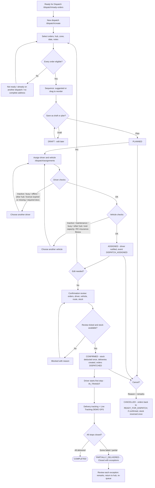
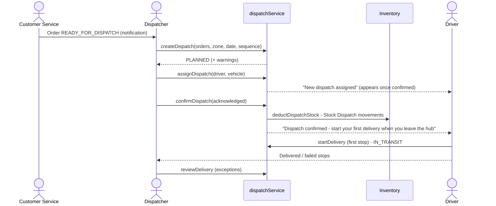

## 1. Workflow summary

| Field | Value |
|---|---|
| Workflow ID | WF-08 |
| Workflow name | Dispatch Workflow |
| Business purpose | Specify dispatch planning, confirmation and closing. |
| Initiating role | Dispatcher |
| Trigger | Orders READY_FOR_DISPATCH |
| Preconditions | READY_FOR_DISPATCH orders; active zones, drivers and vehicles. |
| Final outcome | Confirmed vehicle run. |
| Related requirements | FR-DSP-001, FR-DSP-002, FR-DSP-003, FR-DSP-004, FR-DSP-005, FR-DSP-007 |
| Related test cases | TC-DSP-001, TC-DSP-002, TC-DSP-N01, TC-DSP-003, TC-DSP-004, TC-DSP-N02, TC-DSP-N03, TC-DSP-N04, TC-DSP-005, TC-DSP-N05, TC-DSP-007 |
| Detailed chapter | `docs/workflow/` chapter 11 |

## 2. Step-by-step process

1. Select ready orders, hub, zone, date.
2. Sequence stops (suggested or drag and drop).
3. Save draft or plan.
4. Assign driver and vehicle (WF-09).
5. Review and confirm loading — stock deducted once; deliveries created.
6. Monitor; dispatch closes when all stops close.

## 3. Decision points

Order eligible? Draft or plan? Stock sufficient?

## 4. Approval conditions

Dispatcher confirmation tick.

## 5. Rejection conditions

Cancellation with reason (before any stop starts).

## 6. System actions

Numbering BM-DSP-…, timeline, stock movements, deliveries, notifications.

## 7. User actions

Planning and confirmation.

## 8. Status changes

DRAFT → PLANNED → ASSIGNED → CONFIRMED → IN_TRANSIT → COMPLETED / PARTIALLY_DELIVERED; CANCELLED.

## 9. Notifications

Driver assigned / confirmed / sequence updated / cancelled; Administrator on confirmation.

## 10. Exception scenarios

Ineligible order; stock short; non-compliant resources.

## 11. Workflow diagram

Implementation label: diagrams describe the **prototype behaviour (VERIFIED in source code)** unless a step is marked PROPOSED / NOT IMPLEMENTED.

## 12. Final outcome

Confirmed vehicle run.
