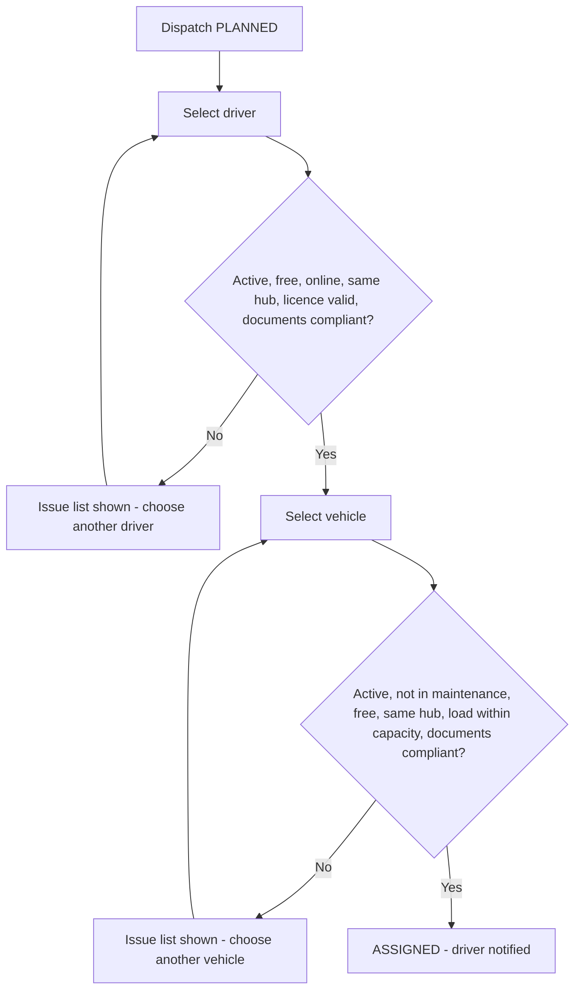

## 1. Workflow summary

| Field | Value |
|---|---|
| Workflow ID | WF-09 |
| Workflow name | Driver Assignment Workflow |
| Business purpose | Specify driver and vehicle assignment with compliance checks. |
| Initiating role | Dispatcher |
| Trigger | Dispatch PLANNED |
| Preconditions | Dispatch PLANNED or ASSIGNED. |
| Final outcome | Compliant assignment. |
| Related requirements | FR-DRA-001, FR-DRA-002, FR-DRA-003, FR-VMS-002 |
| Related test cases | TC-DRA-001, TC-DRA-002, TC-DRA-N01, TC-DRA-003, TC-DRA-N02, TC-VMS-002 |
| Detailed chapter | `docs/workflow/` chapter 11 |

## 2. Step-by-step process

1. Open Driver Assignment.
2. Choose driver — system checks status, availability, hub, licence, required documents.
3. Choose vehicle — status, availability, hub, capacity vs load, required documents.
4. Save assignment; driver notified.

## 3. Decision points

Driver issues? Vehicle issues?

## 4. Approval conditions

No blocking issue.

## 5. Rejection conditions

Assignment refused with issue list.

## 6. System actions

`driverAssignmentIssues`, `vehicleAssignmentIssues`, VMS compliance.

## 7. User actions

Selection.

## 8. Status changes

PLANNED → ASSIGNED.

## 9. Notifications

Driver: "New dispatch assigned"; previous driver: "Removed from …".

## 10. Exception scenarios

Expired licence / documents, over capacity, busy resource.

## 11. Workflow diagram

Implementation label: diagrams describe the **prototype behaviour (VERIFIED in source code)** unless a step is marked PROPOSED / NOT IMPLEMENTED.

## 12. Final outcome

Compliant assignment.
