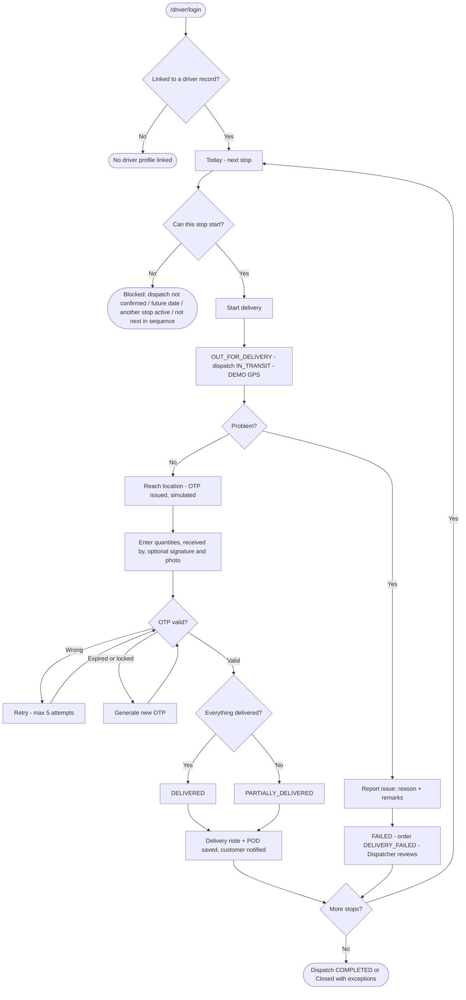
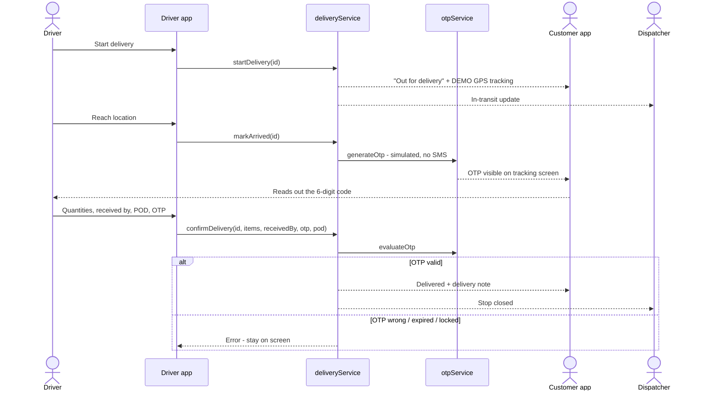

## 1. Workflow summary

| Field | Value |
|---|---|
| Workflow ID | WF-10 |
| Workflow name | Driver Delivery Workflow |
| Business purpose | Specify the driver's stop workflow. |
| Initiating role | Driver |
| Trigger | Dispatch CONFIRMED and date reached |
| Preconditions | Dispatch CONFIRMED; date reached; driver linked to user. |
| Final outcome | Stop closed with proof. |
| Related requirements | FR-DRV-001, FR-DRV-002, FR-DRV-003, FR-DRV-004, FR-DRV-005, FR-OTP-002, FR-POD-001 |
| Related test cases | TC-DRV-001, TC-DRV-002, TC-DRV-N01, TC-DRV-N02, TC-DRV-N03, TC-DRV-003, TC-DRV-004, TC-DRV-005, TC-OTP-002, TC-OTP-N01, TC-OTP-N02, TC-POD-001, TC-POD-N02 |
| Detailed chapter | `docs/workflow/` chapter 08 |

## 2. Step-by-step process

1. Open Today; tap next stop.
2. Start delivery (blocked if not next / not confirmed / future).
3. Drive (DEMO GPS in prototype).
4. Reach location — OTP issued.
5. Enter quantities, receiver, optional signature / photo, OTP.
6. Complete (DELIVERED / PARTIALLY_DELIVERED) or report failure.

## 3. Decision points

Can start? OTP valid? All delivered? Problem?

## 4. Approval conditions

OTP verification.

## 5. Rejection conditions

Failure with reason.

## 6. System actions

Tracking session, OTP, delivery note, notifications, dispatch closing.

## 7. User actions

Driver actions; customer gives OTP.

## 8. Status changes

Delivery DISPATCHED → OUT_FOR_DELIVERY → DELIVERED / PARTIALLY_DELIVERED / FAILED.

## 9. Notifications

Customer and Dispatcher at each step.

## 10. Exception scenarios

Wrong / expired / locked OTP; out of sequence; failure.

## 11. Workflow diagram

Implementation label: diagrams describe the **prototype behaviour (VERIFIED in source code)** unless a step is marked PROPOSED / NOT IMPLEMENTED.

## 12. Final outcome

Stop closed with proof.
