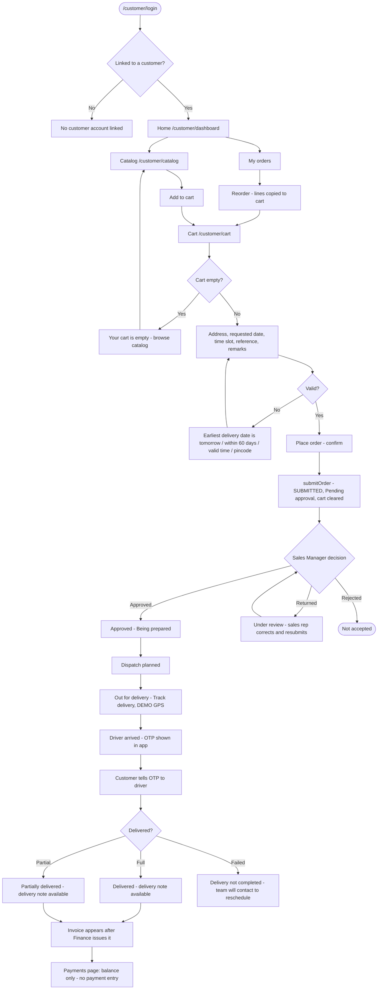

## 1. Workflow summary

| Field | Value |
|---|---|
| Workflow ID | WF-11 |
| Workflow name | Customer Order Workflow |
| Business purpose | Specify customer self-service ordering. |
| Initiating role | Customer |
| Trigger | Customer opens the catalog |
| Preconditions | Customer user linked to a customer record. |
| Final outcome | Order in approval queue. |
| Related requirements | FR-CAP-001, FR-CAP-002, FR-CAP-006 |
| Related test cases | TC-CAP-001, TC-CAP-002, TC-CAP-N01, TC-CAP-N02, TC-CAP-006 |
| Detailed chapter | `docs/workflow/` chapter 09 |

## 2. Step-by-step process

1. Browse catalog; add to cart.
2. Review cart totals and credit warning.
3. Enter delivery details (address, date tomorrow–60 days, time slot, reference, remarks).
4. Place order; confirm.
5. Order submitted for Sales Manager approval.

## 3. Decision points

Address registered or other; time slot.

## 4. Approval conditions

Sales Manager approval (WF-04).

## 5. Rejection conditions

Manager rejects; customer sees "Not accepted".

## 6. System actions

`placeCustomerOrder` → `submitOrder` (source customer_app; VIP → High priority).

## 7. User actions

Customer.

## 8. Status changes

SUBMITTED (Pending approval).

## 9. Notifications

Order placed; later approved / rejected.

## 10. Exception scenarios

Empty cart; invalid date; unlinked login.

## 11. Workflow diagram

Implementation label: diagrams describe the **prototype behaviour (VERIFIED in source code)** unless a step is marked PROPOSED / NOT IMPLEMENTED.

## 12. Final outcome

Order in approval queue.
