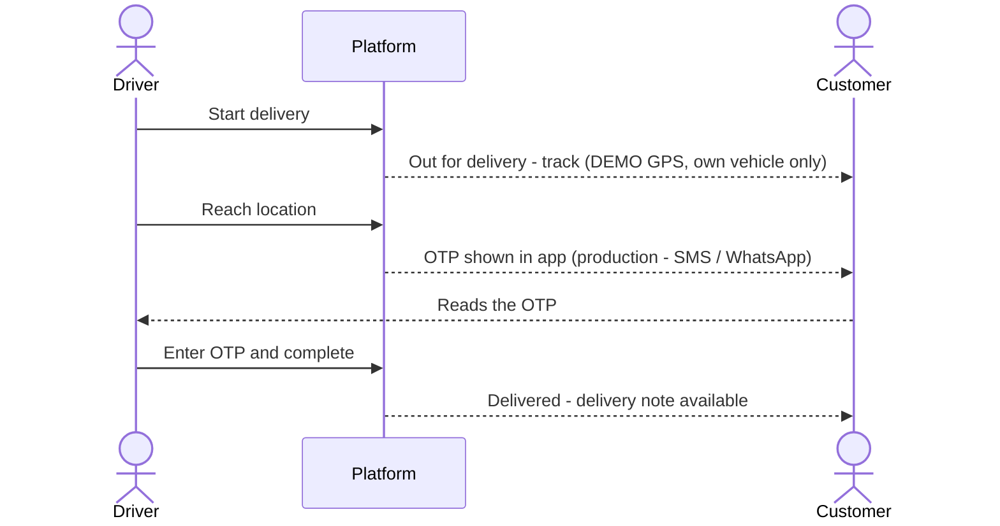

## 1. Workflow summary

| Field | Value |
|---|---|
| Workflow ID | WF-12 |
| Workflow name | Customer Tracking Workflow |
| Business purpose | Specify customer delivery tracking and OTP handover. |
| Initiating role | Customer |
| Trigger | Driver starts the stop |
| Preconditions | Customer has an order on a confirmed dispatch. |
| Final outcome | Handover confirmed by the customer. |
| Related requirements | FR-CAP-003, FR-CAP-004, FR-OTP-001, FR-CAP-005 |
| Related test cases | TC-CAP-003, TC-CAP-004, TC-OTP-001, TC-CAP-005 |
| Detailed chapter | `docs/workflow/` chapter 09 |

## 2. Step-by-step process

1. Driver starts the stop — customer notified "Out for delivery".
2. Customer opens Track delivery (DEMO GPS map, own vehicle only).
3. Driver reaches location — OTP shown in large digits with expiry.
4. Customer reads OTP to driver.
5. Delivery completed — delivery note available.

## 3. Decision points

—

## 4. Approval conditions

Customer OTP.

## 5. Rejection conditions

Customer may refuse — driver records failure "Customer Refused".

## 6. System actions

Tracking session; OTP; notifications.

## 7. User actions

Customer shares OTP.

## 8. Status changes

OUT_FOR_DELIVERY → DELIVERED.

## 9. Notifications

Out for delivery; driver arrived; delivered / not completed.

## 10. Exception scenarios

OTP expiry → new OTP.

## 11. Workflow diagram

Implementation label: diagrams describe the **prototype behaviour (VERIFIED in source code)** unless a step is marked PROPOSED / NOT IMPLEMENTED.

## 12. Final outcome

Handover confirmed by the customer.
