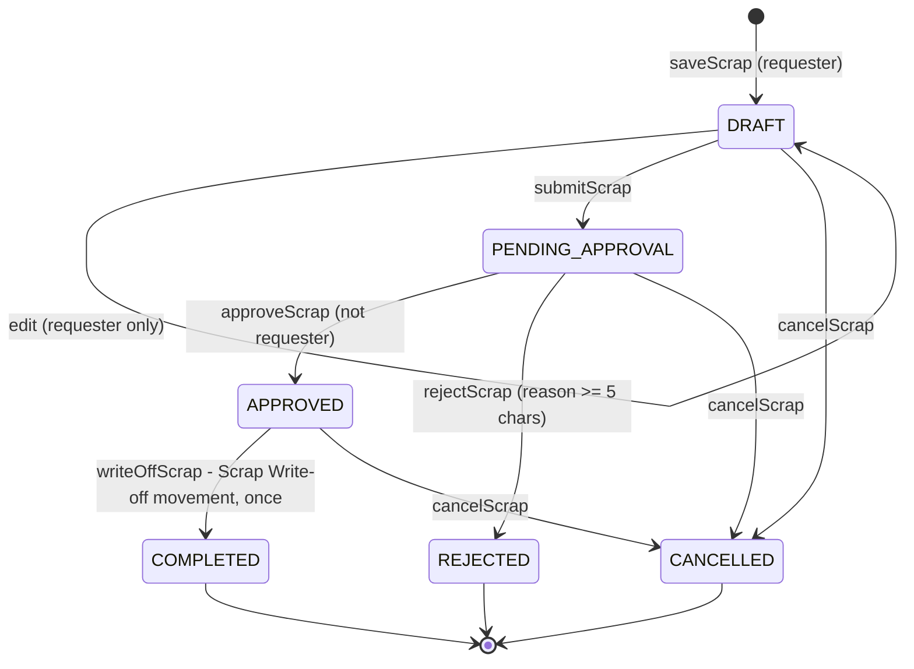
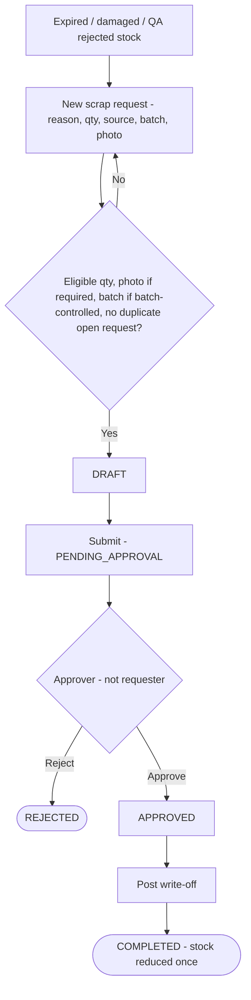

## 1. Workflow summary

| Field | Value |
|---|---|
| Workflow ID | WF-14 |
| Workflow name | Scrap Workflow |
| Business purpose | Specify scrap write-off. |
| Initiating role | Warehouse / QA / Inventory staff |
| Trigger | Unusable stock found |
| Preconditions | Unusable stock at hub. |
| Final outcome | Stock written off with evidence. |
| Related requirements | FR-SCR-001, FR-SCR-002, FR-SCR-003, FR-SCR-004 |
| Related test cases | TC-SCR-001, TC-SCR-002, TC-SCR-N02, TC-SCR-N03, TC-SCR-003, TC-SCR-N01, TC-SCR-004 |
| Detailed chapter | `docs/workflow/` chapter 07, 10 |

## 2. Step-by-step process

1. Create request (reason, qty, source, batch, photo).
2. Submit.
3. Approver (not requester) approves or rejects.
4. Approver posts write-off once.

## 3. Decision points

Approve or reject.

## 4. Approval conditions

Different user with scrap.approve.

## 5. Rejection conditions

Reason ≥ 5 characters.

## 6. System actions

Eligibility check; Scrap Write-off movement.

## 7. User actions

Requester, approver.

## 8. Status changes

DRAFT → PENDING_APPROVAL → APPROVED → COMPLETED; REJECTED; CANCELLED.

## 9. Notifications

Pending requests on warehouse dashboard.

## 10. Exception scenarios

Quantity above eligible; missing photo / batch; duplicate.

## 11. Workflow diagram

Implementation label: diagrams describe the **prototype behaviour (VERIFIED in source code)** unless a step is marked PROPOSED / NOT IMPLEMENTED.

## 12. Final outcome

Stock written off with evidence.
