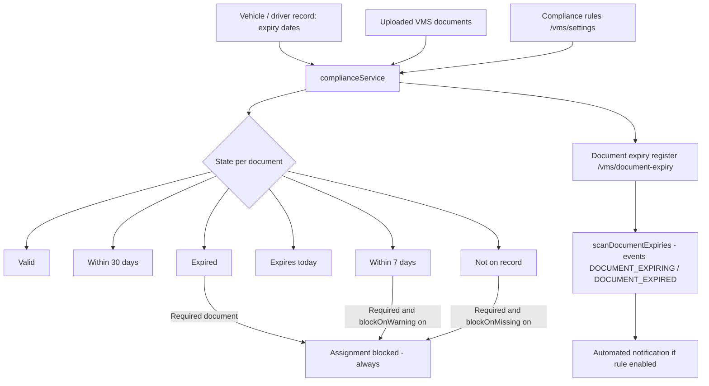

## 1. Workflow summary

| Field | Value |
|---|---|
| Workflow ID | WF-15 |
| Workflow name | Vehicle Management Workflow |
| Business purpose | Specify vehicle and driver compliance management. |
| Initiating role | Administrator |
| Trigger | Vehicle / driver document recorded or expiring |
| Preconditions | Vehicles and drivers recorded. |
| Final outcome | Only compliant fleet on the road. |
| Related requirements | FR-VMS-001, FR-VMS-002, FR-VMS-003, FR-VMS-004 |
| Related test cases | TC-VMS-001, TC-VMS-002, TC-VMS-003, TC-VMS-004 |
| Detailed chapter | `docs/workflow/` chapter 11 |

## 2. Step-by-step process

1. Record document numbers and expiry dates; upload files.
2. Compliance computed per document.
3. Expiry register reviewed; scan raises events.
4. Assignment blocked for expired required documents.

## 3. Decision points

Required? Expired / warning / missing?

## 4. Approval conditions

Document verification (WF-22).

## 5. Rejection conditions

—

## 6. System actions

`complianceService`, expiry events.

## 7. User actions

Administrator / Dispatcher.

## 8. Status changes

VALID / MONTH / WEEK / TODAY / EXPIRED / MISSING.

## 9. Notifications

DOCUMENT_EXPIRING / DOCUMENT_EXPIRED (automation).

## 10. Exception scenarios

Assignment refused.

## 11. Workflow diagram

Implementation label: diagrams describe the **prototype behaviour (VERIFIED in source code)** unless a step is marked PROPOSED / NOT IMPLEMENTED.

## 12. Final outcome

Only compliant fleet on the road.
