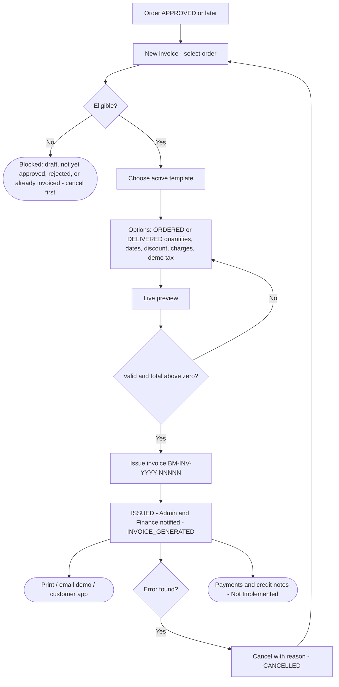
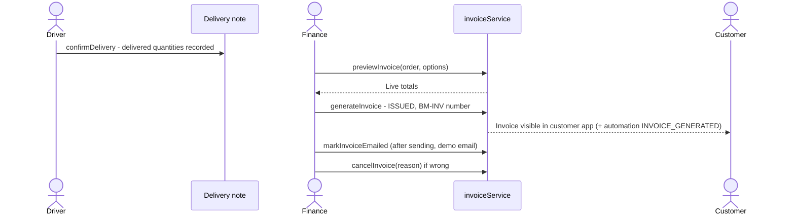

## 1. Workflow summary

| Field | Value |
|---|---|
| Workflow ID | WF-16 |
| Workflow name | Invoice Workflow |
| Business purpose | Specify invoice issue and cancellation (scope to be confirmed). |
| Initiating role | Finance |
| Trigger | Order approved or delivered |
| Preconditions | Order APPROVED or later without active invoice; active template. |
| Final outcome | Invoice issued. |
| Related requirements | FR-INVC-001, FR-INVC-002, FR-INVC-003, FR-INVC-004 |
| Related test cases | TC-INVC-001, TC-INVC-002, TC-INVC-N01, TC-INVC-N02, TC-INVC-003, TC-INVC-N03, TC-INVC-004 |
| Detailed chapter | `docs/workflow/` chapter 12 |

## 2. Step-by-step process

1. New invoice — select order.
2. Choose template and options (quantity basis, dates, discount, charges, demo tax).
3. Preview; issue (BM-INV-YYYY-NNNNN).
4. Print / email (demo) / visible to customer.
5. Cancel with reason if wrong; reissue.

## 3. Decision points

Eligible? Quantity basis?

## 4. Approval conditions

—

## 5. Rejection conditions

Cancellation.

## 6. System actions

Snapshot, numbering, totals, event INVOICE_GENERATED.

## 7. User actions

Finance.

## 8. Status changes

ISSUED → CANCELLED.

## 9. Notifications

Admin and Finance.

## 10. Exception scenarios

Draft / unapproved order; duplicate; zero total.

## 11. Workflow diagram

Implementation label: diagrams describe the **prototype behaviour (VERIFIED in source code)** unless a step is marked PROPOSED / NOT IMPLEMENTED.

## 12. Final outcome

Invoice issued.
