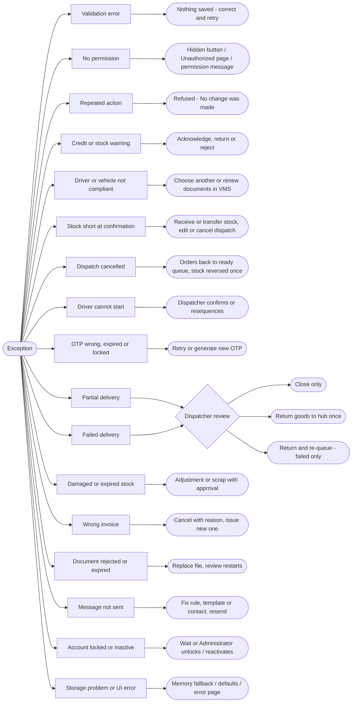

## 1. Workflow summary

| Field | Value |
|---|---|
| Workflow ID | WF-18 |
| Workflow name | Exception Management Workflow |
| Business purpose | Specify how exceptions are detected and resolved. |
| Initiating role | Any role |
| Trigger | Validation failure or operational exception |
| Preconditions | — |
| Final outcome | Exception resolved. |
| Related requirements | FR-EXC-001, FR-EXC-002, FR-EXC-003, FR-DRA-002, FR-OTP-002 |
| Related test cases | TC-EXC-001, TC-EXC-N01, TC-EXC-002, TC-EXC-N02, TC-EXC-003, TC-DRA-002, TC-DRA-N01, TC-OTP-002, TC-OTP-N01, TC-OTP-N02 |
| Detailed chapter | `docs/workflow/` chapter 15 |

## 2. Step-by-step process

1. Service detects the exception and refuses the action or moves the record to an exception status.
2. Named role resolves it (see register in docs/workflow chapter 15).

## 3. Decision points

Exception type.

## 4. Approval conditions

Depends on type.

## 5. Rejection conditions

—

## 6. System actions

Validation, idempotency, transactions.

## 7. User actions

Resolver role.

## 8. Status changes

Exception statuses: RETURNED, REJECTED, DELIVERY_FAILED, PARTIALLY_DELIVERED, RETURNED_TO_HUB, CANCELLED.

## 9. Notifications

Responsible role notified.

## 10. Exception scenarios

37 exceptions listed in docs/workflow 15.2.

## 11. Workflow diagram

Implementation label: diagrams describe the **prototype behaviour (VERIFIED in source code)** unless a step is marked PROPOSED / NOT IMPLEMENTED.

## 12. Final outcome

Exception resolved.
