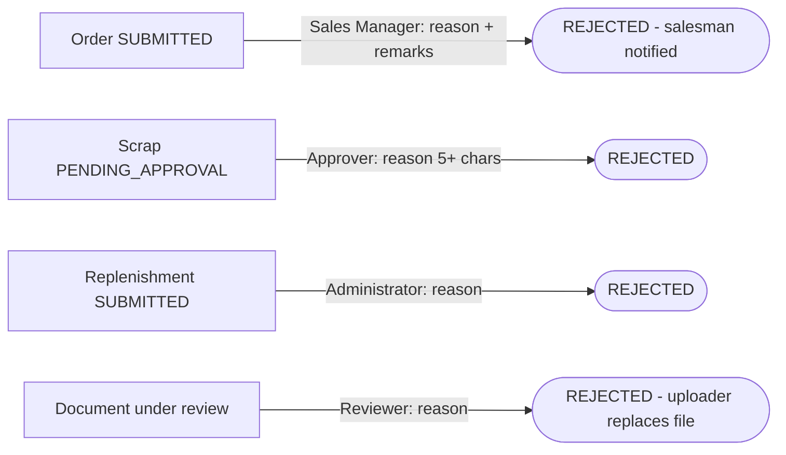

## 1. Workflow summary

| Field | Value |
|---|---|
| Workflow ID | WF-19 |
| Workflow name | Rejection Workflow |
| Business purpose | Specify all rejection paths. |
| Initiating role | Sales Manager / reviewers |
| Trigger | Order, scrap, replenishment or document rejected |
| Preconditions | A request awaiting decision. |
| Final outcome | Requester informed. |
| Related requirements | FR-APR-005, FR-SCR-003, FR-DOC-003, FR-AI-003 |
| Related test cases | TC-APR-005, TC-APR-N02, TC-SCR-003, TC-SCR-N01, TC-DOC-003, TC-DOC-N01, TC-AI-003 |
| Detailed chapter | `docs/workflow/` chapter 07 |

## 2. Step-by-step process

1. Order: Sales Manager rejects with reason → REJECTED (final).
2. Scrap: approver rejects with reason → REJECTED.
3. Replenishment: Administrator rejects with reason → REJECTED.
4. Document: reviewer rejects with reason → REJECTED; uploader replaces file.

## 3. Decision points

Reject vs return (orders only).

## 4. Approval conditions

—

## 5. Rejection conditions

Reason mandatory in every case.

## 6. System actions

Decision records; notifications.

## 7. User actions

Approver.

## 8. Status changes

→ REJECTED.

## 9. Notifications

Requester notified / sees reason.

## 10. Exception scenarios

Missing reason refused.

## 11. Workflow diagram

Implementation label: diagrams describe the **prototype behaviour (VERIFIED in source code)** unless a step is marked PROPOSED / NOT IMPLEMENTED.

## 12. Final outcome

Requester informed.
