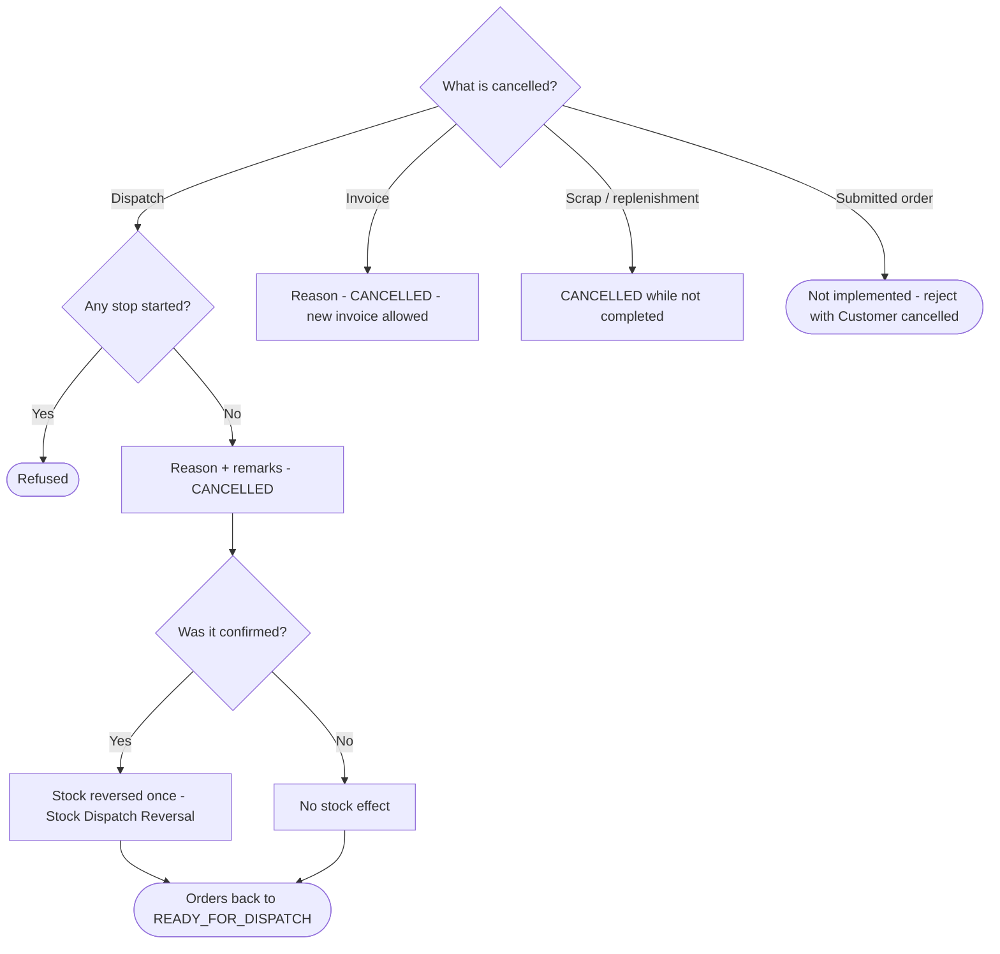

## 1. Workflow summary

| Field | Value |
|---|---|
| Workflow ID | WF-20 |
| Workflow name | Cancellation Workflow |
| Business purpose | Specify cancellation paths and their stock effects. |
| Initiating role | Dispatcher / Finance / requester |
| Trigger | Dispatch, invoice, scrap or replenishment must be cancelled |
| Preconditions | A cancellable record. |
| Final outcome | Record cancelled cleanly. |
| Related requirements | FR-DSP-005, FR-INVC-003, FR-SCR-001, FR-ORD-010 |
| Related test cases | TC-DSP-005, TC-DSP-N05, TC-INVC-003, TC-INVC-N03, TC-SCR-001, TC-ORD-010 |
| Detailed chapter | `docs/workflow/` chapter 15 |

## 2. Step-by-step process

1. Dispatch: cancel with reason + remarks before any stop starts; orders back to READY_FOR_DISPATCH; stock reversed once if confirmed.
2. Invoice: cancel with reason; new invoice possible.
3. Scrap / replenishment: cancel while not completed.
4. Order: cancellation after submission NOT IMPLEMENTED (reject with "Customer cancelled").

## 3. Decision points

Cancellable state?

## 4. Approval conditions

—

## 5. Rejection conditions

—

## 6. System actions

Reversal movements; timeline.

## 7. User actions

Owner role.

## 8. Status changes

→ CANCELLED.

## 9. Notifications

Driver and Admin on dispatch cancellation.

## 10. Exception scenarios

Started dispatch cannot be cancelled.

## 11. Workflow diagram

Implementation label: diagrams describe the **prototype behaviour (VERIFIED in source code)** unless a step is marked PROPOSED / NOT IMPLEMENTED.

## 12. Final outcome

Record cancelled cleanly.
