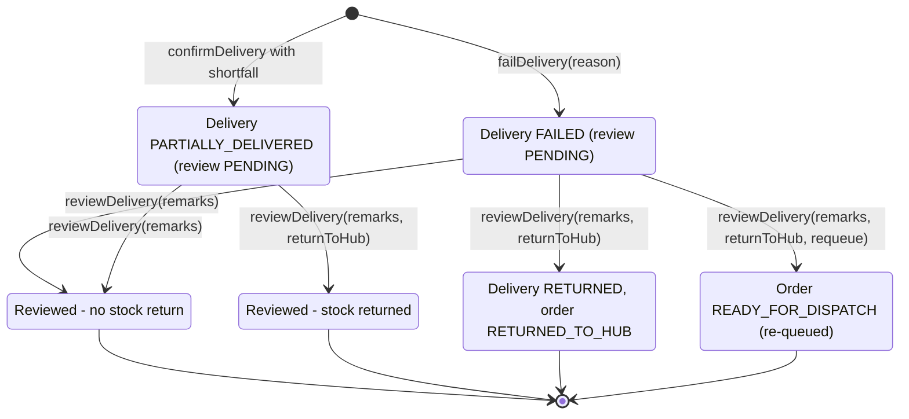

## 1. Workflow summary

| Field | Value |
|---|---|
| Workflow ID | WF-21 |
| Workflow name | Return Delivery Workflow |
| Business purpose | Specify return delivery handling. |
| Initiating role | Driver / Dispatcher |
| Trigger | Delivery failed or partially accepted |
| Preconditions | Delivery FAILED or PARTIALLY_DELIVERED. |
| Final outcome | Goods and order status corrected. |
| Related requirements | FR-DRV-005, FR-EXC-001, FR-EXC-002, FR-EXC-003 |
| Related test cases | TC-DRV-005, TC-EXC-001, TC-EXC-N01, TC-EXC-002, TC-EXC-N02, TC-EXC-003 |
| Detailed chapter | `docs/workflow/` chapter 15 |

## 2. Step-by-step process

1. Driver records failure reason or shortfall.
2. Dispatcher opens delivery; enters review remarks.
3. Optionally return undelivered goods to hub (once).
4. For failed + returned: optionally re-queue the order.

## 3. Decision points

Return stock? Re-queue?

## 4. Approval conditions

Dispatcher review.

## 5. Rejection conditions

—

## 6. System actions

Delivery Return movement; order status update.

## 7. User actions

Dispatcher.

## 8. Status changes

FAILED → RETURNED; order → RETURNED_TO_HUB or READY_FOR_DISPATCH.

## 9. Notifications

Failure notification to Admin, Dispatcher, customer.

## 10. Exception scenarios

Second review refused.

## 11. Workflow diagram

Implementation label: diagrams describe the **prototype behaviour (VERIFIED in source code)** unless a step is marked PROPOSED / NOT IMPLEMENTED.

## 12. Final outcome

Goods and order status corrected.
