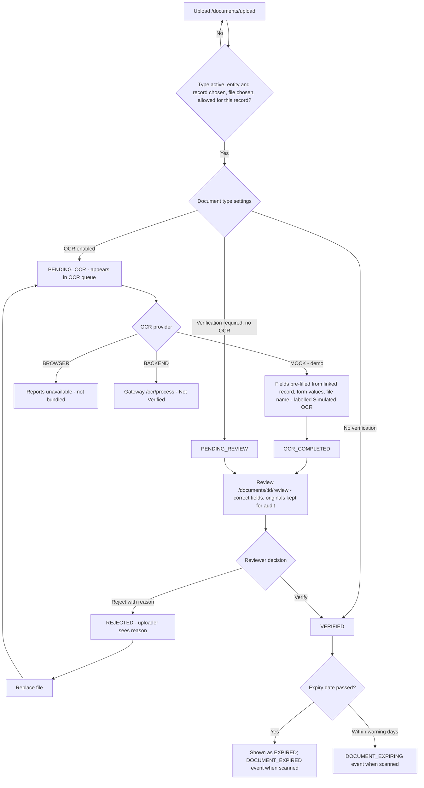
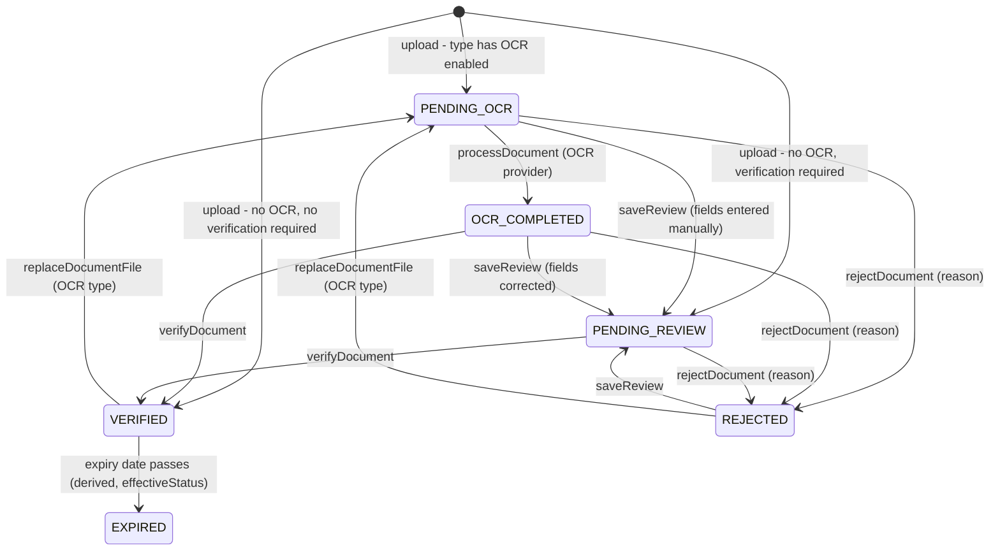

## 1. Workflow summary

| Field | Value |
|---|---|
| Workflow ID | WF-22 |
| Workflow name | Document Upload and Verification Workflow |
| Business purpose | Specify document upload and verification. |
| Initiating role | Any uploader |
| Trigger | Document uploaded |
| Preconditions | Active document type; user may upload for the record. |
| Final outcome | Verified document. |
| Related requirements | FR-DOC-001, FR-DOC-002, FR-DOC-003, FR-DOC-004 |
| Related test cases | TC-DOC-001, TC-DOC-N02, TC-DOC-002, TC-DOC-003, TC-DOC-N01, TC-DOC-004 |
| Detailed chapter | `docs/workflow/` chapter 13 |

## 2. Step-by-step process

1. Upload with type, record, file, fields.
2. OCR (if enabled) extracts fields (MOCK in prototype).
3. Reviewer corrects fields.
4. Verify or reject with reason.
5. Uploader replaces file after rejection.

## 3. Decision points

OCR type? Verify or reject?

## 4. Approval conditions

Reviewer verifies.

## 5. Rejection conditions

Reason mandatory.

## 6. System actions

OCR result kept with originals; expiry derived.

## 7. User actions

Uploader, reviewer.

## 8. Status changes

PENDING_OCR → OCR_COMPLETED → PENDING_REVIEW → VERIFIED / REJECTED.

## 9. Notifications

Expiry events.

## 10. Exception scenarios

File not stored; provider unavailable.

## 11. Workflow diagram

Implementation label: diagrams describe the **prototype behaviour (VERIFIED in source code)** unless a step is marked PROPOSED / NOT IMPLEMENTED.

## 12. Final outcome

Verified document.
