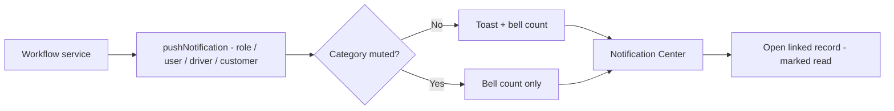

## 1. Workflow summary

| Field | Value |
|---|---|
| Workflow ID | WF-23 |
| Workflow name | Notification Workflow |
| Business purpose | Specify in-app notifications. |
| Initiating role | System |
| Trigger | Any workflow event |
| Preconditions | — |
| Final outcome | User informed. |
| Related requirements | FR-NOTF-001, FR-NOTF-002, FR-AUTO-002 |
| Related test cases | TC-NOTF-001, TC-NOTF-002, TC-AUTO-002 |
| Detailed chapter | `docs/workflow/` chapter 13 |

## 2. Step-by-step process

1. Service calls `pushNotification` with target role / user / driver / customer.
2. Bell count updates; toast unless muted.
3. User opens Notification Center and follows link.
4. Marked read.

## 3. Decision points

Muted category?

## 4. Approval conditions

—

## 5. Rejection conditions

—

## 6. System actions

`notificationService`.

## 7. User actions

Read / mute.

## 8. Status changes

Unread → Read.

## 9. Notifications

—

## 10. Exception scenarios

—

## 11. Workflow diagram

Implementation label: diagrams describe the **prototype behaviour (VERIFIED in source code)** unless a step is marked PROPOSED / NOT IMPLEMENTED.

## 12. Final outcome

User informed.
