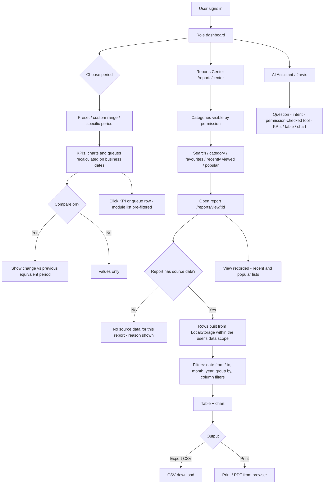

## 1. Workflow summary

| Field | Value |
|---|---|
| Workflow ID | WF-24 |
| Workflow name | Reporting Workflow |
| Business purpose | Specify dashboards and reports. |
| Initiating role | Office roles |
| Trigger | User opens a dashboard or report |
| Preconditions | Report category permission. |
| Final outcome | Insight / export. |
| Related requirements | FR-RPT-001, FR-RPT-002, FR-DASH-002 |
| Related test cases | TC-RPT-001, TC-RPT-002, TC-DASH-002, TC-DASH-N01 |
| Detailed chapter | `docs/workflow/` chapter 14 |

## 2. Step-by-step process

1. Choose period on dashboard; compare.
2. Drill down to lists.
3. Open Reports Center; search / favourite.
4. Run report with filters; export CSV or print.

## 3. Decision points

Report has source data?

## 4. Approval conditions

—

## 5. Rejection conditions

—

## 6. System actions

`reportService.runReport` with data scope.

## 7. User actions

Analysis.

## 8. Status changes

—

## 9. Notifications

—

## 10. Exception scenarios

24 reports state "no source data".

## 11. Workflow diagram

Implementation label: diagrams describe the **prototype behaviour (VERIFIED in source code)** unless a step is marked PROPOSED / NOT IMPLEMENTED.

## 12. Final outcome

Insight / export.
