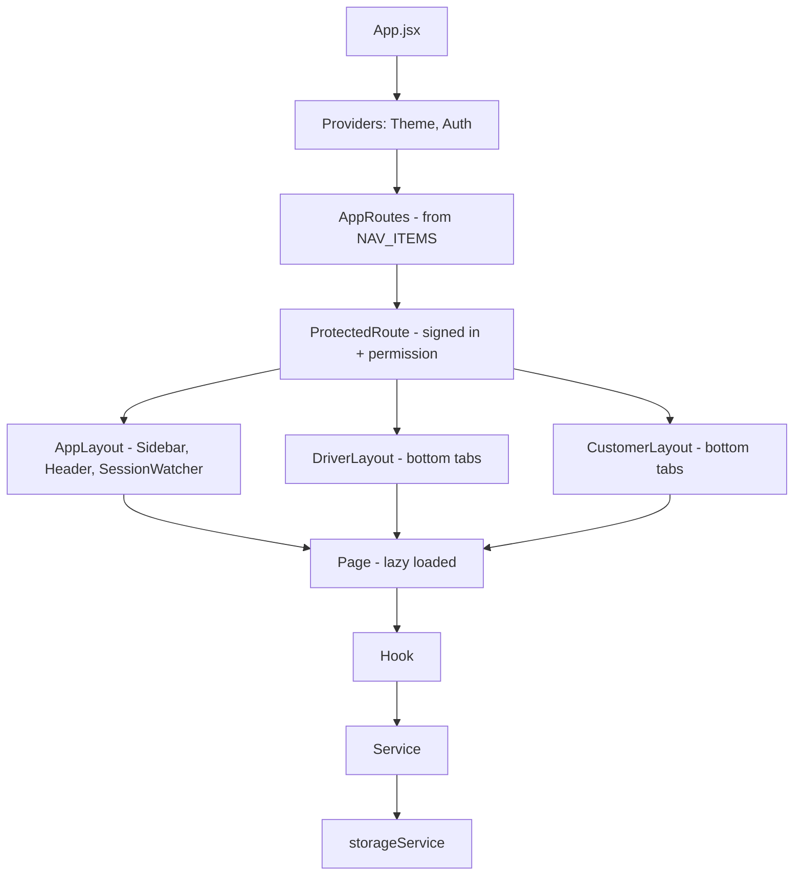
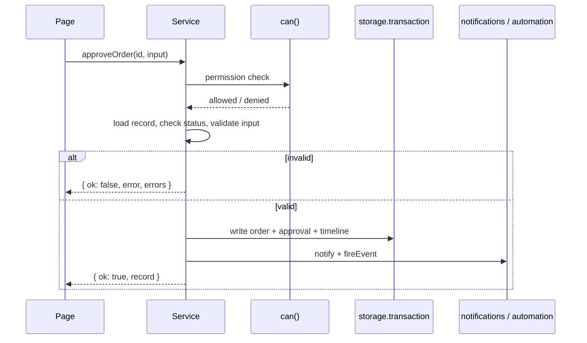

## 1. Source structure — VERIFIED

| Folder | Files | Responsibility |
|---|---|---|
| `src/config` | 15 | Navigation (206 entries), roles, permissions, RBAC catalogue, status metadata (orders, dispatch, documents, invoices, communication, VMS, AI), runtime config |
| `src/services` | 84 | Business services, validation, storage, simulators, seed data (`services/seed`), AI (`services/ai`) and ML (`services/ml`) |
| `src/pages` | 134 | Screens grouped by module (orders, dispatch, driver, customer, inventory, scrap, vms, documents, invoices, communication, calls, reports, ai, admin, account, auth, errors) |
| `src/components` | 121 | Layouts, common UI kit (Button, Card, DataTable, Modal, Input…), dashboard widgets, module components |
| `src/hooks` | 19 | Data hooks (`useDashboardData`, `useDriverWorkspace`, `useCustomerWorkspace`, `useTableQuery`, `usePermission`…) |
| `src/context` | 3 | `AuthContext`, `ThemeContext`, `DashboardPeriodContext` |
| `src/routes` | 2 | `AppRoutes` (generated from navigation), `ProtectedRoute` |
| `src/utils` | 11 | Formatters, periods, dashboard filters, stock helpers, demo geo, invoice snapshot, dispatch stock |

## 2. Component structure

## 3. Routing structure — VERIFIED

- Every route is an entry in `NAV_ITEMS` with `path`, `page`, `permission`, `hidden`, `parent`, `redirectTo`, `public`.
- `AppRoutes` maps `page` keys to lazy components; public routes (`/login`, `/driver/login`, `/customer/login`,
  `/forgot-password`, `/reset-password`) use `PublicOnlyRoute`.
- `ProtectedRoute` redirects signed-out users to the sign-in page of the right app and shows `/unauthorized` when the
  permission is missing; unknown paths render `NotFound`.
- Landing path per role from the role record (`landingPathFor`).
- Full screen list: {{ref:BM-UX-004}}.

## 4. State management — VERIFIED

| State | Mechanism |
|---|---|
| Session and user | `AuthContext` (session in localStorage or sessionStorage) |
| Theme | `ThemeContext` (`bellomassi_theme`) |
| Dashboard period | `DashboardPeriodContext` (memory only, per dashboard) |
| Business data | `useStoredValue` / `useSyncExternalStore` over `storageService.subscribe`; read cache; cross-tab sync through `storage` events |
| Forms | `useFormState` (local state, field errors from service `errors`) |
| Tables | `useTableQuery` (search, filter, sort, pagination in memory) |

## 5. Service layer design — VERIFIED

- Each service owns one area and exports pure-ish functions: `getX`, `validateX`, `createX`, `updateX`, status
  transitions (`approveOrder`, `confirmDispatch`…).
- Return contract: `{ ok: true, record }` or `{ ok: false, error, errors }` (field map).
- Permission first: `if (!can(user, 'orders.approve')) return deny('…')`.
- State guard second: status must match the expected state, otherwise a "No change was made" message.
- Writes through `storage.transaction([...])` so related keys update together.
- Side effects: timeline event, notification (`pushNotification`), automation event (`fireEvent`), activity log.

## 6. Validation design

- Field validation in `validateX` functions per service (`services/validation.js` shared helpers: required, email,
  phone, pincode, PAN, GSTIN, dates, numbers).
- Cross-record rules in the service (stock, credit, sequence, compliance).
- UI shows `errors[field]` beside the field and `error` as a toast.
- Production: the same rules in DRF serializers / service layer; the browser keeps its checks for usability only.

## 7. Error handling

| Layer | Prototype | Production (PROPOSED) |
|---|---|---|
| Service | Structured `{ ok:false }` results, never throws for business errors | Domain exceptions → HTTP 400 / 403 / 404 / 409 with error codes |
| Storage | JSON safety; corrupted key falls back to defaults; in-memory fallback when storage blocked; issues listed | DB constraints + transactions; retry on serialization failure |
| UI | Error boundary page, NotFound, Unauthorized, toasts | Same + API error mapping, offline banner in mobile app |
| Integrations | Simulated statuses (SENT_DEMO, FAILED_DEMO) | Retry with back-off, dead-letter queue, integration log |

## 8. Data storage design — VERIFIED

`storageService` is the only module that touches browser storage: key registry (`STORAGE_KEYS`), versioning
(`APP_DATA_VERSION` 8) and migrations, seed on first load, read cache, change subscription, transactions, export /
import with validation, reset to demo data, usage report. Detail: {{ref:BM-DAT-001}}.

## 9. Integration components

`services/integrationGateway.js` calls an optional gateway when `VITE_INTEGRATION_GATEWAY_URL` is set; otherwise the
simulators are used (`emailService` demo mode, `openWAService` mock, `ocrService` MOCK, `aiProviderService` DEMO,
`trackingService` DEMO GPS, `otpService`). Gateway mode is NOT VERIFIED.

## 10. Detailed workflow logic

The exact rules per workflow are documented in {{ref:BM-SYS-007}} and the module FRDs; key algorithms:

| Logic | Location | Summary |
|---|---|---|
| Approval checks | `approvalService.getApprovalChecks` | 6 checks with severity block / warn; credit block configurable |
| Suggested sequence | `dispatchService.suggestSequence` | Priority rank → pincode → order number |
| Stock deduction | `utils/dispatchStock` | Per line, once (`stockDeducted`), reversal once (`stockReversed`) |
| Start rules | `deliveryService.startDelivery` | Dispatch confirmed / in transit, date reached, next in sequence, single active stop |
| OTP | `otpService` | 6 digits, expiry, 5 attempts, invalidation on regenerate |
| Dispatch closing | `deliveryService` | COMPLETED if all delivered else PARTIALLY_DELIVERED |
| Compliance | `complianceService` | Expiry states and blocking rules |
| Dashboard filter | `utils/dashboardFilter` | Per-collection business date |

## 11. Future backend service design — PROPOSED

| Django app | Models (main) | Services | API prefix |
|---|---|---|---|
| `accounts` | User, Role, Permission, RolePermission, UserRole, LoginAttempt | auth, users, rbac | `/api/v1/auth`, `/users`, `/roles` |
| `masterdata` | Customer, CustomerLocation, Product, ProductCategory, Hub, Zone, ZonePincode, Supplier, Company | master data CRUD | `/customers`, `/products`, `/hubs`, `/zones` |
| `orders` | Order, OrderItem, OrderApproval, Consolidation, OrderEvent | order, approval, consolidation, credit | `/orders` |
| `logistics` | Driver, Vehicle, Dispatch, DispatchStop, Delivery, DeliveryItem, DeliveryOtp, ProofOfDelivery, DeliveryNote, TrackingSession, LocationPoint | dispatch, assignment, delivery, otp, tracking | `/dispatches`, `/deliveries`, `/driver`, `/tracking` |
| `inventory` | StockItem, StockMovement, StockReceipt, StockTransfer, StockAdjustment, ScrapRequest, ReplenishmentRequest | stock, scrap, replenishment | `/inventory`, `/scrap` |
| `documents` | DocumentType, Document, OcrResult, ComplianceRule | documents, OCR, compliance | `/documents`, `/vms` |
| `billing` | InvoiceTemplate, Invoice, InvoiceLine | invoice | `/invoices` |
| `comms` | Notification, MessageTemplate, Message, AutomationRule, CallLog | notify, email, whatsapp/sms, automation | `/notifications`, `/messages` |
| `core` | Setting, AuditLog, Sequence | settings, audit, numbering | `/settings`, `/audit-logs` |

API detail: {{ref:BM-API-001}}; tables: {{ref:BM-DAT-002}}.
