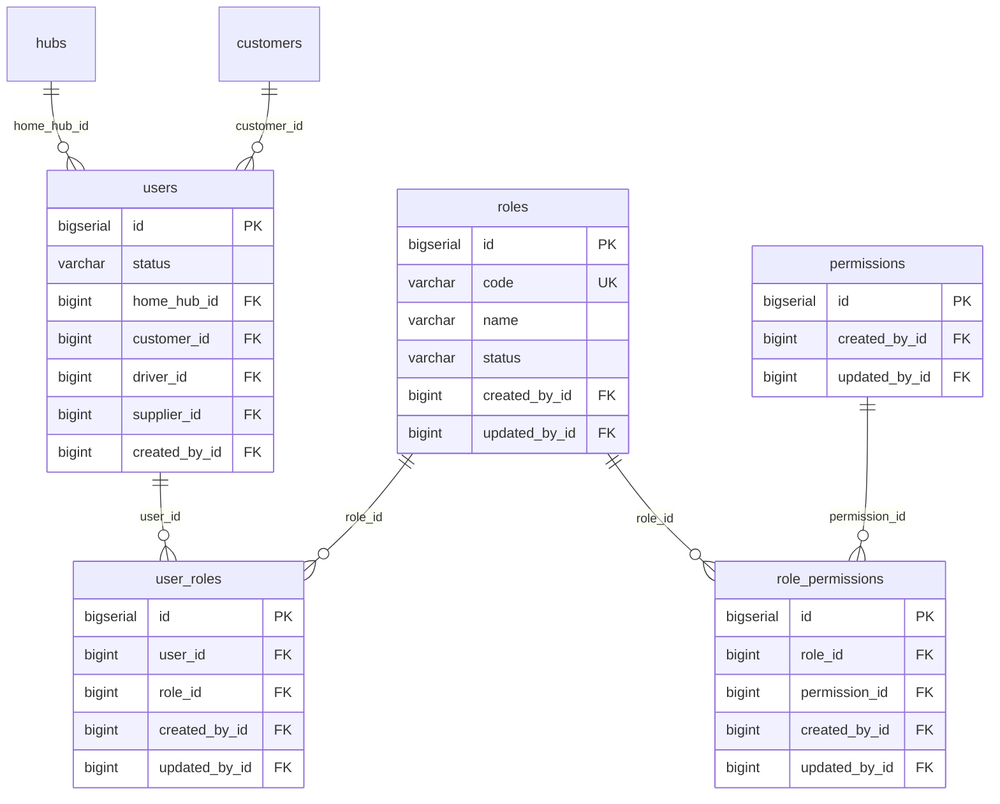
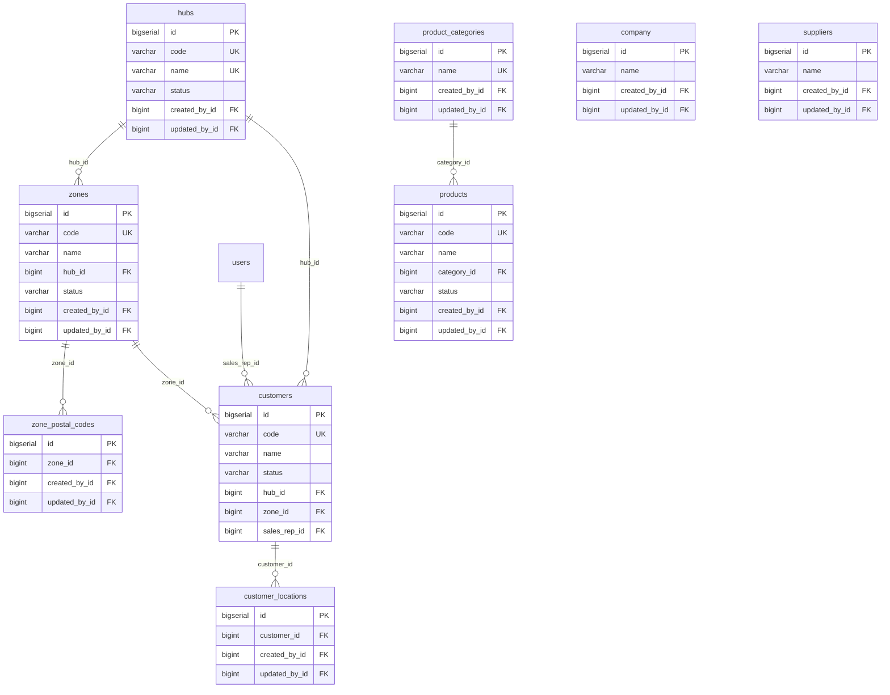
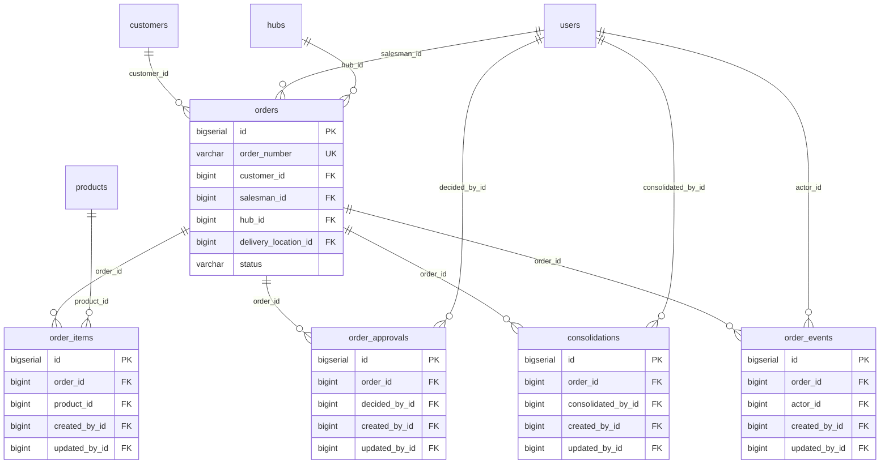
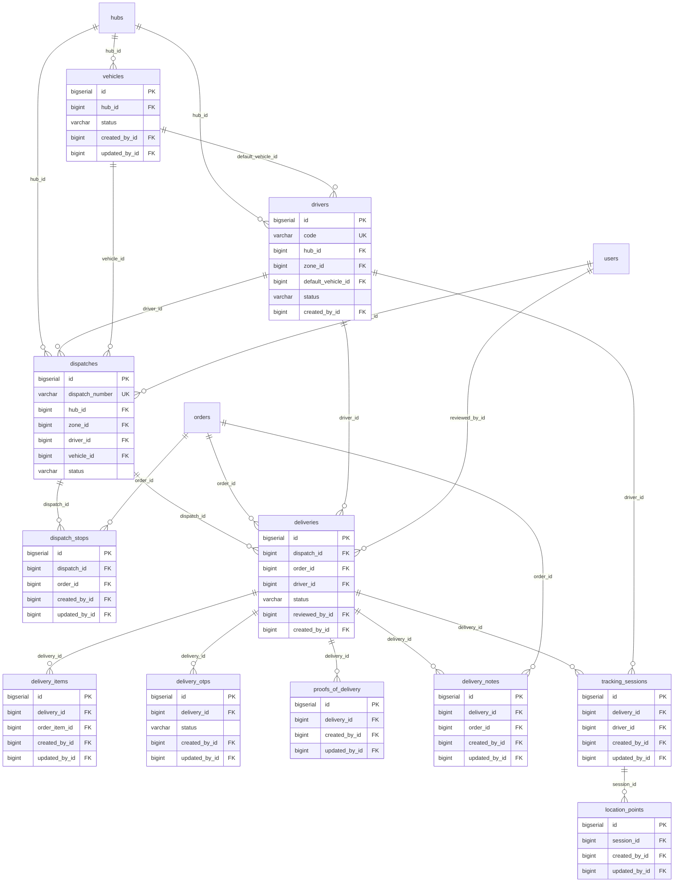
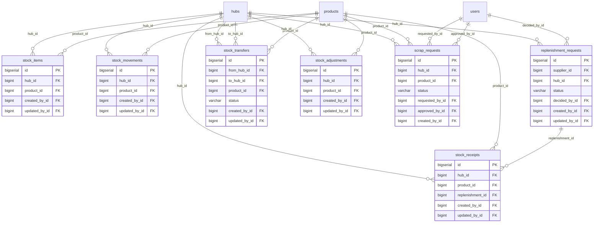
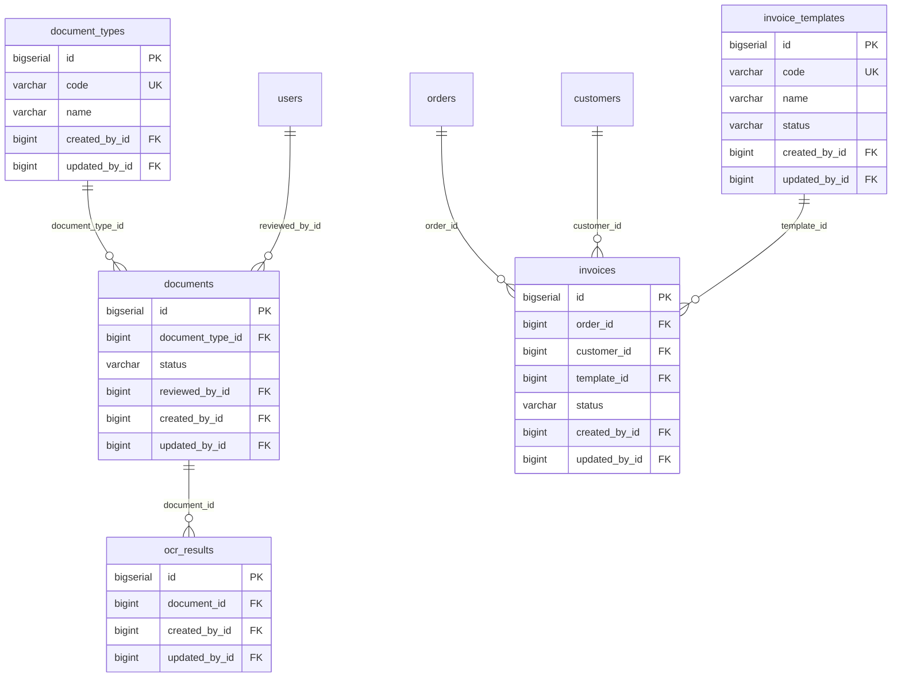
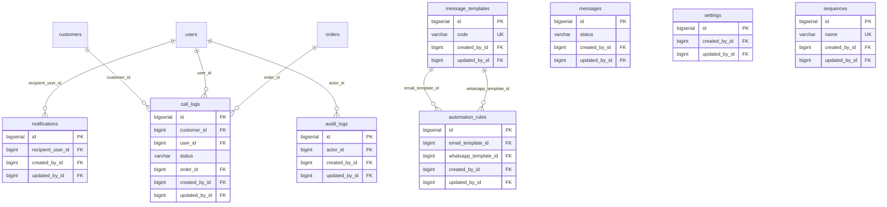

## 1. Design principles — PROPOSED

- PostgreSQL 16, Django ORM migrations; surrogate `bigserial` keys; business numbers unique.
- Every table has audit columns `created_at`, `created_by_id`, `updated_at`, `updated_by_id`.
- Master data uses **soft delete** (`is_deleted`, `deleted_at`); transactions are never deleted (cancel / status instead).
- Status columns are `varchar` with CHECK constraints listing the exact prototype status codes.
- Money `numeric(14,2)`; quantities `numeric(12,3)`; times `timestamptz` (UTC) displayed in the organisation time zone.
- Optimistic locking (`version`) on orders, dispatches and stock rows; `SELECT … FOR UPDATE` in stock and status transitions.
- Files in object storage; only keys stored in the database. OTPs stored hashed.
- GPS points partitioned by month; retention per {{ref:BM-DAT-005}}.

## 2. Table catalogue

| Domain | Table | Django app | Prototype source | Description | Columns |
|---|---|---|---|---|---|
| Identity and access | `users` | accounts | `bellomassi_demo_users` | User accounts for all roles | 22 |
| Identity and access | `roles` | accounts | `bellomassi_roles` | System and custom roles | 15 |
| Identity and access | `permissions` | accounts | `bellomassi_permissions` | Permission catalogue (110 keys) | 8 |
| Identity and access | `role_permissions` | accounts | `bellomassi_roles.permissions` | Permissions granted to a role | 7 |
| Identity and access | `user_roles` | accounts | `bellomassi_demo_users.roles` | Roles assigned to a user | 8 |
| Master data | `company` | core | `bellomassi_company` | Company profile | 13 |
| Master data | `hubs` | masterdata | `bellomassi_hubs` | Fulfilment hubs / warehouses | 19 |
| Master data | `zones` | masterdata | `bellomassi_dispatch_zones` | Delivery zones per hub | 11 |
| Master data | `zone_postal_codes` | masterdata | `bellomassi_dispatch_zones.pincodes` | Pincodes of a zone | 7 |
| Master data | `customers` | masterdata | `bellomassi_customers` | Customer accounts | 25 |
| Master data | `customer_locations` | masterdata | `bellomassi_customers.address*` | Delivery locations of a customer | 18 |
| Master data | `product_categories` | masterdata | `bellomassi_products.category` | Product categories | 6 |
| Master data | `products` | masterdata | `bellomassi_products` | Item catalogue | 23 |
| Master data | `suppliers` | masterdata | `bellomassi_forecast_settings.suppliers` | Suppliers | 12 |
| Orders | `orders` | orders | `bellomassi_orders` | Sales orders | 32 |
| Orders | `order_items` | orders | `bellomassi_orders.items` | Order lines | 13 |
| Orders | `order_approvals` | orders | `bellomassi_approvals` | Approval decisions | 14 |
| Orders | `consolidations` | orders | `bellomassi_consolidations` | Customer Service verification | 11 |
| Orders | `order_events` | orders | `bellomassi_order_timeline` | Order timeline | 12 |
| Logistics | `drivers` | logistics | `bellomassi_drivers` | Drivers | 18 |
| Logistics | `vehicles` | logistics | `bellomassi_vehicles` | Vehicles | 16 |
| Logistics | `dispatches` | logistics | `bellomassi_dispatches` | Vehicle runs | 21 |
| Logistics | `dispatch_stops` | logistics | `bellomassi_dispatches.orderIds/sequence` | Orders on a dispatch in sequence | 9 |
| Logistics | `deliveries` | logistics | `bellomassi_deliveries` | One delivery per order per dispatch | 24 |
| Logistics | `delivery_items` | logistics | `bellomassi_deliveries.items` | Delivered quantities per line | 12 |
| Logistics | `delivery_otps` | logistics | `bellomassi_delivery_otps` | Delivery OTPs | 12 |
| Logistics | `proofs_of_delivery` | logistics | `bellomassi_delivery_pod` | POD evidence | 10 |
| Logistics | `delivery_notes` | logistics | `bellomassi_delivery_notes` | Delivery notes | 11 |
| Logistics | `tracking_sessions` | logistics | `bellomassi_driver_tracking` | GPS tracking per delivery | 12 |
| Logistics | `location_points` | logistics | `(not stored in prototype)` | GPS points (partitioned by month) | 12 |
| Inventory | `stock_items` | inventory | `bellomassi_inventory` | Stock per product per hub | 14 |
| Inventory | `stock_movements` | inventory | `bellomassi_stock_movements` | Movement ledger | 13 |
| Inventory | `stock_receipts` | inventory | `bellomassi_stock_receipts` | Goods receipts | 12 |
| Inventory | `stock_transfers` | inventory | `bellomassi_stock_transfers` | Inter-hub transfers | 12 |
| Inventory | `stock_adjustments` | inventory | `bellomassi_stock_adjustments` | Stock adjustments | 12 |
| Inventory | `scrap_requests` | inventory | `bellomassi_scrap_requests` | Scrap requests | 18 |
| Inventory | `replenishment_requests` | inventory | `bellomassi_replenishment_drafts` | Purchase requests | 12 |
| Documents and billing | `document_types` | documents | `bellomassi_document_types` | Document types | 14 |
| Documents and billing | `documents` | documents | `bellomassi_documents` | Stored documents | 23 |
| Documents and billing | `ocr_results` | documents | `bellomassi_ocr_results` | OCR extraction results | 10 |
| Documents and billing | `invoice_templates` | billing | `bellomassi_invoice_templates` | Invoice templates | 12 |
| Documents and billing | `invoices` | billing | `bellomassi_invoices` | Customer invoices (scope to confirm) | 16 |
| Communication and platform | `notifications` | comms | `bellomassi_notifications` | In-app notifications | 12 |
| Communication and platform | `message_templates` | comms | `bellomassi_email_templates / whatsapp_templates` | Email / WhatsApp / SMS templates | 12 |
| Communication and platform | `messages` | comms | `bellomassi_email_history / whatsapp_messages` | Outbound messages | 14 |
| Communication and platform | `automation_rules` | comms | `bellomassi_notification_templates` | Event rules | 11 |
| Communication and platform | `call_logs` | comms | `bellomassi_call_history` | Call history | 17 |
| Communication and platform | `settings` | core | `bellomassi_settings` | Application settings | 8 |
| Communication and platform | `sequences` | core | `bellomassi_order_sequence / dispatch_sequence …` | Document number sequences | 9 |
| Communication and platform | `audit_logs` | core | `bellomassi_audit_logs` | Audit trail (append-only) | 13 |

## ER diagram — Identity and access

## ER diagram — Master data

## ER diagram — Orders

## ER diagram — Logistics

## ER diagram — Inventory

## ER diagram — Documents and billing

## ER diagram — Communication and platform

## Column definitions

All columns with type, keys and constraints are in {{ref:BM-DAT-003}}. Summary of keys per table:

| Table | Primary key | Foreign keys | Unique | Indexed |
|---|---|---|---|---|
| `users` | id | home_hub_id→hubs, customer_id→customers, driver_id→drivers, supplier_id→suppliers | username, email | phone |
| `roles` | id | — | code | — |
| `permissions` | id | — | key | — |
| `role_permissions` | id | role_id→roles, permission_id→permissions | — | — |
| `user_roles` | id | user_id→users, role_id→roles | — | — |
| `company` | id | — | — | — |
| `hubs` | id | — | code, name | — |
| `zones` | id | hub_id→hubs | code | — |
| `zone_postal_codes` | id | zone_id→zones | — | postal_code |
| `customers` | id | hub_id→hubs, zone_id→zones, sales_rep_id→users | code, sap_customer_no | — |
| `customer_locations` | id | customer_id→customers | — | — |
| `product_categories` | id | — | name | — |
| `products` | id | category_id→product_categories | code, sku, barcode, sap_material_no | — |
| `suppliers` | id | — | — | — |
| `orders` | id | customer_id→customers, salesman_id→users, hub_id→hubs, delivery_location_id→customer_locations | order_number | requested_delivery_date, status |
| `order_items` | id | order_id→orders, product_id→products | — | — |
| `order_approvals` | id | order_id→orders, decided_by_id→users | — | — |
| `consolidations` | id | order_id→orders, consolidated_by_id→users | order_id | — |
| `order_events` | id | order_id→orders, actor_id→users | — | — |
| `drivers` | id | hub_id→hubs, zone_id→zones, default_vehicle_id→vehicles | code, mobile, employee_no, licence_no | — |
| `vehicles` | id | hub_id→hubs | registration_no | — |
| `dispatches` | id | hub_id→hubs, zone_id→zones, driver_id→drivers, vehicle_id→vehicles, confirmed_by_id→users | dispatch_number | dispatch_date, status |
| `dispatch_stops` | id | dispatch_id→dispatches, order_id→orders | — | — |
| `deliveries` | id | dispatch_id→dispatches, order_id→orders, driver_id→drivers, reviewed_by_id→users | delivery_number | status |
| `delivery_items` | id | delivery_id→deliveries, order_item_id→order_items | — | — |
| `delivery_otps` | id | delivery_id→deliveries | — | — |
| `proofs_of_delivery` | id | delivery_id→deliveries | delivery_id | — |
| `delivery_notes` | id | delivery_id→deliveries, order_id→orders | note_number, delivery_id | — |
| `tracking_sessions` | id | delivery_id→deliveries, driver_id→drivers | — | — |
| `location_points` | id | session_id→tracking_sessions | — | recorded_at |
| `stock_items` | id | hub_id→hubs, product_id→products | — | — |
| `stock_movements` | id | hub_id→hubs, product_id→products | — | occurred_at |
| `stock_receipts` | id | hub_id→hubs, product_id→products, replenishment_id→replenishment_requests | receipt_number | — |
| `stock_transfers` | id | from_hub_id→hubs, to_hub_id→hubs, product_id→products | transfer_number | — |
| `stock_adjustments` | id | hub_id→hubs, product_id→products | adjustment_number | — |
| `scrap_requests` | id | hub_id→hubs, product_id→products, requested_by_id→users, approved_by_id→users | request_number | — |
| `replenishment_requests` | id | supplier_id→suppliers, hub_id→hubs, decided_by_id→users | request_number | — |
| `document_types` | id | — | code | — |
| `documents` | id | document_type_id→document_types, reviewed_by_id→users | — | entity_id, expiry_date |
| `ocr_results` | id | document_id→documents | — | — |
| `invoice_templates` | id | — | code | — |
| `invoices` | id | order_id→orders, customer_id→customers, template_id→invoice_templates | invoice_number | — |
| `notifications` | id | recipient_user_id→users | — | recipient_role |
| `message_templates` | id | — | code | — |
| `messages` | id | — | — | — |
| `automation_rules` | id | email_template_id→message_templates, whatsapp_template_id→message_templates | event | — |
| `call_logs` | id | customer_id→customers, user_id→users, order_id→orders | — | — |
| `settings` | id | — | — | — |
| `sequences` | id | — | name | — |
| `audit_logs` | id | actor_id→users | — | action, occurred_at |

## Constraints and indexes

| Constraint | Definition |
|---|---|
| Status checks | `orders.status IN (DRAFT, SUBMITTED, RETURNED, REJECTED, APPROVED, CONSOLIDATED, READY_FOR_DISPATCH, DISPATCHED, OUT_FOR_DELIVERY, PARTIALLY_DELIVERED, DELIVERED, DELIVERY_FAILED, RETURNED_TO_HUB)`; similar for dispatches, deliveries, OTPs, scrap, documents, invoices |
| One active invoice per order | Partial unique index `invoices(order_id) WHERE status = 'ISSUED'` |
| One open scrap per hub+product+source | Partial unique index on `scrap_requests` where status in (DRAFT, PENDING_APPROVAL, APPROVED) |
| One stock row per hub+product | Unique `(hub_id, product_id)` on `stock_items` |
| Unique stop | Unique `(dispatch_id, order_id)` and `(dispatch_id, sequence)` on `dispatch_stops` |
| One active dispatch per order | Partial unique on `dispatch_stops(order_id)` joined to non-cancelled dispatch (enforced in service + trigger) |
| Zone name per hub | Unique `(hub_id, name)` on `zones` |
| Non-negative stock | CHECK `total_qty >= 0` unless product allows negative (service-level) |
| Scrap approver ≠ requester | CHECK `approved_by_id <> requested_by_id` |
| Frequent queries | Indexes on `orders(status, requested_delivery_date)`, `orders(salesman_id, status)`, `deliveries(driver_id, status)`, `dispatches(dispatch_date, status)`, `stock_movements(hub_id, product_id, occurred_at)`, `documents(expiry_date)`, `audit_logs(occurred_at)` |

## Status fields

Exact values: {{ref:BM-GLO-003}}. They are identical to the prototype so that the frontend status metadata can be reused.

## Audit fields and soft delete

Audit columns on every table; `audit_logs` is append-only (no UPDATE / DELETE grants for the application role). Soft delete on: users, roles, hubs, zones, customers, customer_locations, products, suppliers, documents, templates, call logs. Business transactions (orders, dispatches, deliveries, movements, invoices) are never deleted; drafts may be hard-deleted by their owner.

## Data retention and migration

See {{ref:BM-DAT-005}} and {{ref:BM-DAT-004}}.
